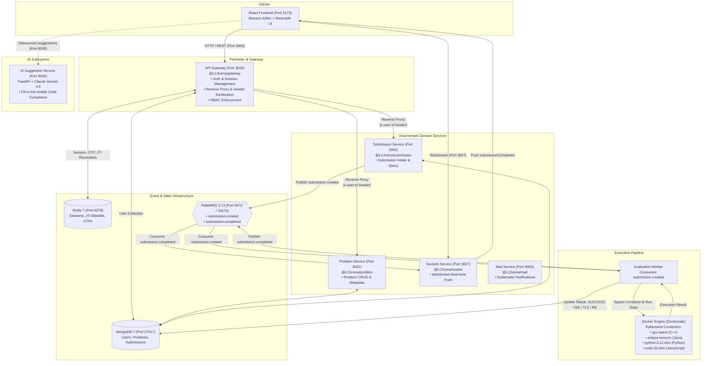

# AGENTS.md — LCArena System Design & Architecture Guide

> **Target Audience:** Autonomous AI coding agents and human engineers.  
> **Purpose:** Comprehensive technical blueprint, system design specification, architectural invariants, and component reference for the **LCArena** codebase.

---

## 1. Project Overview & Mission

**LCArena** is a distributed, containerized online judge and competitive programming platform designed for high concurrency, security, and extensibility. It includes:
- An **API Gateway** managing authentication, session state, rate limiting, and reverse-proxying.
- **Isolated Domain Microservices** for Problem management, Submission intake, Email, and Real-time WebSocket notifications.
- A **Dockerized Sandboxed Code Execution Engine** executing untrusted code (C++, Java, Python, JavaScript) inside ephemeral Docker containers under strict resource and time limits.
- An **AI Autocompletion Engine** powered by FastAPI and Anthropic Claude Sonnet providing inline IDE completions within Monaco Editor.
- A **Modern React Frontend** featuring resizable panes, Monaco Editor, problem statement viewing, and dynamic test case inspection.
- A **Turborepo Monorepo** structuring TypeScript and Python microservices alongside reusable backend domain libraries.

---

## 2. High-Level System Architecture

LCArena employs a **Microservices Architecture with Asynchronous Event-Driven Processing**:



---

## 3. Subsystem Deep-Dive

### 3.1 API Gateway (`apps/apis/gateway`)

The Gateway is the perimeter security boundary and single public HTTP ingress point for application traffic.

#### Responsibilities:
1. **Reverse Proxying (`http-proxy-middleware` via `proxy.factory.ts`)**:
   - Routes `/api/problems/*` to `PROBLEM_SERVICE_URL` (`:3001`).
   - Routes `/api/submissions/*` to `SUBMISSION_SERVICE_URL` (`:3002`).
   - **Fails Closed**: Unmapped routes or unmapped HTTP methods are rejected immediately with a standardized JSON 404 (`notFoundHandler`), never forwarding unknown paths to downstream services.
   - **Timeout Handling**: Translates `ECONNRESET`, `ETIMEDOUT`, or gateway socket timeouts into `504 Gateway Timeout` or `502 Bad Gateway`.
2. **Perimeter Security & Header Sanitization**:
   - **Strips Client Spoofing**: `proxyReq.removeHeader("x-user-id")` and `proxyReq.removeHeader("authorization")` are stripped from incoming client requests to eliminate identity spoofing.
   - **Injects Verified Identity**: Derives `userId` from the cryptographically verified JWT access token and injects verified `x-user-id: <userId>` into the upstream request to downstream services.
   - **Forwards Client Tracking Metadata**: Attaches `x-forwarded-for`, `x-forwarded-proto`, and `x-forwarded-host`.
   - **Body Forwarding**: Uses `fixRequestBody(proxyReq, req)` to ensure express-parsed JSON bodies stream cleanly downstream.
3. **Authentication & Session Lifecycle (`auth.controller.ts`, `auth.service.ts`, `token.service.ts`)**:
   - **Dual-Token System**:
     - **Access Token**: Short-lived JWT (default 15 minutes / 900s), sent via `Authorization: Bearer <token>`, carrying `{ userId, email, name, userRole, jti }`.
     - **Refresh Token**: Long-lived JWT (default 7 days / 604800s), transmitted via `httpOnly`, `sameSite: lax`, `path: /auth` cookie (also accepts body fallback).
   - **Redis Session Storage**: Stored at `session:<userId>` containing the current active `refreshToken`.
   - **Refresh Token Rotation**: Each call to `/auth/refresh` issues a new refresh token and overwrites the Redis session key. Stale or replayed refresh tokens immediately fail with `401 Session is no longer active`.
   - **Immediate Revocation (Logout / Account Deletion)**:
     - On logout, the refresh token session in Redis is deleted (`session:<userId>`).
     - The access token's `jti` is stored in Redis at `revoked_access:<jti>` with TTL equal to the token's remaining lifespan. The `authenticate` middleware checks `isAccessTokenRevoked(jti)` on every request, ensuring instant revocation.
4. **OTP Subsystem (`otp.service.ts`)**:
   - Secure numeric 6-digit OTPs (`crypto.randomInt(100000, 1000000)`).
   - Stored in Redis at `otp:<normalized_email>` with a 5-minute (300s) TTL.
   - Single-use: Deleted from Redis immediately upon successful verification.
   - Supports both password registration verification (`/auth/register`) and passwordless login (`/auth/login-otp`).
5. **Role-Based Access Control (RBAC)**:
   - User types: `Regular`, `Admin`, `Premium`.
   - Mutation endpoints on `/api/problems` (`POST`, `PUT`, `DELETE`) require `UserType.Admin`.
   - `/auth/users/:userId/role` is Admin-only for promoting/demoting users.
   - Submissions read/update (`GET /api/submissions/:id`, `PUT /api/submissions/:id`) are guarded by `submissionOwner.middleware.ts`, allowing access only if `submission.userId === caller.userId` or caller has `Admin` privileges.

---

### 3.2 Problem Service (`apps/apis/problem`)

Manages coding challenges, problem descriptions, and test case resources.

- **Port**: `3001`
- **Data Model**: `Problem` collection in MongoDB.
  - `description`: Detailed markdown problem description.
  - `difficulty`: `"Easy" | "Medium" | "Hard"`.
  - `sampleTestCaseUrl`: Public URL for sample input/output.
  - `testCasesUrl`: URL/path for the complete test case suite archive.
  - `time_limit`: Execution time limit per test case in milliseconds (default `5000ms`).
- **Endpoints**:
  - `GET /health`: Health check.
  - `GET /`: List all problems (public).
  - `GET /:id`: Fetch single problem by ID (public).
  - `POST /`: Create problem (Admin via gateway).
  - `PUT /:id`: Update problem fields (Admin via gateway).
  - `DELETE /:id`: Delete problem (Admin via gateway).

---

### 3.3 Submission Service (`apps/apis/submission`)

Ingress point for user code submissions.

- **Port**: `3002`
- **Security**: Validates caller identity through `userValidation` middleware which expects the verified `x-user-id` header provided by the API Gateway.
- **Workflow**:
  1. Receives `{ problemId, code, language }`.
  2. Creates a `Submission` record in MongoDB with `status: { status: "PENDING" }`.
  3. Publishes an event to RabbitMQ queue `submission.created`:
     ```json
     {
       "code": "...",
       "language": "cpp",
       "status": { "status": "PENDING" },
       "submissionId": "<ObjectId>",
       "userId": "<ObjectId>",
       "problemId": "<ObjectId>"
     }
     ```
  4. Returns `201 Created` with the newly created submission document.
- **Endpoints**:
  - `POST /`: Submit solution (authenticated).
  - `GET /:submissionId`: Fetch submission status and details.
  - `PUT /:submissionId`: Update submission code/language/status.

---

### 3.4 Execution Engine (`packages/backend/execution`)

The sandboxed code execution core. Evaluates untrusted user code against test cases in isolated containers using Dockerode.

#### Architecture:
- **Base Class (`Executor`)**:
  - Manages Docker image lifecycle (`pullImage`).
  - Executes shell commands within running containers (`runCommand`) via Docker Exec and demultiplexed stdout/stderr streams.
  - Packs test cases from disk into a POSIX tar archive (`tar-stream`) and injects them into the container's `/workspace` (`copyTestCasesToContainer`).
  - Synthesizes an automated bash test harness (`generateRunnerScript`).
- **Language-Specific Implementations**:
  | Language | Executor Class | Docker Image | Wrapper Strategy | Compile / Syntax Command | Run Command |
  | :--- | :--- | :--- | :--- | :--- | :--- |
  | **C++** | `CPPExecutor` | `gcc:latest` | Wraps `#include "Solution.cpp"` with boilerplate `Main.cpp` reading standard input and invoking `Solution::solve`. | `g++ -O3 -std=c++17 Main.cpp -o ./solution` | `./solution` |
  | **Java** | `JavaExecutor` | `eclipse-temurin` | Wraps user `Solution` with a `Main.java` reading tokens via `Scanner` and invoking `sol.solve`. | `javac Main.java Solution.java` | `java Main` |
  | **Python** | `PythonExecutor` | `python:3.11-slim` | Wraps user `Solution` with `main.py` reading `sys.stdin` and invoking `sol.solve`. | `python -m py_compile solution.py` | `python main.py` |
  | **JavaScript** | `JSExecutor` | `node:20-slim` | Wraps `Solution` class with `main.js` reading standard input via `fs.readFileSync(0)`. | `node -c solution.js` | `node main.js` |

#### Test Harness & Runner Script (`generateRunnerScript`):
Inside the container, a temporary `runner.sh` script is generated:
1. **Compilation Check**: Runs `compileCmd`. If exit code != 0, returns immediately with:
   ```json
   { "status": "COMPILE_ERROR", "compileError": "<compiler_output>" }
   ```
2. **Iterative Test Execution**:
   - Loops over every test case directory in `./testcases/`.
   - Locates `*.in` (input) and `*.ans` (expected output).
   - Measures execution time using high-resolution timestamps (`date +%s%N`).
   - Runs `timeout "$TIME_LIMIT" <runCmd> < "$input_file" > "$user_out"`.
   - **Verdict Categorization**:
     - Exit code `124`: **Time Limit Exceeded (`TLE`)**.
     - Exit code `!= 0`: **Runtime Error (`RE`)**.
     - Output mismatch via `diff -b -B "$ans_file" "$user_out"`: **Wrong Answer (`WA`)**.
     - Matches: **Passed**.
3. **Structured JSON Output**:
   ```json
   {
     "status": "SUCCESS",
     "passed": 40,
     "total": 40,
     "executionTimeMs": { "tc_01": 12, "tc_02": 15 },
     "failedCases": {
       "tle": [],
       "re": [],
       "wa": []
     }
   }
   ```
4. **Cleanup**: Container is guaranteed to be stopped and removed in a `finally` block.

---

### 3.5 Real-Time Notification Service (`apps/apis/sockets`)

Provides instant status updates to browser clients via WebSockets when code evaluation completes.

- **Port**: `3007`
- **Protocol**: Socket.io / WebSockets.
- **Connection Registry**: Maintains in-memory user-to-socket mapping:
  `userSockets: Map<userId, Set<socketId>>`
- **Event Flow**:
  1. Listens to RabbitMQ queue `submission.completed`.
  2. Extracts `{ userId, submissionId, problemId, status, results, failedTestCase }`.
  3. Finds all active socket IDs associated with `userId`.
  4. Emits `submissionCompleted` event directly to those sockets.

---

### 3.6 AI Code Suggestion Service (`apps/apis/ai-suggestion-service`)

FastAPI microservice acting as an intelligent Copilot for the Monaco code editor.

- **Port**: `8000`
- **Framework**: FastAPI + Pydantic v2 + LangChain (`langchain-anthropic`).
- **Model**: Anthropic Claude Sonnet (`claude-sonnet-4-5-20250929`).
- **Mechanism**: Fill-In-The-Middle (FIM) code completion.
  - Takes: `prefix`, `suffix`, `language_id`, `cursor_position`, `editor_info`.
  - Enforces strict system instructions: Predicts exclusively the minimal insertion code at the cursor, forbids markdown code fences, respects indentation and language semantics, avoids code duplication from prefix/suffix.
  - Returns structured `GetSuggestionResponse` containing candidate `choices`, model ID, and token usage statistics.
- **Frontend Integration (`CodeEditor.tsx`)**:
  - Debounced keystroke events (`DEBOUNCE_MS = 400ms`).
  - Supports request cancellation via `AbortController`: In-flight completions are automatically aborted whenever the user types additional keystrokes, avoiding stale predictions and saving network bandwidth.

---

### 3.7 Frontend Web Application (`apps/frontend`)

- **Stack**: React 18, Vite, TypeScript, Chakra UI v3, Monaco Editor (`@monaco-editor/react`).
- **Layout Architecture**:
  - Modular resizable split-pane layout (`Resizable.tsx`):
    - Left Pane: Problem description, requirements, sample cases (`DescriptionBox.tsx`).
    - Right Top Pane: Monaco Editor with multi-language selector (`CodeEditor.tsx`, `LanguageSelector.tsx`).
    - Right Bottom Pane: Test case inputs, outputs, console results (`TestCases.tsx`).

---

## 4. Shared Monorepo Packages (`packages/backend/`)

Turborepo links internal packages via npm workspaces:

| Package | Purpose & Key Exports |
| :--- | :--- |
| `@LCArena/config` | Singleton infrastructure connections: `dbConnect`, `getRedisClient`, `connectToQueue`, `channel`, `queue`. |
| `@LCArena/models` | Mongoose models & interfaces: `User`, `IUser`, `UserType`, `Problem`, `IProblem`, `Submission`, `ISubmission`, `ELanguage`. |
| `@LCArena/middlewares` | Express middleware suite: `userValidation`, `roleValidation`, `appErrorHandler`, `AuthenticatedUser` type augmentation. |
| `@LCArena/utils` | Shared primitives: `AppError` taxonomy (`BadRequestError`, `UnauthorizedError`, `ForbiddenError`, `NotFoundError`, `ConflictError`, `InternalServerError`), `sendSuccess`, `sendError`, `logger` (Winston), `getEnvVariable`. |
| `@LCArena/execution` | Language execution interfaces and implementations: `Executor`, `CPPExecutor`, `JavaExecutor`, `PythonExecutor`, `JSExecutor`, `ExecutionResult`. |

---

## 5. Data Models & Database Design

### 5.1 MongoDB Schemas

#### User Schema (`users`)
```typescript
{
  name: { type: String, required: true, trim: true },
  email: { type: String, required: true, unique: true, lowercase: true, trim: true },
  password: { type: String, required: true, minlength: 6 }, // bcrypt hashed (cost 10)
  profilePicUrl: { type: String, default: "/default-url", required: true },
  userType: { type: String, enum: ["Regular", "Admin", "Premium"], default: "Regular" },
  roleExpiry: { type: Date, default: null },
  resetPasswordToken: { type: String },
  resetTokenExpiry: { type: String },
  timestamps: true
}
```

#### Problem Schema (`problems`)
```typescript
{
  description: { type: String, required: true },
  difficulty: { type: String, enum: ["Easy", "Medium", "Hard"], required: true },
  sampleTestCaseUrl: { type: String, required: true },
  testCasesUrl: { type: String, required: true },
  time_limit: { type: Number, required: true, default: 5000 }, // in milliseconds
  timestamps: true
}
```

#### Submission Schema (`submissions`)
```typescript
{
  problemId: { type: mongoose.Schema.Types.ObjectId, ref: "Problem", required: true },
  userId: { type: mongoose.Schema.Types.ObjectId, ref: "User", required: true },
  code: { type: String, required: true },
  language: { type: String, enum: ["py", "cpp", "java", "js"], required: true },
  status: { type: mongoose.Schema.Types.Mixed, required: true }, // ExecutionResult union
  timestamps: true
}
```

### 5.2 Redis Key Topology & Policies

| Key Pattern | Data Type | Value | TTL | Purpose |
| :--- | :--- | :--- | :--- | :--- |
| `session:<userId>` | String | `<refreshToken>` | 7 days (604800s) | Tracks currently active refresh token for session rotation & revocation. |
| `revoked_access:<jti>` | String | `"1"` | Remaining JWT life | Instant blacklist for logged-out access tokens. |
| `otp:<email>` | String | `123456` (6-digit) | 5 minutes (300s) | Ephemeral OTP code for email verification & passwordless auth. |

### 5.3 RabbitMQ Queues & Payloads

- **`submission.created`**:
  - Published by: `Submission Service`
  - Consumed by: `Evaluation Worker`
  - Payload: `{ submissionId, userId, problemId, code, language, status }`
- **`submission.completed`**:
  - Published by: `Evaluation Worker`
  - Consumed by: `Sockets Service`
  - Payload: `{ submissionId, userId, problemId, status, results, failedTestCase }`

---

## 6. Network Topology & Port Matrix

| Service | Port | Protocol | Purpose / Public Exposure |
| :--- | :--- | :--- | :--- |
| **API Gateway** | `3000` | HTTP | **Public Entry Point**. Authenticates, handles sessions, proxies downstream. |
| **Problem Service** | `3001` | HTTP | Internal only. Handles problem catalog. |
| **Submission Service** | `3002` | HTTP | Internal only. Manages code submissions. |
| **Mail Service** | `3003` | HTTP | Internal only. Email dispatching via Nodemailer. |
| **Sockets Service** | `3007` | WS / HTTP | **Public Entry Point**. Real-time submission status push notifications. |
| **AI Suggestion Service**| `8000` | HTTP | **Public / Direct**. Code completion engine for Monaco Editor. |
| **Frontend** | `5173` | HTTP | Client web browser interface (Vite dev server). |
| **MongoDB** | `27017`| TCP | Primary persistent database. |
| **Redis** | `6379` | TCP | Caching, session store, token blacklist, OTP storage. |
| **RabbitMQ AMQP** | `5672` | AMQP | Message broker for asynchronous submission queue. |
| **RabbitMQ Management**| `15672`| HTTP | RabbitMQ Web Management UI (`guest` / `guest`). |

---

## 7. Security Invariants for AI Agents

When authoring or modifying code in LCArena, AI agents **MUST** enforce the following security invariants:

1. **Perimeter Identity Boundary**:
   - Downstream services (Problem, Submission) **MUST NEVER** trust client-supplied headers like `x-user-id` or `authorization`.
   - The Gateway **MUST ALWAYS** strip any incoming client `x-user-id` and `authorization` headers prior to proxying.
   - Verified identities must be minted exclusively by the Gateway's `authenticate` middleware after checking JWT signatures and verifying the JTI blacklist in Redis.
2. **Fail-Closed Gateways**:
   - The Gateway **MUST NEVER** proxy unmatched endpoints. Unregistered routes and unallowed HTTP methods must be rejected with 404/405 before hitting downstream services.
3. **Information Disclosure Prevention**:
   - The User document's `password` (bcrypt hash) **MUST NEVER** be returned in any HTTP response. Always use `toPublicUser()`.
   - Login error messages for wrong passwords and non-existent emails **MUST BE IDENTICAL** (`"Invalid email or password"`) to prevent account enumeration.
4. **Session Invalidation**:
   - Passwords changes, account deletions, and logouts **MUST** revoke both the Redis session key (`session:<userId>`) and blacklist the active access token's `jti` in Redis.
5. **Execution Sandboxing**:
   - Untrusted code **MUST NEVER** be run directly on the host machine.
   - All executions must run inside ephemeral Docker containers without host filesystem mounts and under strict command timeouts (`timeout "$TIME_LIMIT"`).
6. **Error Format Consistency**:
   - Errors must route through `appErrorHandler` to preserve standard `{ success: false, message, errors? }` shapes.

---

## 8. Development, Testing & Operational Runbook

### 8.1 Monorepo Commands

```sh
npm run dev           # Start all workspace services in parallel via Turborepo
npm run build         # Build all packages and services
npm run check-types   # Run TypeScript type checking across monorepo
npm run lint          # Run ESLint across monorepo
npm run format        # Run Prettier code formatting
```

### 8.2 Docker Compose Stack

To boot the full infrastructure and containerized services:

```sh
cp .env.example .env  # Configure secrets (JWT keys, AWS, OpenAI, Anthropic, Mail)
docker compose up -d  # Start MongoDB, Redis, RabbitMQ, and services
```

### 8.3 Running Tests

Each API service contains dedicated end-to-end API suites and load tests using Node.js built-in test runner (`node:test`):

```sh
# Gateway End-to-End Suite (Exercises full auth, RBAC, and proxying)
cd apps/apis/gateway && npm test

# Problem Service Suite
cd apps/apis/problem && npm test
cd apps/apis/problem && npm run test:load

# Submission Service Suite
cd apps/apis/submission && npm test
cd apps/apis/submission && TEST_USER_ID=<valid_user_id> npm run test:load
```

---

## 9. Extending the System (Agent Cookbooks)

### 9.1 Adding a New Programming Language to the Execution Engine

To add language support (e.g., Rust):
1. Add language enum entry to `ELanguage` in `packages/backend/models/src/submission.model.ts` (e.g., `rust = "rust"`).
2. Create `RustExecutor` subclassing `Executor` in `packages/backend/execution/src/executors/RustExecutor.ts`:
   - Set `IMAGE_NAME = "rust:latest"`.
   - Provide wrapper boilerplate reading input and calling `Solution::solve`.
   - Provide `compileCmd` (e.g., `rustc main.rs -O -o solution`) and `runCmd` (e.g., `./solution`).
3. Export from `packages/backend/execution/src/index.ts`.
4. Register the new executor in the evaluation worker's language router.

### 9.2 Adding a New Downstream Microservice

When adding a new microservice (e.g., Contest Service):
1. Create `apps/apis/contest` with its own `package.json` named `@LCArena/contest` and `tsconfig.json`.
2. Add workspace entry and port (e.g., `:3004`).
3. In `apps/apis/gateway/src/config/services.config.ts`, add the service definition (`CONTEST_SERVICE_URL`).
4. In `apps/apis/gateway/src/routes/contest.routes.ts`, create the route module using `createServiceProxy(servicesConfig.contest)` and mount authentication/role middlewares.
5. Register the router in `apps/apis/gateway/src/routes/index.ts`.
6. Add the service to `docker-compose.yml` and `.env.example`.
