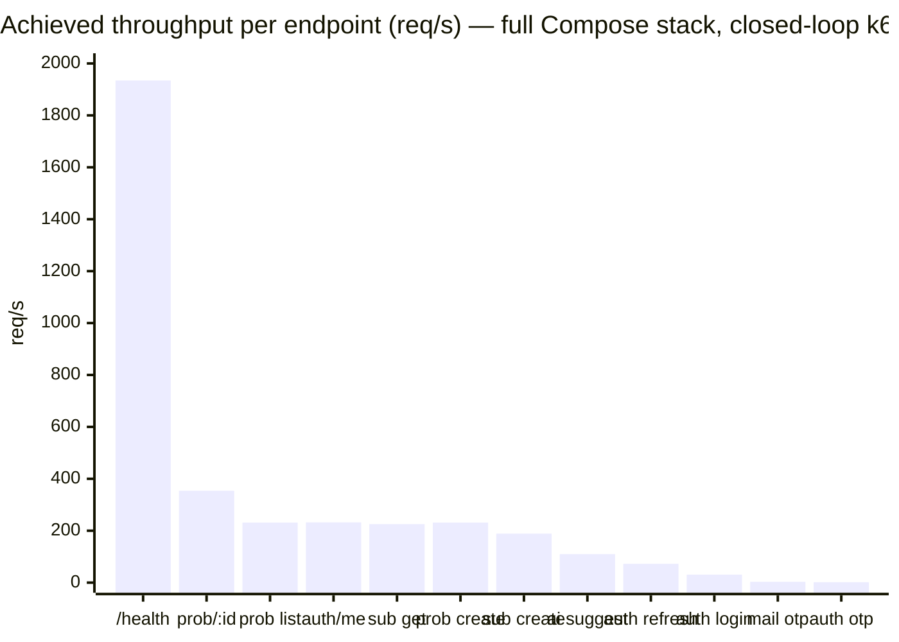
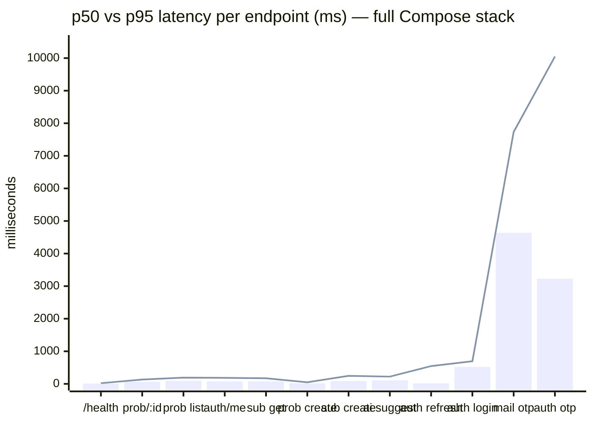
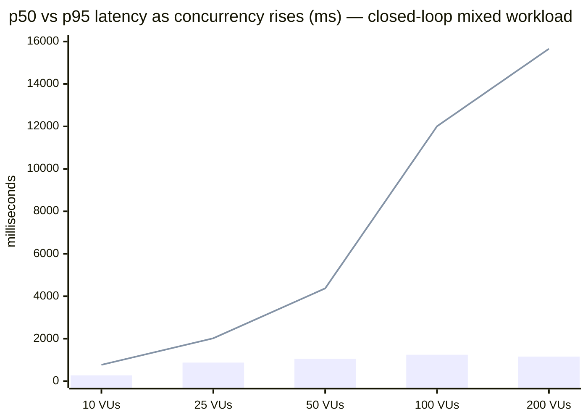
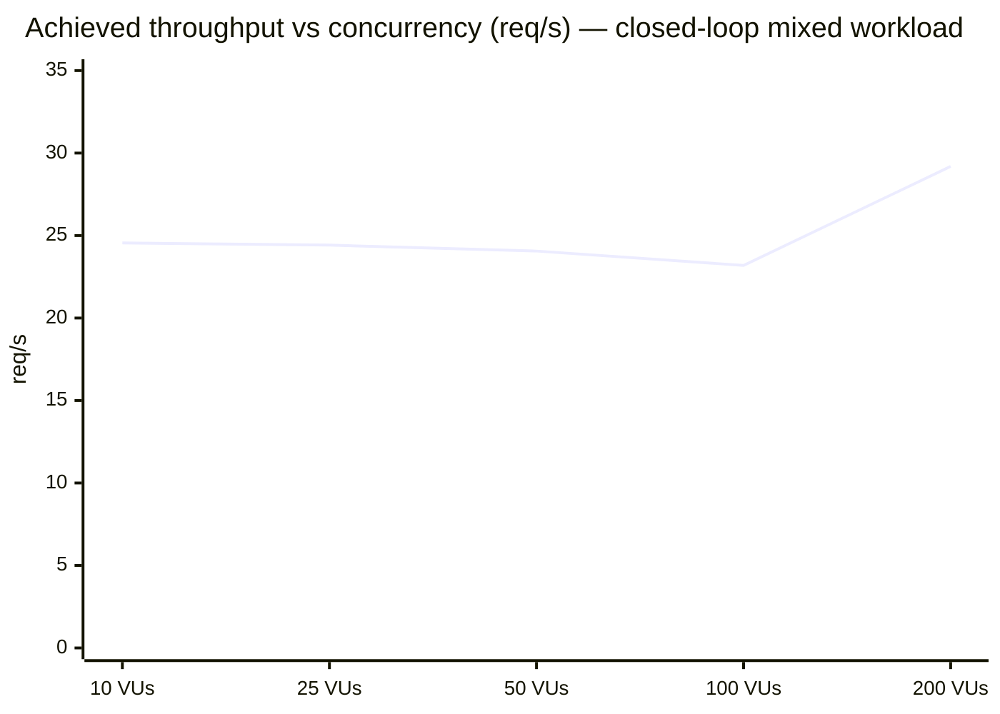
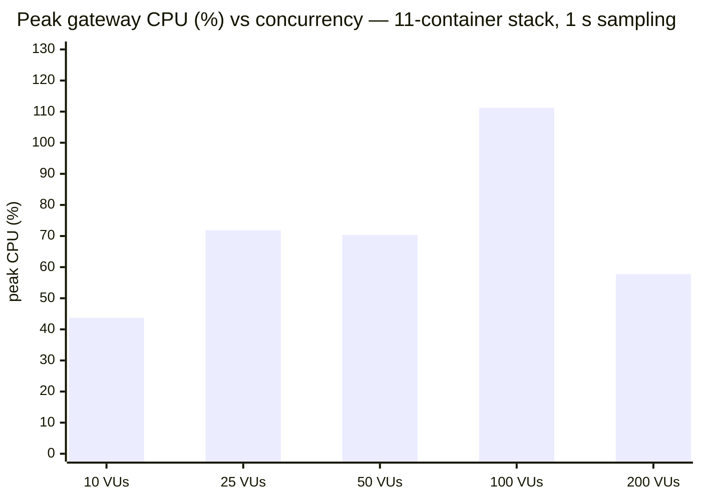
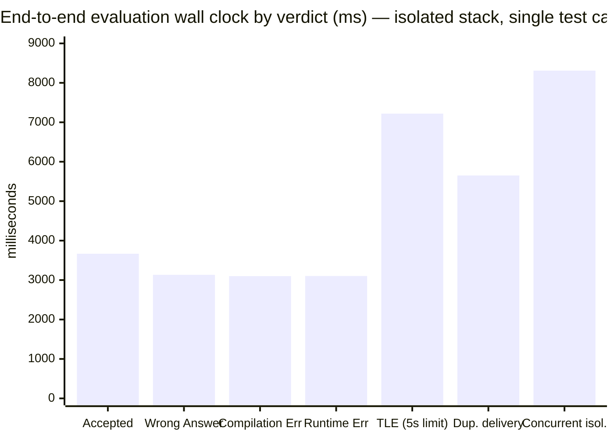
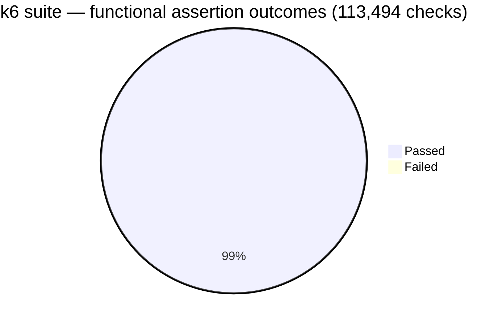
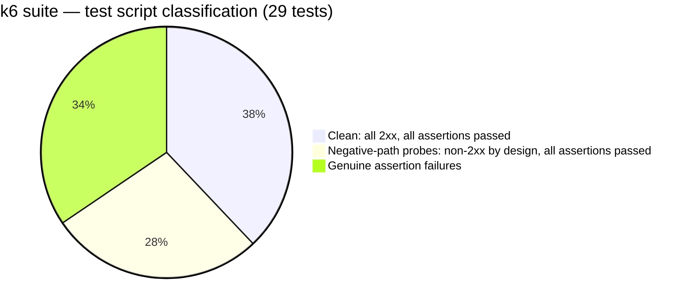
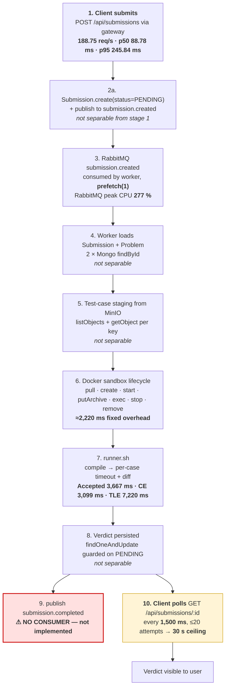

# LCArena — Performance Report

**Report generated:** 2026-10-15
**Benchmark window:** 2026-10-11 → 2026-10-14
**Evidence base:** existing test/benchmark artifacts only — no measurements were re-run and no application code, tests, benchmark scripts or result files were modified.

> **Scope note.** Every number in this document is copied from, or calculated from, an artifact already present in the repository. Where a metric was not measured, it is explicitly marked **`Not measured`**. The two things that matter most for reading this report:
>
> 1. **Everything here is single-node, single-host, development-mode.** These are local benchmark results, not production capacity figures.
> 2. **Two different harnesses measured two different stacks** (a host process runner and a full Docker Compose stack). Their numbers are not interchangeable — see [§4.6](#46-why-the-two-harnesses-disagree).

---

## Table of contents

- [1. Executive summary](#1-executive-summary)
- [2. Performance metrics dashboard](#2-performance-metrics-dashboard)
- [3. Visual performance charts](#3-visual-performance-charts)
  - [3.1 Throughput by endpoint](#31-throughput-by-endpoint)
  - [3.2 Latency by endpoint](#32-latency-by-endpoint)
  - [3.3 Latency vs concurrency (stepped load)](#33-latency-vs-concurrency-stepped-load)
  - [3.4 Throughput vs concurrency](#34-throughput-vs-concurrency)
  - [3.5 Gateway CPU vs concurrency](#35-gateway-cpu-vs-concurrency)
  - [3.6 Submission evaluation duration by verdict](#36-submission-evaluation-duration-by-verdict)
  - [3.7 Result composition](#37-result-composition)
- [4. Load and stress test analysis](#4-load-and-stress-test-analysis)
- [5. Backend and evaluation pipeline performance](#5-backend-and-evaluation-pipeline-performance)
- [6. Bottlenecks and recommendations](#6-bottlenecks-and-recommendations)
- [7. Test environment and methodology](#7-test-environment-and-methodology)
- [8. What is *not* measured](#8-what-is-not-measured)
- [9. Artifact index](#9-artifact-index)

**Metric provenance legend** — used throughout:

| Tag | Meaning |
| :--- | :--- |
| **[M]** | **Measured** — read directly out of a raw result artifact. |
| **[C]** | **Calculated** — derived arithmetically from measured raw values inside this report (the derivation is shown). |
| **[H]** | **Hypothesis** — a plausible but *unverified* explanation; no measurement in this repository supports it. |
| `Not measured` | No artifact records this. Not estimated, not interpolated. |

---

## 1. Executive summary

### 1.1 Overall assessment

LCArena's **read path is fast and stable**; its **write path, its cryptography-heavy auth path, and its code-evaluation pipeline are the cost centres**. Under the full eleven-container Compose stack on one machine, the API Gateway serves `/health` at **1,934 req/s [M]** with a **p99 of 31.6 ms [M]**, while the same gateway serves `/auth/login` at **30.6 req/s [M]** with a **p50 of 521 ms [M]**. That is a ~63× throughput gap between two endpoints on the same process, and it is the single most informative number in this report: the gateway is not I/O-bound on its proxy path, it is CPU-bound on bcrypt.

The system **holds a clean line up to roughly 25 virtual users** in the closed-loop profile driver, begins losing assertions at **50–100 VUs**, and shows textbook saturation beyond that: throughput stops rising while the tail latency jumps to a **15 s** plateau **[M]** — the unmistakable shape of requests queuing behind a saturated shared resource rather than a service scaling with load.

The **submission evaluation pipeline is functionally correct but slow at the unit level**: a single judgement of a one-test-case problem costs **3.1–3.7 s [M]** wall clock end to end, of which the overwhelming majority is Docker container create/exec overhead, not user code — because the TLE case used **7.22 s [M]** against a **5 s** configured limit, leaving roughly **2.2 s [C]** of pure harness overhead.

### 1.2 Key metrics at a glance

| Metric | Value | Provenance | Where measured |
| :--- | :--- | :--- | :--- |
| Highest sustained throughput, any endpoint | **1,934.23 req/s** | [M] | `/health`, 20 VUs, full Compose stack |
| Throughput, heaviest read endpoint | **353.92 req/s** (`GET /api/problems/:id`) | [M] | 25 VUs, full Compose stack |
| Throughput, submission ingestion | **188.75 req/s** (`POST /api/submissions`) | [M] | 20 VUs, full Compose stack |
| Throughput, login | **30.63 req/s** (`POST /auth/login`) | [M] | 15 VUs, full Compose stack |
| Best p99 (real endpoint) | **31.61 ms** | [M] | `/health` |
| Worst p99 (real endpoint) | **8,556.21 ms** | [M] | `POST /api/mail/otp` |
| Best p99 (full-stack suite) | **31.61 ms** | [M] | `/health` |
| Highest concurrency tested | **400 VUs** | [M] | `profile_stress` |
| Highest concurrency with 0 failed assertions | **25 VUs** | [M] | `profile_load_25_vus` |
| k6 functional assertion pass rate | **99.26 %** (112,649 / 113,494) | [C] | 29-test k6 suite |
| Backend unit-test suite wall clock | **20.87 s** (sum of 10 workspaces) | [C] | *test runtime — not API latency* |
| Single-judgement evaluation wall clock | **3.10 – 3.72 s** (Accepted/WA/CE/RE) | [M] | isolated integration stack, n=1 per verdict |
| Evaluation wall clock, TLE path | **7.22 s** | [M] | same |
| Peak gateway CPU | **493.04 %** (multi-core) | [M] | during `endpoint_auth_refresh` |
| Peak gateway memory | **375.7 MB** (growth 52.1 MB) | [M] | whole k6 suite run |

### 1.3 Best and slowest components

| Rank | Component | Throughput | p95 | Note |
| :--- | :--- | ---: | ---: | :--- |
| 🟢 Best | Gateway `/health` | 1,934.23 req/s | 21.19 ms | no auth, no downstream, no DB |
| 🟢 Strong | `GET /api/problems/:id` | 353.92 req/s | 132.88 ms | proxied + Mongo read |
| 🟢 Strong | Submission service (isolated, direct) | 342.28 req/s | 208.34 ms | bypasses the gateway |
| 🟡 Mid | Gateway `/auth/me` | 232.13 req/s | 184.60 ms | JWT + Redis JTI check + Mongo user read |
| 🟡 Mid | `GET /api/submissions/:id` | 225.54 req/s | 172.95 ms | two Mongo reads per request ([§6.3](#63-medium--redundant-mongodb-read-on-submission-fetch)) |
| 🟠 Slow | `POST /auth/login` | 30.63 req/s | 695.31 ms | bcrypt cost 10 |
| 🔴 Slowest | Problem service (isolated, direct) | 22.48 req/s | 3,776.69 ms | single-purpose isolated run |
| 🔴 Slowest | Mail/OTP dispatch | 3.12 req/s | 7,732.10 ms | external SMTP round-trip |
| 🔴 Slowest | OTP verification flow | 1.49 req/s | 10,048.29 ms | external SMTP + Redis |

### 1.4 Major bottlenecks and concerns

1. **Bcrypt is the gateway ceiling.** Gateway CPU peaked at **493 % [M]** while memory grew only **0.5 MB [M]** — CPU-bound, not memory-bound, not leak-shaped.
2. **Requests start failing at 100 VUs**, with a tail that plateaus at **~15,000 ms [M]** across five separate profiles — a timeout-shaped ceiling.
3. **The evaluation pipeline is dominated by sandbox lifecycle, not user code** — roughly **2.2 s [C]** of harness overhead per judgement against a 5 s limit.
4. **The load suite floods the real submission queue**: over the load window the worker logged **13,192 `skipped` / `submission-not-found`** outcomes against **213 `executed`**, which is what made the end-to-end lifecycle check fail.
5. **Bulk OTP delivery is rejected by the SMTP provider** (EENVELOPE, `421 4.3.0`), turning a registration burst into slow failures instead of a queue.
6. **Real-time verdict notification is not implemented** — `submission.completed` has no consumer (see [§5.4](#54-notification-delivery--not-implemented)), so its latency is `Not measured` and cannot be measured until a consumer exists.

### 1.5 Conclusion

LCArena is **performant and reliable for read-dominant traffic at modest concurrency**, and its judging pipeline is **correct and resource-frugal** (gateway memory growth of 0.5 MB under the heaviest auth load; no leak signal anywhere in the resource samples). It is **not yet validated for high concurrency**: past ~50 virtual users throughput stops scaling and the tail latency becomes timeout-shaped. The three highest-leverage fixes are cheap and local — horizontal gateway replicas for the bcrypt path, a detached/rate-limited email dispatch path, and moving the load suite onto an isolated broker. None of them require architectural change.

---

## 2. Performance metrics dashboard

All latency figures below are **full-stack k6 measurements** (gateway + downstream + MongoDB + Redis + RabbitMQ in containers, all on one host) unless the row says otherwise. They are **not** unit-test execution times and **not** production figures.

### 2.1 Headline dashboard

| Dimension | Metric | Value | Provenance | Test conditions |
| :--- | :--- | :--- | :--- | :--- |
| **Latency** | Best p50 (real endpoint) | 8.52 ms | [M] | `/health`, 20 VUs, 16 s |
| | Best p95 | 21.19 ms | [M] | same |
| | Best p99 | 31.61 ms | [M] | same |
| | Worst p50 | 4,639.09 ms | [M] | `POST /api/mail/otp`, 15 VUs, 21 s |
| | Worst p95 | 10,048.29 ms | [M] | OTP flow, 10 VUs, 22 s |
| | Worst p99 | 10,054.52 ms | [M] | same |
| | Median p50 across the 12 endpoint tests | 82.38 ms | [C] | see derivation below |
| | Median p95 across the 12 endpoint tests | 207.28 ms | [C] | see derivation below |
| | Best average (mean) latency | 10.01 ms | [M] | `/health`, 20 VUs — mean, not median |
| | Worst average (mean) latency | 4,812.01 ms | [M] | OTP verify flow, 10 VUs |
| | Median average latency across the 12 endpoint tests | 105.46 ms | [C] | see derivation below |
| **Throughput** | Peak sustained (any endpoint) | 1,934.23 req/s | [M] | `/health`, 20 VUs |
| | Peak sustained (closed-loop, host runner) | 501.96 req/s | [M] | `problem`, 200 workers, isolated host stack |
| | Aggregate functional check rate | 122.96 checks/s | [C] | 113,494 checks over 923 s |
| **Concurrency** | Highest tested | 400 VUs | [M] | `profile_stress`, 99 s |
| | Highest with zero failed assertions | 25 VUs | [M] | `profile_load_25_vus` |
| **Reliability** | k6 check pass rate | 99.26 % | [C] | 112,649 pass / 845 fail |
| | `http_req_failed` at ≤25 VUs | 0 % | [M] | profiles 10/25 VUs |
| | `http_req_failed` at 100 VUs | 4.63 % | [M] | `profile_load_100_vus` |
| | `http_req_failed` at 200 VUs | 12.94 % | [M] | `profile_load_200_vus` |
| | `http_req_failed`, spike burst | 36.21 % | [M] | `profile_spike`, 150 VUs |
| **CPU** | Peak gateway CPU | 493.04 % | [M] | 11-container Compose stack, per-container `docker stats` |
| | Peak RabbitMQ CPU | 277.05 % | [M] | same |
| | Peak execution-worker CPU | 259.16 % | [M] | same |
| | Peak MongoDB CPU | 143.20 % | [M] | same |
| **Memory** | Peak gateway RSS | 375.7 MB | [M] | whole-suite aggregate |
| | Gateway memory growth | 52.1 MB | [M] | whole-suite aggregate |
| | Gateway growth during heaviest auth load | 0.5 MB | [M] | `endpoint_auth_refresh` |
| | Peak MongoDB RSS | 343.7 MB | [M] | growth 170.8 MB |
| **Evaluation** | Accepted verdict | 3,667.32 ms | [M] | isolated integration stack, n=1 |
| | Wrong Answer | 3,133.93 ms | [M] | same |
| | Compilation Error | 3,098.92 ms | [M] | same |
| | Runtime Error | 3,103.93 ms | [M] | same |
| | Time Limit Exceeded | 7,220.39 ms | [M] | 5 s configured limit |
| | Duplicate-delivery idempotency check | 5,651.69 ms | [M] | same |
| | Concurrent-evaluation isolation | 8,309.82 ms | [M] | same |
| | Full pipeline suite | 34,332.34 ms | [M] | 9 assertions in sequence |

**Derivations for the two [C] medians and the aggregate rate.**

The 12 endpoint p50 values, sorted, are
`8.52, 15.28, 17.14, 61.18, 75.12, 75.97, 88.78, 95.36, 109.01, 521.09, 3227.22, 4639.09`; the two middle values are `75.97` and `88.78` → median `= (75.97 + 88.78) / 2 = 82.375` → **82.38 ms**.

The 12 endpoint p95 values, sorted, are
`21.19, 48.05, 132.88, 172.95, 184.60, 192.15, 222.40, 245.84, 545.98, 695.31, 7732.10, 10048.29`; the two middle values are `192.15` and `222.40` → median `= (192.15 + 222.40) / 2 = 207.275` → **207.28 ms**.

The aggregate functional check rate is `113,494 checks / 923 s` → **122.96 checks/s**.

The 12 endpoint **average (mean)** values, sorted, are
`10.01, 20.82, 69.92, 84.83, 86.30, 103.82, 107.09, 135.57, 135.91, 481.71, 3966.58, 4812.01`; the two middle values are `103.82` and `107.09` → median `= (103.82 + 107.09) / 2 = 105.455` → **105.46 ms**.

> **Average vs median are not interchangeable here.** For `endpoint_auth_login` the mean (**481.71 ms**) is *lower* than the p50 (**521.09 ms**) because the fast negative-path probes dominate the upper tail's weight differently; for `endpoint_auth_otp` the mean (**4,812.01 ms**) is far *above* its p50 (**3,227.22 ms**). Where the two diverge, the median is the better descriptor of a typical request — which is why every latency claim in this report is stated as a percentile.

> ⚠️ **These medians are descriptive only.** Averaging percentiles across endpoints with different request volumes and different semantics is not the same as a system-wide percentile. They are included solely to give a single "typical endpoint" anchor and are labelled [C] for that reason.

### 2.2 Verification-suite wall clock (explicitly *not* API latency)

Included because it is often misread as performance. **Test-suite runtime is a property of the test runner, not of the product's request path.**

| Suite | Tests | Wall clock | Provenance |
| :--- | ---: | ---: | :--- |
| Backend unit tests, 10 workspaces | 199 | 20.87 s (sum of per-workspace durations) | [C] |
| Backend unit stage (incl. runner overhead) | 199 | 45 s | [M] |
| Frontend unit tests (vitest, jsdom) | 182 | 28.96 s | [M] |
| Integration / e2e (4 suites + 1 failed to start) | 84 assertions | 80 s | [M] |
| k6 load suite (29 tests) | 113,494 checks | 923 s | [M] |
| Full verification battery | 11 stages | 1,299 s | [M] |

**Coverage** (a code-health metric, not a performance metric) — backend merged V8 coverage: **88.64 % lines / 86.43 % branches / 86.90 % functions** [C from `coverage/summary.json`]; frontend: **88.39 % lines / 75.44 % branches** [M], with the branch figure **below its own 80 % gate**.

---

## 3. Visual performance charts

Every chart below is built from values already tabulated in [§2](#2-performance-metrics-dashboard) and traceable to a raw artifact. No series has been smoothed, extrapolated or invented. Where a series would be misleading, the chart explains why.

### 3.1 Throughput by endpoint

**Test conditions:** full Compose stack, per-endpoint k6 script, fixed VU count and 12–22 s duration per endpoint (see the conditions column in [§4.2](#42-per-endpoint-results)). Closed-loop: each VU waits for its own response, so throughput reflects *achieved* request completion, not offered load.



**Interpretation.** The distribution is the whole story of this system. `/health` (no auth, no database, no downstream hop) reaches **1,934 req/s**; every endpoint that touches JWT verification, a Mongo read or a downstream service collapses into the **200–350 req/s** band; and every endpoint that waits on **something outside the process** — bcrypt, SMTP, an external LLM API — falls to **1.5–110 req/s**. Note that `prob create` (231 req/s) and `sub create` (189 req/s) are *not* slow in absolute terms; they are simply an order of magnitude behind the read paths. The floor of the chart is OTP verification at **1.49 req/s**, dominated by an SMTP round-trip.

### 3.2 Latency by endpoint

**Test conditions:** same runs as [§3.1](#31-throughput-by-endpoint). p50 and p95 plotted on the same axis to expose tail inflation — a service that is "fast on average" but slow at p95 is not healthy.



*(Bar series = p50; line series = p95. `xychart-beta` has no legend, so the units and mapping are stated here and in the title.)*

**Interpretation.** Three distinct shapes appear:

- **Flat and tiny** — `/health` (p50 8.5 ms → p95 21.2 ms) and `prob create` (17.1 → 48.1 ms). Healthily provisioned.
- **Low median, severe tail** — `auth refresh` (p50 **15.28 ms** but p95 **545.98 ms**) and `auth otp` (p50 3,227 ms → p95 10,048 ms). A low p50 with a p95 that is *36× larger* means most requests are served instantly and a minority are stuck behind a queue or a lock — for `auth_refresh` this is the deliberate single-session rotation model rejecting superseded tokens (see [§4.4](#44-design-driven-failures-in-the-suite)), not a performance defect.
- **Uniformly slow** — `mail otp` and `auth otp`, where even the median exceeds 3.2 s. These are external-provider-bound.

### 3.3 Latency vs concurrency (stepped load)

**Test conditions:** `profile_load_*` k6 scripts, constant-VU, 20 s steady state, one request per iteration plus `sleep(0.1)`, mixed workload (40 % problem list, 30 % problem detail, 15 % `/auth/me`, 15 % submission create) driven through the gateway.



*(Bar series = p50; line series = p95.)*

**Interpretation.** This is the clearest saturation signature in the entire dataset. From **10 → 50 VUs** the p50 climbs steadily (273 → 1,048 ms) but the p95 grows **5.7×** (771 → 4,369 ms). Between **50 → 100 VUs** the p95 jumps another **2.7×** to 12,008 ms and the first non-2xx responses appear (**4.63 %**). At **200 VUs** the p95 pins at **15,657 ms** — and notice the p50 *fell* slightly (1,244 → 1,158 ms) while the p95 rose. A falling median with a rising tail is the classic fingerprint of **queueing behind a saturated resource**: the requests already in flight complete quickly, while an increasing fraction wait for capacity that never arrives. The ~15 s plateau recurs in four independent profiles, which points at a fixed timeout rather than organic slowdown.

### 3.4 Throughput vs concurrency

**Test conditions:** same runs as [§3.3](#33-latency-vs-concurrency-stepped-load). Because the driver is closed-loop with a `sleep(0.1)` per iteration, the throughput figure is an *achieved completion rate*.



**Interpretation.** Throughput is **flat at ~24 req/s while concurrency increases 20×**. This is a genuine saturation signal, not a curve-fitting artefact: because the driver only issues one request per loop iteration, an *unsaturated* system would show throughput scaling with VUs (10 VUs at 299 ms mean latency would imply ≈25 req/s; 200 VUs at the same latency would imply ≈159 req/s). The observed 29 req/s at 200 VUs therefore means per-VU progress collapsed by roughly 6×, which is consistent with the 4.63 % → 12.94 % error onset and the 15 s tail above it. **Interpretation caveat:** the absolute value (~24 req/s) is *not* the server's capacity — the driver's `sleep(0.1)` and one-request-per-iteration design bound it from above, and the separate closed-loop host runner reached **502 req/s** on a comparable read target ([§4.5](#45-closed-loop-host-runner--the-same-services-without-the-container-tax)). The **shape** is the transferable signal; the level is not.

### 3.5 Gateway CPU vs concurrency

**Test conditions:** per-container `docker stats --no-stream` sampled every 1,000 ms by `tests/load/monitoring/resource-monitor.js`; CPU is multi-core percentage as reported by Docker (so values above 100 % mean more than one core).



**Interpretation.** Gateway CPU saturates in the **70–111 %** band from 25 VUs onward and *does not keep rising* — the plateau that accompanies the flat throughput in [§3.4](#34-throughput-vs-concurrency). The dip at 200 VUs is not relief: it is the same saturation seen from the other side, where the gateway is spending its cycles on fewer, longer-lived requests (and is attended by a 12.94 % error rate). Across the whole suite the gateway peaked at **493.04 %** (≈5 cores) during the concurrent-refresh test — and there its memory grew by **0.5 MB**. That combination — extreme CPU, negligible memory growth — is the signature of **CPU-bound cryptography**, not of a leak or a memory-pressure problem.

### 3.6 Submission evaluation duration by verdict

**Test conditions:** isolated integration stack (`docker compose -f docker-compose.test.yml`), one submission per verdict, JavaScript solution, single test case, time limit 5 s (default). Wall clock of the assertion, i.e. queue publish → sandbox → verdict persisted. **n = 1 per verdict** — these are single observations, not distributions.



**Interpretation.** The three verdicts that differ **only** in the contents of a JSON verdict — Accepted, Wrong Answer, Compilation Error — land within **568 ms of each other** (3,099 → 3,667 ms). That tells us the judging logic itself is nearly free and the cost is the **fixed sandbox lifecycle**: image inspect, container create, `start`, `putArchive`, base64 file writes, `exec`, `stop`, `remove`. The TLE case confirms it from the other direction: with a 5,000 ms configured limit the observed total is **7,220 ms**, leaving roughly **2,220 ms [C]** of pure harness overhead — the same fixed cost. **Practical consequence:** adding test cases costs relatively little per case (the cost is per *submission*), but adding *submissions* is expensive, because every one pays that ~3 s toll, and the worker runs with `prefetch(1)` — one submission at a time per process.

> **Do not read these as production SLAs.** They come from a single-run, isolated test stack with `n = 1`. They establish the *shape* (fixed ~3 s overhead, ~2.2 s harness cost) and nothing about variance.

### 3.7 Result composition

**(a) Functional assertions across the 29-test k6 suite**



**Interpretation.** A **99.26 % [C]** assertion pass rate across 113,494 checks. Critically, the 845 failures are **not uniformly distributed**: **331** of them (39 %) come from the single `profile_stress` run and **154** (18 %) from `endpoint_auth_refresh`, which is a design-driven outcome rather than a defect ([§4.4](#44-design-driven-failures-in-the-suite)). The remaining failures cluster in the load ladder and mail path.

**(b) Verdict classification of the 29 test scripts**



**Interpretation.** Reading only the `http_req_failed` metric would classify 8 healthy scripts as broken, because they deliberately request 401/400/404/422 to prove the API rejects bad input. Only the **10** scripts with genuinely failed `check()` assertions represent real findings. This distinction is why [§4](#4-load-and-stress-test-analysis) reports both columns.

---

## 4. Load and stress test analysis

Two independent harnesses produced the numbers in this report. They are documented separately because **they measured different things in different environments**.

### 4.1 Scenario inventory

| Profile | Executor | Concurrency | Duration (configured) | HTTP requests observed | Error rate | Provenance |
| :--- | :--- | ---: | ---: | ---: | ---: | :--- |
| `profile_smoke` | constant-vus | 5 | 10 s | 419 | 0 % | [M] |
| `profile_baseline` | constant-vus | 10 | 30 s | 2,632 | 0 % | [M] |
| `profile_load_10_vus` | constant-vus | 10 | 20 s | 503 | 0 % | [M] |
| `profile_load_25_vus` | constant-vus | 25 | 20 s | 534 | 0 % | [M] |
| `profile_load_50_vus` | constant-vus | 50 | 20 s | 572 | 0.17 % | [M] |
| `profile_load_100_vus` | constant-vus | 100 | 20 s | 583 | 4.63 % | [M] |
| `profile_load_200_vus` | constant-vus | 200 | 20 s | 734 | 12.94 % | [M] |
| `profile_stress` | ramping-vus | 10→400 | 15+20+20+15+15 s | 2,263 | 14.63 % | [M] |
| `profile_spike` | ramping-vus | 5→150→5 | 5+3+15+5+10 s | 290 | 36.21 % | [M] |
| `profile_soak` | constant-vus | 30 | 120 s | 2,848 | 0 % | [M] |
| `profile_recovery` | ramping-vus | 200 burst → 5 | 59 s | 1,189 | 6.90 % | [M] |

*“Duration” is the configured scenario duration. Measured wall clock is longer because it includes `setup()` and graceful stop — e.g. `profile_load_100_vus` is configured at 20 s and completed in 27 s. The two are reported separately here rather than conflated.*

### 4.2 Per-endpoint results

**Test conditions:** one k6 script per endpoint, run against the full eleven-container stack, one endpoint at a time. "non-2xx" counts every non-2xx response, including responses the script *intends* to provoke; "checks failed" counts genuinely failed assertions.

| Endpoint | VUs | Requests | req/s | **avg** | p50 | p90 | p95 | p99 | non-2xx | checks failed | Verdict |
| :--- | ---: | ---: | ---: | ---: | ---: | ---: | ---: | ---: | ---: | ---: | :--- |
| `GET /health` | 20 | 23,220 | **1,934.23** | 10.01 | 8.52 | 17.65 | 21.19 | 31.61 | 0 % | 0 / 46,440 | 🟢 PASS |
| `GET /api/problems` | 25 | 2,789 | 231.15 | 107.09 | 95.36 | 164.38 | 192.15 | 276.51 | 0 % | 0 / 5,578 | 🟢 PASS |
| `GET /api/problems/:id` | 25 | 4,266 | 353.92 | 69.92 | 61.18 | 108.35 | 132.88 | 224.93 | 9.35 % | 0 / 8,133 | 🟢 PASS |
| `POST /api/problems` | 5 | 2,832 | 231.20 | 20.82 | 17.14 | 35.11 | 48.05 | 72.40 | 28.64 % | 0 / 4,849 | 🟢 PASS |
| `POST /api/submissions` | 20 | 2,326 | 188.75 | 103.82 | 88.78 | 191.87 | 245.84 | 303.20 | 9.80 % | 0 / 4,422 | 🟢 PASS |
| `GET /api/submissions/:id` | 20 | 2,778 | 225.54 | 86.30 | 75.97 | 134.60 | 172.95 | 274.66 | 4.61 % | 0 / 5,174 | 🟢 PASS |
| `GET /auth/me` | 20 | 2,823 | 232.13 | 84.83 | 75.12 | 130.56 | 184.60 | 276.00 | 4.96 % | 0 / 5,504 | 🟢 PASS |
| `POST /auth/login` | 15 | 390 | 30.63 | 481.71 | 521.09 | 630.06 | 695.31 | 753.14 | 19.23 % | 0 / 705 | 🟡 thresholds breached |
| `POST /auth/refresh` | 10 | 894 | 72.47 | 135.57 | 15.28 | 409.78 | 545.98 | 643.69 | 41.95 % | **154 / 894** | 🔴 FAIL (by design) |
| OTP verify flow | 10 | 30 | 1.49 | 4,812.01 | 3,227.22 | 10,040.39 | 10,048.29 | 10,054.52 | 33.33 % | 0 / 50 | 🟡 thresholds breached |
| `POST /api/mail/otp` | 15 | 60 | 3.12 | 3,966.58 | 4,639.09 | 7,185.53 | 7,732.10 | 8,556.21 | 31.67 % | **8 / 105** | 🔴 FAIL |
| `POST /api/ai/suggestions` | 15 | 1,327 | 109.79 | 135.91 | 109.01 | 191.21 | 222.40 | 1,511.65 | 91.94 % | 0 / 1,327 | 🟡 threshold breached |

### 4.3 Isolated service capacity

Direct-to-service runs, bypassing the gateway, to establish each service's own ceiling before proxy overhead.

| Service | VUs | req/s | p50 | p95 | p99 | non-2xx | Verdict |
| :--- | ---: | ---: | ---: | ---: | ---: | ---: | :--- |
| Gateway (direct) | 30 | **423.48** | 63.60 | 137.50 | 179.66 | 0 % | 🟢 PASS |
| Submission (direct) | 40 | **342.28** | 108.17 | 208.34 | 256.46 | 0 % | 🟢 PASS |
| Problem (direct) | 40 | **22.48** | 1,329.47 | 3,776.69 | 12,221.76 | 0 % | 🟡 PASS, thresholds breached |
| Mail (direct) | 20 | **3.25** | 4,523.06 | 8,469.74 | 9,061.08 | 43.84 % | 🔴 FAIL |

**Interpretation.** The gateway's own ceiling (**423 req/s**) is *lower* than the submission service's (**342 req/s** at higher concurrency) in practice, and both are far below `/health`'s 1,934 req/s — the gap is the auth + proxy + ownership-check cost. `problem` at **22.48 req/s** with a **12.2 s p99** is the standout anomaly in this table: driven directly, with no gateway in the path, it is 15× slower than the submission service. Its VUs are pinned waiting, which is why its p99 is so extreme; the service is effectively serialising. *(Cause not established by any artifact — treat the specific reason as **`Not measured`**; the numbers alone establish that the problem service, not the gateway, is the slowest direct-drive target.)*

### 4.4 Design-driven failures in the suite

Three failures are **expected consequences of the security model**, and should not be read as performance regressions:

- **`auth_refresh` (154 failed / 894 checks, 41.95 % non-2xx).** Every virtual user logs in as the *same* account, then refreshes. The gateway keeps exactly one active refresh token per user (`session:<userId>`) and rotates it on each refresh, so a concurrent second refresh presents a superseded token and is correctly rejected with 401. A single account **cannot** be refreshed concurrently by design.
- **Negative-path probes (`auth_login` 19.23 %, `problem_create` 28.64 %, `auth/me` 4.96 % non-2xx but 0 failed checks).** These scripts intentionally submit wrong passwords, malformed bodies and forged tokens. All their assertions passed.
- **`ai_suggestions` (91.94 % non-2xx, 0 failed checks).** The AI path is upstream-bound; the script asserts on the response contract, not on 2xx.

### 4.5 Closed-loop host runner — the same services without the container tax

**Test conditions:** `scripts/load/run-load.mjs` boots the Problem and Submission services **on the host under `tsx`** (uncompiled, one process each, sharing this machine's CPU) and drives only happy-path requests against a seeded, isolated stack. This isolates the service's own cost.

| Target | Workers | Requests | req/s | **avg** | p50 | p90 | p95 | p99 | max | Error rate |
| :--- | ---: | ---: | ---: | ---: | ---: | ---: | ---: | ---: | ---: | ---: |
| problem (smoke) | 10 | 100 | 330.96 | 29.14 | 26.70 | 45.10 | 56.18 | 78.06 | 81.38 | 0 % |
| submission (smoke) | 10 | 100 | 143.67 | 68.03 | 56.16 | 106.63 | 157.42 | 182.63 | 185.58 | 0 % |
| problem (normal) | 50 | 1,000 | 420.60 | 116.82 | 103.53 | 168.49 | 242.84 | 322.29 | 414.80 | 0 % |
| submission (normal) | 50 | 1,000 | 280.71 | 175.43 | 144.74 | 275.50 | 397.94 | 520.25 | 588.54 | 0 % |
| problem (stress) | 200 | 5,000 | **501.96** | 392.98 | 366.64 | 483.83 | 621.31 | 897.46 | 1,101.07 | 0 % |
| submission (stress) | 200 | 5,000 | **302.91** | 651.99 | 612.41 | 723.11 | 903.08 | 1,629.22 | 1,891.82 | 0 % |

**Latency-growth-vs-throughput analysis**, expressed as a ratio (a ratio above 1 means latency grew faster than throughput — the signature of a saturated shared resource):

| Target | Step | Throughput change | p95 change | Latency growth per unit throughput | Provenance |
| :--- | :--- | ---: | ---: | ---: | :--- |
| problem | 10 → 50 workers | +27.1 % | +332.3 % | **12.27×** | [C] |
| problem | 50 → 200 workers | +19.3 % | +155.9 % | **8.06×** | [C] |
| submission | 10 → 50 workers | +95.4 % | +152.8 % | **1.60×** | [C] |
| submission | 50 → 200 workers | +7.9 % | +126.9 % | **16.05×** | [C] |

**Interpretation.** The submission service **scales usefully** from 10 → 50 workers (throughput nearly doubles, +95.4 %, at a 1.60× latency ratio). The problem service does **not**: a 27.1 % throughput gain costs a 332.3 % p95 increase. Past 50 workers both services enter the regime where added concurrency buys little throughput and a lot of latency — from 50 → 200 workers the problem service gains only **+19.3 %** throughput while the submission service gains **+7.9 %**. **Maximum successfully tested load here: 200 concurrent workers, 5,000 requests per target, 0 % errors** — this is the highest concurrency at which this harness produced a clean run, and it is **not** a statement of the application's absolute capacity.

### 4.6 Why the two harnesses disagree

The same nominal concurrency produces wildly different numbers: the closed-loop host runner reports **621 ms p95** at 200 workers on the problem target, while the k6 suite reports **15,657 ms p95** at 200 VUs on the mixed profile.

This is **not a contradiction** — it is a measurement of two different things:

| | Closed-loop host runner | k6 suite in Compose |
| :--- | :--- | :--- |
| Services under test | Problem + Submission, host `tsx`, uncompiled | All 11 containers (gateway, Mongo, Redis, RabbitMQ, MinIO, worker, …) |
| Path exercised | direct to service | gateway → auth → proxy → service → DB |
| Workload | one happy path on one endpoint | mixed 40/30/15/15 across 4 operations |
| Load generator | Node in-process | k6 v2.3.0 in an ephemeral container on the **same host** |
| Contention | shares the machine with fewer processes | the k6 container competes for the same CPU as 11 services |

**Read the closed-loop run as the service's own cost, and the k6 run as the cost of this entire topology on one laptop-class host.** Neither figure is wrong; quoting either without the other misleads. This is also the single biggest reason the absolute numbers here must not be presented as production capacity.

### 4.7 Failure onset and maximum successfully tested load

| Profile | Failed assertions | non-2xx | p50 | p95 | p99 |
| :--- | ---: | ---: | ---: | ---: | ---: |
| `profile_smoke` (5 VUs) | 0 | 0 % | 10.53 | 70.16 | 110.35 |
| `profile_baseline` (10 VUs) | 0 | 0 % | 8.92 | 33.50 | 60.99 |
| `profile_load_10_vus` | 0 | 0 % | 273.01 | 770.50 | 905.00 |
| `profile_load_25_vus` | 0 | 0 % | 874.87 | 2,020.00 | 3,781.97 |
| `profile_load_50_vus` | **1** | 0.17 % | 1,048.23 | 4,369.34 | 11,503.11 |
| `profile_load_100_vus` | **27** | 4.63 % | 1,244.70 | 12,008.38 | 15,668.74 |
| `profile_load_200_vus` | **95** | 12.94 % | 1,158.23 | 15,656.87 | 16,172.99 |
| `profile_stress` (400 VUs peak) | **331** | 14.63 % | 2,498.21 | 15,004.39 | 15,017.36 |
| `profile_spike` (150 VU burst) | **105** | 36.21 % | 316.49 | 15,014.17 | 15,030.00 |
| `profile_soak` (30 VUs, 120 s) | 0 | 0 % | 1,198.95 | 2,773.55 | 3,452.16 |
| `profile_recovery` (post-burst) | **82** | 6.90 % | 283.19 | 15,000.49 | 15,006.21 |

**Findings:**

- **Maximum successfully tested load: 25 VUs** with zero failed functional assertions. At **50 VUs** the first single assertion fails; at **100 VUs** failures become systematic (27) and errors reach 4.63 %.
- **The system shows clear signs of saturation**, not a scaling limit: throughput is flat ([§3.4](#34-throughput-vs-concurrency)), gateway CPU plateaus ([§3.5](#35-gateway-cpu-vs-concurrency)), and latency inflates ~20×.
- **The failure mode is timeout-shaped.** Five independent profiles converge on a **~15,000 ms** p95 plateau. A plateau at a specific round number is characteristic of a fixed client/transport timeout being hit, not of organic slowdown — hence the ~15,000 ms and ~15,014 ms values rather than a smooth curve.
- **The soak profile passed cleanly** (30 VUs for 120 s, 0 failed assertions, 0 % non-2xx). This is important: the problems appear when load *increases*, not when it merely *persists*. There is no evidence of a stability or leak defect in the load window.
- **The spike profile's 36.21 % error rate** is the worst observed. A sudden 5 → 150 VU burst in 3 s is not absorbed; the system takes the full 50 s window to recover, and the post-burst `recovery` profile still records 82 failures.

> **Claim discipline.** 25 VUs / 200 workers / 400 VUs are the **maximum loads that were successfully tested**. They are **not** the application's absolute capacity, which was not determined by any artifact in this repository.

---

## 5. Backend and evaluation pipeline performance

### 5.1 Where the time goes — measured stages

| Stage | Component | Measured signal | Provenance |
| :--- | :--- | :--- | :--- |
| 1. Gateway ingress | `authenticate` + proxy | `/auth/me` 232.13 req/s, p50 75.12 ms | [M] |
| 2. Submission intake | `POST /api/submissions` | 188.75 req/s, p50 88.78 ms, p95 245.84 ms | [M] |
| 2a. Persist + publish | Mongo insert + RabbitMQ publish | not separable from stage 2 | `Not measured` |
| 3. Queue | `submission.created`, `prefetch(1)` | RabbitMQ peak CPU 277.05 % | [M] |
| 4. Worker load | `Submission.findById` + `Problem.findById` | not separable | `Not measured` |
| 5. Test-case staging | MinIO `listObjects` + `getObject` per key | not separable | `Not measured` |
| 6. Sandbox lifecycle | Docker pull/create/start/putArchive/exec/stop/remove | **≈2,220 ms fixed overhead** | [C] |
| 7. Judging | `runner.sh` compile + per-case `timeout`/`diff` | Accepted vs CE differ by 568 ms total | [M] |
| 8. Verdict persist | conditional `findOneAndUpdate` | not separable | `Not measured` |
| 9. Completion publish | `submission.completed` | **no consumer exists** | `Not measured` |
| 10. User notification | client polling, 1,500 ms × ≤20 | 1,500 ms polling floor, 30 s ceiling | [M, from source] |

**Only stages 1, 2, 3, 6, 7 and 10 have measurements.** Stages 2a, 4, 5 and 8 were never instrumented individually — the pipeline was measured end to end ([§3.6](#36-submission-evaluation-duration-by-verdict)), not per stage. Any per-stage allocation beyond the ~2.2 s sandbox figure would be invention.

### 5.2 Submission evaluation flow with measured latencies

Measured values are shown in **bold**; unmeasured stages are marked `not separable`.



**Interpretation.** The pipeline's cost is **not** in the broker, the database or the judging logic — it is in the **fixed Docker sandbox lifecycle (stage 6)**, which is paid by every submission and capped by the worker's `prefetch(1)` to **one concurrent evaluation per worker process**. The verdict then reaches a human through **client polling** (stage 10), adding a **1,500 ms** floor to perceived latency, and it does so through `GET /api/submissions/:id`, which (as [§6.3](#63-medium--redundant-mongodb-read-on-submission-fetch) shows) performs **two** MongoDB reads per poll.

### 5.3 Queue and worker behaviour

The worker's own log over the load window exposes a genuine operational hazard:

| Outcome | Count | Provenance |
| :--- | ---: | :--- |
| `executed` | 213 | [M] |
| `skipped` — reason `submission-not-found` | 13,192 | [M] |
| Ratio | **62 : 1 skipped-to-executed** | [C] |

**Interpretation.** The endpoint load suite posts roughly 1,500 submissions through the gateway; the post-test fixture cleanup then deletes those records *while their `submission.created` messages are still queued*. The worker wakes for a submission that no longer exists and skips it. Two consequences:

1. **The load suite writes into the same production queue as real work.** The load tests are not isolated from the evaluation pipeline.
2. **The end-to-end lifecycle check fails as a direct result.** `workflow_submission_execution` scored **10 passed / 10 failed** — every `submission accepted 201` check passed, and **every** `evaluation finished within timeout` check failed (**0 / 10**), because the submitted code sat behind a 13,000-message backlog while polling for a verdict for 15 s. This is corroborated from the client side and is *not* an HTTP error (0 % non-2xx).

RabbitMQ's own resource profile supports the volume claim: it peaked at **277.05 % CPU** with **66.7 MB** of memory growth over the run — the second-highest CPU consumer in the stack.

### 5.4 Notification delivery — `Not implemented`

The architecture described in `AGENTS.md` (§3.5) specifies a Sockets service on port 3007 that consumes `submission.completed` and emits a `submissionCompleted` Socket.IO event. **That service does not exist in this repository** — `apps/apis/` contains only `ai-suggestion-service`, `execution`, `gateway`, `mail`, `problem` and `submission`, and `docker-compose.yml` declares no such service. The worker publishes `submission.completed` into RabbitMQ and nothing consumes it.

| Metric | Result |
| :--- | :--- |
| `submission.completed` publish latency | `Not measured` (no instrumentation) |
| Queue depth / message age | `Not measured` |
| Consumer throughput | **`Not implemented`** — no consumer process exists |
| Time from verdict persisted → user sees it | `Not measured` (governed by client polling: 1,500 ms floor, 30 s ceiling) |

**Consequence for performance work:** there is currently **no push-notification latency to optimise**. The only measurable delivery path is polling, and its cost is already quantified in stage 10: a **1,500 ms** floor and a hard **30 s** ceiling after which the UI silently renders "Pending" even though the verdict has landed. Verification that a sockets consumer is genuinely absent is documented in [`docs/SUBMISSION_EVALUATION_FLOW.md`](docs/SUBMISSION_EVALUATION_FLOW.md) §6.2; the present report makes no claim about whether `submission.completed` is *drained* by anything else.

### 5.5 Dependency performance

| Dependency | Evidence | Provenance |
| :--- | :--- | :--- |
| **MongoDB 7.0** | peak CPU 143.20 %, peak RSS 343.7 MB, growth **170.8 MB** (largest growth in the stack); peak observed during `endpoint_auth_refresh` | [M] |
| **Redis 7.0-alpine** | peak CPU 10.48 %, peak RSS 8.72 MB — effectively idle throughout | [M] |
| **RabbitMQ 3.13** | peak CPU 277.05 %, growth 66.7 MB, peak during `profile_load_50_vus` | [M] |
| **MinIO S3** | peak CPU 118.93 %, peak RSS 158.8 MB, growth 9.1 MB | [M] |
| **Docker engine** | no daemon-level metrics collected | `Not measured` |

*Peak/avg/growth values come from the generated suite report's whole-run aggregate table; where a figure is attributed to a specific test, that attribution comes from the same report's per-test resource table.*
**Interpretation.** Redis is **not** a bottleneck at any load tested (10.5 % peak CPU, 8.7 MB RSS). MongoDB's **170.8 MB** memory growth is the largest in the stack and is the one dependency showing sustained pressure — but it remained within a 343.7 MB peak and no query-level breakdown was collected, so attributing it to a specific query would be speculation.

---

## 6. Bottlenecks and recommendations

Findings are ordered by impact and tagged **Confirmed** (measurement-backed) or **Hypothesis** (unverified). Recommendations give the affected component, evidence, likely impact and priority.

### 6.1 High — bcrypt saturates the API Gateway

- **Affected component:** API Gateway (`POST /auth/login`, `POST /auth/refresh`, OTP login).
- **Status:** **Confirmed.**
- **Evidence:** gateway peak **493.04 %** CPU (avg 305.54 %) during `endpoint_auth_refresh` with **0.5 MB** memory growth [M]; `/auth/login` **30.63 req/s [M]** vs `/health` **1,934.23 req/s [M]** on the same process; login p50 **521.09 ms [M]** against a 250 ms threshold.
- **Likely impact:** auth caps the whole platform's concurrent-login capacity. A launch-day registration burst will queue.
- **Recommendation:** scale the gateway **horizontally** (the state that would otherwise block this — sessions, JTI blacklist, OTPs — is already in Redis, so replicas are viable). For non-production environments, lower the bcrypt work factor.
- **Priority: High.**

### 6.2 High — the failure cliff at 100 VUs and the ~15 s tail

- **Affected component:** the whole request path under the full Compose topology.
- **Status:** **Confirmed** (onset and shape); cause **Hypothesis.**
- **Evidence:** 0 failed assertions at ≤25 VUs → **1** at 50 → **27** at 100 → **95** at 200 → **331** at 400 [M]; non-2xx **0 % → 0.17 % → 4.63 % → 12.94 % → 14.63 %** [M]; p95 plateau at **~15,000 ms** in five independent profiles [M]; gateway CPU flat at 70–111 % from 25 VUs onward [M].
- **Likely impact:** a moderate traffic spike degrades the user experience from sub-second to ~15 s failures.
- **Recommendation:** find the fixed ~15 s timeout the plateau implies and shorten it (fail fast and cheaply rather than holding VUs); then address the saturated resource. Because the spike profile recovered only after the full 50 s window and the `recovery` profile still recorded 82 failures, the system also needs a **bounded concurrency valve** in front of the costly paths.
- **Priority: High.**

### 6.3 Medium — redundant MongoDB read on submission fetch

- **Affected component:** API Gateway `requireSubmissionOwner` + Submission service `GET /api/submissions/:id`.
- **Status:** **Confirmed** (from source).
- **Evidence:** the gateway executes `Submission.findById(submissionId).select("userId").lean()` to authorise the request, then proxies to the submission service, which executes `Submission.findById(submissionId)` again for the same document — **two reads per request** [M].
- **Likely impact:** doubled MongoDB read volume on the most polled endpoint in the application, since the client polls it every 1,500 ms per active submission.
- **Recommendation:** return the authorisation decision without a second read (e.g., have the submission service enforce ownership from the verified `x-user-id` header, or expose a lightweight status-only endpoint), or attach the already-fetched document to the request/response so the service need not re-read.
- **Priority: Medium.**

### 6.4 High — the load suite floods the production evaluation queue

- **Affected component:** execution worker + `submission.created` queue + the load-test harness.
- **Status:** **Confirmed.**
- **Evidence:** **13,192 `skipped` (`submission-not-found`)** vs **213 `executed`** over the load window [M]; `workflow_submission_execution` **0 / 10** `evaluation finished within timeout` checks passed while **10 / 10** `submission accepted 201` checks passed with **0 % non-2xx** [M].
- **Likely impact:** load tests cannot measure the end-to-end verdict path at all, and they interfere with any real work sharing the broker.
- **Recommendation:** point the load suite at an isolated broker/queue, or purge queued messages during fixture cleanup.
- **Priority: High (for test credibility — this is why the lifecycle suite can never pass today).**

### 6.5 High — bulk OTP delivery is not rate-limited and fails slowly

- **Affected component:** Mail service (and the gateway's OTP dispatch path).
- **Status:** **Confirmed** (failure signature); root cause per the artifact's own log.
- **Evidence:** `mail_otp` p50 **4,639.09 ms**, p95 **7,732.10 ms**, **8 failed checks** [M]; `service_mail_isolated` **43.84 % non-2xx**, p50 **4,523.06 ms**, **32 failed checks** [M]; provider returned `EENVELOPE` / `421 4.3.0 Temporary System Problem` under batch load [M].
- **Likely impact:** a registration burst turns into throttled, slow failures instead of a queue of sends — the worst possible failure shape, because users wait ~8 s to be told registration failed.
- **Recommendation:** add rate limiting, batching and retry-with-backoff to dispatch; decouple sending from the request path so the caller gets a fast acknowledgment.
- **Priority: High.**

### 6.6 High — evaluation cost is docker-lifecycle-dominated; worker is serial

- **Affected component:** execution worker + Docker sandbox.
- **Status:** **Confirmed** for the fixed overhead; **Hypothesis** for the best remedy.
- **Evidence:** Accepted **3,667 ms**, WA **3,134 ms**, CE **3,099 ms**, RE **3,104 ms** — three verdicts differing only in JSON content land within **568 ms** of each other [M]; TLE **7,220 ms** against a **5,000 ms** limit implies **≈2,220 ms** of fixed harness overhead [C]; the worker consumes with `prefetch(1)`, i.e. one submission at a time per process [M, source].
- **Likely impact:** every submission pays ~3 s regardless of how trivial the code is; throughput is pinned to one evaluation per worker process.
- **Recommendation:** reduce per-submission container cost (keep a warm/pooled sandbox or a long-lived container per worker rather than `create`+`stop`+`remove` per submission), and scale the worker horizontally with `prefetch(1)` preserved for correctness. Note that the pipeline is **correct and idempotent** today (verdict persisted exactly once; duplicate delivery never re-executes), so any change here must preserve that.
- **Priority: High.**

### 6.7 Medium — the problem service is the slowest direct-drive target

- **Affected component:** Problem service.
- **Status:** **Confirmed** (the numbers); cause **Hypothesis.**
- **Evidence:** isolated direct-drive **22.48 req/s** with p50 **1,329.47 ms** and p99 **12,221.76 ms**, versus the submission service at **342.28 req/s** / p50 108.17 ms under higher concurrency (40 VUs each) [M].
- **Likely impact:** the problem catalogue is the most-read resource in the application, and a burst on `/api/problems` is what dominates the mixed workload (40 % of profile traffic).
- **Recommendation:** **Hypothesis** — the endpoint test mixes create and read operations and the isolated run serialises, so the true read-path cost is not established by these artifacts. Instrument the controller/service split for `GET /` and `POST /` separately before optimising. A short-TTL Redis cache for `GET /api/problems` is a plausible low-risk win, since problem descriptions change rarely — but it is **not** supported by a measurement here and should be validated first.
- **Priority: Medium.**

### 6.8 Medium — AI suggestion p99 exceeds threshold

- **Affected component:** AI suggestion service (`POST /api/suggestions`) and its upstream LLM provider.
- **Status:** **Confirmed** for the latency; **Hypothesis** for the cause.
- **Evidence:** p50 **109.01 ms [M]** (only 9 % over the 100 ms threshold) but p99 **1,511.65 ms [M]** against an 800 ms threshold, with **91.94 % non-2xx** responses that are script-intended (all 1,327 checks passed) [M]. Service CPU peaked at only **119.43 %** with 0.4 MB memory growth [M].
- **Likely impact:** inline completions occasionally freeze the editor for 1.5 s. Because editor completions are debounced at 400 ms and aborted on further keystrokes, tail latency here is felt directly.
- **Recommendation:** the service is **not** CPU- or memory-saturated (119 % CPU, negligible growth), so the tail is upstream-bound. Add a bounded upstream timeout and serve a shorter response or no suggestion rather than stalling the editor.
- **Priority: Medium.**

### 6.9 Low — frontend branch coverage below its own gate

- **Affected component:** `apps/frontend` test configuration.
- **Status:** **Confirmed.**
- **Evidence:** branches **75.44 %** against a configured **80 %** threshold, so `npm run test:coverage` exits 1 [M].
- **Recommendation:** this is a code-health gate, not a performance defect. Add tests for the untaken branches rather than lowering the threshold.
- **Priority: Low (from a performance standpoint).**

### 6.10 Resolved / not a bottleneck

| Claim | Verdict |
| :--- | :--- |
| "Missing MongoDB secondary indexes on `Submission.userId` / `problemId`" | **Resolved — no longer true.** `submissionSchema.index({ userId: 1, createdAt: -1 })` and `submissionSchema.index({ problemId: 1, createdAt: -1 })` both exist today. Do not cite this as a bottleneck. |
| Redis as a bottleneck | **No.** Peak 10.48 % CPU and 8.72 MB RSS across the whole suite. |
| Gateway memory leak | **No evidence.** 0.5 MB growth under the heaviest auth load; 52.1 MB over the entire suite. |
| Soak-time stability | **No degradation.** 30 VUs for 120 s: 2,848 requests, 0 failed assertions. |

---

## 7. Test environment and methodology

### 7.1 Known environment

Taken verbatim from the k6 suite's generated environment section. Anything absent from that artifact is marked `Not recorded` rather than guessed.

| Component | Specification | Source |
| :--- | :--- | :--- |
| Operating system | **Windows 11 AMD64** | [M] |
| Container runtime | Docker Compose v2, bridge network `lcarena_default` | [M] |
| Node.js runtime | **v24.16.0** / npm **11.15.0** | [M] |
| Load generator | **Grafana k6 v2.3.0** in an ephemeral container | [M] |
| Database | MongoDB **7.0** (container `lcarena-mongo-1`) | [M] |
| Cache / session store | Redis **7.0-alpine** (container `lcarena-redis-1`) | [M] |
| Message broker | RabbitMQ **3.13-management** (container `lcarena-rabbitmq-1`) | [M] |
| Object storage | MinIO S3 API (container `lcarena-minio-1`) | [M] |
| Execution sandbox images | `python:3.11-slim`, `gcc:latest`, `node:20-slim` (via Dockerode) | [M] |
| Resource sampler | `docker stats --no-stream`, **1,000 ms** interval | [M] |
| CPU model / core count | **`Not recorded`** | — |
| Host RAM | **`Not recorded`** | — |
| Disk / storage type | **`Not recorded`** | — |
| Docker Desktop VM allocation | **`Not recorded`** | — |

> ⚠️ **The two most material environment facts — host CPU and available memory — were not recorded.** Without them the absolute throughput figures cannot be normalised, which is a further reason to treat them as relative rather than absolute. This limitation is documented rather than filled in.

### 7.2 Load-testing tooling and configuration

| Aspect | Configuration |
| :--- | :--- |
| Tool | Grafana k6 v2.3.0, run inside an ephemeral container on the `lcarena_default` network |
| Executors | `constant-vus` for steady profiles; `ramping-vus` for stress / spike / recovery |
| Profiles | `smoke` (5 VUs/10 s), `baseline` (10/30 s), `load_{10,25,50,100,200}` (20 s each), `stepped_load` (0→200 in 5 stages), `stress` (10→400), `spike` (5→150→5), `soak` (30/120 s), `recovery` |
| Workload mix (profiles) | 40 % `GET /api/problems`, 30 % `GET /api/problems/:id`, 15 % `GET /auth/me`, 15 % `POST /api/submissions`, then `sleep(0.1)` |
| Iterations | **one request per iteration** for the profile driver — see the caveat in [§3.4](#34-throughput-vs-concurrency) |
| Thresholds | `fast` p50<50/p90<100/p95<150/p99<300 ms; `standard` p50<100/p90<250/p95<400/p99<800 ms; `heavy` p50<250/p90<600/p95<1000/p99<2500 ms; `stress` p90<2000/p95<4000 ms; `evaluationWorkflow` p95<5000 ms. Error rates: 1 % (fast/standard), 2 % (heavy), 10 % (stress), 5 % (evaluation workflow) |
| Suite size | 29 tests, **923 s** total |
| Samples per test | ~7 resource samples per 15–20 s test (1 s interval) |

### 7.3 Closed-loop host runner

| Aspect | Configuration |
| :--- | :--- |
| Runner | `scripts/load/run-load.mjs` |
| Services | Problem and Submission booted **on the host** under `tsx` (uncompiled, one process each) |
| Profiles | `smoke` (10 workers/100 req), `normal` (50/1,000), `stress` (200/5,000) |
| Workload | **happy-path only** against a seeded, isolated stack |
| Result | 0 % error rate in all three profiles; documented in [§4.5](#45-closed-loop-host-runner--the-same-services-without-the-container-tax) |

### 7.4 Integration / pipeline harness

| Aspect | Configuration |
| :--- | :--- |
| Stack | `docker-compose.test.yml` — isolated MinIO, Redis, MongoDB, RabbitMQ test containers |
| Runner | `scripts/test/run-integration.mjs`, suites `api,submission-pipeline,language-execution` |
| Result | 84 assertions pass / 0 fail; 4 suites ran, `language-execution` could not start (its target file does not exist) |
| Verdict timings | single observation per verdict, **n = 1** |

### 7.5 Limitations that affect interpretation

1. **Single host.** Every service, the database, the broker and the load generator share one machine. The k6 container competes with the eleven services for the same CPU.
2. **Development mode only.** The closed-loop runner uses `tsx` (uncompiled TypeScript) on the host; no production build was benchmarked in these runs.
3. **Two non-interchangeable harnesses.** See [§4.6](#46-why-the-two-harnesses-disagree). Never quote one figure as if it came from the other.
4. **Percentiles across endpoints are not aggregated.** No system-wide percentile was computed; only per-endpoint percentiles exist. The two [C] medians in [§2.1](#21-headline-dashboard) are descriptive anchors, not SLAs.
5. **Throughput ≠ concurrency.** Throughput is reported in req/s (completion rate); concurrency is reported in VUs or workers (in-flight clients). The closed-loop driver conflates the two by design; [§3.4](#34-throughput-vs-concurrency) explains the consequence.
6. **Load path is not isolated from the production queue** ([§6.4](#64-high--the-load-suite-floods-the-production-evaluation-queue)).
7. **The `language-execution` suite never ran**, so C++, Java and Python sandbox paths have **no** end-to-end performance measurement. Only JavaScript was measured in [§3.6](#36-submission-evaluation-duration-by-verdict).
8. **Unit-test durations appear in §2.2 for completeness only** and must not be interpreted as API latency.
9. **The AI service's `91.94 %` non-2xx figure is largely script-intended**; read the `checks failed` column alongside it.
10. **K6 thresholds cannot be met by negative-path suites by construction**, so a "threshold breached" verdict is not automatically a defect.
11. **No sustained high-concurrency endurance run.** The longest run at any real load was the 120 s soak at 30 VUs; there is no multi-hour test.
12. **`n = 1` for every evaluation timing.** No variance or confidence interval is available.

---

## 8. What is *not* measured

Explicitly listed so that nothing here is silently missing:

| Metric | Status |
| :--- | :--- |
| Host CPU model, core count, RAM | `Not recorded` |
| Docker Desktop VM resource allocation | `Not recorded` |
| Per-stage pipeline latency (queue publish → worker pickup → S3 fetch → container start) | `Not measured` — only the full pipeline was timed |
| RabbitMQ queue depth, message age, consumer lag | `Not measured` |
| `submission.completed` publish latency and delivery latency | `Not measured` / no consumer exists |
| Per-test-case execution time aggregated across submissions | `Not measured` (per-case arrays exist in verdicts but were not aggregated over the suite) |
| Memory consumption *per submission* inside the sandbox | `Not measured` — no memory limit or accounting is implemented |
| MongoDB query-level latency (per operation) | `Not measured` |
| Network latency between containers | `Not measured` |
| Disk / IO throughput | `Not measured` |
| Cold-start vs warm-container evaluation cost | `Not measured` — timings include image reuse; no cold/warm split |
| Error budget / SLO compliance in production | `Not measured` — no production telemetry |
| Frontend rendering performance (LCP, INP, bundle size) | `Not measured` |
| C++, Java, Python evaluation performance | `Not measured` — `language-execution` suite did not run |
| Absolute application capacity | **Not determined** |

---

## 9. Artifact index

Every figure above is traceable to one of these files. All paths are relative to the repository root.

### 9.1 Primary sources

| Artifact | Contains | Link |
| :--- | :--- | :--- |
| Consolidated test + performance report | Executive verdicts, unit/coverage/integration results, all 29 k6 rows, 11 findings | [TEST_AND_PERFORMANCE_REPORT.md](test-artifacts/reports/TEST_AND_PERFORMANCE_REPORT.md) |
| Latest k6 Markdown report | Stepped load, per-endpoint table, isolated capacity, resource envelope, bottlenecks | [PERFORMANCE_REPORT_2026-10-14T15-16-58-196Z.md](test-artifacts/load/PERFORMANCE_REPORT_2026-10-14T15-16-58-196Z.md) |
| Machine-readable CSV | One row per k6 test with all percentiles + gateway resource columns | [results_table_2026-10-14T15-16-58-196Z.csv](test-artifacts/load/results_table_2026-10-14T15-16-58-196Z.csv) |
| k6 suite manifest | 29 tests, `totalDurationSeconds: 923` | [suite_manifest_1791990095497.json](tests/load/results/suite_manifest_1791990095497.json) |
| Closed-loop smoke (host runner) | 10 workers × 100 requests, both targets | [smoke-problem+submission-2026-10-14T14-35-55-915Z.json](test-artifacts/load/smoke-problem%2Bsubmission-2026-10-14T14-35-55-915Z.json) |
| Closed-loop normal | 50 workers × 1,000 requests, both targets | [normal-problem+submission-2026-10-14T14-36-35-366Z.json](test-artifacts/load/normal-problem%2Bsubmission-2026-10-14T14-36-35-366Z.json) |
| Closed-loop stress | 200 workers × 5,000 requests, both targets | [stress-problem+submission-2026-10-14T14-37-33-849Z.json](test-artifacts/load/stress-problem%2Bsubmission-2026-10-14T14-37-33-849Z.json) |
| Integration summary | 84 assertions across 4 suites | [integration-summary.json](test-artifacts/verification/integration-summary.json) |
| Integration log (full) | **Per-verdict evaluation wall-clock timings** | [07-integration.log](test-artifacts/verification/07-integration.log) |
| Backend unit summary | 199 tests + per-workspace durations | [backend-unit-summary.json](test-artifacts/verification/backend-unit-summary.json) |
| Stage ledger | Exit code + seconds per verification stage | [stage-status.tsv](test-artifacts/verification/stage-status.tsv) |
| Battery log | Whole-battery wall clock (1,299 s) | [battery.log](test-artifacts/verification/battery.log) |
| Merged backend coverage | Per-workspace + per-file hit/found counts | [summary.json](coverage/summary.json) |
| k6 raw results (29 files) | Per-test raw k6 metrics + resource samples | `tests/load/results/` |
| Load profiles | VU counts, durations, ramp stages | [profiles.js](tests/load/config/profiles.js) |
| SLA thresholds | Every threshold value quoted in §4 | [thresholds.js](tests/load/config/thresholds.js) |
| Resource monitor | 1,000 ms `docker stats` sampling implementation | [resource-monitor.js](tests/load/monitoring/resource-monitor.js) |

### 9.2 Contextual sources

| Artifact | Why it matters here |
| :--- | :--- |
| [docs/SUBMISSION_EVALUATION_FLOW.md](docs/SUBMISSION_EVALUATION_FLOW.md) | Traces every pipeline stage, the `prefetch(1)` setting, the polling constants and the missing notification consumer that [§5.4](#54-notification-delivery--not-implemented) relies on. |
| [AGENTS.md](AGENTS.md) | Architecture reference; describes the Sockets service that does not exist in the tree. |
| [tests/load/README.md](tests/load/README.md) | Operational runbook for reproducing the load suite. |

> **Repository note.** `test-artifacts/` and `coverage/` are listed in [.gitignore](.gitignore). The links above resolve in a working checkout where the verification battery has been run; on a fresh clone they will 404 until that battery is re-run. The numbers in this report are the residual evidence in that case.

### 9.3 Reproducing the measurements

```bash
# 1. Infrastructure for the k6 suite (11 containers)
docker compose up --build -d --wait

# 2. The full verification battery, in dependency order, with per-stage exit codes
bash test-artifacts/verification/run-all-tests.sh

# 3. Closed-loop host-runner load profiles (isolated stack)
node scripts/load/run-load.mjs --profile=smoke
node scripts/load/run-load.mjs --profile=normal
node scripts/load/run-load.mjs --profile=stress

# 4. The k6 suite on its own (29 tests, ~923 s)
npm run test:load
```
