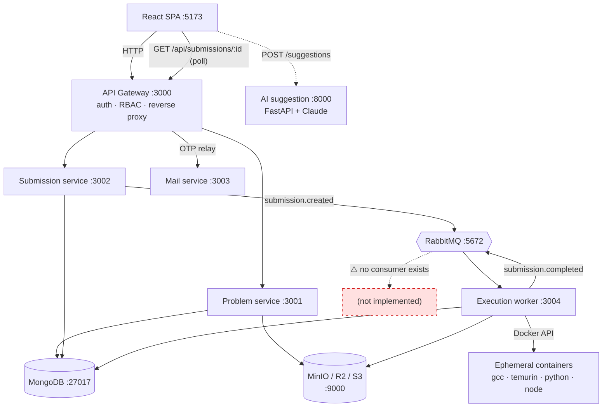

# LCArena

A distributed, containerized online judge. It serves a problem catalogue and a
Monaco-based coding workspace, accepts user submissions over HTTP, queues them,
executes untrusted code in ephemeral Docker containers, and returns a verdict the
browser displays.

> **Deployed demo note:** the currently hosted frontend runs in demo mode with
> local sample problems, and its "Run" button does not execute code. Grading works
> when the stack runs locally with Docker. See
> [the frontend README](apps/frontend/README.md#%EF%B8%8F-read-this-first-the-deployed-frontend-runs-in-demo-mode).

## Architecture



Read **[docs/SUBMISSION_EVALUATION_FLOW.md](docs/SUBMISSION_EVALUATION_FLOW.md)**
for the complete traced lifecycle — every stage, every verdict, the exact event
names and payloads, and the documented gaps.

## Technology stack

| Layer | Technology |
| :--- | :--- |
| Monorepo | Turborepo 2 + npm workspaces (Node ≥ 24, npm ≥ 11) |
| API services | TypeScript, Express 5, Zod 4, Mongoose 9 |
| Gateway auth | `jsonwebtoken` (access + refresh), Redis sessions/JTI blacklist/OTPs, `http-proxy-middleware` |
| Queue | RabbitMQ 3.13 (`amqplib`) |
| Storage | S3-compatible via `@aws-sdk/client-s3` (MinIO locally, Cloudflare R2 in production) |
| Sandbox | `dockerode` + ephemeral containers: `gcc:latest`, `eclipse-temurin`, `python:3.11-slim`, `node:20-slim` |
| Frontend | React 19, Vite 8, TypeScript, Tailwind CSS v4, Monaco, Vitest |
| AI | Python 3.12, FastAPI, LangChain, Anthropic Claude Sonnet |
| Data | MongoDB 7, Redis 7 |

## Repository structure

```
LCArena/
├── apps/
│   ├── apis/
│   │   ├── gateway/               # public entry point: auth, RBAC, proxy
│   │   ├── problem/               # problem CRUD + test-case uploads
│   │   ├── submission/            # submission intake -> RabbitMQ
│   │   ├── execution/             # evaluation worker (@LCArena/evaluator)
│   │   ├── mail/                  # SMTP relay for OTP emails
│   │   └── ai-suggestion-service/ # FastAPI code completion
│   └── frontend/                  # React SPA
├── packages/backend/
│   ├── config/                    # db/redis/rabbitmq/S3 connections + key layout
│   ├── models/                    # Mongoose schemas: User, Problem, Submission
│   ├── middlewares/               # userValidation, roleValidation, appErrorHandler
│   ├── utils/                     # AppError taxonomy, response envelope, logger, env
│   └── execution/                 # Executor base + language executors, verdict types
├── docs/                          # BACKEND.md, SUBMISSION_EVALUATION_FLOW.md, deploy guide
├── scripts/                       # docker health, seeding, test/coverage runners
└── tests/load/                    # load-test suite and reports
```

## Documentation

### Services

| Component | Port | README |
| :--- | :--- | :--- |
| API Gateway | 3000 | [apps/apis/gateway](apps/apis/gateway/README.md) |
| Problem service | 3001 | [apps/apis/problem](apps/apis/problem/README.md) |
| Submission service | 3002 | [apps/apis/submission](apps/apis/submission/README.md) |
| Mail service | 3003 | [apps/apis/mail](apps/apis/mail/README.md) |
| Execution worker | 3004 | [apps/apis/execution](apps/apis/execution/README.md) |
| AI suggestion service | 8000 | [apps/apis/ai-suggestion-service](apps/apis/ai-suggestion-service/README.md) |
| Frontend | 5173 | [apps/frontend](apps/frontend/README.md) |

### Shared packages

| Package | README |
| :--- | :--- |
| `@LCArena/config` | [packages/backend/config](packages/backend/config/README.md) |
| `@LCArena/models` | [packages/backend/models](packages/backend/models/README.md) |
| `@LCArena/middlewares` | [packages/backend/middlewares](packages/backend/middlewares/README.md) |
| `@LCArena/utils` | [packages/backend/utils](packages/backend/utils/README.md) |
| `@LCArena/execution` | [packages/backend/execution](packages/backend/execution/README.md) |

### Guides

- **[docs/SUBMISSION_EVALUATION_FLOW.md](docs/SUBMISSION_EVALUATION_FLOW.md)** — the end-to-end submission lifecycle, notification analysis and known gaps. Start here to understand how a verdict reaches a user.
- [docs/BACKEND.md](docs/BACKEND.md) — operations: environment, health checks, every test command, load profiles, cleanup and troubleshooting.
- [docs/FRONTEND_DEPLOY_AWS.md](docs/FRONTEND_DEPLOY_AWS.md) — deploying the SPA.
- [AGENTS.md](AGENTS.md) — system design and the security invariants agents must uphold. **Note:** it describes a Sockets service on port 3007 that is not implemented in this repository.

## Getting started

### Prerequisites

- **Node.js ≥ 24** and **npm ≥ 11** (enforced by the root `package.json` `engines`).
- **Docker Engine / Docker Desktop** with Compose v2. The execution worker needs
  Docker able to run **Linux containers** and will pull the four language images
  on first use.
- Python ≥ 3.12 only if you run the AI suggestion service outside Docker.

### Run the backend with Docker Compose

```sh
git clone https://github.com/Osank31/LCArena.git
cd LCArena
cp .env.example .env      # then fill in secrets (JWT keys, SMTP, Anthropic)
npm run docker:up         # docker compose up --build -d --wait
npm run docker:health     # per-service health table (exit 1 if unhealthy)
```

The public entry point is <http://localhost:3000>. The full port matrix, Compose
variables and security notes are in [docs/BACKEND.md](docs/BACKEND.md).

Services crash at boot if a required environment variable is missing, and
`getEnvVariable()` names the missing variable in the log.

### Run the frontend

```sh
cd apps/frontend
npm run dev               # http://localhost:5173
```

The Vite dev server proxies `/auth`, `/api` and `/health` to the gateway on
`:3000` and `/suggestions` to the AI service on `:8000`.

### Run a single service on the host

```sh
npx turbo run dev --filter=@LCArena/gateway
```

Point its URLs at `localhost` with the published ports (`MONGODB_URL`,
`REDIS_HOST`, `REDIS_PORT`, `RABBITMQ_URL`, `PROBLEM_SERVICE_URL`, …).

## Running tests

Backend selections use Turborepo filters that **exclude the frontend and the
Python service**.

```sh
# Unit tests: pure Node, no MongoDB/Redis/RabbitMQ/Docker needed
npm run test:backend
npm run test:backend -- --filter=@LCArena/utils       # one workspace
npm run test:coverage                                  # + aggregated coverage reports

# Typecheck and build every backend workspace
npm run check-types:backend
npm run build:backend

# Integration: boots isolated infra (Mongo 27018, Redis 6380, RabbitMQ 5673)
# and real services, then runs the API + submission-pipeline suites. Needs Docker.
npm run test:integration
npm run test:integration -- --suites=api               # HTTP contracts only

# Everything fast: typecheck -> build -> unit tests
npm run test:all:fast
npm run test:all                                       # + integration

# Load tests (smoke 10/100, normal 50/1000, stress 200/5000)
npm run seed:problems
TEST_PROBLEM_ID=<id> npm run test:load -- --profile=smoke --target=problem
npm run test:load -- --infra --profile=smoke --target=all
```

Per-service suites, the opt-in Docker E2E test and frontend Vitest suites are
documented in each service README, and the full command reference is in
[docs/BACKEND.md](docs/BACKEND.md).

The execution worker's end-to-end test is opt-in and is the only automated proof
of the full pipeline including sandboxed Docker execution:

```sh
cd apps/apis/execution && E2E=1 npm run test:integration
```

## Other root scripts

```sh
npm run docker:up              # start the stack (waits for healthchecks)
npm run docker:down            # stop containers, KEEP data volumes
npm run docker:down:volumes    # stop and DELETE all local database/queue data
npm run docker:logs            # follow all logs
npm run seed:problems          # idempotently insert sample problems
npm run format                 # Prettier over **/*.{ts,tsx,md}
npm run lint                   # ESLint across the monorepo
```

## Security invariants

These are enforced in code and must not be weakened:

- The gateway is the only component that reads a JWT, and the only one allowed to
  set `x-user-id` on an upstream request. It strips client-supplied `x-user-id`
  and `authorization` before proxying.
- Unregistered gateway routes and methods are rejected with 404 rather than
  forwarded.
- The user's bcrypt `password` hash is never returned (`toPublicUser()` builds the
  response field by field), and login failures for a wrong password and a
  nonexistent email return the identical `"Invalid email or password"`.
- Logout, password change and account deletion revoke the Redis session and
  blacklist the access token's `jti`.
- Untrusted code never runs on the host. It runs in ephemeral containers under
  GNU `timeout`, and the container is removed afterwards.
- Databases, Redis, RabbitMQ and internal service ports are bound to
  `127.0.0.1` in the development Compose file. The execution worker mounts the
  host Docker socket, which is **development-only** and must never be treated as a
  production security boundary.

Known hardening gaps in the sandbox (no memory/CPU limits, no network isolation)
and in the notification path are documented in
[docs/SUBMISSION_EVALUATION_FLOW.md](docs/SUBMISSION_EVALUATION_FLOW.md#10-gaps-race-conditions-and-reliability-issues).
