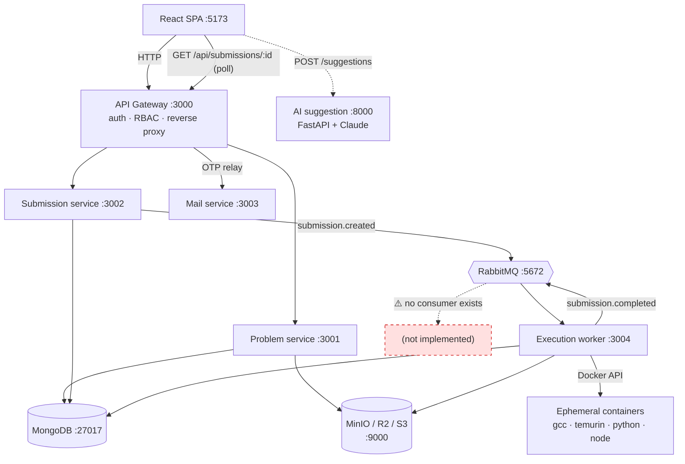

# LCArena

A distributed, containerized online judge. It serves a problem catalogue and a Monaco-based coding workspace, accepts user submissions over HTTP, queues them, executes untrusted code in ephemeral Docker containers, and returns a verdict the browser displays.

> **Deployed demo note:** the currently hosted frontend runs in demo mode with local sample problems, and its "Run" button does not execute code. Grading works when the stack runs locally with Docker. See [the frontend README](apps/frontend/README.md#%EF%B8%8F-read-this-first-the-deployed-frontend-runs-in-demo-mode).

## Architecture



The submission lifecycle is traced end-to-end below (§5–§7). The language-execution E2E suite is a documented gap — see the Testing section below.

## Technology stack

| Layer        | Technology                                                                                              |
| :----------- | :------------------------------------------------------------------------------------------------------ |
| Monorepo     | Turborepo 2 + npm workspaces (Node ≥ 24, npm ≥ 11)                                                      |
| API services | TypeScript, Express 5, Zod 4, Mongoose 9                                                                |
| Gateway auth | `jsonwebtoken` (access + refresh), Redis sessions/JTI blacklist/OTPs, `http-proxy-middleware`           |
| Queue        | RabbitMQ 3.13 (`amqplib`)                                                                               |
| Storage      | S3-compatible via `@aws-sdk/client-s3` (MinIO locally, Cloudflare R2 in production)                     |
| Sandbox      | `dockerode` + ephemeral containers: `gcc:latest`, `eclipse-temurin`, `python:3.11-slim`, `node:20-slim` |
| Frontend     | React 19, Vite 8, TypeScript, Tailwind CSS v4, Monaco, Vitest                                           |
| AI           | Python 3.12, FastAPI, LangChain, Anthropic Claude Sonnet                                                |
| Data         | MongoDB 7, Redis 7                                                                                      |

## Repository structure

```
LCArena/
├── apps/
│   ├── apis/
│   │   ├── gateway/               # public entry point: auth, RBAC, proxy
│   │   ├── problem/               # problem CRUD + test-case uploads
│   │   ├── submission/            # submission intake -> RabbitMQ
│   │   ├── execution/             # evaluation worker (@LCArena/evaluator)
│   │   ├── mail/                  # SMTP relay for OTP emails
│   │   └── ai-suggestion-service/ # FastAPI code completion
│   └── frontend/                  # React SPA
├── packages/backend/
│   ├── config/                    # db/redis/rabbitmq/S3 connections + key layout
│   ├── models/                    # Mongoose schemas: User, Problem, Submission
│   ├── middlewares/               # userValidation, roleValidation, appErrorHandler
│   ├── utils/                     # AppError taxonomy, response envelope, logger, env
│   └── execution/                 # Executor base + language executors, verdict types
```

## Documentation

### Services

| Component             | Port | README                                                                       |
| :-------------------- | :--- | :--------------------------------------------------------------------------- |
| API Gateway           | 3000 | [apps/apis/gateway](apps/apis/gateway/README.md)                             |
| Problem service       | 3001 | [apps/apis/problem](apps/apis/problem/README.md)                             |
| Submission service    | 3002 | [apps/apis/submission](apps/apis/submission/README.md)                       |
| Mail service          | 3003 | [apps/apis/mail](apps/apis/mail/README.md)                                   |
| Execution worker      | 3004 | [apps/apis/execution](apps/apis/execution/README.md)                         |
| AI suggestion service | 8000 | [apps/apis/ai-suggestion-service](apps/apis/ai-suggestion-service/README.md) |
| Frontend              | 5173 | [apps/frontend](apps/frontend/README.md)                                     |

### Shared packages

| Package                | README                                                                 |
| :--------------------- | :--------------------------------------------------------------------- |
| `@LCArena/config`      | [packages/backend/config](packages/backend/config/README.md)           |
| `@LCArena/models`      | [packages/backend/models](packages/backend/models/README.md)           |
| `@LCArena/middlewares` | [packages/backend/middlewares](packages/backend/middlewares/README.md) |
| `@LCArena/utils`       | [packages/backend/utils](packages/backend/utils/README.md)             |
| `@LCArena/execution`   | [packages/backend/execution](packages/backend/execution/README.md)     |

### Guides

- [CLAUDE.md](CLAUDE.md) — project commands, verification steps, and known gaps.
- [TESTING_DOCUMENTATION.md](TESTING_DOCUMENTATION.md) — full test command reference, load-test profiles, coverage gates, and cleanup instructions (archived to docs/archive/).
- [Performance.md](Performance.md) — load-test results and performance tuning notes (archived to docs/archive/).

## Getting started

### Prerequisites

- **Node.js ≥ 24** and **npm ≥ 11** (enforced by the root `package.json` `engines`).
- **Docker Engine / Docker Desktop** with Compose v2. The execution worker needs Docker able to run **Linux containers** and will pull the four language images on first use.
- Python ≥ 3.12 only if you run the AI suggestion service outside Docker.

### Run the backend with Docker Compose

```sh
git clone https://github.com/Osank31/LCArena.git
cd LCArena
cp .env.example .env      # then fill in secrets (JWT keys, SMTP, Anthropic)
npm run docker:up         # docker compose up --build -d --wait
npm run docker:health     # per-service health table (exit 1 if unhealthy)
```

The public entry point is <http://localhost:3000>. The full port matrix, Compose variables and security notes are in CLAUDE.md.

Services crash at boot if a required environment variable is missing, and `getEnvVariable()` names the missing variable in the log.

### Run the frontend

```sh
cd apps/frontend
npm run dev               # http://localhost:5173
```

The Vite dev server proxies `/auth`, `/api` and `/health` to the gateway on `:3000` and `/suggestions` to the AI service on `:8000`.

### Run a single service on the host

```sh
npx turbo run dev --filter=@LCArena/gateway
```

Point its URLs at `localhost` with the published ports (`MONGODB_URL`, `REDIS_HOST`, `REDIS_PORT`, `RABBITMQ_URL`, `PROBLEM_SERVICE_URL`, …).

## Running tests

No unit, integration, or load test suites remain in the repository — the `test/unit`, `test/integration`, and `tests/load` directories and their `test:*` npm scripts were removed from every workspace.

To restore testing, add unit test files under `test/unit/` (per workspace) and re-add `test:unit` scripts, or re-create `tests/load/` and the load-test runner. Until then, `npm run test:*` commands are unavailable.

## Other root scripts

```sh
npm run docker:up              # start the stack (waits for healthchecks)
npm run docker:down            # stop containers, KEEP data volumes
npm run docker:down:volumes    # stop and DELETE all local database/queue data
npm run docker:logs            # follow all logs
npm run seed:problems          # idempotently insert sample problems
npm run format                 # Prettier over **/*.{ts,tsx,md}
npm run lint                   # ESLint across the monorepo
```

---

## 1. Subsystem design

### 1.1 API Gateway (`apps/apis/gateway`)

The Gateway is the perimeter security boundary and single public HTTP ingress point.

**Responsibilities:**
- **Reverse Proxying** (`http-proxy-middleware` via `proxy.factory.ts`): routes `/api/problems/*` to problem:3001 and `/api/submissions/*` to submission:3002. Fails closed — unmapped routes or methods are rejected with 404 (`notFoundHandler`), never forwarded downstream.
- **Header sanitization**: strips client-supplied `x-user-id` and `authorization`, injects verified `x-user-id` from the JWT, and attaches `x-forwarded-for/proto/host`.
- **Authentication & session lifecycle** (`auth.controller.ts`, `auth.service.ts`, `token.service.ts`): dual-token system — short-lived access JWT (default 15 min / 900s) via `Authorization: Bearer`, long-lived refresh JWT (default 7 days / 604800s) as an `httpOnly`, `sameSite: lax`, `path: /auth` cookie. Redis session at `session:<userId>` holds the current refresh token; refresh rotation overwrites the key (stale/replayed refresh fails with `401 Session is no longer active`). Logout deletes the session and blacklists the access token's `jti` at `revoked_access:<jti>` with TTL = remaining token life.
- **OTP subsystem** (`otp.service.ts`): secure 6-digit numeric OTPs (`crypto.randomInt(100000, 1000000)`), stored at `otp:<normalized_email>` with 5-minute (300s) TTL, single-use (deleted on verification). Used by `/auth/register` and `/auth/login-otp`.
- **RBAC**: user types `Regular | Admin | Premium`. Admin-only mutations on `/api/problems` (`POST`/`PUT`/`DELETE`) and `/auth/users/:userId/role`. Submission reads/updates are gated by `requireSubmissionOwner` (owner or Admin).

**Routes (`/auth`)** — all responses use the shared envelope `{ status, message, success, data, error }` on success and `{ success: false, message, errors? }` on error:

| Method   | Path                       | Auth                     | Success                                                       |
| :------- | :------------------------- | :----------------------- | :------------------------------------------------------------ |
| `POST`   | `/auth/send-otp`           | none                     | 200, `data: null` (mail queued in background)                 |
| `POST`   | `/auth/register`           | none                     | 201, `data: { user, accessToken }` + refresh cookie           |
| `POST`   | `/auth/login-otp`          | none                     | 200, `data: { user, accessToken }` + refresh cookie           |
| `POST`   | `/auth/login`              | none                     | 200, `data: { user, accessToken }` + refresh cookie           |
| `POST`   | `/auth/refresh`            | refresh token            | 200, rotated cookie                                           |
| `POST`   | `/auth/logout`             | optional                 | 200, cookie cleared                                           |
| `GET`    | `/auth/me`                 | access token             | 200, `data: PublicUser`                                       |
| `POST`   | `/auth/change-password`    | access token             | 200                                                           |
| `DELETE` | `/auth/account`            | access token             | 200, cookie cleared                                           |
| `PATCH`  | `/auth/users/:userId/role` | access token + **Admin** | 200, `data: PublicUser`                                       |

`PublicUser` = `{ id, userId, name, email, profilePicUrl, userType, userRole, roleExpiry }` — built field-by-field by `toPublicUser()`, so the bcrypt hash never leaks.

**Proxied routes:**

| Method                | Path                                 | Auth                       | Upstream           |
| :-------------------- | :----------------------------------- | :------------------------- | :----------------- |
| `GET`                 | `/api/problems`, `/api/problems/:id` | none                       | Problem service    |
| `POST` `PUT` `DELETE` | `/api/problems`, `/api/problems/:id` | access token + **Admin**   | Problem service    |
| `POST`                | `/api/submissions`                   | access token               | Submission service |
| `GET` `PUT`           | `/api/submissions/:id`               | access token + owner/Admin | Submission service |

### 1.2 Problem Service (`apps/apis/problem`)

Owns the coding-challenge catalogue and test-case objects.

- **Port:** `3001`. Internal only — no auth of its own; the gateway enforces RBAC.
- **Data model** (`Problem`): `description` (markdown, required), `difficulty` (`Easy|Medium|Hard`), `sampleTestCaseUrl`, `testCasesUrl`, `time_limit` (ms, default 5000), `testCaseStoragePrefix`, `testCasesCount`.
- **Endpoints:** `GET /health`, `GET /` (list, public), `GET /:id` (public), `POST /` / `PUT /:id` / `DELETE /:id` (Admin via gateway).
- **Test-case storage:** uploads each `input`/`output` pair to object storage under `Evaluation_Test_Cases/Test_Cases_<PROBLEM_ID>/test_case_NNN/input.in` and `.../output.ans` (3-digit zero padding). Compensating cleanup rolls back partial uploads on failure.

### 1.3 Submission Service (`apps/apis/submission`)

Ingress point for user code. Deliberately small and fast — it persists `PENDING` and publishes `submission.created`; it does not execute anything.

- **Port:** `3002`. Internal only; trusts `x-user-id` minted by the gateway (`userValidation` looks the user up in Mongo).
- **Workflow:** validate `{ problemId, code, language }` → resolve caller → mint `{ status: "PENDING" }` server-side (client-supplied `status` is stripped by Zod) → persist `Submission` → publish `submission.created` → return `201` with the document (client has `_id` to poll).
- **Payload:** `{ code, language, status, submissionId, userId, problemId }` — message is **not** published persistent and `submission.created` is asserted non-durable in `@LCArena/config`, so a broker restart can drop an unprocessed submission.

### 1.4 Execution Worker (`apps/apis/execution`)

Closes the submission lifecycle: consume `submission.created`, stage test cases, run untrusted code in ephemeral Docker sandboxes, atomically persist one verdict, publish `submission.completed`.

- **Port:** `3004`, `/health` only.
- **Pipeline:** load Submission + Problem from Mongo (source of truth, not the message) → acquire test cases from S3/archive/local → run via `@LCArena/execution` (Dockerode, `gcc:latest`/`eclipse-temurin`/`python:3.11-slim`/`node:20-slim`) → conditional `findOneAndUpdate` guarded on `status.status === "PENDING"` → publish `submission.completed`.
- **Idempotency:** a non-`PENDING` submission is never re-executed; its stored verdict is re-published instead (repairs persist-but-crash-before-notify).
- **Sandbox:** `HostConfig: {}` — no memory/CPU/pids limits, no dropped capabilities, no read-only rootfs, default network (outbound access), runs as image default user. Development-only host Docker socket mount; never a production boundary.

**Verdicts:** `SUCCESS` (Accepted), `COMPILE_ERROR`, `WA`, `RE`, `TLE`, `INTERNAL_ERROR`. `SUCCESS` means "the harness ran" — a wrong answer is `SUCCESS` with `failedCases.wa` populated. The worker derives human verdicts with precedence `tle → re → wa`.

### 1.5 AI Code Suggestion Service (`apps/apis/ai-suggestion-service`)

FastAPI microservice providing fill-in-the-middle (FIM) code completion for Monaco.

- **Port:** `8000`. Python ≥ 3.12, FastAPI + Uvicorn, LangChain + Anthropic Claude (`claude-sonnet-4-5-20250929`).
- Reaches the frontend **directly** (not through the gateway): Vite proxies `/suggestions` to `:8000`. No authentication or rate limiting of its own — anything reaching port 8000 can consume the Anthropic quota. Keep it on loopback or behind the gateway with auth.
- **POST /suggestions**: `prefix`, `suffix`, `language_id` (`python|javascript|cpp|java`), `cursor_position`, `editor_info` → `{ id, model, choices[], usage, latency_ms }`. Empty `choices` when context is insufficient.
- **Gap:** the frontend discards the response body — no inline insertion is rendered today (transport/cancellation verified, UX not).

### 1.6 Sockets service (port 3007) — NOT IMPLEMENTED

Referenced in architecture but there is no `apps/apis/sockets` workspace and no consumer of `submission.completed`. Real-time push does not exist; the frontend polls `GET /api/submissions/:id` (1.5s × 20).

## 2. Shared packages (`packages/backend/`)

| Package                | Purpose & key exports                                                                                                |
| :--------------------- | :------------------------------------------------------------------------------------------------------------------- |
| `@LCArena/config`      | `dbConnect`, `redisConnect`/`getRedisClient`, RabbitMQ `channel`/`queue`/`connectToQueue`, S3 client + key-layout helpers (`getTestCaseInputKey`/`getTestCaseOutputKey`, `getProblemTestCasePrefix`, `formatTestCaseFolderName`). Queue names: `submission.created`, `submission.completed`, `submission.created.dead`. |
| `@LCArena/models`      | Mongoose schemas `User` (`UserType`: Regular/Admin/Premium), `Problem`, `Submission`; `ELanguage` enum (`py`/`cpp`/`java`/`js`). |
| `@LCArena/middlewares` | `userValidation` (resolve `x-user-id` → `req.user`), `roleValidation`, `appErrorHandler`, `AuthenticatedUser` type augmentation. |
| `@LCArena/utils`       | `AppError` taxonomy, `sendSuccess`/`sendError`, `logger` (Winston), `getEnvVariable`.                                |
| `@LCArena/execution`   | Abstract `Executor` + `CPPExecutor`/`JavaExecutor`/`PythonExecutor`/`JSExecutor`, `ExecutionResult` union, `compareOutputs`/`normalizeOutput`. |

## 3. Data models & database design

### 3.1 MongoDB schemas

#### `users`

```
{
  name:           String,  required, trim
  email:          String,  required, unique, lowercase, trim
  password:       String,  required, minlength 6   // bcrypt hash, cost 10
  profilePicUrl:  String,  default "/default-url", required
  userType:       String,  enum ["Regular","Admin","Premium"], default "Regular", required
  roleExpiry:     Date,    default null
  resetPasswordToken: String
  resetTokenExpiry:   String   // typed String, not Date; unused — password reset not implemented
}
// { timestamps: true }
```

#### `problems`

```
{
  description:          String, required
  difficulty:           String, required, enum ["Easy","Medium","Hard"]
  sampleTestCaseUrl:    String, required
  testCasesUrl:         String, required (schema-level; service injects "storage://auto" preprocess)
  time_limit:           Number, required, default 5000   // ms
  testCaseStoragePrefix:String, required false
  testCasesCount:       Number, required false, default 0
}
// { timestamps: true }
```

#### `submissions`

```
{
  problemId: ObjectId, ref "Problem"
  code:      String, required
  language:  String, required, enum Object.values(ELanguage)
  userId:    ObjectId, ref "User"
  status:    Mixed, required   // ExecutionResult union from @LCArena/execution
}
// { timestamps: true }
// indexes: { userId: 1, createdAt: -1 }, { problemId: 1, createdAt: -1 }
```

`ExecutionResult` union:
```
{ status: "PENDING" }
{ status: "COMPILE_ERROR", compileError: string }
{ status: "SUCCESS", passed, total, failedCases: { tle[], re[], wa[] }, executionTimeMs }
{ status: "INTERNAL_ERROR", message: string }
```

### 3.2 Test-case storage hierarchy (S3 / MinIO / Cloudflare R2)

```
Evaluation_Test_Cases/Test_Cases_<PROBLEM_ID>/test_case_001/input.in
Evaluation_Test_Cases/Test_Cases_<PROBLEM_ID>/test_case_001/output.ans
...
```

- Contents preserved verbatim (whitespace and trailing newlines).
- The worker validates folder completeness: every `test_case_XXX` directory needs both `input.in` and `output.ans`.

### 3.3 Output comparison & judging policy (`compareOutputs`)

- CRLF/CR → LF.
- Trim trailing whitespace per line; drop trailing blank lines.
- Preserve token-level differences (`compareOutputs`).
- Sandbox runner uses `diff -b -B` (ignore whitespace change, ignore blank lines) — two judging implementations that can drift.

### 3.4 Redis key topology & policies

| Key pattern       | Value              | TTL              | Purpose                                              |
| :---------------- | :----------------- | :--------------- | :--------------------------------------------------- |
| `session:<userId>`| active refresh token| 7 days (604800s) | Rotation + revocation                                |
| `revoked_access:<jti>` | `"1"`        | remaining JWT life | Instant blacklist for logged-out access tokens       |
| `otp:<email>`     | 6-digit code       | 5 minutes (300s) | Single-use verification code                         |

### 3.5 RabbitMQ queues & payloads

- **`submission.created`** — published by Submission service, consumed by Execution worker. Payload: `{ submissionId, userId, problemId, code, language, status }`. Non-durable, non-persistent publish — messages can be lost on broker restart.
- **`submission.completed`** — published by Execution worker, asserted durable with `persistent: true`. Payload: `{ submissionId, userId, problemId, status, results, failedTestCase }`. **No production consumer** — see §1.6.
- **`submission.created.dead`** — DLQ for malformed / retries-exhausted messages, durable.

## 4. Network topology & port matrix

| Service                   | Port  | Protocol       | Purpose / public exposure                                                      |
| :------------------------ | :---- | :------------- | :----------------------------------------------------------------------------- |
| API Gateway               | 3000  | HTTP           | **Public entry**. Auth, sessions, RBAC, reverse proxy.                         |
| Problem Service           | 3001  | HTTP           | Internal only. Problem catalog & test-case uploads.                            |
| Submission Service        | 3002  | HTTP           | Internal only. Code submission intake.                                         |
| Mail Service              | 3003  | HTTP           | Internal only. SMTP relay for OTP emails.                                      |
| Execution Worker          | 3004  | HTTP (`/health`)| Internal only. Consumes submissions, runs Docker sandboxes.                    |
| Sockets Service           | 3007  | WS / HTTP      | **Not implemented** — real-time push (see §1.6).                               |
| AI Suggestion Service     | 8000  | HTTP           | Direct (not via gateway). Code completion for Monaco.                          |
| MinIO API                 | 9000  | HTTP / S3      | Local S3-compatible object storage.                                            |
| MinIO Console             | 9001  | HTTP           | MinIO web management console (`minioadmin` / `minioadmin`).                    |
| Frontend                  | 5173  | HTTP           | Client web browser interface (Vite dev server).                                |
| MongoDB                   | 27017 | TCP            | Primary persistent database.                                                   |
| Redis                     | 6379  | TCP            | Sessions, JTI blacklist, OTPs.                                                 |
| RabbitMQ AMQP             | 5672  | AMQP           | Message broker for submission queue.                                           |
| RabbitMQ Management       | 15672 | HTTP           | Web management UI (`guest` / `guest`).                                         |

All infra is bound to `127.0.0.1` in Compose.

## 5. Security invariants

These are enforced in code and must not be weakened:

1. **Perimeter identity boundary.** Downstream services **MUST NEVER** trust client-supplied `x-user-id` or `authorization`. The Gateway strips any incoming client `x-user-id`/`authorization` before proxying and mints verified identity from the JWT (signature + Redis JTI blacklist + user re-read from Mongo per request).
2. **Fail-closed gateway.** Unmatched routes/methods are rejected with 404, never forwarded downstream.
3. **Information disclosure prevention.** `password` (bcrypt hash) is never returned (`toPublicUser()` builds responses field by field). Login failures for wrong password and nonexistent email return the identical `"Invalid email or password"`.
4. **Session invalidation.** Logout, password change, and account deletion revoke the Redis session (`session:<userId>`) and blacklist the access token's `jti`.
5. **Execution sandboxing.** Untrusted code never runs on the host — ephemeral Docker containers under `timeout`, removed in `finally` blocks. Host Docker socket mount is development-only.
6. **Error format consistency.** Errors route through `appErrorHandler` → `{ success: false, message, errors? }`.

## 6. Known gaps

- `sockets` service on port 3007 (WebSocket real-time push) is referenced but **not implemented** — no `apps/apis/sockets` workspace, no consumer of `submission.completed`. The frontend polls for verdicts instead.
- `apps/apis/payment` and `apps/apis/sse` directories exist but are empty/unwired.
- Language-execution E2E suite target (`test/integration/languages.e2e.ts`) does not exist — C++/Java/Python sandbox execution lacks E2E coverage.
- ESLint crashes before linting any backend file (TypeScript 6 incompatibility); only the frontend has a working ESLint config.
- Frontend branch coverage (~75%) is below the 80% Vitest gate.

## 7. Getting started (continued)

See the top of this file for prerequisites, Docker Compose, frontend dev, and single-service commands.

## 8. Documentation synchronization (mandatory)

This rule applies to every agent and subagent working in the LCArena repository.

Documentation updates are a required part of completing any coding task, not a separate optional step. Whenever you make changes to the codebase, you must automatically identify and update all relevant documentation files before considering the task complete.

CLAUDE.md must not exceed 200 lines total.

### When to update

Update docs when your change touches: API routes/bodies/status codes; environment variables; RabbitMQ queue names or payloads; database fields/Mongoose schemas/indexes; Zod validation rules; security logic (auth/RBAC/header sanitization); service config (ports, dependencies, env vars); architecture (new/removed service, new infra); commands/scripts/verification steps; known gaps.

### Documentation files

Root: README.md (overview, architecture, tech stack, security invariants), CLAUDE.md (commands, verification, gaps), TESTING_DOCUMENTATION.md (testing, CI, coverage, archived), Performance.md (benchmarks, archived).
Services: apps/frontend/README.md, apps/apis/{gateway,problem,submission,execution,mail,ai-suggestion-service}/README.md.
Packages: packages/backend/{config,models,middlewares,utils,execution}/README.md.
Config: docker-compose*.yml, .env.example, turbo.json, root package.json, Dockerfile, .github/workflows/backend-ci.yml.

### How to update

1. Identify affected files before finishing implementation.
2. Update minimally — target only affected sections; preserve existing docs; link instead of duplicating.
3. Verify against source code/config (ports, env vars, queue names, routes, rules). Do not claim updated if unverified.
4. If no doc update is needed, state why in your completion report.

### Restrictions

- Never modify generated files (package-lock.json, .turbo/, dist/, coverage/), third-party (node_modules/), secrets (.env), or .codegraph/.
- Do not update unrelated docs or skip updates because they weren't requested.
- Changes to this section require explicit user consent; agents must not auto-grant standing permissions to edit CLAUDE.md.

### Completion report

Include: docs updated, what changed, verification performed, any docs not updated and why.
