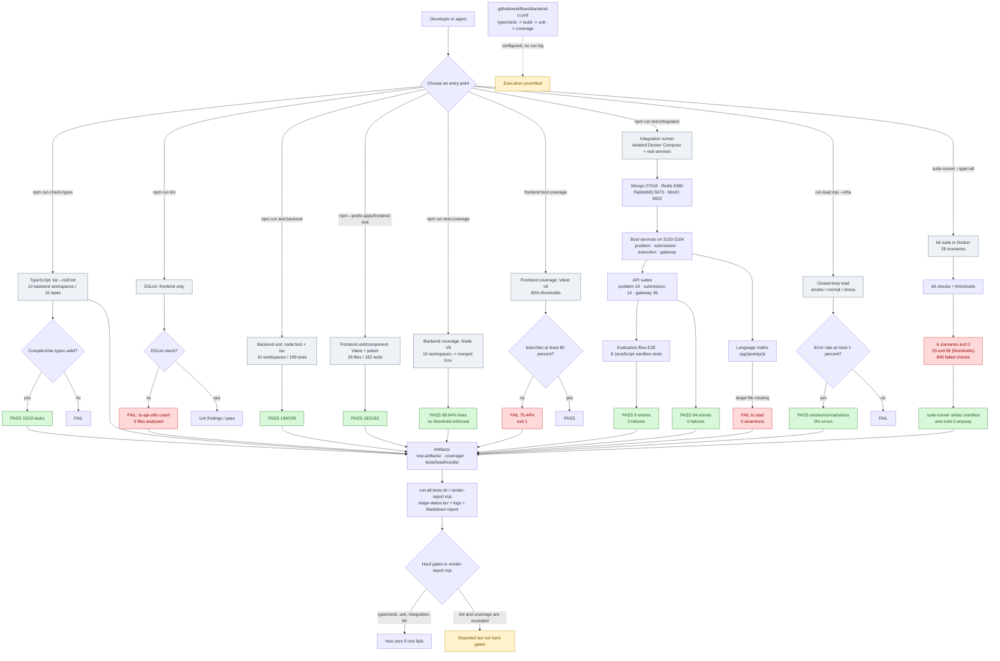
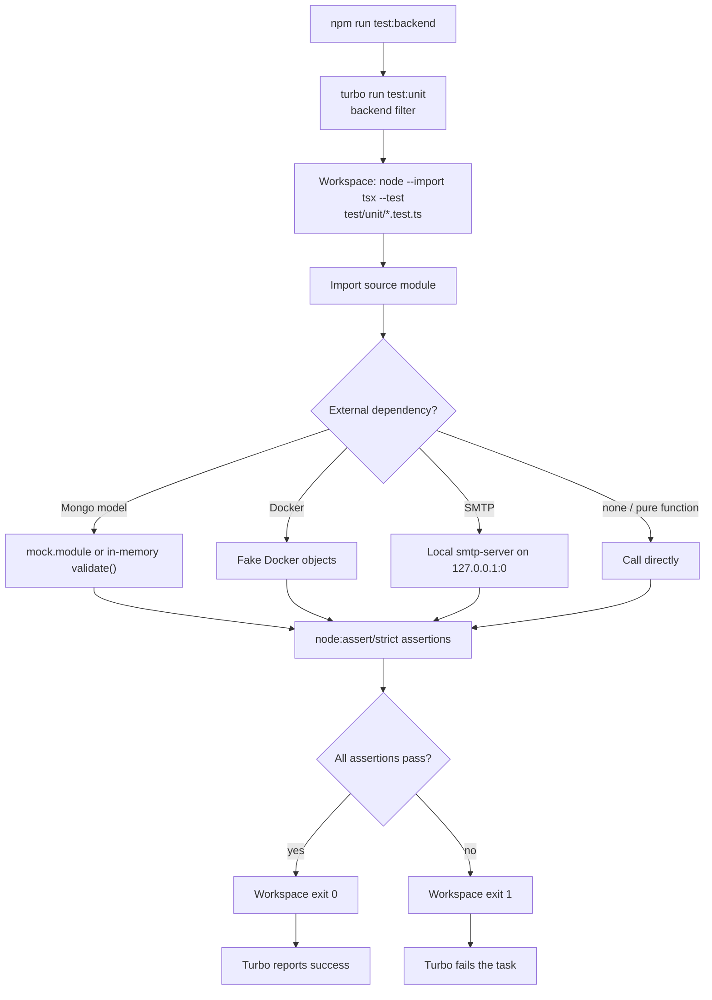
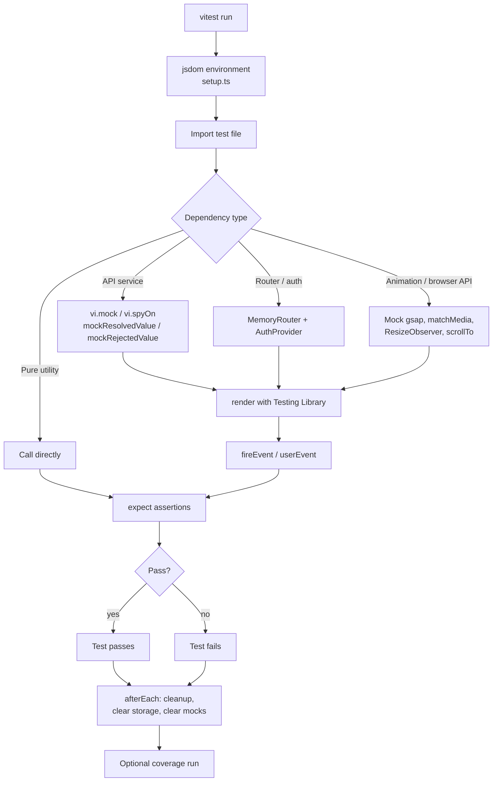
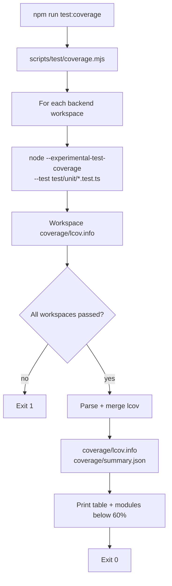
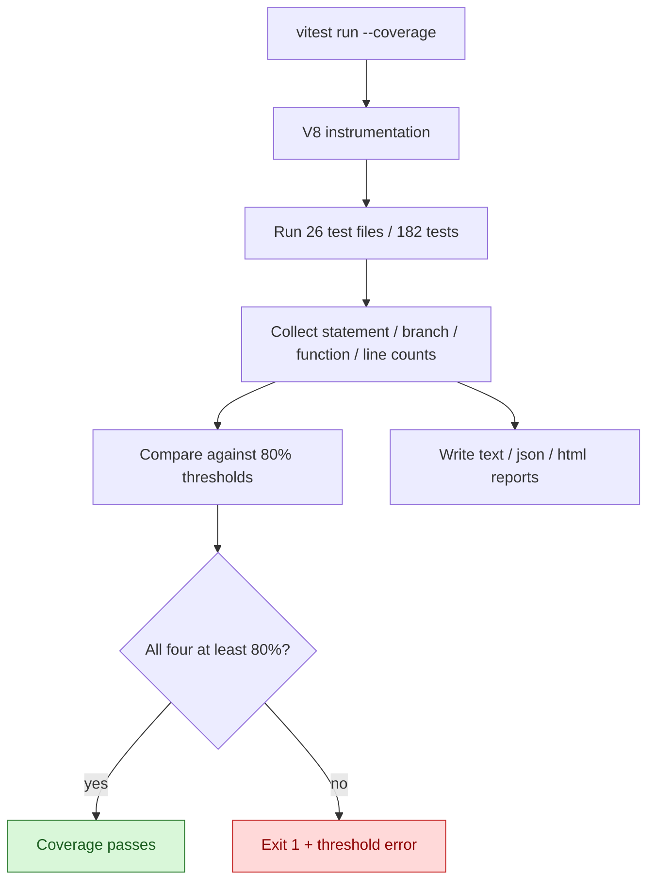
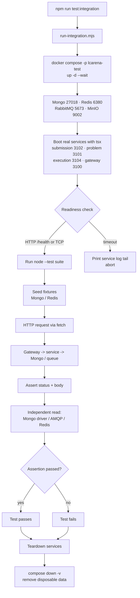
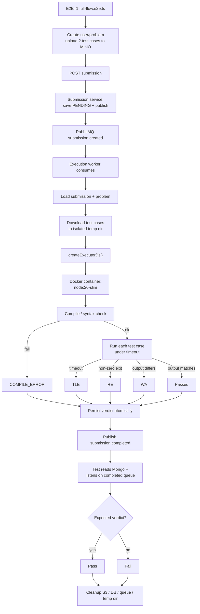
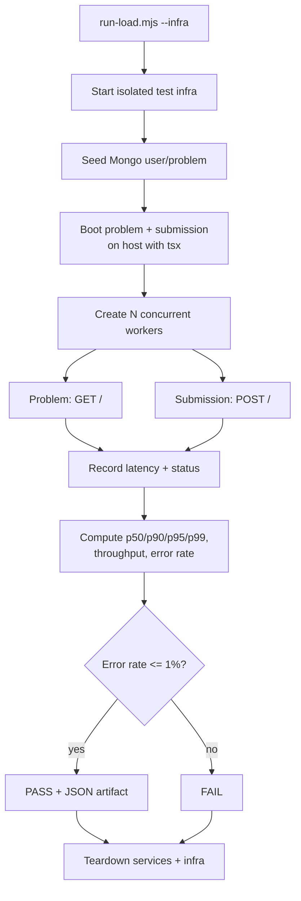
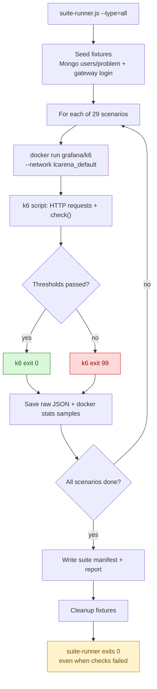
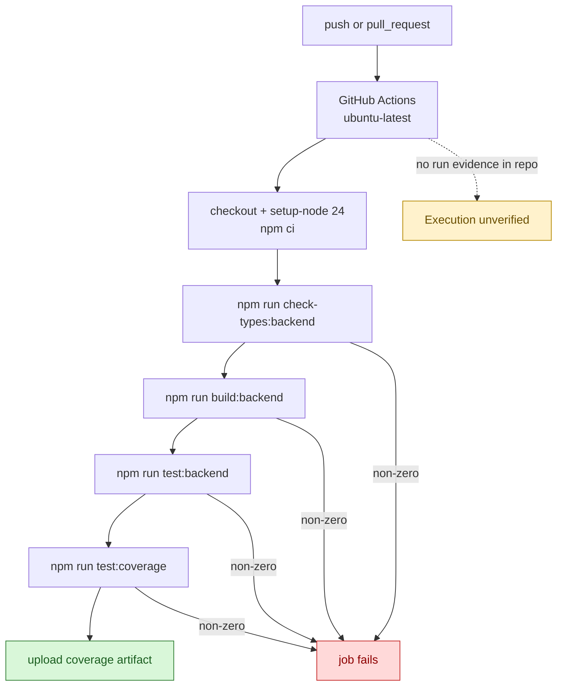

# LCArena — Complete Testing Documentation & Audit

> A beginner-friendly audit of **what testing actually exists in this repository**, what was actually executed, what the results mean, and what remains unverified.
>
> This document is based on the source tree, test files, package scripts, CI configuration, archived logs and reports, plus a small set of safe re-runs performed during the audit. It does **not** change application code, tests or production configuration.

---

## Audit metadata

| Item | Value |
| :--- | :--- |
| Audit date | **2026-10-17** |
| Repository | LCArena monorepo |
| Branch / commit | `main` · `51b00c6` (“Added performance visulization”) |
| Working tree at audit start/end | Clean (`git status --short` produced no output) |
| Host | Windows 11 AMD64 · Node.js **v24.16.0** · npm **11.15.0** |
| Docker CLI | **29.5.2** installed, but the Docker daemon was **not running** on 2026-10-17 |
| Historical test window | 2026-10-11 → 2026-10-14 (archived artifacts) |
| Fresh re-runs | 2026-10-17: typecheck, backend build, backend unit tests, frontend unit tests, backend coverage, frontend coverage, lint |

### Evidence legend used throughout

| Tag | Meaning |
| :--- | :--- |
| **[V]** | Verified directly in source/configuration during this audit. |
| **[H]** | Historical execution evidence found in `test-artifacts/`, `coverage/` or `tests/load/results/`. |
| **[R]** | Re-run by this audit on 2026-10-17; results are reported separately from history. |
| **[U]** | Configured or claimed, but execution cannot be verified. |
| **[N]** | Not implemented, or the target does not exist in the repository. |

**Important rule used in this report:** a test file existing does **not** mean the test ran, and a wrapper script exiting `0` does **not** mean every assertion passed. Both distinctions matter in this repository.

---

## Table of contents

1. [Executive summary](#1-executive-summary)
2. [The system under test](#2-the-system-under-test)
3. [Overall testing flowchart](#3-overall-testing-flowchart)
4. [Evidence base and audit method](#4-evidence-base-and-audit-method)
5. [Testing types in detail](#5-testing-types-in-detail)
   - [5.1 Static type checking](#51-static-type-checking)
   - [5.2 Linting (ESLint)](#52-linting-eslint)
   - [5.3 Backend unit tests](#53-backend-unit-tests)
   - [5.4 Frontend unit and component tests](#54-frontend-unit-and-component-tests)
   - [5.5 Backend coverage](#55-backend-coverage)
   - [5.6 Frontend coverage](#56-frontend-coverage)
   - [5.7 HTTP API integration tests](#57-http-api-integration-tests)
   - [5.8 Database persistence tests](#58-database-persistence-tests)
   - [5.9 Message queue and asynchronous tests](#59-message-queue-and-asynchronous-tests)
   - [5.10 End-to-end sandboxed evaluation tests](#510-end-to-end-sandboxed-evaluation-tests)
   - [5.11 Language-matrix E2E tests (not run)](#511-language-matrix-e2e-tests-not-run)
   - [5.12 Closed-loop load tests](#512-closed-loop-load-tests)
   - [5.13 k6 endpoint and isolated-service load tests](#513-k6-endpoint-and-isolated-service-load-tests)
   - [5.14 k6 workflow and lifecycle tests](#514-k6-workflow-and-lifecycle-tests)
   - [5.15 Stress testing](#515-stress-testing)
   - [5.16 Spike testing](#516-spike-testing)
   - [5.17 Soak testing](#517-soak-testing)
   - [5.18 Recovery testing](#518-recovery-testing)
   - [5.19 Security-focused tests](#519-security-focused-tests)
   - [5.20 Validation and error-handling tests](#520-validation-and-error-handling-tests)
   - [5.21 Build verification](#521-build-verification)
   - [5.22 CI/CD test pipeline](#522-cicd-test-pipeline)
   - [5.23 Testing categories not implemented](#523-testing-categories-not-implemented)
6. [Test cases and assertions explained](#6-test-cases-and-assertions-explained)
7. [Test infrastructure and dependencies](#7-test-infrastructure-and-dependencies)
8. [Testing summary table](#8-testing-summary-table)
9. [Overall results and gaps](#9-overall-results-and-gaps)
10. [Appendix: commands, files and glossary](#10-appendix-commands-files-and-glossary)

---

## 1. Executive summary

### 1.1 What this report is

This is an audit of the testing that exists in LCArena today. It explains each testing type in plain English, shows the real files and commands, walks through representative test cases, and separates:

- tests that **definitely ran** and produced artifacts,
- tests that were **re-run during this audit**,
- tests that are **configured but whose execution cannot be verified**,
- tests that are **missing or broken**.

### 1.2 The one-paragraph verdict

LCArena has a genuinely broad automated test story for a project of this size: **199 backend unit tests**, **182 frontend component/unit tests**, **77 individual API/pipeline integration tests** (69 API + 8 sandbox E2E), and a **29-test k6 load suite** with closed-loop load measurements. Most contract-level and happy-path behaviour is covered, and the JavaScript evaluation pipeline is proven end to end. However, the overall picture is **not green**: ESLint cannot run at all, frontend branch coverage fails its own 80% gate, the C++/Java/Python end-to-end language matrix does not exist, the k6 suite records **845 failed functional checks** while its wrapper still exits `0`, and the CI workflow has no verifiable execution history. The strongest evidence is for unit/API contracts and the JavaScript evaluation path; the weakest is for non-JavaScript execution, notification, browser behaviour, failure recovery and production-like load.

### 1.3 Status at a glance

| Area | Status | Short reason |
| :--- | :--- | :--- |
| TypeScript typecheck | **Executed — Passed** | 15/15 Turbo tasks (10 check-types + 5 dependency builds), 0 errors, fresh on 2026-10-17 |
| Backend build | **Executed — Passed** | 10/10 workspaces, fresh on 2026-10-17 |
| ESLint | **Executed — Failed (tool crash)** | `ts-api-utils` crashes before any file is linted |
| Backend unit tests | **Executed — Passed** | 199/199 tests, fresh on 2026-10-17 |
| Frontend unit/component tests | **Executed — Passed** | 182/182 tests in 26 files, fresh on 2026-10-17 |
| Backend coverage | **Executed — Passed (no gate)** | 88.64% lines / 86.43% branches / 86.90% functions |
| Frontend coverage | **Executed — Failed** | 75.44% branches < configured 80% threshold |
| API integration | **Executed — Passed** | 69 individual tests across problem/submission/gateway, 0 failures |
| Database persistence | **Executed — Passed** | Real MongoDB read-back assertions |
| Queue / async | **Executed — Passed** | Publish exactly once, consume, idempotency |
| JavaScript sandbox E2E | **Executed — Passed** | AC/WA/CE/RE/TLE + concurrency + cleanup |
| C++/Java/Python E2E | **Configured — Execution failed to start** | Target `languages.e2e.ts` does not exist |
| Closed-loop load | **Executed — Passed** | Smoke/normal/stress, 0% errors |
| k6 load suite | **Executed — Completed with failures; wrapper exit 0** | 29 tests, 113,494 checks, 845 failed |
| Security assertions | **Executed — Passed** | Auth, RBAC, IDOR, token revocation, spoofing |
| CI workflow | **Configured — Execution unverified** | No GitHub Actions run log or artifact in repo |
| Browser E2E / accessibility / visual | **Not Implemented** | No Playwright/Cypress or equivalent |
| AI suggestion service tests | **Not Implemented** | No Python test suite |
| Sockets/notification tests | **Not Implemented** | The service itself is absent |

### 1.4 What I could and could not verify

**Could verify:**

- The exact test files, scripts, ports, thresholds and mock/real dependency choices in source.
- Historical results from archived logs and JSON summaries dated 2026-10-11 → 2026-10-14.
- Fresh results for everything that does **not** need Docker: typecheck, build, unit tests, coverage, lint.
- The current state of `package.json`, the CI workflow and the reporting scripts.

**Could not verify:**

- Whether GitHub Actions ever ran `backend-ci.yml` successfully. There are no workflow-run logs, badges or uploaded artifacts in the repository.
- A fresh integration, sandboxed-E2E or load run. The Docker daemon was unavailable on 2026-10-17 (`docker ps` failed with `The system cannot find the file specified` for the Docker Desktop pipe).
- Prior agent-session transcripts or terminal scrollback. Only repository files and artifacts remain; those artifacts are partly git-ignored and were produced by several different runs.
- Production behaviour, real SMTP delivery, real user traffic or production capacity.

---

## 2. The system under test

### 2.1 Services and ports

LCArena is a Turborepo monorepo with npm workspaces. The test-relevant services are:

| Component | Path | Dev port | Role |
| :--- | :--- | ---: | :--- |
| API Gateway | `apps/apis/gateway` | 3000 | Auth, sessions, OTP, RBAC, reverse proxy |
| Problem service | `apps/apis/problem` | 3001 | Problem CRUD and test-case upload |
| Submission service | `apps/apis/submission` | 3002 | Submission intake and queue publish |
| Mail service | `apps/apis/mail` | 3003 | OTP email delivery |
| Execution worker | `apps/apis/execution` | 3004 (`/health`) | RabbitMQ consumer + Docker sandbox orchestration |
| AI suggestion service | `apps/apis/ai-suggestion-service` | 8000 | Python/FastAPI code completion |
| Frontend | `apps/frontend` | 5173 | React/Vite SPA |
| MongoDB | Docker | 27017 | Users, problems, submissions |
| Redis | Docker | 6379 | Sessions, JTI blacklist, OTPs |
| RabbitMQ | Docker | 5672 / 15672 | `submission.created`, `submission.completed`, dead-letter queue |
| MinIO / S3 | Docker | 9000 / 9001 | Test-case object storage |

**Sockets service:** `AGENTS.md` describes `apps/apis/sockets` on port 3007, but the directory has no files and `docs/BACKEND.md` explicitly calls it “not implemented in this repository”. The `submission.completed` queue therefore has **no production consumer**; the frontend polls `GET /api/submissions/:id` instead. `apps/apis/socket` and `apps/apis/payment` exist only as empty directories and are not npm workspaces.

### 2.2 Test surfaces map

| Surface | Where it lives | What it drives |
| :--- | :--- | :--- |
| Backend unit | Each workspace's `test/unit/` | Pure functions, schemas, middleware, consumer logic, executor script generation |
| Frontend unit/component | `apps/frontend/src/test/` | React components, pages, routing, services, utilities |
| API integration | `apps/apis/*/test/integration/*.api.test.js` | Real HTTP services + real Mongo/Redis/RabbitMQ/MinIO |
| Sandbox E2E | `apps/apis/execution/test/integration/full-flow.e2e.ts` | Full HTTP → queue → worker → Docker → MongoDB → completed queue path |
| Closed-loop load | `scripts/load/run-load.mjs` | Happy-path Problem GET and Submission POST with a fixed worker pool |
| k6 load/stress | `tests/load/` | 29 scenarios: profiles, 12 endpoints, 4 isolated services, 2 workflows |
| Static analysis | Root and workspace scripts | `tsc --noEmit`, ESLint |
| Coverage | `scripts/test/coverage.mjs`, Vitest config | Node V8 and Vitest v8 coverage |
| Reporting | `test-artifacts/verification/run-all-tests.sh`, `scripts/test/render-report.mjs` | Per-stage logs, exit codes, consolidated report |

### 2.3 Inter-service paths: tested or not?

| Path | Test evidence | Status |
| :--- | :--- | :--- |
| Browser-like client → Gateway | `gateway.api.test.js` (real HTTP) | **Tested** |
| Gateway → Problem service | Gateway proxy tests + admin CRUD | **Tested** |
| Gateway → Submission service | Gateway submission routing tests | **Tested** |
| Gateway → Redis (sessions, JTI, OTP) | Gateway auth/refresh/logout/OTP tests | **Tested** |
| Gateway → MongoDB (users) | Gateway login/role/delete tests | **Tested** |
| Gateway → Mail service | Unit tests with recording client; integration sets mail URL to a dead port to prove best-effort behaviour | **Partially tested** |
| Problem service → MongoDB | Integration tests read back with the MongoDB driver | **Tested** |
| Problem service → MinIO/S3 | `full-flow.e2e.ts` verifies key hierarchy and contents | **Tested (E2E)** |
| Submission service → MongoDB | Integration tests read back directly | **Tested** |
| Submission service → RabbitMQ | Integration test inspects the queue | **Tested** |
| Worker → RabbitMQ | E2E consumes `submission.created` and listens on `submission.completed` | **Tested** |
| Worker → MongoDB | E2E asserts persisted verdicts | **Tested** |
| Worker → MinIO/S3 | E2E downloads test cases | **Tested** |
| Worker → Docker sandbox | E2E runs JavaScript in real containers | **Tested for JS only** |
| Worker → C++/Java/Python sandbox | Language matrix target is missing | **Not tested end to end** |
| Worker → `submission.completed` consumer | No consumer exists | **Not implemented** |
| Frontend → Gateway | Frontend tests mock all services; no real browser E2E | **Not tested against a real backend** |
| Frontend → AI suggestion service | No frontend test drives a real AI service | **Not tested** |

---

## 3. Overall testing flowchart

This diagram reflects the **actual** workflow discovered in the repository, including independent parallel branches, broken stages and the unverified CI path. It is not an idealized pipeline.



### 3.1 How to read the overall flowchart

- **Parallel branches are intentional.** Typecheck, lint, backend units, frontend units, coverage, integration and load tests are separate entry points. The repository also has a battery script (`run-all-tests.sh`) that runs them in sequence, but they do not depend on each other technically.
- **Docker is the dividing line.** Everything above the integration runner needs no infrastructure. Integration, the sandbox E2E and all load tests need Docker. On 2026-10-17 only the non-Docker branch could be re-run.
- **Failures are detected at different levels.** Unit/component failures come from assertions; integration failures from HTTP/DB/queue assertions; k6 failures from `check()` results or threshold breaches; the wrapper scripts sometimes disagree with those results.
- **Reporting is downstream, not authoritative.** The report generator reads artifacts, but some of its narrative is hard-coded and its hard gates exclude lint and coverage. See [§4.3](#43-historical-artifacts-and-their-limits) and [§7.7](#77-reporting-pipeline).

### 3.2 Dependency notes

| Stage | Depends on | Why |
| :--- | :--- | :--- |
| Backend unit | Nothing (no DB/broker/Docker) | Mocks/fakes are used where needed |
| Frontend unit | Nothing external | Services are mocked |
| Backend coverage | Backend unit tests | Runs the same suites with V8 coverage |
| Frontend coverage | Frontend unit tests | Runs the same Vitest suites with coverage |
| Integration API | Docker Compose test infra + real services | Real Mongo/Redis/RabbitMQ/MinIO |
| Sandbox E2E | Integration infra + Docker daemon + sandbox images | Real containers |
| Closed-loop load | Docker Compose test infra; host `tsx` services | Isolated stack, happy-path only |
| k6 load | The **main** `lcarena` Compose stack + Docker | k6 runs in a container on `lcarena_default` |
| CI | GitHub-hosted runner | Only typecheck/build/unit/coverage |

### 3.3 Where failures are detected

- **Assertion failures** → `node:test` / Vitest report a failed test and a non-zero workspace exit.
- **HTTP/DB/queue contract failures** → integration tests fail and `run-integration.mjs` exits non-zero.
- **Coverage thresholds** → only the frontend is configured with thresholds; backend coverage has none.
- **k6 checks** → a failing `check()` is recorded in the result JSON but does **not** automatically fail the suite runner.
- **k6 thresholds** → each k6 process exits `99` on a threshold breach; `suite-runner.js` records that but still exits `0`.
- **Lint** → currently exits `2` because ESLint crashes, not because it found code problems.
- **CI** → would fail on a non-zero step, but no run evidence exists.

---

## 4. Evidence base and audit method

### 4.1 What was inspected

- Every `package.json` script in the root and in the backend/frontend workspaces.
- Every test file under `test/unit/`, `test/integration/` and `src/test/` (names, structure, representative assertions).
- `apps/frontend/vite.config.ts` (Vitest + coverage config).
- `docker-compose.test.yml`, `docker-compose.load.yml`, `docker-compose.yml`.
- `.github/workflows/backend-ci.yml`.
- `scripts/test/run-integration.mjs`, `scripts/test/coverage.mjs`, `scripts/test/render-report.mjs`, `scripts/load/run-load.mjs`, `scripts/lib/harness.mjs`.
- `tests/load/` (config, fixtures, k6 scripts, runners, reports, results).
- `test-artifacts/verification/*.log`, `stage-status.tsv`, `battery.log`, `backend-unit-summary.json`, `integration-summary.json`, `load-runs.csv`.
- `test-artifacts/reports/TEST_AND_PERFORMANCE_REPORT.md` and its JSON companion.
- `test-artifacts/load/PERFORMANCE_REPORT_2026-10-14T15-16-58-196Z.md` and closed-loop JSON artifacts.
- `tests/load/results/suite_manifest_1791990095497.json` (the 29-test manifest).
- `coverage/summary.json`, per-workspace `coverage/lcov.info`, `apps/frontend/coverage/coverage-final.json`.
- `docs/BACKEND.md`, `docs/SUBMISSION_EVALUATION_FLOW.md`, `README.md`, `AGENTS.md`, `Performance.md`.

### 4.2 What was re-run during this audit

All re-runs were safe, local, read-only with respect to source code, and did not touch production services.

| Command | Result | Time | Notes |
| :--- | :--- | ---: | :--- |
| `npm run check-types -- --force` | **PASS**, 15/15 Turbo tasks (10 check-types + 5 dependency builds), 0 cached | 6.1 s | Fresh TypeScript check |
| `npm run build:backend -- --force` | **PASS**, 10/10 tasks, 0 cached | 4.7 s | Fresh backend build |
| `npm run test:backend -- --force` | **PASS**, 199/199 tests, 0 fail/skip | 12.6 s turbo wall clock | Fresh backend unit run |
| `npm --prefix apps/frontend test` | **PASS**, 26/26 files, 182/182 tests | 24.2 s | Fresh frontend unit run |
| `npm run test:coverage -- --keep-going` | **PASS**, 88.64% lines / 86.43% branches | ~30 s | Reproduced the archived backend numbers exactly |
| `npm --prefix apps/frontend run test:coverage` | **FAIL**, branches 75.44% < 80% | ~25 s | Two runs produced 75.73% and 75.44% branches; both fail |
| `npm run lint` | **FAIL**, exit 2 | 1.7 s | ESLint crashes before analysing files |

**Not re-run:** integration, sandbox E2E, k6, closed-loop load. Docker daemon was unavailable. Historical results for those are reported separately and labelled **[H]**.

### 4.3 Historical artifacts and their limits

The strongest historical evidence is the 2026-10-14 verification battery. Its artifacts are real, but they have important limitations:

1. **`coverage/` and `test-artifacts/` are git-ignored.** They exist in this working checkout but would not exist in a fresh clone. A reader cloning the repository cannot reproduce the historical logs without re-running the battery.
2. **`tests/load/results/` and `tests/load/fixtures/test-context.json` are tracked.** The load history is committed, but so are generated test credentials and tokens (see [§5.19](#519-security-focused-tests)). Do not publish or reuse those values.
3. **Stage timings disagree across artifacts.** `stage-status.tsv` records `03-unit-backend = 45s`; `battery.log` records `1s` (Turbo cache hit); `03-unit-backend.log` shows a 36.5s Turbo run. The logs were produced by different runs and some files were overwritten/appended. Treat counts and exit codes as more reliable than seconds.
4. **The consolidated report contains hard-coded narrative.** `scripts/test/render-report.mjs` computes numbers from artifacts but its findings section is static text. One finding (“`npm run test:all` is broken because the scripts do not exist”) was true when the report was generated at 2026-10-14 20:52:44 IST, but commit `acd1f77` added those scripts at 20:53:23 IST — less than a minute later. The finding is now **stale**. Do not repeat it as current fact.
5. **The report’s “112,649 functional assertions executed” is a wording bug.** The manifest contains **113,494 checks**: 112,649 passed and 845 failed. The renderer printed the pass count as “executed”.
6. **The k6 “soak” was not a real soak.** `tests/load/config/profiles.js` defines a 120s soak, but `suite-runner.js` overrides it to **45s**. Baseline is 25s, stress 30s, spike 25s and recovery 30s in the orchestrated run. These are short measurements, not endurance tests.
7. **The 2026-10-14 backend unit run came from Turbo cache** in the battery (`FULL TURBO`, 15/15 cached; battery log records 1s). The audit’s `--force` run is the fresh evidence.
8. **No CI run history is present.** The workflow file is tracked, but there are no run logs, artifacts or status checks in the repository.
9. **Prior agent-session history is inaccessible.** Only files remain; there is no transcript of previous agent sessions or terminal scrollback.

### 4.4 Current environment vs historical environment

| Item | Historical (artifacts) | Audit (2026-10-17) |
| :--- | :--- | :--- |
| OS | Windows 11 AMD64 | Windows 11 AMD64 |
| Node | v24.16.0 | v24.16.0 |
| npm | 11.15.0 | 11.15.0 |
| Docker | Compose v2, 11-container `lcarena` stack | CLI 29.5.2, **daemon not running** |
| k6 | Grafana k6 **v2.3.0** in an ephemeral container | Not run |
| MongoDB / Redis / RabbitMQ / MinIO | Real containers | Not started |
| Host CPU/RAM | **Not recorded** in the historical report | Not measured |
| Browser | Not used for tests | Not used |

### 4.5 Status vocabulary

| Status | Exact meaning in this report |
| :--- | :--- |
| **Executed — Passed** | A command ran in the stated context and every reported assertion/gate passed. |
| **Executed — Failed** | A command ran and a real assertion, threshold or tool failure occurred. |
| **Partially Executed** | Some scenarios ran and passed; others failed, were skipped or could not start. |
| **Configured — Execution Unverified** | The test/CI configuration exists, but no trustworthy execution evidence was found. |
| **Not Implemented** | No test of this kind exists in the repository. |
| **Unknown** | Evidence is insufficient even to classify. (Rare; used explicitly where needed.) |

---

## 5. Testing types in detail

Each section below follows the same ten questions: what it is, why it is needed, what was tested, how it works, a real example, how it was executed, the results, what it proves and does not prove, what to learn, and the evidence.

---

### 5.1 Static type checking

**1. What is it?**

Static type checking asks the TypeScript compiler to verify that values, function arguments, object properties and imports are used consistently **without running the program**. `tsc --noEmit` performs the check and writes no JavaScript output.

**2. Why is it needed?**

It catches a large class of mistakes before any test runs: passing a string where a number is expected, misspelling an object field, importing a module that does not exist, or forgetting a required property. It is the cheapest feedback loop in a TypeScript monorepo.

**3. What exactly was tested in my codebase?**

The root `check-types` task runs the **10 backend workspaces that define a `check-types` script**:

- `packages/backend/config`, `execution`, `middlewares`, `models`, `utils`
- `apps/apis/gateway`, `problem`, `submission`, `mail`, `execution`

Turbo also schedules **5 dependency builds** (`^build`) for those workspaces, which is why the run reports 15 tasks. The **frontend has no `check-types` script**; its TypeScript build check (`tsc -b`) runs only inside `npm --prefix apps/frontend run build`, which is not part of the test battery or the backend CI workflow.

The compiler checks the source and test TypeScript against each workspace's `tsconfig.json`. It does **not** exercise runtime behaviour, database queries or HTTP routes.

**4. How does it work?**

1. `npm run check-types` invokes `turbo run check-types`.
2. Turbo schedules each workspace's `check-types` script (`tsc --noEmit`).
3. Turbo first builds workspace dependencies (`dependsOn: ["^build"]` in `turbo.json`).
4. A workspace with a type error exits non-zero; Turbo marks the task failed and exits non-zero.
5. Because Turbo caches task outputs, a repeated run may replay a previous success unless `--force` is used.

**5. Example from my application**

A representative failure would be calling the submission service's update handler with `status` typed as a plain string instead of the `ExecutionResult` union. The compiler would reject it before any HTTP test could run. This audit did not find a current type error; the examples here illustrate the kind of mistake the gate catches.

**6. How was it executed?**

```bash
# Root, all backend TypeScript workspaces (plus dependency builds)
npm run check-types

# Backend only (excludes the frontend)
npm run check-types:backend

# Force a fresh run instead of a Turbo cache replay
npm run check-types -- --force
```

CI runs `npm run check-types:backend` in `.github/workflows/backend-ci.yml`.

**7. What were the results?**

- **Fresh audit run (2026-10-17):** `15 successful, 15 total`, `0 cached`, **6.147s**, exit `0` **[R]**.
- **Historical battery (2026-10-14):** exit `0`; `01-static-check-types.log` shows 13 cached / 15 tasks and 3.018s **[H]**.
- No errors, no skipped tasks.

**8. What did this test prove, and what did it not prove?**

- **Proved:** the source tree is type-consistent against the installed TypeScript version at the time of the run; imports and public types line up across workspaces.
- **Did not prove:** runtime correctness, logic correctness, schema validity, database/HTTP behaviour, or that CI actually ran the check. A type-clean program can still be functionally wrong.

**9. What should I learn about this testing type?**

- **Static vs dynamic checking:** types are checked before execution; tests check behaviour during execution.
- **`--noEmit`:** type-check without producing build output.
- **Monorepo builds:** Turbo's `^build` dependency means typechecking may build dependencies first.
- **Cache replay:** a green cached result is a recorded verdict for unchanged inputs, not a fresh analysis.
- **Typecheck ≠ build ≠ test:** three different gates; all three exist here.

**10. Evidence**

- Root script: `package.json` (`check-types`, `check-types:backend`)
- Turbo config: `turbo.json`
- Historical log: `test-artifacts/verification/01-static-check-types.log`
- CI step: `.github/workflows/backend-ci.yml`
- Fresh run: audit log `/tmp/typecheck-fresh.log` (not part of the repository)

---

### 5.2 Linting (ESLint)

**1. What is it?**

Linting is static analysis for code quality and consistency: unused variables, suspicious patterns, React hook dependency mistakes, forbidden imports, and style rules. It is not a type checker and not a test of behaviour.

**2. Why is it needed?**

Linting catches “smells” that compile and run but are risky: missing hook dependencies, accidental `any`, unused state, inconsistent patterns. It also keeps a large codebase readable.

**3. What exactly was tested in my codebase?**

Only the frontend has a lint script:

- `apps/frontend/package.json` → `"lint": "eslint ."`
- `apps/frontend/eslint.config.js` → flat config with `@eslint/js` recommended, `typescript-eslint` recommended, `react-hooks` recommended and `react-refresh` Vite rules.
- No backend workspace defines a `lint` script, so root `turbo run lint` schedules only the frontend task.

**4. How does it work?**

1. `npm run lint` → `turbo run lint`.
2. Turbo finds the only workspace with a `lint` task: `frontend`.
3. The frontend runs `eslint .` over `apps/frontend`.
4. ESLint loads its config and TypeScript parser.
5. It should report findings and exit `0` or `1`; a configuration/tool crash exits `2`.

**5. Example from my application**

The intended check would flag something like a React component using `useEffect` with a missing dependency. In reality, ESLint never reaches the files: it crashes while loading `ts-api-utils`, a transitive dependency of `@typescript-eslint/typescript-estree`, with:

```text
TypeError: Cannot read properties of undefined (reading 'Intrinsic')
```

So the observable result is a **tool crash**, not a lint finding.

**6. How was it executed?**

```bash
npm run lint
```

**7. What were the results?**

- **Fresh audit run (2026-10-17):** exit **2**, 0 successful tasks, 1 failed task, 1.68s **[R]**.
- **Historical battery (2026-10-14):** exit **2**, 3s **[H]**.
- Full error: `TypeError: Cannot read properties of undefined (reading 'Intrinsic')` inside `node_modules/ts-api-utils/lib/index.cjs`.
- **Files analysed: 0. Lint findings: 0.**

**8. What did this test prove, and what did it not prove?**

- **Proved:** the ESLint toolchain is currently incompatible with the installed TypeScript/ESLint combination; the lint gate provides **no signal**.
- **Did not prove:** that the code is lint-clean, or that the code has lint problems. Nothing was analysed.

**9. What should I learn about this testing type?**

- **Linter vs formatter:** ESLint finds patterns; Prettier formats. This repo has Prettier but no `format:check` gate.
- **Exit code 2:** in ESLint, usually a configuration or crash, distinct from exit `1` (lint errors found).
- **Flat config:** the `eslint.config.js` format used by modern ESLint.
- **Plugin compatibility:** ESLint, TypeScript and `@typescript-eslint` versions must be aligned.
- **A broken gate is worse than no gate:** it looks like quality control but produces nothing.

**10. Evidence**

- `package.json` (`lint`)
- `apps/frontend/package.json`, `apps/frontend/eslint.config.js`
- `test-artifacts/verification/02-static-lint.log`
- Fresh audit run (terminal output; not stored in the repo)

---

### 5.3 Backend unit tests

**1. What is it?**

A unit test exercises a small piece of code in isolation — a function, schema, middleware, parser or handler — with its external dependencies removed or replaced. Unit tests are fast and pinpoint failures precisely.

**2. Why is it needed?**

They catch logic and contract regressions immediately, without needing MongoDB, Redis, RabbitMQ or Docker. They are the cheapest place to lock down validation rules, error mapping, output comparison and message-handling logic.

**3. What exactly was tested in my codebase?**

10 backend workspaces, **199 tests across 49 suites**:

| Workspace | Tests | What is covered |
| :--- | ---: | :--- |
| `@LCArena/config` | 11 | Redis accessor failure mode, queue names/topology, storage key formatting, S3/MinIO/R2 config resolution |
| `@LCArena/evaluator` (`apps/apis/execution`) | 41 | RabbitMQ consumer, executor factory, S3 test-case acquisition, submission service logic, test-case validation, message schema |
| `@LCArena/execution` (`packages/backend/execution`) | 32 | Base `Executor` runner-script generation, tar packaging, path safety, output comparison policy |
| `@LCArena/gateway` | 5 | Mail client request shape, timeout, token header, failure propagation/best-effort notify |
| `@LCArena/mail` | 12 | Express app routes, OTP templates, validation, real local SMTP delivery |
| `@LCArena/middlewares` | 18 | `appErrorHandler` mappings, `roleValidation`, `userValidation` |
| `@LCArena/models` | 20 | User/Problem/Submission schema validation, defaults, enums, indexes, password compare |
| `@LCArena/problem` | 30 | Problem Zod schemas, id guards, controller error forwarding |
| `@LCArena/submission` | 9 | Submission create/update schemas, status-stripping, language enum |
| `@LCArena/utils` | 21 | `AppError` taxonomy, env variable helper, logger table, response helpers |

**4. How does it work?**

1. `npm run test:backend` → `turbo run test:unit` for backend workspaces only.
2. Each workspace runs `node --import tsx --test "test/unit/*.test.ts"`.
3. `tsx` lets Node execute TypeScript directly.
4. `node:test` provides `describe`, `it`, `before`, `after`, `beforeEach`.
5. `node:assert/strict` provides assertions.
6. Dependencies are replaced where needed:
   - `@LCArena/models` is module-mocked in the middleware tests (`--experimental-test-module-mocks`).
   - Docker is replaced by fake objects in executor tests.
   - Mongoose schema tests call `doc.validate()` in memory (no MongoDB server).
   - Mail tests use a real `smtp-server` on a random loopback port, not a mock.
7. A failing assertion fails the workspace, which fails Turbo.



**5. Example from my application**

**Example A — output comparison (pure logic):**

Test: `packages/backend/execution/test/unit/outputComparison.test.ts` → “matches Windows CRLF output with Unix LF expected output”.

- Input: `actual = "hello world\r\n42\r\n"`, `expected = "hello world\n42\n"`.
- Action: `compareOutputs(actual, expected)`.
- Expected: `result.matched === true`.
- Observed: the test passes in the fresh 199/199 run.
- What a failure would mean: the judge would mark a correct Windows-style solution as Wrong Answer.

**Example B — a negative assertion:**

Test: “rejects wrong numeric values”.

- Input: `actual = "43\n"`, `expected = "42\n"`.
- Expected: `matched === false`, `diffLine === 1`, reason mentions `Expected '42', got '43'`.
- What a failure would mean: the judge would accept an incorrect answer.

**Example C — middleware fail-closed behaviour:**

Test: `packages/backend/middlewares/test/unit/userValidation.test.ts` → “rejects a request with no x-user-id header”.

- Input: a request with no `x-user-id`.
- Expected: status `401`, body `{ message: "Missing user header" }`, no database lookup, no `next()` call.
- What a failure would mean: a downstream service could process an unauthenticated request.

**6. How was it executed?**

```bash
# All backend workspaces
npm run test:backend

# One workspace
npm run test:backend -- --filter=@LCArena/utils

# Force fresh execution instead of Turbo cache
npm run test:backend -- --force

# Inside one workspace
cd packages/backend/utils && npm run test:unit
```

**7. What were the results?**

- **Fresh audit run (2026-10-17, `--force`):** **199/199 passed, 0 failed, 0 skipped, 0 todo**; 15/15 Turbo tasks successful; `0 cached`; 12.649s wall clock **[R]**.
- Per-workspace test-process durations from the fresh run: config 3.01s, evaluator 5.28s, execution 1.14s, gateway 1.27s, mail 4.07s, middlewares 1.72s, models 2.12s, problem 4.78s, submission 3.39s, utils 0.39s.
- **Historical summary (2026-10-14):** 199/199, 49 suites, 0 fail/skip, summed duration 20.87s **[H]**.
- Historical battery stage `03-unit-backend` exited `0`; its log shows a fresh 36.5s run, while `battery.log` recorded a 1s cache hit. The test counts are consistent across all three.

**8. What did this test prove, and what did it not prove?**

- **Proved:** unit-level contracts for schemas, validation, error mapping, output comparison, executor script generation, consumer logic and mail transport; these paths behave as asserted with external infrastructure removed.
- **Did not prove:** real HTTP behaviour, real database persistence, real Docker execution, cross-service integration, concurrency, or production configuration. A unit test can pass while the real system fails to connect to a database.

**9. What should I learn about this testing type?**

- **Unit vs integration:** unit tests isolate one piece; integration tests wire real pieces together.
- **Assertions:** `assert.equal`, `assert.deepEqual`, `assert.rejects`, `assert.throws`.
- **Test doubles:** mocks, stubs, fakes and spies — see [§6.1](#61-testing-terminology).
- **Setup/teardown:** `before`/`after`/`beforeEach` create and clean state.
- **Test isolation:** each test should not depend on another test's leftovers.
- **Cache replay:** Turbo can replay a prior success; use `--force` when you need fresh execution.

**10. Evidence**

- Test files: `packages/backend/*/test/unit/*.test.ts`, `apps/apis/*/test/unit/*.test.ts`
- Runner scripts: each workspace's `package.json` (`test:unit`)
- Turbo config: `turbo.json`
- Historical summary: `test-artifacts/verification/backend-unit-summary.json`
- Historical log: `test-artifacts/verification/03-unit-backend.log`
- Representative tests:
  - [`outputComparison.test.ts`](packages/backend/execution/test/unit/outputComparison.test.ts)
  - [`userValidation.test.ts`](packages/backend/middlewares/test/unit/userValidation.test.ts)
  - [`user.model.test.ts`](packages/backend/models/test/unit/user.model.test.ts)
  - [`mailer.test.ts`](apps/apis/mail/test/unit/mailer.test.ts)
  - [`service.test.ts`](apps/apis/problem/test/unit/service.test.ts)
  - [`validation.test.ts`](apps/apis/submission/test/unit/validation.test.ts)

---

### 5.4 Frontend unit and component tests

**1. What is it?**

Frontend tests render React components in a simulated browser (`jsdom`) and assert what the user sees and what happens after interactions. They also test plain TypeScript utilities and service wrappers. A **component test** is a unit test for a UI component; it is not a full browser end-to-end test.

**2. Why is it needed?**

They catch broken rendering, missing labels, wrong button behaviour, bad form validation, broken auth context, and incorrect parsing/formatting — without starting a backend. They are much faster and more stable than browser E2E tests.

**3. What exactly was tested in my codebase?**

**26 test files, 182 tests**, organized as:

| Area | Files | Examples of what is checked |
| :--- | ---: | :--- |
| Common components | 11 | Button rendering/click/loading, Input label/error/helper, Modal open/close/Escape, Badge variants, Tabs, Navbar dropdown/mobile menu, Resizable drag, Alert, EmptyState, ServerStatusModal, workspace panels |
| Pages | 8 | Login (password + OTP tabs), Register, Problems list, Problem detail (load, language switch, reset, Run), Submissions, Profile, NotFound, offline demo mode |
| Services/context/utilities | 6 | `apiClient` token storage/interceptors, `authService`/`problemService`/`submissionService`, `AuthContext`, `codeRunner`, `problemParser`, `verdictHelper`, starter code |
| Routing | 1 | App route rendering/protected routes |

The tests use:
- `@testing-library/react` (`render`, `screen`, `fireEvent`, `waitFor`),
- `@testing-library/jest-dom` matchers (`toBeInTheDocument`, `toBeDisabled`, `toHaveClass`),
- `@testing-library/user-event` where realistic typing/clicking is needed,
- `vi.mock` / `vi.spyOn` to replace services,
- `MemoryRouter` / `BrowserRouter` and `AuthProvider` wrappers.

**4. How does it work?**

1. `npm --prefix apps/frontend test` → `vitest run`.
2. Vitest reads `test` config from `apps/frontend/vite.config.ts`: `environment: 'jsdom'`, `globals: true`, `setupFiles: './src/test/setup.ts'`, `testTimeout: 10000`.
3. `src/test/setup.ts` loads jest-dom matchers, cleans up after each test, clears local/session storage and mocks `matchMedia`, `ResizeObserver`, `scrollTo` and pointer capture.
4. Each test file imports the component or utility.
5. External services are mocked/spied; animations are mocked or disabled.
6. The test renders, interacts and asserts.
7. `afterEach` cleanup prevents DOM leakage between tests.



**5. Example from my application**

**Example A — Button click:**

Test: `apps/frontend/src/test/components/Button.test.tsx` → “handles click events”.

- Input: `<Button onClick={handleClick}>Click Me</Button>`.
- Action: `fireEvent.click(screen.getByRole("button"))`.
- Expected: `handleClick` called exactly once.
- Observed: test passes in the fresh 182/182 run.
- What a failure would mean: the button’s click handler is not wired or is swallowed.

**Example B — disabled loading button:**

- Input: `<Button isLoading onClick={handleClick}>Loading Button</Button>`.
- Expected: button is disabled; clicking it does **not** call the handler.
- What a failure would mean: users could double-submit while a request is in flight.

**Example C — login form:**

Test: `LoginPage.test.tsx` → “validates empty fields on submission”.

- Input: submit the form with both fields empty.
- Expected: the message `/please fill in both email and password/i` appears.
- Observed: passes.
- What a failure would mean: client-side validation is missing.

**Example D — service call and token storage:**

Test: `services.test.ts` → “login authenticates user and sets access token”.

- Action: `authService.login({ email, password })` with `apiClient.post` mocked to return a user + `accessToken`.
- Expected: `apiClient.post` called with `/auth/login` and the credentials; `getStoredToken()` returns `"token_123"`.
- What a failure would mean: the frontend does not persist the token, so the next request is unauthenticated.

**6. How was it executed?**

```bash
npm --prefix apps/frontend test          # vitest run
npm --prefix apps/frontend run test:watch
npm --prefix apps/frontend run test:coverage
```

**7. What were the results?**

- **Fresh audit run (2026-10-17):** **26/26 test files passed, 182/182 tests passed**, 24.24s **[R]**.
- **Historical run (2026-10-14):** 26/26 files, 182/182 tests, 26.93s **[H]**.
- Historical log contains React `act(...)` warnings from `SubmissionsPage.test.tsx` (“An update to SubmissionsPage inside a test was not wrapped in act(...)”). They did not fail the test but are a stability smell.
- No skipped or todo tests were reported.

**8. What did this test prove, and what did it not prove?**

- **Proved:** the tested components render and respond to interactions as expected under mocked services; auth context and utility functions behave correctly for the covered cases.
- **Did not prove:** real browser layout, CSS, accessibility (beyond queried roles/labels), real HTTP behaviour, real authentication, real routing against a live server, or cross-browser compatibility. A component test with a mocked API can pass while the real endpoint is broken.

**9. What should I learn about this testing type?**

- **jsdom:** a simulated DOM, not a real browser; no real layout or paint.
- **Testing Library philosophy:** query the UI the way a user would (`getByRole`, `getByLabelText`).
- **`act()` warnings:** state updates outside React’s test-aware execution; usually harmless but can hide race conditions.
- **Mocking services:** `vi.mock` replaces a module; `vi.spyOn` wraps one function.
- **Component vs E2E:** components test UI logic; E2E tests the whole deployed system.
- **Accessibility queries:** role/label queries also encourage accessible markup.

**10. Evidence**

- Config: [`apps/frontend/vite.config.ts`](apps/frontend/vite.config.ts)
- Setup: `apps/frontend/src/test/setup.ts`
- Test files: `apps/frontend/src/test/components/`, `pages/`, `unit/`, `routing/`
- Representative tests:
  - [`Button.test.tsx`](apps/frontend/src/test/components/Button.test.tsx)
  - [`LoginPage.test.tsx`](apps/frontend/src/test/pages/LoginPage.test.tsx)
  - [`services.test.ts`](apps/frontend/src/test/unit/services.test.ts)
  - [`AuthContext.test.tsx`](apps/frontend/src/test/unit/AuthContext.test.tsx)
  - [`codeRunner.test.ts`](apps/frontend/src/test/unit/codeRunner.test.ts)
- Historical log: `test-artifacts/verification/04-unit-frontend.log`

---

### 5.5 Backend coverage

**1. What is it?**

Coverage measures how much of the source code the tests executed. Line coverage counts executed lines; branch coverage counts taken/untaken decision paths; function coverage counts called functions. It is a **map of what was not exercised**, not a measure of correctness.

**2. Why is it needed?**

It reveals untested modules and dead spots. A high number can still hide a critical untested branch, so coverage is best used to find gaps rather than to declare quality.

**3. What exactly was tested in my codebase?**

The backend coverage runner covers the 10 backend workspaces that have `test/unit/` directories. It runs the **unit tests only**, not the integration/E2E suites. It reports coverage for **34 files that were actually loaded by those tests** — not every source file in the repository.

**4. How does it work?**

1. `npm run test:coverage` → `node scripts/test/coverage.mjs`.
2. For each workspace, the script runs Node with `--experimental-test-coverage`.
3. Node writes an `lcov.info` report into `<workspace>/coverage/`.
4. The script parses each `lcov.info`, normalizes paths, merges them, and writes:
   - `coverage/lcov.info` (merged)
   - `coverage/summary.json` (machine-readable)
5. It prints a per-workspace table and lists modules below 60% line coverage.
6. **No backend threshold is enforced.** The command exits non-zero only if a workspace's tests fail.



**5. Example from my application**

- `packages/backend/utils/src/AppError.ts` reports **52/52 lines**, 18/18 branches and 17/17 functions — fully covered by the `AppError` tests.
- `apps/apis/problem/src/service.ts` reports **59.81% line coverage**, the lowest module listed by the runner.
- `packages/backend/config` reports **72.13% lines** and **50% functions**, consistent with its storage/queue config paths not all being exercised.

**6. How was it executed?**

```bash
npm run test:coverage
npm run test:coverage -- --workspace=@LCArena/utils
npm run test:coverage -- --keep-going
```

**7. What were the results?**

**Fresh audit run (2026-10-17)** reproduced the archived numbers exactly **[R]**:

| Workspace | Files | Lines | Branches | Functions |
| :--- | ---: | ---: | ---: | ---: |
| `packages/backend/utils` | 4 | 96.91% | 100.00% | 97.06% |
| `packages/backend/models` | 3 | 97.87% | 100.00% | 75.00% |
| `packages/backend/config` | 5 | 72.13% | 83.33% | 50.00% |
| `packages/backend/execution` | 4 | 94.43% | 94.23% | 88.00% |
| `packages/backend/middlewares` | 3 | 100.00% | 97.14% | 100.00% |
| `apps/apis/gateway` | 1 | 100.00% | 82.35% | 100.00% |
| `apps/apis/problem` | 3 | 75.63% | 78.87% | 74.51% |
| `apps/apis/submission` | 1 | 98.80% | 83.33% | 87.50% |
| `apps/apis/execution` | 5 | 90.17% | 82.74% | 91.09% |
| `apps/apis/mail` | 5 | 99.44% | 87.65% | 97.92% |
| **All backend** | **34** | **88.64%** | **86.43%** | **86.90%** |

Exact totals: lines `2864/3231`, branches `497/575`, functions `272/313`. Exit `0`.

**Historical result (2026-10-14):** identical percentages; `coverage/summary.json` generated at `2026-10-14T14:33:17Z` **[H]**.

**8. What did this test prove, and what did it not prove?**

- **Proved:** the unit suites execute a large share of the loaded backend code, with especially strong coverage in `utils`, `models`, `middlewares` and `mail`.
- **Did not prove:** whole-repository coverage. The 34 files are only those imported by unit tests. For example, the gateway workspace shows **1 file** at 100% because only the mail client is unit-tested; the auth controllers, proxy and middleware are exercised by integration tests, which this coverage command does not measure. There is also **no backend coverage threshold**, so a regression in coverage would not fail anything.

**9. What should I learn about this testing type?**

- **Line vs branch vs function coverage:** they answer different questions.
- **lcov:** a standard coverage report format.
- **Instrumentation:** V8 records which code ran.
- **Coverage blind spots:** unloaded files are often invisible.
- **Coverage ≠ quality:** a line can be executed without its result being meaningfully asserted.
- **Thresholds:** a gate turns coverage into an enforceable budget; the backend has none.

**10. Evidence**

- Runner: [`scripts/test/coverage.mjs`](scripts/test/coverage.mjs)
- Merged summary: `coverage/summary.json`
- Merged lcov: `coverage/lcov.info`
- Per-workspace: `packages/backend/*/coverage/lcov.info`, `apps/apis/*/coverage/lcov.info`
- Historical log: `test-artifacts/verification/05-coverage-backend.log`
- Fresh run: `/tmp/backend-coverage-fresh.log` (audit-only)

---

### 5.6 Frontend coverage

**1. What is it?**

The same coverage concept applied to `apps/frontend/src/**/*.{ts,tsx}`, measured by Vitest's V8 provider. It reports statements, branches, functions and lines, and **enforces 80% thresholds on all four**.

**2. Why is it needed?**

The frontend has many branches (loading/error/empty/success, role-dependent UI, responsive states). Without a gate, large parts of the UI can silently lose tests. The threshold prevents coverage from drifting downward.

**3. What exactly was tested in my codebase?**

All frontend source files except:
- `src/main.tsx`
- `src/test/**`
- `*.d.ts`, `src/vite-env.d.ts`
- `src/types/**`

Coverage is generated from the same 26 Vitest files / 182 tests described in [§5.4](#54-frontend-unit-and-component-tests).

**4. How does it work?**

1. `npm --prefix apps/frontend run test:coverage` → `vitest run --coverage`.
2. Vitest instruments the source with the V8 provider.
3. It writes `text`, `json` and `html` reports into `apps/frontend/coverage/`.
4. It compares the global percentages against the configured thresholds:
   ```ts
   thresholds: { statements: 80, branches: 80, functions: 80, lines: 80 }
   ```
5. If any threshold is below 80, Vitest exits non-zero.



**5. Example from my application**

The lowest branch-coverage files in the archived report include:
- `src/utils/codeRunner.ts` — 64.13% branches
- `src/context/AuthContext.tsx` — 67.85% branches
- `src/services/apiClient.ts` — 66.1% branches

A concrete branch example: `codeRunner.ts` has parsing and comparison fallbacks (for malformed input, non-string output, empty examples). The tests cover the common paths but not every fallback, which is why branch coverage is lower than line coverage.

**6. How was it executed?**

```bash
npm --prefix apps/frontend run test:coverage
```

**7. What were the results?**

- **Fresh audit run (2026-10-17):** 26/26 files and 182/182 tests passed, but coverage **failed the gate**:
  - Statements **86.69%**
  - Branches **75.44%** ❌ (threshold 80%)
  - Functions **80.25%**
  - Lines **88.39%**
  - Exit **1** with `ERROR: Coverage for branches (75.44%) does not meet global threshold (80%)` **[R]**.
- A second fresh run produced **75.73%** branches; the difference is small but shows that coverage can vary slightly between runs (likely async component paths). Both runs fail.
- **Historical result (2026-10-14):** statements 86.76%, branches 75.44%, functions 80.58%, lines 88.39%; exit `1` **[H]**.
- This gate failure is real and intentional: the threshold is in the repository config, not an audit invention.

**8. What did this test prove, and what did it not prove?**

- **Proved:** line/statement coverage is broad, and the suite is large; branch coverage is materially below the project's own standard.
- **Did not prove:** that 80% branch coverage would make the UI correct; it also does not cover real browser rendering, accessibility, visual layout or live API integration. The threshold failure is a coverage policy failure, not a runtime bug.

**9. What should I learn about this testing type?**

- **Statement vs branch coverage:** a branch can be half-covered even when every line runs.
- **Coverage thresholds:** they turn coverage into a CI gate.
- **V8 provider:** instrumentation-based coverage used by Vitest.
- **Coverage drift:** small run-to-run differences can occur with async UI code.
- **Where to add tests:** use the HTML report to find untaken branches, not just low percentages.

**10. Evidence**

- Config: [`apps/frontend/vite.config.ts`](apps/frontend/vite.config.ts) (coverage block)
- HTML report: `apps/frontend/coverage/index.html`
- Machine-readable: `apps/frontend/coverage/coverage-final.json`
- Historical log: `test-artifacts/verification/06-coverage-frontend.log`
- Consolidated report: `test-artifacts/reports/TEST_AND_PERFORMANCE_REPORT.md` §5

---

### 5.7 HTTP API integration tests

**1. What is it?**

Integration tests start the real services, connect them to real infrastructure, and drive them over HTTP. They verify that routing, validation, middleware, database writes and inter-service calls work **together**, not just in isolation.

**2. Why is it needed?**

Unit tests cannot catch a wrong route, a missing `x-user-id` injection, a Mongoose query that never persists, or a proxy that forwards the wrong method. Integration tests catch those wiring failures.

**3. What exactly was tested in my codebase?**

Three HTTP suites:

| Suite | File | Individual tests | What it covers |
| :--- | :--- | ---: | :--- |
| Problem service | `apps/apis/problem/test/integration/problem.api.test.js` | 19 | Health, create/list/get/update/delete, validation, malformed JSON, unknown/malformed IDs, Mongo persistence, unknown-field stripping |
| Submission service | `apps/apis/submission/test/integration/submission.api.test.js` | 14 | Missing/invalid user, create PENDING, Mongo persistence, RabbitMQ publish exactly once, payload validation, language enum, get/update, 404/400 |
| Gateway | `apps/apis/gateway/test/integration/gateway.api.test.js` | 36 | Login, refresh rotation/replay, logout/JTI revocation, OTP, registration, password change, role management, account deletion, problem proxy + RBAC, spoofed header rejection, unmapped-route 404, submission ownership, admin access |
| **Total** | | **69** | Plus 3 group nodes + 4 suite nodes = **84 passing entries** |

The 4th suite (`evaluation-flow`) is the sandbox E2E described in [§5.10](#510-end-to-end-sandboxed-evaluation-tests).

**4. How does it work?**

1. `npm run test:integration` → `node scripts/test/run-integration.mjs`.
2. The runner starts isolated infrastructure with `docker compose -p lcarena-test -f docker-compose.test.yml up -d --wait`:
   - MongoDB **27018**
   - Redis **6380**
   - RabbitMQ **5673**
   - MinIO **9002 / 9003**
3. It boots the real services on the host with `tsx`:
   - submission **3102**
   - problem **3101**
   - execution **3104**
   - gateway **3100**
4. It waits for readiness: HTTP `/health` for problem/execution, TCP for submission/gateway.
5. It runs the selected suites with `node --test`.
6. Tests seed users/problems directly in MongoDB and sometimes use Redis/AMQP clients.
7. Tests make real `fetch` requests and assert status/body, then often read MongoDB directly with the driver.
8. On teardown, services are stopped and `docker compose ... down -v` removes the disposable infrastructure.



**5. Example from my application**

**Example A — Problem validation:**

Test: “POST / rejects a description shorter than 10 characters”.

- Input: `{ description: "short", difficulty: "Easy", sampleTestCaseUrl: "...", testCasesUrl: "...", time_limit: 2000 }`.
- Action: `POST /` to the Problem service.
- Expected: status `400`, `success: false`, `message: "Validation Error"`, an error whose `path` includes `description`.
- Observed: passes in the integration run.
- What a failure would mean: invalid problems could be stored and later break evaluation.

**Example B — Gateway spoofing:**

Test: [`“ignores a spoofed x-user-id header claiming admin”`](apps/apis/gateway/test/integration/gateway.api.test.js#L536).

- Input: a normal (non-admin) user's Bearer token **plus** `x-user-id: <admin id>`.
- Action: `POST /api/problems` through the gateway.
- Expected: **403**.
- Observed: passes.
- What a failure would mean: a client could impersonate an admin by setting a header — a critical security break.

**Example C — Submission queue publish:**

Test: [`“POST / publishes the submission to the submission.created queue”`](apps/apis/submission/test/integration/submission.api.test.js#L214).

- Action: create a submission, then scan the `submission.created` queue.
- Expected: exactly **one** message for that submission, with matching `code`, `language`, `problemId`, `userId`, and `status.status === "PENDING"`.
- Observed: passes.
- What a failure would mean: submissions would never be evaluated, or would be evaluated twice.

**6. How was it executed?**

```bash
# Default suites: api + submission-pipeline
npm run test:integration

# HTTP/API only (no Docker sandbox execution)
npm run test:integration -- --suites=api

# Include the language matrix (currently fails to start)
npm run test:integration -- --suites=api,submission-pipeline,language-execution

# Keep the isolated stack for debugging
npm run test:integration -- --keep

# Full battery, including integration
bash test-artifacts/verification/run-all-tests.sh
```

**7. What were the results?**

**Historical run (2026-10-14)** **[H]**:

| Suite | Pass | Fail | Skipped |
| :--- | ---: | ---: | ---: |
| `problem-service` | 20 entries (19 tests) | 0 | 0 |
| `submission-service` | 15 entries (14 tests) | 0 | 0 |
| `gateway` | 40 entries (36 tests + 3 groups) | 0 | 0 |
| `evaluation-flow` | 9 entries (8 tests) | 0 | 0 |
| **Total** | **84 entries** | **0** | **0** |

The integration stage exited `1` only because the **language-matrix** suite could not start (see [§5.11](#511-language-matrix-e2e-tests-not-run)); the four suites above all passed. The stage took 80s in the battery ledger. Service logs are in `test-artifacts/integration/`.

**8. What did this test prove, and what did it not prove?**

- **Proved:** the main HTTP contracts, validation, persistence and gateway proxy/auth behaviour work against real infrastructure in the isolated test stack.
- **Did not prove:** production configuration, TLS, real mail delivery (the mail URL is intentionally dead in integration), multiple gateway replicas, horizontal scaling, browser behaviour, or failure recovery when Mongo/Redis/RabbitMQ goes down.

**9. What should I learn about this testing type?**

- **Integration vs unit:** real dependencies and wiring, slower and more realistic.
- **Fixtures:** seeded data needed before a test.
- **Setup/teardown:** the runner starts and destroys the whole stack.
- **Test isolation:** separate ports, separate database, no shared volumes.
- **Direct verification:** reading MongoDB with the driver is stronger than trusting the service's own response.
- **Readiness checks:** TCP/HTTP polling prevents flaky startup races.

**10. Evidence**

- Runner: [`scripts/test/run-integration.mjs`](scripts/test/run-integration.mjs)
- Infrastructure: [`docker-compose.test.yml`](docker-compose.test.yml)
- Suites:
  - [`problem.api.test.js`](apps/apis/problem/test/integration/problem.api.test.js)
  - [`submission.api.test.js`](apps/apis/submission/test/integration/submission.api.test.js)
  - [`gateway.api.test.js`](apps/apis/gateway/test/integration/gateway.api.test.js)
- Summary: `test-artifacts/verification/integration-summary.json`
- Full log: `test-artifacts/verification/07-integration.log`
- Service logs: `test-artifacts/integration/*.log`

---

### 5.8 Database persistence tests

**1. What is it?**

These tests verify that data written by an API actually lands in the database and can be read back, and that invalid data is rejected before it is stored.

**2. Why is it needed?**

A service can return `201 Created` while silently failing to persist, or persist the wrong fields. Database tests catch schema/ORM mismatches, missing required fields and unintended field injection.

**3. What exactly was tested in my codebase?**

- **Problem service:** create, update, delete; read-back with the MongoDB driver; unknown-field stripping; timestamps.
- **Submission service:** create PENDING, update verdict; read-back with the driver.
- **Gateway:** user documents seeded directly, login reads them, role changes and account deletion mutate them.
- **Models (unit level):** Mongoose schema validation for `User`, `Problem`, `Submission`, including required fields, defaults, enums, unique email index and bcrypt password comparison.

**4. How does it work?**

- Integration tests open a `MongoClient` against the isolated test database (`lcarena_test`) and query the collection directly, bypassing the service's own model layer.
- Model unit tests construct Mongoose documents and call `validate()`; this runs client-side validation **without a MongoDB server**.

**5. Example from my application**

Test: “POST / creates a problem and persists it to MongoDB”.

- Action: `POST /` with a valid problem.
- Expected: status `201`; response id is a valid ObjectId; then `problems.findOne({ _id })` returns the document with the same description, difficulty, sample URL, testCases URL and `time_limit`; `createdAt` is a `Date`.
- Observed: passes.
- What a failure would mean: the API reports success but the problem is missing from the database.

Test: “POST / strips unknown fields instead of persisting them”.

- Input includes `hacker: "x"`, `__v: 99`, `_id: "forged"`.
- Expected after read-back: `stored.hacker === undefined`, `stored.__v === 0`.
- What a failure would mean: clients could inject arbitrary fields or forge IDs.

**6. How was it executed?**

```bash
npm run test:integration -- --suites=api
```

**7. What were the results?**

- All persistence assertions in the problem, submission and gateway suites passed in the 2026-10-14 run **[H]**: 84 entries, 0 failures.
- Model schema tests: 20/20 passed in the fresh backend unit run **[R]**.
- No database-specific failure was reported in the archived logs.

**8. What did this test prove, and what did it not prove?**

- **Proved:** the tested create/update/delete paths persist the expected fields and reject invalid documents.
- **Did not prove:** index performance, transaction behaviour, replica-set failover, migration/versioning, concurrent writes, or recovery from a MongoDB outage. There are no load tests against MongoDB internals and no failure-injection tests.

**9. What should I learn about this testing type?**

- **ORM vs driver:** Mongoose validates; the MongoDB driver gives an independent read.
- **Fixtures and cleanup:** test documents must be removed after the run.
- **Field stripping:** Mongoose strict mode prevents unknown fields from being saved.
- **Schema vs database constraints:** client-side validation is not the same as a database constraint.
- **Test database isolation:** a separate database/port prevents accidental production writes.

**10. Evidence**

- Problem tests: [`problem.api.test.js`](apps/apis/problem/test/integration/problem.api.test.js)
- Submission tests: [`submission.api.test.js`](apps/apis/submission/test/integration/submission.api.test.js)
- Model tests: `packages/backend/models/test/unit/*.test.ts`
- Model sources: `packages/backend/models/src/*.model.ts`
- Integration logs: `test-artifacts/integration/problem.log`, `submission.log`, `gateway.log`

---

### 5.9 Message queue and asynchronous tests

**1. What is it?**

These tests verify that a service publishes the right message to RabbitMQ, that a consumer receives it, and that duplicate or failed deliveries do not corrupt state. This is **asynchronous** testing: the result arrives later, through a broker, not in the HTTP response.

**2. Why is it needed?**

The evaluation pipeline is queue-driven. A lost message means a submission never gets a verdict; a duplicate message can cause double evaluation; a poison message can loop forever. Unit tests alone cannot prove the broker wiring.

**3. What exactly was tested in my codebase?**

- **Publisher:** Submission service publishes exactly one `submission.created` message per submission, with the expected payload and `PENDING` status.
- **Consumer logic (unit):** `apps/apis/execution/test/unit/consumer.test.ts` — ack/nack, retry/dead-letter, malformed messages, missing submission, already-finalized submission, finalize race.
- **Pipeline consumer (E2E):** `full-flow.e2e.ts` consumes `submission.created`, runs evaluation, persists the verdict, and publishes `submission.completed`.
- **Idempotency:** duplicate delivery of the same message must not recompute the verdict.
- **Queue names:** `submission.created`, `submission.completed`, `submission.created.dead`.

**4. How does it work?**

1. The submission API saves the document with `status: { status: "PENDING" }`.
2. It calls `channel.sendToQueue("submission.created", Buffer.from(JSON.stringify(payload)))`.
3. The integration test opens its own AMQP connection, drains the queue (acking each message), collects matching IDs, then re-publishes the messages to avoid destroying data.
4. It asserts exactly one match and checks each field.
5. The E2E test listens on `submission.completed` and polls MongoDB for the persisted verdict.
6. The worker unit tests use a fake channel object and assert `ack`, `nack`, `sendToQueue` and retry counts.

**5. Example from my application**

Test: “publishes the submission to the submission.created queue”.

- Input: one valid submission via `POST /`.
- Action: inspect `submission.created`.
- Expected: exactly **1** message with:
  - `code` equal to the submitted code,
  - `language === "js"`,
  - `problemId` and `userId` matching,
  - `status.status === "PENDING"`.
- Observed: passes.
- What a failure would mean: the worker would never see the submission, or would see a different payload than the API stored.

E2E idempotency test:

- Action: deliver the same message twice.
- Expected: the submission remains `SUCCESS`, no recomputation, and the completion event is re-published rather than duplicated in state.
- Observed: passes; test took ~5.65s.

**6. How was it executed?**

```bash
# Integration publisher + E2E consumer
npm run test:integration

# Consumer unit tests
cd apps/apis/execution && npm run test:unit

# Full sandbox pipeline (opt-in)
cd apps/apis/execution && E2E=1 npm run test:integration
```

**7. What were the results?**

- Submission publisher test: passed **[H]**.
- Consumer unit tests: 41/41 evaluator tests passed in the fresh unit run **[R]**, including duplicate/retry/idempotency cases.
- E2E idempotency and pipeline: 8/8 tests passed in the archived run **[H]**; the whole evaluation-flow suite took 34.3s.
- **Important operational finding:** the k6 endpoint suite posted ~1,500 submissions into the **same production queue** used by the running stack, then deleted the MongoDB records during fixture cleanup. The worker log shows **213 `executed` vs 13,192 `skipped` with reason `submission-not-found`**. This caused the later workflow/lifecycle test to poll behind a backlog and fail all 10 of its checks. This is a test-isolation defect, not necessarily a product defect.

**8. What did this test prove, and what did it not prove?**

- **Proved:** the publisher sends the expected payload; the consumer handles duplicates and missing submissions; the pipeline can persist verdicts and publish completion.
- **Did not prove:** behaviour during a broker outage, message loss under crash, dead-letter exhaustion under sustained failure, queue-depth alarms, or multi-consumer competing consumption. The load suite also shows that test traffic can contaminate the production queue.

**9. What should I learn about this testing type?**

- **Producer/consumer:** asynchronous message flow.
- **Ack/nack:** confirming or rejecting delivery.
- **Idempotency:** processing the same message twice without changing the result.
- **Dead-letter queue:** where poison messages go after retries.
- **At-least-once delivery:** duplicates are normal; consumers must tolerate them.
- **Test isolation:** a load test must not share a broker with the system it is measuring.

**10. Evidence**

- Publisher test: [`submission.api.test.js`](apps/apis/submission/test/integration/submission.api.test.js#L214)
- Consumer unit: [`consumer.test.ts`](apps/apis/execution/test/unit/consumer.test.ts)
- E2E pipeline: [`full-flow.e2e.ts`](apps/apis/execution/test/integration/full-flow.e2e.ts)
- Queue names: `packages/backend/config/src/queue.ts` (or equivalent config export)
- Load contamination evidence: `test-artifacts/integration/execution.log`, consolidated report §8.2

---

### 5.10 End-to-end sandboxed evaluation tests

**1. What is it?**

An end-to-end (E2E) test drives the entire real system: HTTP request → database → message queue → worker → object storage → Docker sandbox → verdict → database → completion event. Nothing in the middle is mocked.

**2. Why is it needed?**

This is the only way to prove that untrusted user code is actually compiled, executed in an isolated container, compared against expected output, and mapped to the correct verdict. Unit tests can prove the runner script text; only E2E proves Docker actually ran it.

**3. What exactly was tested in my codebase?**

`apps/apis/execution/test/integration/full-flow.e2e.ts` (JavaScript only):

- Test cases stored in MinIO with the required hierarchy:
  `Evaluation_Test_Cases/Test_Cases_<ID>/test_case_001/input.in` and `output.ans`.
- Correct JavaScript submission → `SUCCESS`, 2/2 passed.
- Wrong answer → `SUCCESS` with `failedCases.wa`.
- Syntax error → `COMPILE_ERROR` with `compileError`.
- Throwing code → `SUCCESS` with `failedCases.re`.
- Infinite loop → `SUCCESS` with `failedCases.tle`.
- Duplicate queue delivery → idempotent, no recomputation.
- Two concurrent evaluations → no cross-contamination.
- Workspace cleanup in `finally`.

The test is **opt-in**: it skips unless `E2E=1`.

**4. How does it work?**

1. `E2E=1 node --import tsx --test full-flow.e2e.ts`.
2. `before` creates a user/problem, uploads two test cases to MinIO with `putObject`.
3. The test posts a submission to the Submission service.
4. Submission saves `PENDING` and publishes `submission.created`.
5. The execution worker consumes the message, loads the submission/problem, downloads the test-case prefix from MinIO into an isolated temp directory.
6. `createExecutor("js", dir)` builds a `JSExecutor`.
7. The executor starts an ephemeral `node:20-slim` container, injects a tar of the test cases, generates a `runner.sh`, compiles/syntax-checks the code, and runs each case under `timeout`.
8. The runner returns JSON with `status`, `passed`, `total`, `executionTimeMs`, `failedCases`.
9. The worker persists the verdict atomically (`status.status === "PENDING"` guard), then publishes `submission.completed`.
10. The test polls MongoDB and/or the completion queue and asserts the expected verdict.
11. `after` removes S3 objects, DB documents and queue state; workspace cleanup is asserted separately.



**5. Example from my application**

**Correct submission:**

```js
class Solution {
  solve(points) { return points.length; }
}
module.exports = { Solution };
```

- Test cases: 2 points → `2`, 3 points → `3`.
- Expected: `status.status === "SUCCESS"`, `passed === 2`, `total === 2`, `failedCases` all empty.
- Observed: passes; the archived log reports **3,667ms** for this test.
- What a failure would mean: the sandbox or judge comparison is broken.

**Wrong answer:**

```js
class Solution { solve() { return 999; } }
```

- Expected: `SUCCESS` with `failedCases.wa.length === 2`, `passed === 0`, completion event `failedTestCase === "test_case_001"`.
- Observed: passes; **3,134ms**.

**Compile/syntax error:**

```js
class Solution { solve() { return syntax error !; } }
```

- Expected: `status.status === "COMPILE_ERROR"` with a non-empty `compileError`.
- Observed: passes; **3,099ms**.

**Runtime error and TLE:**

- Throwing solution → `failedCases.re` non-empty.
- Infinite loop → `failedCases.tle` non-empty; the test took **7,220ms**, consistent with the 2s per-case limit plus container overhead.

**Concurrency:**

- Two submissions evaluated at once → one `SUCCESS` 2/2 and one `SUCCESS` 0/2 WA, no cross-contamination; **8,310ms**.

**6. How was it executed?**

```bash
# Through the isolated integration runner (recommended)
npm run test:integration -- --suites=submission-pipeline

# Directly from the execution workspace
cd apps/apis/execution
E2E=1 npm run test:integration
```

**7. What were the results?**

From `test-artifacts/verification/07-integration.log` **[H]**:

- `tests 8`, `pass 8`, `fail 0`, `skipped 0`.
- Suite total: **34,332ms**.
- Per-test timings: MinIO key hierarchy 14.7ms; correct 3,667ms; wrong 3,134ms; compile error 3,099ms; runtime error 3,104ms; TLE 7,220ms; idempotency 5,652ms; concurrency 8,310ms.
- The integration summary counts this as **9 entries** because the suite node itself is counted.

This audit did **not** re-run it because Docker was unavailable.

**8. What did this test prove, and what did it not prove?**

- **Proved:** for JavaScript, the complete pipeline works: MinIO storage, RabbitMQ, worker consumption, Docker container execution, output comparison, verdict persistence, completion publishing, idempotency and concurrent isolation.
- **Did not prove:** C++, Java or Python execution; memory limits/accounting; container escape resistance; resource exhaustion; multi-host scheduling; production image versions; or the real-time notification path (no consumer exists).

**9. What should I learn about this testing type?**

- **E2E testing:** the whole system, real dependencies.
- **Sandboxing:** untrusted code runs in an ephemeral container.
- **Verdict taxonomy:** AC/SUCCESS, WA, TLE, RE, CE, INTERNAL_ERROR.
- **Idempotency:** duplicate delivery must not double-evaluate.
- **Concurrency isolation:** one submission must not see another's workspace.
- **Cleanup:** temp directories, S3 objects, DB rows and queue messages must be removed.

**10. Evidence**

- Test: [`full-flow.e2e.ts`](apps/apis/execution/test/integration/full-flow.e2e.ts)
- Worker/executor: `apps/apis/execution/src/`, `packages/backend/execution/src/`
- Integration log: `test-artifacts/verification/07-integration.log`
- Summary: `test-artifacts/verification/integration-summary.json`
- Pipeline documentation: `docs/SUBMISSION_EVALUATION_FLOW.md`

---

### 5.11 Language-matrix E2E tests (not run)

**1. What is it?**

A language-matrix test runs the same end-to-end flow for every supported language — C++, Java, Python and JavaScript — to prove that each language's wrapper, compile command, run command and verdict mapping work.

**2. Why is it needed?**

The execution engine has four separate executors. JavaScript passing does not prove C++ compiles, Java's `javac` invocation works, or Python's wrapper reads stdin correctly. Each language is a separate integration risk.

**3. What exactly was tested in my codebase?**

**Nothing ran.** The integration runner defines a `language-execution` suite that points at:

```text
apps/apis/execution/test/integration/languages.e2e.ts
```

That file **does not exist** anywhere in the repository. The `full-flow.e2e.ts` test only exercises JavaScript.

**4. How does it work (intended)?**

1. Runner selects `--suites=language-execution`.
2. It starts the same isolated stack and services.
3. It invokes `node --import tsx --test apps/apis/execution/test/integration/languages.e2e.ts`.
4. The missing file causes Node to print `Could not find ...` and exit.

**5. Example from my application**

Actual output from the archived integration log:

```text
[integration] running suite "language-matrix" (language-execution)
Could not find 'apps/apis/execution/test/integration/languages.e2e.ts'
```

**6. How was it executed?**

```bash
npm run test:integration -- --suites=api,submission-pipeline,language-execution
```

This was run by the verification battery on 2026-10-14. It failed to start.

**7. What were the results?**

- Suite `language-matrix`: **FAIL**, 0 tests, 0 assertions.
- Overall integration summary: `1 of 5 suites failed`.
- The integration stage exited `1` because of this missing suite, even though the other four suites passed all 84 entries.
- Default `npm run test:integration` does **not** include `language-execution`, so a default run would not show this failure.

**8. What did this test prove, and what did it not prove?**

- **Proved:** the suite is configured but its target file is missing; the runner correctly reports a startup failure rather than silently skipping.
- **Did not prove:** that C++, Java or Python execution is broken. It simply was not tested end to end.

**9. What should I learn about this testing type?**

- **Test matrix:** one dimension (language) multiplied by scenarios.
- **Skip vs fail:** a missing test file should be a failure, not a skip.
- **Parameterized tests:** the same assertions can run with different language inputs.
- **Coverage of integrations:** a feature with four implementations needs four end-to-end paths.

**10. Evidence**

- Suite definition: [`scripts/test/run-integration.mjs`](scripts/test/run-integration.mjs)
- Missing target: `apps/apis/execution/test/integration/languages.e2e.ts` (does not exist)
- The only existing E2E file: `apps/apis/execution/test/integration/full-flow.e2e.ts`
- Failure log: `test-artifacts/verification/07-integration.log`
- Summary: `test-artifacts/verification/integration-summary.json`

---

### 5.12 Closed-loop load tests

**1. What is it?**

A load test sends many requests concurrently and measures throughput (requests per second), latency percentiles (p50/p90/p95/p99) and error rate. A **closed-loop** runner uses a fixed pool of workers that each send the next request as soon as the previous one finishes.

**2. Why is it needed?**

Functional tests prove one request works; load tests show how the system behaves under concurrency. They reveal saturation, tail latency and whether error rates rise as traffic grows.

**3. What exactly was tested in my codebase?**

`scripts/load/run-load.mjs` drives two happy paths:

- **Problem:** `GET /` (list problems).
- **Submission:** `POST /` (submission ingestion: HTTP + MongoDB + RabbitMQ publish).

Profiles:

| Profile | Concurrency | Max requests | Notes |
| :--- | ---: | ---: | :--- |
| `smoke` | 10 | 100 per target | Fast sanity check |
| `normal` | 50 | 1,000 per target | “Production-ish” load |
| `stress` | 200 | 5,000 per target | Find the breaking point |

The runner boots the **isolated test infrastructure** and the Problem/Submission services **on the host with `tsx`** (uncompiled development mode). The evaluation worker is deliberately excluded, so the submission measurement is ingestion only.

**4. How does it work?**

1. `node scripts/load/run-load.mjs --infra --profile=... --target=all`.
2. The harness starts `docker-compose.test.yml` (Mongo 27018, Redis 6380, RabbitMQ 5673, MinIO 9002).
3. It seeds a test user and a problem.
4. It starts the Problem and Submission services on the host with `tsx`.
5. It creates N concurrent workers; each sends requests until the request budget is exhausted.
6. It records every latency, status code and failure.
7. It computes min/mean/p50/p90/p95/p99/max and throughput.
8. It writes a JSON artifact under `test-artifacts/load/`.
9. It tears down the services and infrastructure.



**5. Example from my application**

**Smoke (10 workers, 100 requests each):**

- Problem: 100 requests, 0 failed, **330.96 req/s**, p50 26.7ms, p95 56.18ms.
- Submission: 100 requests, 0 failed, **143.67 req/s**, p50 56.16ms, p95 157.42ms.

**Stress (200 workers, 5,000 requests each):**

- Problem: 5,000 requests, 0 failed, **501.96 req/s**, p50 366.64ms, p95 621.31ms, p99 897.46ms.
- Submission: 5,000 requests, 0 failed, **302.91 req/s**, p50 612.41ms, p95 903.08ms, p99 1,629.22ms.
- All status codes were `200` / `201`; error rate 0%.

**6. How was it executed?**

```bash
# Self-contained isolated stack + services (needs Docker)
npm run test:load -- --infra --profile=smoke  --target=all
npm run test:load -- --infra --profile=normal --target=all
npm run test:load -- --infra --profile=stress --target=all

# Against an already running backend
TEST_PROBLEM_ID=<id> npm run test:load -- --profile=smoke --target=problem
TEST_USER_ID=<id> TEST_PROBLEM_ID=<id> npm run test:load -- \
  --profile=normal --target=submission
```

**7. What were the results?**

Archived on 2026-10-14, all three stages exited `0` **[H]**:

| Profile | Target | Requests | Throughput | p50 | p95 | p99 | Errors |
| :--- | :--- | ---: | ---: | ---: | ---: | ---: | ---: |
| smoke | problem | 100 | 330.96 req/s | 26.7ms | 56.18ms | 78.06ms | 0% |
| smoke | submission | 100 | 143.67 req/s | 56.16ms | 157.42ms | 182.63ms | 0% |
| normal | problem | 1,000 | 420.60 req/s | 103.53ms | 242.84ms | 322.29ms | 0% |
| normal | submission | 1,000 | 280.71 req/s | 144.74ms | 397.94ms | 520.25ms | 0% |
| stress | problem | 5,000 | 501.96 req/s | 366.64ms | 621.31ms | 897.46ms | 0% |
| stress | submission | 5,000 | 302.91 req/s | 612.41ms | 903.08ms | 1,629.22ms | 0% |

The pattern is classic saturation: throughput grows slowly from normal to stress while latency grows much faster. The archived report computes a “latency growth per throughput” ratio above 1 for both targets at stress.

**8. What did this test prove, and what did not prove?**

- **Proved:** the Problem and Submission services can handle thousands of happy-path requests with no HTTP errors in this environment; latency and throughput were measured, not estimated.
- **Did not prove:** production capacity. The services ran **uncompiled under `tsx` on the same host** as the test infrastructure; the gateway, Redis, RabbitMQ consumer and Docker sandbox were not in the measured path. Absolute numbers are a development-mode lower bound, not an SLA.

**9. What should I learn about this testing type?**

- **Throughput vs latency:** more load can raise throughput while making each request slower.
- **Percentiles:** p95/p99 describe the slow tail; averages hide it.
- **Closed-loop vs open-loop:** closed-loop workers slow down when the server slows down.
- **Error rate:** the fraction of failed requests.
- **Warm-up and environment:** results depend heavily on hardware and process mode.
- **Happy-path vs negative-path load:** mixing expected 4xx responses into error-rate calculations can mislead.

**10. Evidence**

- Runner: [`scripts/load/run-load.mjs`](scripts/load/run-load.mjs)
- Harness: `scripts/lib/harness.mjs`
- Artifacts:
  - `test-artifacts/load/smoke-problem+submission-2026-10-14T14-35-55-915Z.json`
  - `test-artifacts/load/normal-problem+submission-2026-10-14T14-36-35-366Z.json`
  - `test-artifacts/load/stress-problem+submission-2026-10-14T14-37-33-849Z.json`
- Stage logs: `test-artifacts/verification/08-load-smoke.log`, `09-load-normal.log`, `10-load-stress.log`
- Consolidated report: `test-artifacts/reports/TEST_AND_PERFORMANCE_REPORT.md` §7.1

---

### 5.13 k6 endpoint and isolated-service load tests

**1. What is it?**

Grafana k6 is a load-testing tool that runs JavaScript scenarios, records HTTP metrics, and evaluates **checks** (functional assertions) and **thresholds** (SLA limits). Endpoint tests drive one endpoint at a time; isolated-service tests drive a service directly, bypassing the gateway.

**2. Why is it needed?**

Endpoint tests reveal which specific route is slow or failing; isolated-service tests separate gateway overhead from service cost. Checks also assert behaviour under load, not just latency.

**3. What exactly was tested in my codebase?**

**12 endpoint scripts** in `tests/load/k6/endpoints/`:
gateway health, auth login, auth me, auth refresh, auth OTP flow, problem list, problem get, problem create (admin), submission create, submission get, mail OTP, AI suggestions.

**4 scenarios / 4 service scripts** in `tests/load/k6/services/`:
gateway, problem, submission, mail.

Each script defines `options.thresholds` from `tests/load/config/thresholds.js` (fast/standard/heavy/stress/evaluationWorkflow) and uses `check()` for functional assertions.

**4. How does it work?**

1. `suite-runner.js` seeds fixtures (users, problem, tokens) via MongoDB + Gateway login.
2. For each scenario it runs:
   ```bash
   docker run --rm --network lcarena_default \
     -v <repo>:/workspace -w /workspace/tests/load \
     grafana/k6 run --summary-trend-stats avg,min,med,max,p(50),p(90),p(95),p(99) \
     --summary-export /workspace/tests/load/results/<name>.json <script>
   ```
3. k6 sends requests as virtual users (VUs).
4. `check()` records pass/fail; thresholds are evaluated at the end.
5. k6 exits `0` if thresholds pass, `99` if a threshold is breached.
6. `run-test.js` saves the raw summary and samples `docker stats` every 1,000ms for container CPU/memory.



**5. Example from my application**

`tests/load/k6/endpoints/02-auth-login.js`:

- **Valid login:** `POST /auth/login` with the seeded user → expects `200` and a non-empty `data.accessToken`.
- **Wrong password** (10% of iterations): expects `401`.
- **Missing password** (10% of iterations): expects `400`.

The script deliberately produces non-2xx responses. k6 counts every non-2xx in `http_req_failed`, so the *error rate* metric is not the same as a functional failure. The `checks` column is the meaningful functional signal.

**6. How was it executed?**

```bash
# All 12 endpoints
npm run test:load:endpoints

# Four isolated services
npm run test:load:services

# One endpoint or service
node tests/load/runners/suite-runner.js --type=endpoints --target=<name>

# The whole suite
npm run test:load
```

The suite needs the main `lcarena` Compose stack running (`docker compose up -d --wait`); k6 runs in a container on `lcarena_default`.

**7. What were the results?**

Archived 2026-10-14 **[H]** — selected results:

| Test | Requests | Req/s | non-2xx | Checks passed | Checks failed | p50 | p95 | Result |
| :--- | ---: | ---: | ---: | ---: | ---: | ---: | ---: | :--- |
| `endpoint_gateway_health` | 23,220 | 1,934.23 | 0% | 46,440 | 0 | 8.52ms | 21.19ms | Pass |
| `endpoint_auth_login` | 390 | 30.63 | 19.23% | 705 | 0 | 521.09ms | 695.31ms | Checks pass; thresholds breach |
| `endpoint_auth_me` | 2,823 | 232.13 | 4.96% | 5,504 | 0 | 75.12ms | 184.6ms | Checks pass; threshold breach |
| `endpoint_auth_refresh` | 894 | 72.47 | 41.95% | 740 | **154** | 15.28ms | 545.98ms | **Functional fail** |
| `endpoint_problem_list` | 2,789 | 231.15 | 0% | 5,578 | 0 | 95.36ms | 192.15ms | Pass |
| `endpoint_problem_get` | 4,266 | 353.92 | 9.35% | 8,133 | 0 | 61.18ms | 132.88ms | Checks pass |
| `endpoint_problem_create` | 2,832 | 231.2 | 28.64% | 4,849 | 0 | 17.14ms | 48.05ms | Checks pass; threshold breach |
| `endpoint_submission_create` | 2,326 | 188.75 | 9.8% | 4,422 | 0 | 88.78ms | 245.84ms | Checks pass |
| `endpoint_submission_get` | 2,778 | 225.54 | 4.61% | 5,174 | 0 | 75.97ms | 172.95ms | Checks pass |
| `endpoint_mail_otp` | 60 | 3.12 | 31.67% | 97 | **8** | 4,639.09ms | 7,732.1ms | **Functional fail** |
| `endpoint_ai_suggestions` | 1,327 | 109.79 | 91.94% | 1,327 | 0 | 109.01ms | 222.4ms | Checks pass; threshold breach |
| `service_mail_isolated` | 73 | 3.25 | 43.84% | 41 | **32** | 4,523.06ms | 8,469.74ms | **Functional fail** |

Important interpretation:

- `endpoint_auth_refresh` is **structurally unable to pass** as written: every VU logs in as the same account and refreshes; the gateway allows only one active refresh token per user and rotates it, so concurrent refreshes correctly return `401`. This is a design/test mismatch, not a security bug.
- Mail failures are real under bulk load: Gmail returned `421 4.3.0 Temporary System Problem` / `EENVELOPE` for `bench-N@lcarena.test`, and the mail service has no rate limiting or retry/backoff.
- The AI endpoint’s 91.94% non-2xx rate is expected by design: the script sends an empty prefix/suffix and a payload missing `language_id`, and checks for `400`/`422`; all 1,327 checks passed. It never exercises a **successful** suggestion, so this is a validation/liveness test, not an AI-quality test.
- `http_req_failed` counts all non-2xx responses, including expected 400/401/404/422 from negative-path probes. Do not read it as “the service failed 42% of requests” without the checks column.

**8. What did this test prove, and what did it not prove?**

- **Proved:** endpoint-level functional behaviour and latency under concurrent load; gateway health is extremely fast; auth and mail degrade under concurrency; OTP mail dispatch is the slowest path.
- **Did not prove:** that every threshold breach is a defect (negative-path scripts make some thresholds unachievable), or that the numbers transfer to production. The whole suite ran on one host with the k6 container competing for CPU.

**9. What should I learn about this testing type?**

- **Virtual users (VUs):** simulated concurrent clients.
- **`check()` vs threshold:** a check is a functional assertion; a threshold is an aggregate SLA.
- **`http_req_failed`:** k6 counts non-2xx responses, including intentional negative-path responses.
- **Exit code 99:** k6’s signal for a threshold breach.
- **Tags and groups:** how k6 attributes metrics to a scenario.
- **Isolated service test:** direct service measurement without gateway overhead.

**10. Evidence**

- Endpoint scripts: `tests/load/k6/endpoints/`
- Service scripts: `tests/load/k6/services/`
- Thresholds: [`tests/load/config/thresholds.js`](tests/load/config/thresholds.js)
- Runner: [`tests/load/runners/suite-runner.js`](tests/load/runners/suite-runner.js), [`run-test.js`](tests/load/runners/run-test.js)
- Raw results: `tests/load/results/endpoint_*.json`, `service_*.json`
- Manifest: `tests/load/results/suite_manifest_1791990095497.json`
- Generated report: `test-artifacts/load/PERFORMANCE_REPORT_2026-10-14T15-16-58-196Z.md`
- Consolidated report: `test-artifacts/reports/TEST_AND_PERFORMANCE_REPORT.md` §7.2

---

### 5.14 k6 workflow and lifecycle tests

**1. What is it?**

A workflow test chains multiple requests into a user journey, such as “browse problems” or “submit code and wait for a verdict”. It tests the transitions between endpoints, not just one request.

**2. Why is it needed?**

Many bugs only appear across steps: a login token not accepted by the next call, a submission ID not readable, a poll that never sees a terminal verdict.

**3. What exactly was tested in my codebase?**

- `tests/load/k6/lifecycle/e2e-browse-problems.js` — 20 VUs, 15s: browse the problem list/detail.
- `tests/load/k6/lifecycle/e2e-submission-lifecycle.js` — 5 VUs, 20s: log in, submit code, poll `GET /api/submissions/:id` for up to 15 seconds, expect a non-`PENDING` verdict; tracks `e2e_evaluation_duration_ms`, `submissions_completed_total`, `submissions_poll_timeout_total`.

**4. How does it work?**

1. `setup()` logs in and returns an access token.
2. Each iteration submits one of three Python programs (correct, wrong, syntax error).
3. It polls the submission every 1 second, up to 15 attempts.
4. A verdict other than `PENDING` completes the workflow and records latency.
5. A timeout records a failed check.

**5. Example from my application**

Workflow iteration:

- Input: `POST /api/submissions` with `{ problemId, language: "py", code }`.
- Expected: `201`, then poll returns `200` with `data.status.status` in `SUCCESS`/`COMPILE_ERROR`/`INTERNAL_ERROR` before 15 polls.
- Observed in the archived run: all 10 checks failed for `workflow_submission_execution`; 161 requests, p95 65.13ms; the worker was processing a backlog of ~13,000 skipped messages from the endpoint load tests, so the verdict never arrived within 15 seconds.

**6. How was it executed?**

```bash
npm run test:load:lifecycle
# or
node tests/load/runners/suite-runner.js --type=lifecycle
```

**7. What were the results?**

| Workflow | Requests | Checks passed | Checks failed | p95 | Result |
| :--- | ---: | ---: | ---: | ---: | :--- |
| `workflow_browse_problems` | 541 | 540 | 0 | 1,220.97ms | Pass |
| `workflow_submission_execution` | 161 | 10 | **10** | 65.13ms | **Functional fail** |

The submission workflow’s k6 process exited `0` because its `evaluationWorkflow` threshold (`http_req_failed < 0.05`, p95 < 5000ms) was satisfied — the checks failed, but k6 does not fail a run on checks alone. This is why the suite-level `success` flag can be `true` while functional checks failed.

**8. What did this test prove, and what did not prove?**

- **Proved:** the browse journey works under load; the submission workflow is not reliable when the evaluation queue is congested by another test.
- **Did not prove:** that the submission workflow is broken in normal operation. The root cause was test pollution (the endpoint suite’s queued submissions plus cleanup deleting their DB rows), not necessarily a product defect. It does prove the tests are not isolated.

**9. What should I learn about this testing type?**

- **Workflow testing:** multi-step user journeys.
- **Polling:** asynchronous completion requires a bounded retry loop.
- **Test pollution:** one suite’s traffic can break another suite’s assumptions.
- **Check vs threshold:** a run can exit `0` while functional checks fail.
- **Queue backlog:** asynchronous systems need queue-depth monitoring during tests.

**10. Evidence**

- Scripts: `tests/load/k6/lifecycle/`
- Manifest entry: `workflow_submission_execution` in `tests/load/results/suite_manifest_1791990095497.json`
- Generated report: `test-artifacts/load/PERFORMANCE_REPORT_2026-10-14T15-16-58-196Z.md` §6 (labels it “Passed” despite 10 failed checks — a reporting inconsistency)
- Consolidated report: `test-artifacts/reports/TEST_AND_PERFORMANCE_REPORT.md` §7.2

---

### 5.15 Stress testing

**1. What is it?**

Stress testing pushes the system beyond expected load to find its breaking point: at what concurrency does latency explode or the error rate rise?

**2. Why is it needed?**

It reveals capacity limits and failure modes that normal-load tests hide. It answers “what happens when we get 10× traffic?”

**3. What exactly was tested in my codebase?**

Two independent stress measurements:

1. **Closed-loop stress:** 200 concurrent workers × 5,000 requests per target (`run-load.mjs --profile=stress`).
2. **k6 stress profile:** ramping VUs 10 → 50 → 150 → 300 → 400, orchestrated as a **30s** run by `suite-runner.js` (the config file defines longer stages, but the runner overrides duration).

**4. How does it work?**

- Closed-loop: fixed worker pool; each worker sends the next request when the previous completes; no think time; happy path only.
- k6: ramping VUs with a mixed workload (40% problem list, 30% problem detail, 15% auth/me, 15% submission create) and a 0.1s sleep.

**5. Example from my application**

- Closed-loop stress: Problem 5,000 requests, 501.96 req/s, p95 621.31ms, 0 errors; Submission 5,000 requests, 302.91 req/s, p95 903.08ms, 0 errors.
- k6 stress: 2,263 requests, 23.79 req/s, **14.63% non-2xx**, **331 failed checks**, p50 2,498.21ms, p95 15,004.39ms. It breached even the tolerant stress thresholds (`p90<2000`, `p95<4000`).

**6. How was it executed?**

```bash
npm run test:load:stress                 # k6 stress profile
npm run test:load -- --infra --profile=stress --target=all   # closed-loop
```

**7. What were the results?**

- Closed-loop stress **passed** with 0% errors but showed clear saturation: throughput grew only ~7.9% from normal to stress for submissions, while p95 grew ~127%.
- k6 stress **failed**: 331 failed checks, 14.63% non-2xx, 15s tail latency.
- The two results are not contradictory: they measure different topologies (host services only vs the full 11-container stack + k6 on one host).

**8. What did this test prove, and what did it not prove?**

- **Proved:** in the k6 topology, the stack stops keeping up around 100 VUs; latency and error rate rise sharply; the gateway’s bcrypt work saturates CPU.
- **Did not prove:** an absolute capacity number. Host CPU/RAM were not recorded, the k6 container competed for the same CPU, and the stress profile was shortened to 30s. The shape of the curve is more transferable than the absolute values.

**9. What should I learn about this testing type?**

- **Stress vs load:** load = expected traffic; stress = beyond it.
- **Saturation:** throughput plateaus while latency grows.
- **Tail latency:** p95/p99 often degrade before the error rate.
- **Error budget:** a small non-2xx rate can still represent many users.
- **Environment normalization:** CPU/RAM must be recorded for absolute claims.

**10. Evidence**

- k6 profile: `tests/load/k6/profiles/workload-driver.js`
- Profiles: [`tests/load/config/profiles.js`](tests/load/config/profiles.js)
- Manifest: `tests/load/results/suite_manifest_1791990095497.json` (`profile_stress`)
- Closed-loop artifact: `test-artifacts/load/stress-problem+submission-2026-10-14T14-37-33-849Z.json`
- Report: `test-artifacts/reports/TEST_AND_PERFORMANCE_REPORT.md` §7.3

---

### 5.16 Spike testing

**1. What is it?**

A spike test applies a sudden, short burst of traffic, then drops back to normal. It tests whether the system absorbs the shock or collapses.

**2. Why is it needed?**

Real traffic is not smooth. A launch, a contest start or a retry storm can multiply load in seconds. Spike testing exposes queue buildup, connection exhaustion and slow recovery.

**3. What exactly was tested in my codebase?**

`tests/load/k6/profiles/workload-driver.js` with the `spike` profile: 5 VUs → 150 VUs in 3s → 150 VUs for 15s → back to 5 VUs, orchestrated as a **25s** run.

**4. How does it work?**

Ramping VUs create a sudden burst; the script records checks, latency and errors; thresholds are evaluated at the end.

**5. Example from my application**

Archived result:

- 290 requests, 6.37 req/s, **36.21% non-2xx**, **105 failed checks**, p50 316.49ms, p95 15,014.17ms, p99 15,030ms.
- The run exited `99` (threshold breach).

**6. How was it executed?**

```bash
npm run test:load:spike
```

**7. What were the results?**

**Executed — Failed** **[H]**: 105 failed checks, 36.21% non-2xx, 15s tail latency. The spike profile breached its latency and error-rate thresholds.

**8. What did this test prove, and what did it not prove?**

- **Proved:** in this single-host topology, a sudden burst drives the system into timeout-level latency and errors.
- **Did not prove:** the cause (CPU, queue depth, connection pool, MongoDB locks) or whether autoscaling/queue isolation would fix it. No root-cause instrumentation was captured.

**9. What should I learn about this testing type?**

- **Spike vs stress:** spike is sudden; stress is sustained increase.
- **Burst absorption:** queues and connection pools buffer short spikes.
- **Graceful degradation:** returning 503 quickly can be better than timing out.
- **Recovery:** measure how long after the spike the system returns to baseline.

**10. Evidence**

- Script: `tests/load/k6/profiles/workload-driver.js`
- Manifest: `profile_spike`
- Report: `test-artifacts/load/PERFORMANCE_REPORT_2026-10-14T15-16-58-196Z.md`

---

### 5.17 Soak testing

**1. What is it?**

A soak test runs a moderate load for a long time to detect memory leaks, resource exhaustion and gradual degradation.

**2. Why is it needed?**

Some bugs only appear after minutes or hours: memory growth, file-descriptor leaks, connection-pool exhaustion, log growth.

**3. What exactly was tested in my codebase?**

The k6 `soak` profile is configured as 30 VUs for **120s** in `tests/load/config/profiles.js`, but `suite-runner.js` overrides it to **45s** in the full suite. That is a short endurance run, not a true soak.

**4. How does it work?**

Constant 30 VUs; each iteration performs the mixed workload and sleeps 0.1s; container CPU/memory is sampled every 1,000ms.

**5. Example from my application**

Archived result:

- 2,848 requests, 23.2 req/s, **0% non-2xx**, **0 failed checks**, p50 1,198.95ms, p95 2,773.55ms, p99 3,452.16ms.
- It still exited `99` because its latency thresholds (p50<100, p90<250, p95<400, p99<800) were breached — a threshold failure, not a functional failure.

**6. How was it executed?**

```bash
npm run test:load:soak
```

**7. What were the results?**

**Executed — Passed functionally, failed thresholds** **[H]**: zero failed checks and zero non-2xx, but latency was far above the standard thresholds. Duration was only 45s.

**8. What did this test prove, and what did it not prove?**

- **Proved:** for 45 seconds at 30 VUs, no functional checks failed and no errors were returned.
- **Did not prove:** memory stability, leak freedom, or multi-hour endurance. No memory-growth analysis is reported for this profile, and 45s is too short to detect a slow leak.

**9. What should I learn about this testing type?**

- **Soak vs load:** duration is the defining variable.
- **Memory leak:** RSS growth over time under steady load.
- **Resource exhaustion:** file descriptors, connections, threads.
- **Baseline comparison:** compare the start and end of a long run.
- **Duration honesty:** a 45s run should not be called a soak.

**10. Evidence**

- Profile config: [`tests/load/config/profiles.js`](tests/load/config/profiles.js)
- Duration override: [`tests/load/runners/suite-runner.js`](tests/load/runners/suite-runner.js)
- Manifest: `profile_soak`

---

### 5.18 Recovery testing

**1. What is it?**

A recovery test overloads the system, cuts traffic, and measures whether it returns to normal latency/error rates.

**2. Why is it needed?**

A system that survives a spike but stays degraded is not resilient. Recovery testing measures the cooldown.

**3. What exactly was tested in my codebase?**

The k6 `recovery` profile: 5 VUs baseline → 200 VUs overload → 5 VUs cooldown, orchestrated as a **30s** run.

**4. How does it work?**

Ramping VUs create the overload and cooldown phases; the script records checks and latency throughout; thresholds are evaluated over the whole run.

**5. Example from my application**

Archived result:

- 1,189 requests, 21.52 req/s, **6.9% non-2xx**, **82 failed checks**, p50 283.19ms, p95 15,000.49ms.
- Exit `99`.

**6. How was it executed?**

```bash
npm run test:load:recovery
```

**7. What were the results?**

**Executed — Failed** **[H]**: 82 failed checks, 6.9% non-2xx, 15s tail latency. The recovery window did not bring the system back within the thresholds.

**8. What did this test prove, and what did it not prove?**

- **Proved:** after the overload, the system was still failing checks and showing 15s latency within the measured window.
- **Did not prove:** whether recovery would occur with more time, or what resource (queue, connections, CPU) was still saturated. No post-run queue-depth or connection-pool metrics were captured.

**9. What should I learn about this testing type?**

- **Recovery time objective (RTO):** how quickly service returns.
- **Cooldown:** the post-burst observation window.
- **Cascading failure:** overload can leave queues/connections backed up.
- **Graceful recovery:** retries and backoff should not re-trigger the overload.

**10. Evidence**

- Script: `tests/load/k6/profiles/workload-driver.js`
- Manifest: `profile_recovery`
- Report: `test-artifacts/load/PERFORMANCE_REPORT_2026-10-14T15-16-58-196Z.md`

---

### 5.19 Security-focused tests

**1. What is it?**

Security testing checks that authentication, authorization, session handling, input validation and secret handling resist abuse. It is not only “penetration testing”; many security properties are asserted in ordinary integration tests.

**2. Why is it needed?**

A functionally correct application can still leak passwords, allow privilege escalation, accept forged identities, or let one user read another user's data.

**3. What exactly was tested in my codebase?**

Security properties are embedded in the gateway and submission integration suites, plus validation unit tests:

- **Password non-disclosure:** login response contains no password hash.
- **Account enumeration resistance:** wrong password and unknown email return the same error.
- **Token handling:** HTTP-only refresh cookie scoped to `/auth`; forged token rejected; missing token rejected.
- **Refresh rotation:** old refresh token rejected with `401 Session is no longer active`.
- **Immediate revocation:** logout blacklists the access token's JTI; the token no longer works.
- **OTP:** stored in Redis with TTL; invalid/missing OTP rejected; single-use registration flow.
- **RBAC:** admin can promote/demote; non-admin gets `403`.
- **Identity spoofing:** client-supplied `x-user-id` is stripped; a non-admin cannot claim admin.
- **IDOR/ownership:** a user cannot read/update another user's submission; admin can.
- **Mass assignment:** client-supplied execution `status` is stripped from submission creation.
- **Fail-closed routing:** unmapped routes/methods return JSON 404 instead of being proxied.
- **Malformed input:** invalid ObjectIds and malformed JSON return 4xx, not 500.

**4. How does it work?**

The gateway integration suite seeds users directly in MongoDB (bcrypt-hashed passwords), logs in over real HTTP, captures the refresh cookie, and performs real requests against the gateway and downstream services. It reads Redis/Mongo where needed to verify revocation and state.

**5. Example from my application**

**Spoofed admin header:**

```js
const res = await api("/api/problems", {
  method: "POST",
  token: ownerToken,
  headers: { "x-user-id": admin.toString() },
  body: problemPayload(),
});
assert.equal(res.status, 403);
```

- Input: a normal user's valid token plus a forged admin header.
- Expected: `403`.
- Observed: passes.
- What a failure would mean: privilege escalation.

**Refresh replay:**

- Input: use the old refresh cookie after a successful refresh.
- Expected: `401`, message `"Session is no longer active"`.
- Observed: passes.
- What a failure would mean: a stolen refresh token could be reused indefinitely.

**Login error parity:**

- Wrong password and unknown email must return the **same** error.
- What a failure would mean: account enumeration.

**6. How was it executed?**

```bash
npm run test:integration -- --suites=api
```

**7. What were the results?**

- Gateway suite: **40 entries, 0 failures** (36 individual tests + 3 group nodes + suite) **[H]**.
- Submission suite: **15 entries, 0 failures**, including “requires x-user-id”, “rejects unknown user”, “rejects malformed user id”, “only accepts py/cpp/java/js”, “client status ignored” **[H]**.
- Validation/middleware unit tests: **all pass** in the fresh 199-test run **[R]**.

**8. What did this test prove, and what did it not prove?**

- **Proved:** the documented identity boundary, token lifecycle, RBAC and submission ownership checks work for the tested cases.
- **Did not prove:** comprehensive security. There are **no** tests for rate limiting/brute force, OTP guessing/throttling, CSRF, XSS, SQL/NoSQL injection, dependency vulnerabilities, secret scanning, TLS configuration, or container escape. The committed `tests/load/fixtures/test-context.json` contains generated access tokens, refresh tokens and test passwords — a secret-hygiene problem, even if they are test credentials. No dedicated security suite exists; these are assertions inside functional tests.

**9. What should I learn about this testing type?**

- **Authentication vs authorization:** who you are vs what you may do.
- **JWT and JTI:** token identity and revocation identifier.
- **Refresh rotation:** one-time refresh tokens.
- **RBAC:** role-based access control.
- **IDOR:** insecure direct object reference (reading someone else's record by ID).
- **Mass assignment:** clients injecting fields they should not control.
- **Account enumeration:** different errors leaking whether an account exists.
- **Secret hygiene:** test tokens should not be committed.

**10. Evidence**

- Gateway tests: [`gateway.api.test.js`](apps/apis/gateway/test/integration/gateway.api.test.js)
- Submission tests: [`submission.api.test.js`](apps/apis/submission/test/integration/submission.api.test.js)
- Middleware unit tests: `packages/backend/middlewares/test/unit/`
- Validation tests: `apps/apis/problem/test/unit/validation.test.ts`, `apps/apis/submission/test/unit/validation.test.ts`
- Security invariants: `AGENTS.md` §7
- Committed fixture: `tests/load/fixtures/test-context.json` (do not quote values)

---

### 5.20 Validation and error-handling tests

**1. What is it?**

Validation tests check that bad input is rejected with a clear 4xx error, and error-handling tests check that failures are mapped to the correct status/shape rather than crashing or leaking internals.

**2. Why is it needed?**

Without validation, malformed data reaches the database; without consistent error handling, clients see 500s for user mistakes, and internal details may leak.

**3. What exactly was tested in my codebase?**

- **Zod schemas:** `problem` create/update, `submission` create/update, mail OTP.
- **Error handler:** `appErrorHandler` maps `ZodError` → 400 with per-field issues, `AppError` subclasses → their status, Mongoose `CastError` → 400, body-parser errors → 4xx, unexpected errors → 500.
- **Middleware:** missing/invalid `x-user-id` → 401/404; role guard → 401/403.
- **HTTP integration:** malformed JSON → 400 not 500; invalid IDs → 400; unknown IDs → 404; missing fields reported together; unknown fields stripped; client-supplied status stripped.
- **Frontend:** form validation and error messages (component tests).

**4. How does it work?**

- Unit tests call the Zod schema's `.parse()` and assert accepted/rejected shapes.
- Middleware tests use a harness with fake `req`/`res`/`next`.
- Integration tests send malformed payloads over real HTTP and assert status + body.

**5. Example from my application**

**Problem creation with `{}`:**

- Expected: `400`, `success: false`, `errors.length === 5` (description, difficulty, sampleTestCaseUrl, testCasesUrl, time_limit).
- Observed: passes.
- What a failure would mean: the API accepts incomplete problems or reports only the first error.

**Malformed JSON:**

- Input: body `"{not json"`.
- Expected: `400`, `success: false` — not a 500.
- Observed: passes.

**Client-supplied submission status:**

```ts
createSubmissionSchema.parse({
  problemId: "p1",
  code: "print(1)",
  language: "py",
  status: SUCCESS_VERDICT,
});
```

- Expected: parsed object has no `status` property.
- Observed: passes.
- What a failure would mean: a client could pre-seed an Accepted verdict.

**6. How was it executed?**

```bash
npm run test:backend
npm run test:integration -- --suites=api
npm --prefix apps/frontend test
```

**7. What were the results?**

- Submission validation: **9/9 tests pass** in the fresh run.
- Problem validation: **30/30 problem workspace tests pass**, including schema and controller error paths.
- Middleware error handling: **18/18 tests pass**.
- Integration HTTP validation assertions: **0 failures** in the archived run.
- Frontend form validation tests: pass as part of 182/182.

**8. What did this test prove, and what did it not prove?**

- **Proved:** the documented validation boundaries and error shapes work for the tested fields and endpoints.
- **Did not prove:** exhaustive input fuzzing, injection resistance, every endpoint, file-upload limits (there are schema limits, but no integration test uploads a >5MB file), or error handling under dependency failure.

**9. What should I learn about this testing type?**

- **Validation vs sanitization:** rejecting bad input vs cleaning it.
- **4xx vs 5xx:** client error vs server error.
- **Schema validation:** a declarative contract for input.
- **Error taxonomy:** `AppError` subclasses map to status codes.
- **Mass assignment:** validation should whitelist fields.
- **Error shape consistency:** clients need predictable `{ success, message, errors }`.

**10. Evidence**

- Problem validation: [`validation.test.ts`](apps/apis/problem/test/unit/validation.test.ts)
- Submission validation: [`validation.test.ts`](apps/apis/submission/test/unit/validation.test.ts)
- Error handler: [`errorHandler.test.ts`](packages/backend/middlewares/test/unit/errorHandler.test.ts)
- Middleware: `packages/backend/middlewares/test/unit/userValidation.test.ts`, `roleValidation.test.ts`
- Integration assertions: `apps/apis/problem/test/integration/problem.api.test.js`, `apps/apis/submission/test/integration/submission.api.test.js`

---

### 5.21 Build verification

**1. What is it?**

A build check compiles TypeScript to JavaScript and verifies that the production output can be generated. It is stricter than `tsc --noEmit` in that it writes artifacts and can catch build-only configuration issues.

**2. Why is it needed?**

A project can typecheck but fail to build due to output paths, missing files or emit settings. CI should catch that before deployment.

**3. What exactly was tested in my codebase?**

`npm run build:backend` builds 10 backend workspaces (shared packages + API services), excluding the frontend and the Python AI service. The frontend has its own `vite build` script, but it is **not** run by the test battery or the backend CI workflow.

**4. How does it work?**

Turbo runs each workspace's `build` script (`tsc`), respecting dependency order. Output goes to `dist/`.

**5. Example from my application**

A build failure would look like a `tsc` error about an output path or a missing declaration. This audit did not find one; the build passed.

**6. How was it executed?**

```bash
npm run build:backend
npm run build:backend -- --force
```

CI: `.github/workflows/backend-ci.yml` → `npm run build:backend`.

**7. What were the results?**

- **Fresh audit run (2026-10-17, `--force`):** **10/10 tasks successful**, 0 cached, **4.685s**, exit `0` **[R]**.
- Historical CI execution: unverified (no run logs).

**8. What did this test prove, and what did it not prove?**

- **Proved:** the backend TypeScript projects compile and emit successfully in this environment.
- **Did not prove:** that the built artifacts run correctly, that the frontend builds, that Docker images build, or that the build works on a clean CI runner.

**9. What should I learn about this testing type?**

- **Build vs typecheck:** emit vs no-emit.
- **Artifacts:** `dist/` output is what runs in production.
- **Monorepo build order:** dependencies must build first.
- **Build reproducibility:** a local pass does not prove a clean-runner pass.

**10. Evidence**

- Root script: `package.json` (`build:backend`)
- Turbo config: `turbo.json`
- CI: `.github/workflows/backend-ci.yml`
- Fresh run: `/tmp/build-fresh.log` (audit-only)

---

### 5.22 CI/CD test pipeline

**1. What is it?**

A CI pipeline runs automated checks on every push/pull request in a clean environment, preventing broken code from merging.

**2. Why is it needed?**

Local test runs can be skipped or differ from a clean machine. CI enforces the gate for everyone.

**3. What exactly was tested in my codebase?**

One workflow: `.github/workflows/backend-ci.yml`.

Triggers: `push` to `main`/`master`, and `pull_request`.

Steps:
1. `actions/checkout@v4`
2. `actions/setup-node@v4` with Node 24 and npm cache
3. `npm ci`
4. `npm run check-types:backend`
5. `npm run build:backend`
6. `npm run test:backend`
7. `npm run test:coverage`
8. Upload `coverage/` as an artifact (always)

**4. How does it work?**

GitHub Actions provisions an Ubuntu runner, installs dependencies from the lockfile, runs the commands above, and marks the job failed if any step exits non-zero.



**5. Example from my application**

If a backend unit test fails, step 6 exits non-zero and the job fails. If coverage generation fails, step 7 fails.

**6. How was it executed?**

Automatically on push/PR, according to the workflow. **No execution evidence is available in the repository.**

**7. What were the results?**

- **Execution status: Configured — Execution Unverified [U].**
- There are no workflow-run logs, status badges or uploaded coverage artifacts in the repository.
- The workflow does **not** run frontend tests, lint, integration, E2E, or load tests.

**8. What did this test prove, and what did it not prove?**

- **Proved:** the repository contains a plausible backend CI definition consistent with the local commands.
- **Did not prove:** that it ever ran, passed, or ran on the current commit. A workflow file is a plan, not evidence of execution.

**9. What should I learn about this testing type?**

- **CI vs local:** clean environment, reproducible install, automatic triggers.
- **Workflow steps:** checkout, setup, install, test.
- **Artifacts:** uploaded reports for later inspection.
- **Required checks:** branch protection can require CI to pass.
- **Coverage of CI:** a backend-only pipeline leaves frontend, lint, integration and load unguarded.

**10. Evidence**

- Workflow: [`.github/workflows/backend-ci.yml`](.github/workflows/backend-ci.yml)
- Scripts: root `package.json`
- Coverage config: `scripts/test/coverage.mjs`

---

### 5.23 Testing categories not implemented

These are **not** tests that ran and failed; they are testing capabilities that do not exist in the repository. They are listed so the absence is explicit.

| Category | Status | Evidence / consequence |
| :--- | :--- | :--- |
| Browser E2E (Playwright/Cypress) | **Not Implemented** | No dependency, config or test directory. Frontend tests use jsdom and mocks. |
| Frontend TypeScript build check | **Not Implemented in the gates** | Frontend has no `check-types` script; `tsc -b` runs only in `vite build`, which neither the battery nor CI runs. |
| Real backend integration from the frontend | **Not Implemented** | Frontend tests mock all services; no test drives the SPA against a live gateway. |
| AI suggestion service tests | **Not Implemented** | `apps/apis/ai-suggestion-service` has no `tests/` and is excluded from all TypeScript test commands. |
| Sockets/notification tests | **Not Implemented** | `apps/apis/sockets` does not exist; `submission.completed` has no consumer. |
| Accessibility tests | **Not Implemented** | No axe/jest-axe or similar. |
| Visual regression tests | **Not Implemented** | No screenshot comparison tooling. |
| Contract tests / OpenAPI schema validation | **Not Implemented** | No Pact/OpenAPI validation. |
| Fuzz/property-based tests | **Not Implemented** | No fast-check or fuzzing. |
| Mutation testing | **Not Implemented** | No Stryker. |
| Chaos/failure injection | **Not Implemented** | No Toxiproxy, fault injection, or dependency-outage tests. |
| Dependency vulnerability scanning | **Not Implemented** | No `npm audit`/Dependabot/Snyk config in CI. |
| Secret scanning | **Not Implemented** | No gitleaks/trufflehog; generated tokens are committed in `tests/load/fixtures/test-context.json`. |
| SAST (static application security testing) | **Not Implemented** | Only ESLint (which is broken). |
| Frontend performance (LCP/INP/bundle) | **Not Implemented** | No Lighthouse/Web Vitals measurement. |
| Memory/CPU limits in sandbox tests | **Not Implemented** | Only time limits are enforced; no memory accounting. |
| Multi-language matrix | **Not Implemented** | Target file missing; only JS E2E exists. |
| Production smoke tests | **Not Implemented** | No post-deploy smoke suite. |
| Email delivery E2E | **Not Implemented** | Mail unit tests use a local SMTP server; integration intentionally points at a dead port. |
| Payment tests | **Not Implemented** | `apps/apis/payment` is empty. |

---

## 6. Test cases and assertions explained

### 6.1 Testing terminology

| Term | Plain-English meaning | Example in this repo |
| :--- | :--- | :--- |
| **Assertion** | A statement that must be true for the test to pass. | `assert.equal(res.status, 201)` |
| **Fixture** | Pre-built data or state a test needs. | Seeded users/problems in `gateway.api.test.js`; `mockProblem` in frontend tests |
| **Setup** | Code that runs before a test. | `before()` starts SMTP/Mongo; `beforeEach()` clears mocks |
| **Teardown** | Code that runs after a test to clean up. | `after()` removes DB rows/S3 objects; `afterEach(cleanup)` clears the DOM |
| **Test isolation** | Tests do not depend on each other's state. | Separate `lcarena_test` DB/ports; temp workspace per submission |
| **Mock** | A fake dependency that records calls or returns a canned response. | `vi.mock("../../services/apiClient")` |
| **Stub** | A replacement that returns a fixed value. | `mockResolvedValueOnce({ data: ... })` |
| **Spy** | A wrapper that records calls to a real function. | `vi.spyOn(authService, "login")` |
| **Fake** | A working but simplified implementation. | Fake Docker objects in executor unit tests |
| **Test double** | Umbrella term for mocks, stubs, spies and fakes. | All of the above |
| **Coverage** | The share of code executed by tests. | 88.64% backend lines; 75.44% frontend branches |
| **Flaky test** | A test that sometimes passes and sometimes fails without code changes. | Frontend coverage varied 75.73% ↔ 75.44%; k6 submission workflow depends on queue backlog |
| **Smoke test** | A quick sanity check that the basics work. | k6 `profile_smoke`; closed-loop `smoke` |
| **Load test** | Many requests at expected concurrency. | closed-loop `normal`; k6 baseline |
| **Stress test** | Load beyond expected capacity. | k6 `profile_stress`; closed-loop `stress` |
| **Soak test** | Long-running moderate load. | k6 `profile_soak` (but only 45s in the suite) |
| **Spike test** | Sudden burst then drop. | k6 `profile_spike` |
| **Recovery test** | Measure return to normal after overload. | k6 `profile_recovery` |
| **E2E test** | Full system from the user's entry point to the final result. | `full-flow.e2e.ts` |
| **Integration test** | Several real components wired together. | API suites with real Mongo/Redis/RabbitMQ |
| **Unit test** | One small piece in isolation. | `outputComparison.test.ts` |
| **Contract test** | Verifies two components agree on an interface. | Not implemented; API assertions are the closest thing |
| **Idempotency** | Repeating an operation does not change the result. | Duplicate queue delivery test |
| **Race condition** | Outcome depends on timing. | Concurrent refresh, concurrent evaluations |
| **Threshold** | An aggregate SLA limit. | k6 `p(95)<400`; frontend branch coverage 80% |
| **Check** | A functional assertion inside a k6 script. | `check(res, { 'valid login status is 200': ... })` |
| **Percentile (p95)** | 95% of requests were faster than this value. | Load reports use p50/p90/p95/p99 |

### 6.2 Important test cases explained

The table below is a study guide: input → action → expected → how it is checked → what a failure would mean.

| # | Test | Input / initial state | Action | Expected | Check | If it fails |
| ---: | :--- | :--- | :--- | :--- | :--- | :--- |
| 1 | `outputComparison` CRLF normalization | `"hello world\r\n42\r\n"` vs `"hello world\n42\n"` | `compareOutputs(actual, expected)` | matched | `assert.equal(result.matched, true)` | Windows submissions get false WA |
| 2 | `outputComparison` wrong number | `"43\n"` vs `"42\n"` | `compareOutputs` | not matched, diff line 1 | `assert.equal(matched, false)`, `diffLine === 1` | Wrong answers accepted |
| 3 | `userValidation` missing header | Request with no `x-user-id` | Call middleware | 401 `{ message: "Missing user header" }` | `assert.equal(statusCode, 401)`, `deepEqual(body)` | Unauthenticated requests reach services |
| 4 | `userValidation` unknown user | Header `"ghost"`, DB returns null | Call middleware | `NotFoundError` passed to `next` | `assert.ok(errors[0] instanceof NotFoundError)` | Unknown identities accepted |
| 5 | `user.model` defaults | `{ name: "  Ada Lovelace  ", email: "  Ada@Example.COM  ", password: "..." }` | `new User(...)`, validate | trimmed name/email, default `Regular`, `/default-url`, `roleExpiry: null` | `assert.equal` on each field | Wrong defaults/leaks |
| 6 | `mailer` real SMTP | Local `smtp-server` on random port | `mailer.send(...)` | Raw message contains To/From/Subject/OTP | `assert.match(raw, /To: .../)` | OTP emails malformed or not delivered |
| 7 | Frontend Button click | `<Button onClick={fn}>` | `fireEvent.click` | `fn` called once | `expect(fn).toHaveBeenCalledTimes(1)` | Button dead or double-fires |
| 8 | Frontend empty login | Empty email/password | Submit form | Validation message shown | `findByText(/please fill in both.../)` | Users can submit empty form |
| 9 | Problem POST validation | `description: "short"` | `POST /` | 400, `"Validation Error"`, error path includes `description` | status/body assertions | Invalid problems persisted |
| 10 | Problem persistence | Valid problem payload | `POST /`, then Mongo `findOne` | Document exists with matching fields | Direct MongoDB driver read | API reports success but nothing stored |
| 11 | Unknown-field stripping | `{ hacker: "x", __v: 99, _id: "forged" }` | `POST /`, then read | `hacker` undefined, `__v` 0 | `assert.equal(stored.hacker, undefined)` | Field injection / forged IDs |
| 12 | Gateway spoofed header | Normal user's token + `x-user-id: admin` | `POST /api/problems` | 403 | `assert.equal(res.status, 403)` | Privilege escalation |
| 13 | Gateway refresh replay | Old refresh cookie after rotation | `POST /auth/refresh` | 401 `"Session is no longer active"` | status/body | Stolen refresh token reusable |
| 14 | Submission queue publish | Valid submission | `POST /`, scan queue | Exactly 1 message with PENDING and matching fields | `matches.length === 1` + field assertions | Lost/duplicated evaluation |
| 15 | E2E correct JS | `solve(points) => points.length` | Full pipeline | `SUCCESS`, 2/2 | Mongo verdict + completion event | Judge rejects correct code |
| 16 | E2E wrong JS | `solve() => 999` | Full pipeline | `SUCCESS`, `failedCases.wa` length 2 | Mongo verdict + `failedTestCase` | Wrong code accepted |
| 17 | E2E syntax error | `return syntax error !;` | Full pipeline | `COMPILE_ERROR` + `compileError` | status field | Compile errors misclassified |
| 18 | E2E runtime error | `throw new Error(...)` | Full pipeline | `failedCases.re` | failed case array | Runtime errors reported as WA/AC |
| 19 | E2E TLE | `while (true) {}` | Full pipeline | `failedCases.tle` | failed case array | Infinite loops hang the judge |
| 20 | E2E duplicate delivery | Publish same message twice | Consume twice | No recomputation; verdict stable | Mongo status + event count | Double evaluation |
| 21 | E2E concurrency | Two submissions at once | Run both | Each gets its own verdict | status/passed counts | Cross-contamination |
| 22 | k6 auth login | Valid, wrong-password, missing-password payloads | `POST /auth/login` | 200+token, 401, 400 | `check()` per scenario | Auth regression under load |
| 23 | k6 submission lifecycle | Submit Python code | POST then poll every 1s ×15 | Non-PENDING verdict | `check()` on poll | Async workflow broken/backlogged |

### 6.3 How the three assertion styles differ

| Style | Used by | Example | Failure behaviour |
| :--- | :--- | :--- | :--- |
| `node:assert/strict` | Backend unit and integration tests | `assert.equal(res.status, 201)` | Throws; `node:test` marks the test failed |
| Vitest `expect` | Frontend tests | `expect(handleClick).toHaveBeenCalledTimes(1)` | Throws; Vitest marks the test failed |
| k6 `check()` | Load tests | `check(res, { "valid login status is 200": r => r.status === 200 })` | Records a failed check but does **not** fail the k6 process unless a threshold uses it |

This last point is the single most important subtlety in the load-test results: **845 failed checks did not stop the suite runner from exiting `0`.**

---

## 7. Test infrastructure and dependencies

### 7.1 Tools used

| Tool | What it is | Why it is used here | Which tests depend on it | Real or mocked? |
| :--- | :--- | :--- | :--- | :--- |
| **Node.js `node:test`** | Built-in test runner | Backend unit and integration tests | All `test/unit/*.test.ts`, `*.api.test.js`, `full-flow.e2e.ts` | Real |
| **`node:assert/strict`** | Built-in assertion library | Backend assertions | Backend unit/integration | Real |
| **`tsx`** | TypeScript execution loader | Run `.ts` tests/source without a build | Backend tests, integration service boot | Real |
| **Turborepo** | Monorepo task runner/cache | Run tests across workspaces, cache results | `test:backend`, `check-types`, `build:backend` | Real; can replay cache |
| **Vitest** | Frontend test runner | Component/unit tests | 26 frontend files, 182 tests | Real |
| **jsdom** | Simulated DOM | Browser-like environment in Node | Frontend tests | Simulated (not a real browser) |
| **Testing Library** (`@testing-library/react`, `jest-dom`, `user-event`) | UI testing helpers | Render/query/interact with React | Frontend component/page tests | Real helpers, mocked app services |
| **V8 coverage** (Node `--experimental-test-coverage`, Vitest v8 provider) | Coverage instrumentation | Line/branch/function coverage | Backend and frontend coverage | Real |
| **MongoDB 7** | Database | Persistence, auth users, submissions | Integration, gateway, E2E | Real in integration; **mocked/in-memory** in model unit tests |
| **Redis 7** | Session/JTI/OTP store | Gateway auth/session tests | Gateway integration | Real |
| **RabbitMQ 3.13** | Message broker | Submission pipeline | Submission integration, E2E, worker unit (fake channel) | Real in integration/E2E; **fake channel** in unit |
| **MinIO** | S3-compatible object storage | Test-case storage | E2E | Real |
| **Docker Engine / Dockerode** | Container runtime | Sandbox execution | E2E | Real in E2E; **fake objects** in executor unit tests |
| **`smtp-server`** | Local SMTP server | Test real mail transport | Mail unit tests | Real local server, no external provider |
| **`mongodb` driver** | Direct DB client | Independent read-back verification | Integration tests | Real |
| **`amqplib`** | RabbitMQ client | Queue inspection/publish | Integration tests | Real |
| **`redis` client** | Redis client | Session/JTI verification | Gateway integration | Real |
| **Grafana k6** | Load-testing tool | Endpoint/profile/service/workflow load | 29 k6 scenarios | Real, in a Docker container |
| **`docker stats`** | Container resource sampler | CPU/memory envelope | k6 suite | Real |
| **GitHub Actions** | CI runner | Automated backend checks | `.github/workflows/backend-ci.yml` | Configured, unverified |
| **Mermaid** | Diagram renderer | This document’s flowcharts | N/A | Documentation only |

### 7.2 Real vs mocked dependency matrix

| Test area | MongoDB | Redis | RabbitMQ | Docker | SMTP | HTTP services |
| :--- | :--- | :--- | :--- | :--- | :--- | :--- |
| Backend unit | In-memory Mongoose validation; model module mocked | Mocked/none | Fake channel | Fake objects | Real local SMTP for mail tests | None |
| Frontend unit | None | None | None | None | None | Mocked (`vi.mock`/`spyOn`) |
| API integration | **Real** (27018) | **Real** (6380) | **Real** (5673) | Not used for API suites | Mail URL intentionally dead (3999) | **Real** (3100–3104) |
| Sandbox E2E | **Real** | Not used | **Real** | **Real** | None | **Real** |
| Closed-loop load | **Real** (test infra) | Not used | **Real** (publish path) | Not used | None | **Real** host services |
| k6 load | **Real** (main stack) | **Real** | **Real** | **Real** | **Real** (external Gmail for mail test) | **Real** (main stack) |
| CI | None | None | None | None | None | None |

### 7.3 Setup, teardown and isolation

- **Integration runner:** starts a separate Compose project (`lcarena-test`), alternate ports, throwaway database, no named volumes; boots services with `tsx`; waits for readiness; runs suites; kills services; `down -v`.
- **Test-level cleanup:** problem/submission integration tests delete created documents; gateway tests delete created problems/users/sessions; E2E removes S3 objects, DB rows, queue state and temp directories.
- **Frontend:** `afterEach` runs `cleanup()`, clears `localStorage`/`sessionStorage`, and clears mocks.
- **Load:** seeds fixtures, then cleans submissions/problems it recognizes by test user, description regex or recent timestamp. This cleanup is **not** fully isolated and contributed to the workflow failure.
- **k6:** runs against the **main** `lcarena` stack, not a separate project. It seeds and cleans the same database the development stack uses.

### 7.4 Coverage generation internals

- Backend: `scripts/test/coverage.mjs` runs each workspace separately, writes `coverage/lcov.info`, merges by normalized path, and writes `coverage/summary.json`. It excludes `test/**` and `**/dist/**`. It does **not** enforce thresholds.
- Frontend: `vitest run --coverage` uses the `v8` provider, includes `src/**/*.{ts,tsx}`, excludes `main.tsx`, `test/**`, `*.d.ts`, `types/**`, and enforces 80% on statements/branches/functions/lines.

### 7.5 Load harness internals

- **Closed-loop:** `scripts/load/run-load.mjs` + `scripts/lib/harness.mjs`. Boots isolated infra and host services; fixed worker pool; records latency/status; writes JSON.
- **k6:** `tests/load/runners/suite-runner.js` seeds fixtures, invokes `run-test.js` for each scenario, which runs `docker run grafana/k6` on `lcarena_default`, saves raw JSON, samples `docker stats`, and then `reports/report-generator.js` writes Markdown/CSV.
- **Important:** `suite-runner.js` records `success: false` for non-zero k6 exits but never aggregates them into a non-zero process exit. It exits `0` after writing the manifest.

### 7.6 CI configuration

`.github/workflows/backend-ci.yml` runs on push/PR:

```yaml
- uses: actions/checkout@v4
- uses: actions/setup-node@v4
  with: { node-version: 24, cache: npm }
- run: npm ci
- run: npm run check-types:backend
- run: npm run build:backend
- run: npm run test:backend
- run: npm run test:coverage
- uses: actions/upload-artifact@v4
  if: always()
  with: { name: backend-coverage, path: coverage/, if-no-files-found: ignore }
```

It does **not** run frontend tests, lint, integration, E2E, or load tests. No run logs exist in the repository.

### 7.7 Reporting pipeline

- `test-artifacts/verification/run-all-tests.sh` runs 11 stages in order, writes `<stage>.log`, appends `name<TAB>exit<TAB>seconds` to `stage-status.tsv`, and **always exits `0`** so a failing stage does not hide later stages.
- `scripts/test/render-report.mjs` reads the stage ledger, unit summaries, coverage summary, integration summary, closed-loop artifacts and k6 manifest, and writes:
  - `test-artifacts/reports/TEST_AND_PERFORMANCE_REPORT.md`
  - `test-artifacts/reports/test-and-performance-report.json`
  - “latest” copies with fixed names.
- The renderer’s **hard gates** are: typecheck, backend unit, frontend unit, integration, k6 functional checks. It does **not** hard-gate lint or coverage, even though the report displays them as FAIL.
- The renderer’s findings text is partly hard-coded (see [§4.3](#43-historical-artifacts-and-their-limits)); one finding is now stale.

---

## 8. Testing summary table

Statuses use the vocabulary from [§4.5](#45-status-vocabulary). “Executed” means evidence exists; the result column says whether it passed.

| Testing Type | Component/Service | Test Files or Commands | Execution Status | Result | Main Purpose |
| :--- | :--- | :--- | :--- | :--- | :--- |
| Static type checking | 10 backend TS workspaces | `npm run check-types` / `--force` | **Executed — Passed** | 15/15 Turbo tasks, 0 errors, 6.1s fresh; frontend not included | Catch type/import errors |
| Linting | Frontend | `npm run lint` | **Executed — Failed** | Exit 2; `ts-api-utils` crash; 0 files analysed | Style/risk patterns |
| Backend unit | 10 backend workspaces | `npm run test:backend -- --force` | **Executed — Passed** | 199/199 tests, 0 fail/skip | Isolated logic/schema contracts |
| Frontend unit/component | `apps/frontend` | `npm --prefix apps/frontend test` | **Executed — Passed** | 182/182 tests in 26 files | UI behaviour with mocks |
| Backend coverage | 10 backend workspaces | `npm run test:coverage` | **Executed — Passed (no gate)** | 88.64% lines / 86.43% branches / 86.90% functions | Find untested backend code |
| Frontend coverage | `apps/frontend` | `npm --prefix apps/frontend run test:coverage` | **Executed — Failed** | 75.44% branches < 80% | Enforce UI coverage budget |
| API integration — problem | Problem service | `npm run test:integration -- --suites=api` | **Executed — Passed** | 19 tests, 0 fail | HTTP + Mongo persistence |
| API integration — submission | Submission service | same | **Executed — Passed** | 14 tests, 0 fail | HTTP + Mongo + RabbitMQ |
| API integration — gateway | Gateway | same | **Executed — Passed** | 36 tests + groups, 0 fail | Auth, RBAC, proxy, security |
| Database persistence | MongoDB via integration | same | **Executed — Passed** | Direct driver read-back assertions | Verify real writes |
| Message queue / async | RabbitMQ | submission integration + E2E + consumer unit | **Executed — Passed** | Publish once, consume, idempotency | Async pipeline correctness |
| Sandbox E2E — JavaScript | Execution worker + Docker | `E2E=1 ... full-flow.e2e.ts` | **Executed — Passed** | 8 tests, 0 fail; AC/WA/CE/RE/TLE | Prove full judge pipeline |
| Language matrix — C++/Java/Python/JS | Execution worker | `--suites=language-execution` | **Configured — Execution failed to start** | Target `languages.e2e.ts` missing; 0 tests | Per-language E2E |
| Closed-loop load — smoke | Problem + Submission | `run-load.mjs --infra --profile=smoke` | **Executed — Passed** | 100+100 requests, 0 errors | Fast sanity/throughput check |
| Closed-loop load — normal | Problem + Submission | `--profile=normal` | **Executed — Passed** | 1,000+1,000 requests, 0 errors | Expected-load latency |
| Closed-loop load — stress | Problem + Submission | `--profile=stress` | **Executed — Passed** | 5,000+5,000 requests, 0 errors | Saturation behaviour |
| k6 smoke/baseline | Full stack | `suite-runner --type=smoke/baseline` | **Executed — Passed** | 0 failed checks; 419 / 2,632 requests | Baseline latency |
| k6 endpoints (12) | Gateway/services | `--type=endpoints` | **Partially Executed** | 2 tests with failed checks; many threshold breaches | Endpoint SLA + checks |
| k6 isolated services (4) | Problem/Submission/Mail/Gateway | `--type=services` | **Partially Executed** | Mail 32 failed; others threshold breaches | Raw service capacity |
| k6 lifecycle/workflow | Full stack | `--type=lifecycle` | **Partially Executed** | Browse pass; submission 10/10 checks fail | Multi-step journeys |
| k6 stepped load (10–200 VUs) | Full stack | `--type=stepped` | **Partially Executed** | 1 / 27 / 95 failed checks at 50/100/200 VUs | Find failure onset |
| k6 stress | Full stack | `--type=stress` | **Executed — Failed** | 331 failed checks, 14.63% non-2xx | Breaking point |
| k6 spike | Full stack | `--type=spike` | **Executed — Failed** | 105 failed checks, 36.21% non-2xx | Burst absorption |
| k6 soak | Full stack | `--type=soak` | **Executed — Passed functionally; failed thresholds** | 0 failed checks, 0% non-2xx; thresholds breach; 45s only | Endurance (not a true soak) |
| k6 recovery | Full stack | `--type=recovery` | **Executed — Failed** | 82 failed checks, 6.9% non-2xx | Post-overload recovery |
| Security assertions | Gateway/Submission | Gateway + submission integration | **Executed — Passed** | 0 failures across auth/RBAC/IDOR/spoofing | Identity boundary |
| Validation/error handling | All HTTP services | Unit + integration | **Executed — Passed** | 0 failures | Reject bad input safely |
| Build verification | 10 backend workspaces | `npm run build:backend -- --force` | **Executed — Passed** | 10/10 tasks, 4.7s fresh | Emit production JS |
| CI/CD pipeline | Backend | `.github/workflows/backend-ci.yml` | **Configured — Execution Unverified** | No run logs/artifacts | Automated gate |
| Browser E2E | Frontend + backend | — | **Not Implemented** | No Playwright/Cypress | Real user journey |
| AI service tests | Python FastAPI | — | **Not Implemented** | No Python tests | Completion service correctness |
| Sockets/notification | — | — | **Not Implemented** | Service absent; no consumer | Real-time verdict push |
| Accessibility/visual regression | Frontend | — | **Not Implemented** | No tooling | Inclusive/stable UI |
| Contract/fuzz/mutation/chaos | All | — | **Not Implemented** | No tooling | Deeper defect detection |
| Dependency/secret/SAST scanning | All | — | **Not Implemented** | No CI tooling | Supply-chain security |
| Frontend performance | Frontend | — | **Not Implemented** | No Lighthouse/Web Vitals | User-perceived speed |
| Memory/CPU sandbox limits | Execution | — | **Not Implemented** | Only time limits exist | Resource-abuse resistance |

---

## 9. Overall results and gaps

### A. What has been tested?

Testing evidence exists for:

1. **Backend logic and contracts** — 199 unit tests across schemas, validation, middleware, error handling, output comparison, executor script generation, consumer logic and mail transport.
2. **Frontend UI logic** — 182 tests across components, pages, routing, auth context, services and utilities, with mocked APIs.
3. **HTTP API contracts** — 69 individual integration tests covering the Problem, Submission and Gateway services, including real Mongo/Redis/RabbitMQ/MinIO.
4. **Database persistence** — direct MongoDB read-back for create/update/delete and field stripping.
5. **Queue/asynchronous flow** — publish exactly once, consume, duplicate delivery, idempotency, missing submission, retry/dead-letter unit logic.
6. **The complete JavaScript evaluation pipeline** — MinIO test cases → RabbitMQ → worker → Docker sandbox → verdict → MongoDB → completion event, including all five verdict categories, concurrency isolation and cleanup.
7. **Key security invariants** — password non-disclosure, identical login errors, refresh rotation, JTI revocation, RBAC, spoofed-header rejection, submission ownership.
8. **Load/performance** — closed-loop smoke/normal/stress with 0% errors; k6 baseline/endpoint/service/workflow/stress/spike/soak/recovery measurements, including container CPU/memory samples.
9. **Static/build quality** — typecheck passes; backend build passes.
10. **Coverage measurement** — backend 88.64% lines; frontend 88.39% lines but 75.44% branches.

### B. What has not been verified?

**Functional gaps:**

- **C++, Java and Python end-to-end execution.** The language-matrix target file is missing. Only JavaScript is proven through Docker.
- **Real browser E2E.** No test drives a real browser against a live backend. Frontend tests use jsdom and mocks; the demo-mode tests intentionally avoid the backend.
- **AI suggestion service.** No Python tests. The k6 script only asserts validation errors (`400`/`422`) and Swagger docs liveness (`200`); it never asserts a successful completion response.
- **Sockets/real-time notification.** The service is absent; `submission.completed` has no consumer; the frontend polls instead.
- **Real email delivery.** Unit tests use a local SMTP server; integration points mail at a dead port. Bulk OTP delivery failed against Gmail in load tests.
- **Payment.** The directory is empty; no tests.

**Reliability and failure scenarios:**

- No MongoDB/Redis/RabbitMQ/S3 outage or recovery tests.
- No Docker daemon/image-pull failure tests.
- No memory-limit or OOM tests inside the sandbox; only timeouts.
- No queue-depth/consumer-lag monitoring in tests.
- No multi-consumer or competing-consumer tests.
- No crash/restart recovery tests.
- No sustained multi-hour soak; the “soak” was 45s.
- No graceful-degradation or backpressure tests for mail/OTP.

**Quality attributes:**

- No accessibility (axe), visual regression, cross-browser or responsive testing.
- No frontend performance measurement (LCP/INP/bundle size).
- No contract tests/OpenAPI validation between services.
- No fuzz/property-based testing.
- No mutation testing.
- No dependency vulnerability, secret or SAST scanning.
- No CI enforcement of frontend tests, lint, integration, E2E or load.
- The frontend TypeScript build check (`tsc -b` inside `vite build`) is not run by the battery, CI or this audit.

**Test-infrastructure gaps:**

- The k6 suite runs against the **main** stack and floods the production evaluation queue; the load tests are not isolated.
- `suite-runner.js` does not exit non-zero when functional checks fail.
- The consolidated report’s hard gates exclude lint and coverage; its findings include stale hard-coded text.
- `tests/load/fixtures/test-context.json` commits generated access/refresh tokens and test passwords.
- Backend coverage only measures files loaded by unit tests; the gateway’s 100% is one file, not the gateway.
- Frontend branch coverage is below its own gate.
- ESLint provides zero signal.
- `npm run test:all:fast` runs typecheck + unit tests, but not the build, despite README/`docs/BACKEND.md` describing “typecheck → build → unit”.
- No CI run evidence.

### C. What do the results actually mean?

**High confidence:**

- Backend unit contracts and validation, because 199 tests pass fresh and cover the main edge cases.
- Frontend component behaviour under mocked services, because 182 tests pass fresh across 26 files.
- The **JavaScript** evaluation pipeline, because a real E2E test exercised every verdict path, idempotency and concurrency with real Docker.
- Core gateway security invariants, because real HTTP tests asserted spoofing, rotation, revocation and ownership.

**Medium confidence:**

- HTTP API behaviour under the isolated test stack, because the archived run passed 84 entries but was not re-run in this audit.
- Database persistence, for the tested paths only.
- Queue publishing/consumption, for the happy path and idempotency.

**Low confidence:**

- C++/Java/Python execution: **no E2E evidence**.
- Production capacity and latency: single host, dev-mode services, shortened profiles, no CPU/RAM baseline.
- Notification/real-time behaviour: no service.
- AI suggestion correctness: no tests.
- Failure recovery: no dependency-outage tests.
- Code quality/lint: the gate is broken.
- CI enforcement: no run history.

**Overall:** the project has a strong **contract and pipeline test foundation**, but it is **not fully green or fully covered**. The biggest risks are not “the happy path is broken” — the evidence says it works — but **unverified language paths, unenforced quality gates, test isolation problems, and missing failure/security coverage**.

### D. Recommended next steps (prioritized)

These are **recommendations**, not tests that were performed.

1. **Implement the language matrix E2E** (`languages.e2e.ts`) for C++, Java, Python and JavaScript, and include it in the default integration suites. This is the largest untested product promise.
2. **Make the k6 suite fail the build.** Aggregate `success: false` and non-zero k6 exits in `suite-runner.js`; exit `1` if any functional check fails. Also fix the report’s “assertions executed” wording.
3. **Isolate load tests.** Use a separate broker/database (or purge queued messages during cleanup), never the production queue. Give each VU a distinct user for refresh tests, and add mail rate limiting/retry/backoff.
4. **Fix frontend branch coverage.** Add tests for the untaken branches reported by the HTML report (especially `codeRunner`, `AuthContext`, `apiClient`) or explicitly justify a lower threshold. Do not lower it silently.
5. **Fix the ESLint toolchain.** Align ESLint/TypeScript/`@typescript-eslint`/`ts-api-utils` versions, add `lint` scripts to backend workspaces, and add lint to CI.
6. **Add a CI integration job.** Run `test:integration` with Docker on a runner, upload artifacts, and make it a required check. Publish verification artifacts instead of leaving them git-ignored.
7. **Add browser E2E** (Playwright) for the critical journey: login → open problem → edit code → submit → see verdict. Mock nothing except external AI/mail.
8. **Add AI service tests.** Use pytest + FastAPI TestClient with a mocked Anthropic client; assert FIM prompt construction, response parsing, timeouts and error handling.
9. **Add failure-injection tests.** Stop Mongo/Redis/RabbitMQ/S3 or inject latency; verify clear errors, retries, circuit-breaking and no data corruption.
10. **Add sandbox resource tests.** Enforce and test memory/CPU limits, fork bombs, huge output, and container cleanup on timeout.
11. **Add security hardening tests.** Rate limiting/brute force, OTP guessing, CSRF/CORS, security headers, dependency audit and secret scanning. Remove committed tokens from `tests/load/fixtures/test-context.json`.
12. **Fix reporting truthfulness.** Make `render-report.mjs` hard-gate lint and coverage, remove stale hard-coded findings, and label threshold breaches separately from functional failures.
13. **Add a true soak test** (30+ minutes) and record host CPU/RAM so absolute numbers are interpretable.
14. **Add contract tests/OpenAPI validation** between gateway and downstream services.

### E. Learning roadmap

A beginner-friendly order for studying this project’s testing:

1. **Assertions and unit tests** → [§5.3](#53-backend-unit-tests), [§6.1](#61-testing-terminology), [§6.2](#62-important-test-cases-explained). Start with `outputComparison.test.ts` and `userValidation.test.ts`.
2. **Test doubles (mocks/stubs/spies/fakes)** → [§5.3](#53-backend-unit-tests), [§5.4](#54-frontend-unit-and-component-tests), [§7.2](#72-real-vs-mocked-dependency-matrix). Compare the mocked frontend services with the real integration stack.
3. **Component testing and Testing Library** → [§5.4](#54-frontend-unit-and-component-tests). Study `Button.test.tsx`, `LoginPage.test.tsx` and `AuthContext.test.tsx`.
4. **Coverage** → [§5.5](#55-backend-coverage), [§5.6](#56-frontend-coverage). Learn line vs branch, then inspect the HTML report.
5. **Integration testing** → [§5.7](#57-http-api-integration-tests), [§5.8](#58-database-persistence-tests), [§5.9](#59-message-queue-and-asynchronous-tests). Follow `run-integration.mjs` step by step.
6. **End-to-end and sandboxing** → [§5.10](#510-end-to-end-sandboxed-evaluation-tests). Read `full-flow.e2e.ts` alongside `docs/SUBMISSION_EVALUATION_FLOW.md`.
7. **Load, stress, spike, soak and recovery** → [§5.12](#512-closed-loop-load-tests) through [§5.18](#518-recovery-testing), plus [§7.5](#75-load-harness-internals). Learn percentiles before comparing numbers.
8. **Static analysis and CI** → [§5.1](#51-static-type-checking), [§5.2](#52-linting-eslint), [§5.21](#521-build-verification), [§5.22](#522-cicd-test-pipeline). Understand why a broken lint gate is worse than no gate.
9. **Security testing** → [§5.19](#519-security-focused-tests). Learn authn/authz, JWT/JTI, RBAC, IDOR and mass assignment.
10. **Test strategy, isolation and flakiness** → [§4.3](#43-historical-artifacts-and-their-limits), [§7.3](#73-setup-teardown-and-isolation), [§9](#9-overall-results-and-gaps). Learn why the load suite’s queue contamination produced a false failure.

---

## 10. Appendix: commands, files and glossary

### 10.1 Command cheat sheet

```bash
# ---- fast, no infrastructure ----
npm run check-types                 # all TS workspaces
npm run check-types:backend         # backend only
npm run build:backend               # backend build
npm run lint                        # frontend ESLint (currently crashes)
npm run test:backend                # 199 backend unit tests
npm run test:backend -- --force     # ignore Turbo cache
npm run test:coverage               # backend V8 coverage
npm --prefix apps/frontend test     # 182 frontend tests
npm --prefix apps/frontend run test:coverage

# ---- integration / E2E (needs Docker) ----
npm run test:integration
npm run test:integration -- --suites=api
npm run test:integration -- --suites=submission-pipeline
npm run test:integration -- --suites=api,submission-pipeline,language-execution
cd apps/apis/execution && E2E=1 npm run test:integration

# ---- load (needs Docker + stack) ----
npm run test:load -- --infra --profile=smoke  --target=all
npm run test:load -- --infra --profile=normal --target=all
npm run test:load -- --infra --profile=stress --target=all
npm run test:load:smoke
npm run test:load:baseline
npm run test:load:stepped
npm run test:load:stress
npm run test:load:spike
npm run test:load:soak
npm run test:load:recovery
npm run test:load:endpoints
npm run test:load:services
npm run test:load:lifecycle
npm run test:load                  # k6 --type=all

# ---- orchestration / reporting ----
bash test-artifacts/verification/run-all-tests.sh
npm run test:report
npm run test:all:fast              # typecheck + backend unit + frontend unit
npm run test:all                   # test:all:fast + integration
```

### 10.2 Important test files

**Backend unit:**

- `packages/backend/utils/test/unit/` (4 files, 21 tests)
- `packages/backend/models/test/unit/` (3 files, 20 tests)
- `packages/backend/config/test/unit/` (2 files, 11 tests)
- `packages/backend/execution/test/unit/` (2 files, 32 tests)
- `packages/backend/middlewares/test/unit/` (3 files, 18 tests)
- `apps/apis/gateway/test/unit/mail.client.test.ts` (5 tests)
- `apps/apis/problem/test/unit/` (2 files, 30 tests)
- `apps/apis/submission/test/unit/validation.test.ts` (9 tests)
- `apps/apis/execution/test/unit/` (6 files, 41 tests)
- `apps/apis/mail/test/unit/` (4 files, 12 tests)

**Frontend:**

- `apps/frontend/src/test/components/` (11 files)
- `apps/frontend/src/test/pages/` (8 files)
- `apps/frontend/src/test/unit/` (6 files)
- `apps/frontend/src/test/routing/` (1 file)

**Integration/E2E:**

- `apps/apis/problem/test/integration/problem.api.test.js`
- `apps/apis/submission/test/integration/submission.api.test.js`
- `apps/apis/gateway/test/integration/gateway.api.test.js`
- `apps/apis/execution/test/integration/full-flow.e2e.ts`
- Missing: `apps/apis/execution/test/integration/languages.e2e.ts`

**Load:**

- `tests/load/k6/endpoints/` (12 scripts)
- `tests/load/k6/services/` (4 scripts)
- `tests/load/k6/lifecycle/` (2 scripts)
- `tests/load/k6/profiles/workload-driver.js`
- `tests/load/runners/suite-runner.js`
- `tests/load/runners/run-test.js`
- `tests/load/config/profiles.js`, `thresholds.js`
- `tests/load/monitoring/resource-monitor.js`

### 10.3 Historical artifact index

| Artifact | What it contains |
| :--- | :--- |
| `test-artifacts/verification/stage-status.tsv` | Per-stage exit code and seconds |
| `test-artifacts/verification/battery.log` | Whole-battery log (start, stage results, 1299s total) |
| `test-artifacts/verification/01-static-check-types.log` | Typecheck output |
| `test-artifacts/verification/02-static-lint.log` | ESLint crash |
| `test-artifacts/verification/03-unit-backend.log` | Backend unit output |
| `test-artifacts/verification/04-unit-frontend.log` | Frontend unit output |
| `test-artifacts/verification/05-coverage-backend.log` | Backend coverage table |
| `test-artifacts/verification/06-coverage-frontend.log` | Frontend coverage + threshold error |
| `test-artifacts/verification/07-integration.log` | Integration/E2E output + verdict timings |
| `test-artifacts/verification/08-load-smoke.log` | Closed-loop smoke |
| `test-artifacts/verification/09-load-normal.log` | Closed-loop normal |
| `test-artifacts/verification/10-load-stress.log` | Closed-loop stress |
| `test-artifacts/verification/11-k6-suite.log` | Full k6 suite |
| `test-artifacts/verification/backend-unit-summary.json` | 199 tests, per-workspace counts |
| `test-artifacts/verification/integration-summary.json` | 84 entries, per-suite test names |
| `test-artifacts/verification/load-runs.csv` | Exit code + seconds per closed-loop profile |
| `coverage/summary.json` | Merged backend coverage |
| `coverage/lcov.info` | Merged lcov |
| `apps/frontend/coverage/coverage-final.json` | Frontend coverage data |
| `test-artifacts/load/*.json` | Closed-loop raw results |
| `test-artifacts/load/PERFORMANCE_REPORT_*.md` | Generated k6 report |
| `test-artifacts/reports/TEST_AND_PERFORMANCE_REPORT.md` | Consolidated report |
| `tests/load/results/suite_manifest_1791990095497.json` | 29-test k6 manifest |

> **Note:** `test-artifacts/` and `coverage/` are listed in `.gitignore`; they exist in this checkout but will not be present in a fresh clone. `tests/load/results/` is tracked.

### 10.4 Glossary

| Term | Definition |
| :--- | :--- |
| **AC / Accepted** | Submission passed all test cases. |
| **WA / Wrong Answer** | Output did not match expected output. |
| **TLE / Time Limit Exceeded** | Program ran longer than the per-case limit. |
| **RE / Runtime Error** | Program exited non-zero or crashed. |
| **CE / Compilation Error** | Code failed to compile or syntax-check. |
| **INTERNAL_ERROR** | Infrastructure-side failure during evaluation. |
| **JTI** | JWT ID; used to blacklist a specific access token. |
| **RBAC** | Role-Based Access Control. |
| **IDOR** | Insecure Direct Object Reference; accessing another user's record by ID. |
| **FIM** | Fill-In-The-Middle; the AI completion technique used by the AI service. |
| **VU** | Virtual User; a simulated concurrent client in k6. |
| **p95** | 95th percentile latency. |
| **Fixture** | Predefined data/state for a test. |
| **Mock/Stub/Spy/Fake** | Test doubles replacing real dependencies. |
| **Assertion** | A condition that must hold for a test to pass. |
| **Coverage** | Percentage of code executed by tests. |
| **Flaky** | Passes/fails inconsistently without code changes. |
| **Idempotent** | Repeating an operation yields the same result. |
| **Dead-letter queue** | Queue for messages that cannot be processed after retries. |
| **Soak** | Long-duration moderate load test. |
| **Spike** | Sudden burst load test. |
| **Threshold** | Aggregate performance/coverage limit used as a gate. |

---

### Final note

This report is intentionally explicit about uncertainty. The strongest conclusion you can draw is:

> **LCArena’s tested paths are broadly correct, especially for backend contracts, frontend components and the JavaScript judge pipeline — but the project’s quality gates are not all trustworthy, and several important paths (C++/Java/Python execution, browser E2E, notification, failure recovery, production load) remain unverified.**

Treat the archived numbers as evidence of what happened on 2026-10-14, not as a permanent guarantee. Re-run the Docker-dependent suites in an environment with a running Docker daemon before making release decisions.
