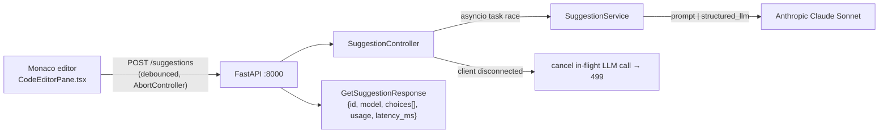

# AI Suggestion Service (`@LCArena/ai-suggestion-service`)

A small FastAPI service that provides **fill-in-the-middle (FIM) code
completion** for the Monaco editor. It receives the code before and after the
cursor plus the language, asks Anthropic Claude for the minimal insertion, and
returns ranked candidates with token usage.

- **Port:** `8000`
- **Runtime:** Python ≥ 3.12, FastAPI + Uvicorn
- **Depends on:** the Anthropic API (via `langchain-anthropic`).
- **Explicitly excluded** from every TypeScript backend command
  (`npm run build:backend`, `check-types:backend`, `test:backend` all filter it
  out with `--filter=!./apps/apis/ai-suggestion-service`), because it is Python
  and has no Node test runner.

---

## Overview

```
prefix (code before cursor) ─┐
suffix (code after cursor)  ─┼─> Claude Sonnet ─> ranked insert_text candidates
language_id, editor_info     ─┘
```

The service is a "predict only what goes at the cursor" engine. Its system
prompt forbids explanations and Markdown fences, forbids repeating code already
present in the prefix or suffix, and instructs the model to return an **empty
`choices` list** when the context is insufficient rather than guessing.

## Architecture



It is reached directly (not through the gateway): the Vite dev server proxies
`/suggestions` to `http://localhost:8000`, and in Compose the port is published
on loopback.

## Technology stack

| Concern | Choice |
| :--- | :--- |
| Framework | `fastapi` with an `APIRouter(prefix="/suggestions")` |
| Server | `uvicorn[standard]` |
| Schemas | Pydantic v2 (`BaseModel`, `Literal`, `Field(ge=…)`) |
| LLM | `langchain_anthropic.ChatAnthropic` + `langchain_core.prompts.ChatPromptTemplate` |
| Model | `claude-sonnet-4-5-20250929`, `timeout=10` |
| Structured output | `model.with_structured_output(LLMSuggestionResponse, include_raw=True)` |
| Env loading | `python-dotenv` (`load_dotenv()` in `services/suggestion_service.py`) |
| CORS | `CORSMiddleware` with `allow_origins=["*"]`, `allow_credentials=False` |

Dependencies are declared twice, deliberately: `requirements.txt` is what the
Docker image installs; `pyproject.toml` additionally declares a `dev`
dependency group (`mypy`, `ruff`).

## Directory structure

```
apps/apis/ai-suggestion-service/
├── main.py                              # FastAPI app, CORS, router, DI for the controller
├── controllers/suggestion_controller.py # request orchestration, empty-input guard, disconnect handling
├── services/suggestion_service.py       # ChatAnthropic + prompt template + chain, response mapping
├── schemas/suggestion_schema.py         # request/response Pydantic models
├── utils/logger.py                      # setup_logger(app) request-logging middleware
├── requirements.txt                     # runtime deps installed by the Dockerfile
├── pyproject.toml                       # project metadata + dev dependency group
├── package.json                         # npm shims: `npm run dev` / `npm start` (Windows venv path)
└── Dockerfile                           # python:3.12-slim, uvicorn on 0.0.0.0:8000
```

## Internal workflow

1. **Route** — `POST /suggestions` with `response_model=GetSuggestionResponse`.
   `get_suggestion_controller()` constructs a fresh `SuggestionService` **per
   request** (FastAPI `Depends`), which also rebuilds the LangChain chain.
2. **Empty-input guard** — if both `prefix` and `suffix` are empty the controller
   raises `HTTPException(400, "Cannot generate suggestion: both prefix and suffix are empty.")`.
3. **Disconnect-aware fan-out** — two asyncio tasks race:

   ```python
   llm_task        = asyncio.create_task(self.service.get_suggestion(data))
   disconnect_task = asyncio.create_task(self._watch_disconnect(request))
   done, pending   = await asyncio.wait({llm_task, disconnect_task},
                                       return_when=asyncio.FIRST_COMPLETED)
   ```

   - If the **disconnect** task finishes first, the in-flight LLM call is
     cancelled and a `499` ("client closed request") is raised. The client never
     sees it; the point is to stop paying for tokens the user no longer wants.
   - Otherwise the disconnect watcher is cancelled and the LLM result is used.
   - `_watch_disconnect` polls `request.is_disconnected()` every 0.25s.
4. **Latency** — `time.perf_counter()` around the whole operation, reported as
   `latency_ms` (rounded to 2 decimals). This overwrites the placeholder `0.0`
   that the service itself sets.
5. **Response mapping** — `id` and `model` come from
   `raw.response_metadata`, `choices` from the parsed structured output, and
   `usage` from `raw.usage_metadata` (`input_tokens` → `prompt_tokens`,
   `output_tokens` → `completion_tokens`, `total_tokens`).
6. **Errors** — any non-`HTTPException` becomes
   `500 { "detail": "Inference engine failure: <message>" }`.

### Prompt contract

The system prompt encodes 15 rules; the important ones:

- Generate **only** the code to insert at the cursor; no explanations, no
  Markdown fences.
- Do not repeat code already present in the prefix or suffix.
- Use the suffix to decide what belongs at the cursor (true FIM).
- Preserve syntax, indentation, formatting, naming and style.
- Prefer the smallest useful completion.
- Do not invent APIs, variables or types.
- **Return an empty `choices` list if there is insufficient context.**
- Only produce multiple candidates when they are genuinely different, ranked
  most-likely first.

The human turn supplies `language_id`, `editor_info`, and the prefix/suffix
delimited by `--- PREFIX ---` / `--- SUFFIX ---` markers.

## API documentation

### `POST /suggestions`

Request (`GetSuggestionRequest`):

| Field | Type | Required | Notes |
| :--- | :--- | :--- | :--- |
| `prefix` | `str` | yes | Code immediately before the cursor |
| `suffix` | `str` | yes | Code immediately after the cursor |
| `language_id` | `Literal['python','javascript','cpp','java']` | yes | Note: **not** LCArena's `py`/`js`/`cpp`/`java` enum |
| `cursor_position` | `{ row: int ≥ 0, col: int ≥ 0 }` | yes | 0-indexed |
| `editor_info` | `str` | no, default `"unknown"` | e.g. `"vscode-1.85"` |

Response (`GetSuggestionResponse`):

```jsonc
{
  "id": "<provider request id>",
  "model": "<model name from response metadata>",
  "choices": [
    {
      "index": 0,
      "insert_text": "return a + b;",
      "finish_reason": "stop",          // "stop" | "length" | "model_length" | "cancelled"
      "range": null,                    // or { start_row, start_col, end_row, end_col }
      "score": 0.9                      // 0..1
    }
  ],
  "usage": { "prompt_tokens": 0, "completion_tokens": 0, "total_tokens": 0 },
  "latency_ms": 812.34
}
```

Errors:

| Condition | Status | Body |
| :--- | :--- | :--- |
| `prefix` and `suffix` both empty | 400 | `{ "detail": "Cannot generate suggestion: both prefix and suffix are empty." }` |
| Client disconnected mid-flight | 499 | `{ "detail": "Client disconnected" }` (not observed by the client) |
| Model/transport failure | 500 | `{ "detail": "Inference engine failure: <message>" }` |
| Schema violation | 422 | FastAPI default validation error |

`GET /docs` and `GET /openapi.json` are enabled (FastAPI defaults); the Compose
healthcheck uses `/docs`.

### Frontend integration (`apps/frontend/src/components/problem/CodeEditorPane.tsx`)

Verified behaviour in the current frontend source:

- Requests are only sent when the user toggles **AI** on (`aiEnabled`); with AI
  off, `fetchSuggestions` returns immediately.
- Trigger: `editor.onDidChangeCursorPosition` **debounced by 500 ms** (the
  repository's `AGENTS.md` says 400 ms — the code says 500).
- Cancellation: the previous request's `AbortController` is aborted on each new
  trigger, and on unmount. Axios cancellations are swallowed silently.
- The request body is `{ prefix, suffix, language_id, cursor_position: { row: 1,
  col: 1 } }` where `prefix`/`suffix` are computed from the Monaco model offset.
  `language_id` uses Monaco language ids (`cpp`, `python`, `java`, `javascript`),
  which satisfy the service's `Literal`.
- Base URL: `import.meta.env.VITE_AI_URL || import.meta.env.VITE_API_URL || ""`
  — empty in dev so the Vite `/suggestions` proxy is used.
- **The response is not consumed.** The `.post(...)` result is discarded: nothing
  inserts `insert_text` into the editor, and no inline ghost text is rendered.
  The feature currently verifies transport, latency and cancellation, not
  completion UX.

## Inter-service communication

This service is a **leaf**: it calls no other LCArena service and reads no shared
state (no MongoDB, no Redis, no RabbitMQ, no object storage). Its only external
dependency is the Anthropic API over outbound HTTPS.

| Direction | Endpoint | Caller |
| :--- | :--- | :--- |
| In | `POST /suggestions` | The React SPA (`CodeEditorPane.tsx`), directly |
| In | `GET /docs`, `GET /openapi.json` | Humans; the Compose healthcheck |
| In | `GET /health` | **Not implemented** — the Compose healthcheck probes `/docs` instead |
| Out | Anthropic Messages API | This service, via LangChain |

Because requests arrive directly rather than through the gateway, this service
receives **no verified identity** and has no authentication or rate limiting of
its own. Anything that can reach port 8000 can consume the configured Anthropic
quota. See [§Known deviations](#known-deviations-and-rough-edges).

## Environment variables and configuration

| Variable | Required | Purpose |
| :--- | :--- | :--- |
| `ANTHROPIC_API_KEY` | **yes in practice** | Read implicitly by `ChatAnthropic` (via LangChain). Passed through by Compose from `.env`. |

There is a `.env` file inside this service directory; it is **not** part of the
Docker image (`Dockerfile` copies only `main.py`, `pyproject.toml` and the four
packages) and must never be committed. In Docker, supply the key through the
Compose environment instead.

Note there is no `.env.example` entry for `ANTHROPIC_API_KEY` in the root
template — it is referenced by `docker-compose.yml` as
`ANTHROPIC_API_KEY: ${ANTHROPIC_API_KEY:-}`, so an unset key produces an empty
string and the first inference call fails at runtime.

## Dependencies and prerequisites

- Python ≥ 3.12 and an Anthropic API key with access to
  `claude-sonnet-4-5-20250929`.
- Outbound HTTPS to the Anthropic API.
- For the npm shim scripts: a Windows-style virtualenv at `venv/Scripts/`. These
  scripts are Windows-specific (`venv\\Scripts\\uvicorn`), so on Linux/macOS run
  `uvicorn main:app` directly or use the Dockerfile.

## Local development and execution

```sh
# Docker (recommended; uses python:3.12-slim)
docker compose up ai-suggestion
# or locally
cd apps/apis/ai-suggestion-service
python -m venv venv && source venv/bin/activate      # venv\Scripts\activate on Windows
pip install -r requirements.txt
export ANTHROPIC_API_KEY=...
uvicorn main:app --reload --host 0.0.0.0 --port 8000
```

Interactive docs: <http://localhost:8000/docs>.

Smoke test:

```sh
curl -X POST http://localhost:8000/suggestions \
  -H "Content-Type: application/json" \
  -d '{"prefix":"def add(a, b):\n    return ","suffix":"\n","language_id":"python","cursor_position":{"row":1,"col":11}}'
```

## Testing

**There are no automated tests for this service.** No `test/` directory, no
pytest configuration, and it is excluded from every root test command. The
`pyproject.toml` `dev` group only provides linters/type-checkers:

```sh
cd apps/apis/ai-suggestion-service
ruff check .        # if the dev group is installed
mypy .              # if the dev group is installed
```

Verification is manual via `/docs` or the curl above. Adding pytest coverage for
the controller's empty-input guard, the 499 disconnect path and the response
mapping would be the highest-value next step.

## Error handling and troubleshooting

| Symptom | Cause / handling |
| :--- | :--- |
| `400 Cannot generate suggestion` | Both `prefix` and `suffix` were empty — expected for an empty file |
| `500 Inference engine failure` | Missing/invalid `ANTHROPIC_API_KEY`, rate limit, or network failure to Anthropic |
| `422` | Body failed Pydantic validation — most commonly `language_id` outside the four allowed values |
| Requests take ~10s then fail | `ChatAnthropic(timeout=10)` elapsed |
| No suggestion appears in the editor | Expected: the frontend discards the response body (see above) |
| No request is sent from the UI | The AI toggle is off; suggestions require `aiEnabled` |
| Repeated duplicate reasoning in suggestions | Prompt rules 3–5 exist for this; if it persists, inspect `prefix`/`suffix` construction in `CodeEditorPane` |
| Debug output on stdout | `services/suggestion_service.py` calls `print(result)` on every request — this is a leftover debug statement that should be removed |

### Known deviations and rough edges

Documented here rather than fixed, because this task is documentation-only:

1. `utils/logger.py` defines `setup_logger(app)` with an `X-Request-ID`
   middleware, but **`main.py` never calls it** — so the request-logging
   middleware, request ids and the custom log format are dead code. Only
   uvicorn's default access log runs.
2. `CORS_ORIGIN`: `allow_origins=["*"]` with `allow_credentials=False`. Any
   origin can call this service; since it is unauthenticated, that also means
   **anyone who can reach port 8000 can spend the Anthropic budget**. Keep it on
   loopback (as Compose does) or put it behind the gateway and add auth.
3. `SuggestionService` sets `latency_ms=0.0` and the controller overwrites it —
   harmless, but it means the service-level value is never meaningful.
4. `score` and `finish_reason` on `SuggestionChoices` are required fields the
   model must supply; an empty `choices` list is the documented "no idea" answer
   and must be handled by consumers.

## Related services

- [Frontend](../../frontend/README.md) — `CodeEditorPane.tsx` is the only client.
- [Gateway](../gateway/README.md) — **does not** proxy `/suggestions`; the SPA
  reaches this service directly.
- [Problem service](../problem/README.md) — supplies the problems being authored in the editor.
