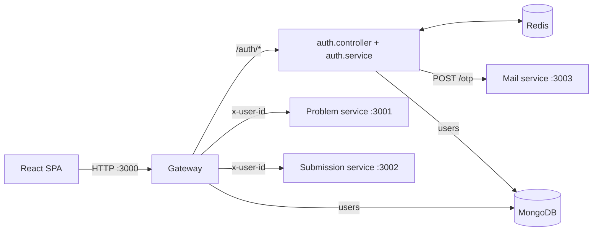

# API Gateway (`@LCArena/gateway`)

The only public HTTP entry point of LCArena. It owns authentication, sessions,
RBAC, and the reverse proxy that fronts the internal Problem and Submission
services. Downstream services never see a client-supplied identity header that
the gateway has not minted itself.

- **Port:** `3000` (`PORT`, required)
- **Runtime:** Node.js ≥ 24, Express 5, commonjs
- **Depends on:** MongoDB (users), Redis (sessions, JTI blacklist, OTPs), the
  Problem and Submission services (proxying), and optionally the Mail service.

---

## Overview

Responsibilities, in the order a request hits them:

1. **CORS + cookies.** `cors({ origin: ALLOWED_ORIGINS, credentials: true })` and
   `cookie-parser`, so the `httpOnly` refresh cookie both round-trips and is
   readable by the handlers.
2. **Route dispatch.** Only explicitly registered routes exist. `notFoundHandler`
   runs after them and turns anything else into a 404 — unknown paths and
   unregistered HTTP methods are never forwarded upstream (fail closed).
3. **Authentication** (`authenticate`) on every protected route: verify the
   bearer access token, check the Redis JTI blacklist, then **re-read the user
   from MongoDB** so a deleted account or a role change takes effect immediately
   instead of at token expiry.
4. **Authorization**: `roleValidation(...)` for Admin-only mutations, and
   `requireSubmissionOwner` for submission reads/updates.
5. **Reverse proxying** for `/api/problems` and `/api/submissions`, stripping
   spoofable headers and injecting the verified `x-user-id`.
6. **Centralized errors** through `appErrorHandler` from `@LCArena/middlewares`.

Notably, `express.json()` is mounted **only** on the `/auth` router. Proxied
request bodies are therefore streamed straight through unchanged: `fixRequestBody`
is invoked on every proxied request but only rewrites the body when a body parser
has actually consumed the stream (which, on these routes, it has not).

## Architecture



The gateway is the trust boundary: it is the only component that reads the JWT,
and the only one allowed to write `x-user-id` onto an upstream request.

## Technology stack

| Concern | Choice |
| :--- | :--- |
| HTTP framework | `express` ^5.2.1 |
| Proxying | `http-proxy-middleware` ^4 (`proxy.factory.ts`) |
| Validation | `zod` ^4 (`src/validation/auth.validation.ts`) |
| Tokens | `jsonwebtoken` ^9 — separate keys for access and refresh |
| Sessions | `redis` via `@LCArena/config` `redisConnect()` / `getRedisClient()` |
| Persistence | `mongoose` via `@LCArena/models` `User` |
| Errors/HTTP shape | `@LCArena/utils` (`AppError` family, `sendSuccess`), `@LCArena/middlewares` (`appErrorHandler`) |
| CORS / cookies | `cors`, `cookie-parser` |

## Directory structure

```
apps/apis/gateway/
├── src/
│   ├── app.ts                       # createApp(): CORS, cookies, routes, 404, error handler
│   ├── index.ts                     # dbConnect + redisConnect + listen
│   ├── config/
│   │   ├── env.config.ts            # required/optional env vars, PORT validation, CORS parsing
│   │   └── services.config.ts       # declarative downstream service registry
│   ├── controllers/
│   │   ├── auth.controller.ts       # 10 auth handlers + refresh-cookie handling
│   │   └── health.controller.ts     # GET /health
│   ├── middlewares/
│   │   ├── authenticate.middleware.ts    # bearer token -> req.user (also exports bearerToken)
│   │   ├── notFound.middleware.ts        # fail-closed 404
│   │   └── submissionOwner.middleware.ts # owner-or-Admin guard
│   ├── proxy/
│   │   ├── proxy.factory.ts         # createServiceProxy(): header sanitization + timeouts
│   │   └── index.ts
│   ├── routes/
│   │   ├── index.ts                 # mounts /, /auth, /api/problems, /api/submissions
│   │   ├── auth.routes.ts           # mounts express.json() for this router only
│   │   ├── problem.routes.ts        # public reads, Admin-only writes
│   │   ├── submission.routes.ts     # authenticated submit + owner-scoped reads
│   │   └── health.routes.ts
│   ├── services/
│   │   ├── auth.service.ts          # toPublicUser, issueTokens, OTP register/login, refresh, logout
│   │   ├── token.service.ts         # sign/verify access+refresh, session + JTI revocation
│   │   ├── otp.service.ts           # crypto OTPs in Redis (5 min, single-use)
│   │   ├── mail.client.ts           # injectable mail client (sendOtpEmail / notifyOtp)
│   │   └── mail.service.ts          # wires createMailClient to axios + env
│   └── validation/auth.validation.ts
└── test/
    ├── unit/mail.client.test.ts
    └── integration/gateway.api.test.js
```

## Internal workflow

### Registration / passwordless login

1. `POST /auth/send-otp` → `generateAndSaveOtp(email)` stores a
   `crypto.randomInt(100000, 1000000)` 6-digit code in Redis at
   `otp:<normalized_email>` with `EX 300`.
2. The OTP is **never logged**, and delivery is **best-effort and
   off the request path**: `sendOtp` calls `dispatchOtp`, which fires `notifyOtp`
   without awaiting it. Failures are logged (never thrown), so `/auth/send-otp`
   cannot be used as an oracle for provider health or account existence, and the
   response is not stretched by the mail service or its SMTP relay. The trade-off
   is that a delivery failure is invisible to the caller — only the logs show it.
3. `POST /auth/register` verifies + deletes the OTP (single-use), rejects an
   existing email, creates the user, then issues tokens.
4. `POST /auth/login-otp` verifies the OTP and issues tokens for an existing user.

### Session lifecycle

- `issueTokens()` signs an access token (`{userId, email, name, userRole, jti}`,
  `ACCESS_TOKEN_TTL_SECONDS`, default 900s) and a refresh token
  (`{userId, jti}`, `REFRESH_TOKEN_TTL_SECONDS`, default 604800s), then
  overwrites `session:<userId>` in Redis with the refresh token.
- The refresh token is returned as an `httpOnly`, `sameSite: lax`,
  `path: /auth` cookie (`secure` when `NODE_ENV=production`) and is the value
  `set` in Redis — so rotation is implicit: issuing a new pair invalidates the
  previous refresh token.
- `POST /auth/refresh` accepts the token from the body or the cookie, verifies
  the signature, requires `isSessionActive(userId, token)`, and rotates. A stale
  or replayed token fails with `401 Session is no longer active`.
- `POST /auth/logout` revokes the session only when the presented refresh token
  **is** the currently stored one (a stale token cannot sign the real user out),
  blacklists the presented access token's JTI, and clears the cookie.
- `DELETE /auth/account` validates the optional password, deletes the user, then
  revokes the session and clears the cookie.

### Redis key topology

| Key | Value | TTL | Purpose |
| :--- | :--- | :--- | :--- |
| `session:<userId>` | active refresh token | refresh TTL | Rotation + revocation |
| `revoked_access:<jti>` | `"1"` | remaining access-token life | Instant logout/blacklist |
| `otp:<email>` | 6-digit code | 300s | Single-use verification code |

## API documentation

All responses use the shared envelope from `@LCArena/utils`:
`{ status, message, success, data, error }` for success, and
`{ success: false, message, errors? }` for errors.

### Health

| Method | Path | Auth | Notes |
| :--- | :--- | :--- | :--- |
| `GET` | `/health` | none | `{ message: "Gateway Healthy" }` |

### Auth (`/auth`)

| Method | Path | Auth | Body | Success |
| :--- | :--- | :--- | :--- | :--- |
| `POST` | `/auth/send-otp` | none | `{ email }` | 200, `data: null` (mail delivery is queued in the background) |
| `POST` | `/auth/register` | none | `{ email, password(≥6), name, otp(6 digits) }` | 201, `data: { user, accessToken }` + refresh cookie |
| `POST` | `/auth/login-otp` | none | `{ email, otp(6 digits) }` | 200, `data: { user, accessToken }` + refresh cookie |
| `POST` | `/auth/login` | none | `{ email, password }` | 200, `data: { user, accessToken }` + refresh cookie |
| `POST` | `/auth/refresh` | refresh token | `{ refreshToken? }` (cookie fallback) | 200, `data: { user, accessToken }` + rotated cookie |
| `POST` | `/auth/logout` | optional | `{ refreshToken? }` | 200, cookie cleared |
| `GET` | `/auth/me` | access token | — | 200, `data: PublicUser` |
| `POST` | `/auth/change-password` | access token | `{ currentPassword, newPassword(≥6) }` | 200 |
| `DELETE` | `/auth/account` | access token | `{ password? }` | 200, cookie cleared |
| `PATCH` | `/auth/users/:userId/role` | access token + **Admin** | `{ role: "Regular"\|"Admin"\|"Premium" }` | 200, `data: PublicUser` |

`PublicUser` is `{ id, userId, name, email, profilePicUrl, userType, userRole, roleExpiry }`.
`toPublicUser()` builds this object field by field — the bcrypt `password` hash
can never leak, even if the schema gains new sensitive fields.

### Proxied (`/api/problems`, `/api/submissions`)

| Method | Path | Auth | Upstream |
| :--- | :--- | :--- | :--- |
| `GET` | `/api/problems`, `/api/problems/:id` | none | Problem service |
| `POST` `PUT` `DELETE` | `/api/problems`, `/api/problems/:id` | access token + **Admin** | Problem service |
| `POST` | `/api/submissions` | access token | Submission service |
| `GET` `PUT` | `/api/submissions/:id` | access token + owner/Admin | Submission service |

`requireSubmissionOwner` loads the submission's `userId`, answers `400` for a
non-ObjectId, `404` when missing, and `403` unless the caller is the owner or an
Admin.

## Inter-service communication

- **HTTP out:** `POST {MAIL_SERVICE_URL}/otp` with `{ email, otp }` and, when
  configured, the `x-mail-service-token` header. The mail service answers `202`
  and delivers in the background; the gateway does not await the call
  (`dispatchOtp`), so `/auth/send-otp` only waits for the Redis write. Timeout
  10s; failures are logged and swallowed.
- **HTTP in (proxied):** `PROBLEM_SERVICE_URL`, `SUBMISSION_SERVICE_URL`. On each
  proxied request the factory:
  - removes client-supplied `x-user-id` and `authorization`
    (spoofing defence),
  - sets `x-user-id` to `req.user.userId` when authenticated,
  - sets `x-forwarded-for` (from `req.ip`), `x-forwarded-proto`, `x-forwarded-host`,
  - calls `fixRequestBody(proxyReq, req)` so a parsed JSON body is re-streamed.
- **Error translation:** `ECONNRESET`/`ETIMEDOUT`/timeout messages become
  `504 <service> service did not respond in time`; anything else becomes
  `502 <service> service is unreachable` (both `{ success: false, message }`).
- **Redis:** session, JTI blacklist, OTP (see the table above).
- **No queues.** The gateway never touches RabbitMQ. Notably, the gateway does
  **not** expose a `/api/submissions/:id/status` long-poll or any WebSocket
  endpoint; clients poll `GET /api/submissions/:id`.

## Environment variables and configuration

Required (`getEnvVariable(name)` throws at boot when unset or blank):

| Variable | Purpose |
| :--- | :--- |
| `PORT` | Listen port; must parse to an integer in 1–65535 or the process throws |
| `MONGODB_URL` | Mongo connection string |
| `ACCESS_TOKEN_JWT_KEY` | Signing key for access tokens |
| `REFRESH_TOKEN_JWT_KEY` | Signing key for refresh tokens (**must differ** from the access key) |
| `PROBLEM_SERVICE_URL` | e.g. `http://problem:3001` |
| `SUBMISSION_SERVICE_URL` | e.g. `http://submission:3002` |

Optional, with defaults:

| Variable | Default | Purpose |
| :--- | :--- | :--- |
| `REDIS_HOST` / `REDIS_PORT` | `localhost` / `6379` | Read by `@LCArena/config` `redisConnect` |
| `MAIL_SERVICE_URL` | `http://localhost:3003` | Mail service base URL |
| `MAIL_SERVICE_TOKEN` | *(unset)* | Shared secret sent as `x-mail-service-token` |
| `ACCESS_TOKEN_TTL_SECONDS` | `900` | Access-token lifetime |
| `REFRESH_TOKEN_TTL_SECONDS` | `604800` | Refresh-token lifetime **and** cookie `maxAge` |
| `PROXY_TIMEOUT_MS` | `15000` | Per-service proxy timeout |
| `CORS_ORIGIN` | `*` | `*` reflects any origin (required for cookie credentials); otherwise a comma-separated allowlist |
| `NODE_ENV` | *(unset)* | When `production`, the refresh cookie is `secure` |
| `LOG_LEVEL` | `info` | Winston level |

Never commit real JWT keys or SMTP credentials. Generate strong keys and set
them through the deployment's secret store; `.env.example` documents the names.

## Dependencies and prerequisites

- MongoDB (users), Redis (sessions/OTP/JTI), and both downstream services must be
  reachable for the gateway to be useful. `dbConnect` exits the process on
  failure; `redisConnect` must succeed before auth works.
- The Mail service is required in practice: `/auth/send-otp` returns 200 even if
  mail delivery fails, but no code reaches the user. Because delivery is
  asynchronous, the response time no longer reflects relay health at all.
- `@LCArena/*` workspace packages must be built (`npm run build:backend`) before
  running the gateway outside Turborepo.

## Local development and execution

```sh
# from the repository root
npm run docker:up            # everything, including infra
# or, iterating on the gateway alone:
npx turbo run dev --filter=@LCArena/gateway
```

Running on the host requires `MONGODB_URL`, `REDIS_HOST`, `REDIS_PORT` and the
service URLs to point at `localhost` with published ports.

The SPA talks to the gateway through the Vite dev proxy (`/auth`, `/api`,
`/health` → `http://localhost:3000`), so no CORS configuration is needed in
development.

Debugging tips: `docker compose logs -f gateway`; a `504`/`502` on `/api/*` means
the target service is unhealthy or unreachable; a `401 Missing bearer token`
means the `Authorization: Bearer <token>` header never reached the gateway.

## Testing

```sh
cd apps/apis/gateway
npm test                        # unit suite (node:test + tsx) — no infra needed
npm run test:integration        # gateway.api.test.js against a live stack
```

The unit suite only covers `mail.client.ts` (injected `MailRequest`, so no live
network). The integration suite exercises the full auth, RBAC and proxying
contract and needs MongoDB, Redis and the services running.

## Error handling and troubleshooting

`appErrorHandler` maps errors as follows:

| Input | Status | Body |
| :--- | :--- | :--- |
| `ZodError` | 400 | `{ success, message: "Validation Error", errors: [{ path, message }] }` |
| `AppError` subclass | its `statusCode` | `{ success: false, message }` |
| Error with a 4xx `statusCode`/`status` | that status | `{ success: false, message }` |
| Mongoose `CastError` | 400 | `{ success: false, message: "Invalid value for <path>" }` |
| anything else | 500 | `{ success: false, message }` |

| Symptom | Likely cause |
| :--- | :--- |
| Boot fails immediately | A required env var is missing; `getEnvVariable` names it |
| `Invalid PORT "..."` | `PORT` is not an integer in 1–65535 |
| Every auth call 401 | Redis down or `redisConnect` never ran |
| 401 after a successful login | Access token expired → refresh; or `jti` blacklisted by a logout |
| 401 on every request after a role change | Unexpected: `authenticate` re-reads the user, so verify MongoDB connectivity |
| 502/504 on `/api/problems` | Problem service unhealthy / slow (check `PROXY_TIMEOUT_MS`) |
| OTP never arrives | Mail service unreachable or SMTP misconfigured; the gateway intentionally logs and swallows this (`Failed to deliver OTP email`) |
| `/auth/send-otp` is slow | Should be ~ms: it only writes Redis. A slow response means Redis, not mail — delivery was decoupled from the request |
| Refresh cookie "disappears" | Cookie is scoped to `path=/auth`; it is not sent with `/api/*` calls by design |

## Related services

- [Problem service](../problem/README.md) — proxied at `/api/problems`.
- [Submission service](../submission/README.md) — proxied at `/api/submissions`.
- [Mail service](../mail/README.md) — OTP delivery.
- [Execution worker](../execution/README.md) — where submissions go after intake.
- [Submission evaluation flow](../../../docs/SUBMISSION_EVALUATION_FLOW.md) — end-to-end lifecycle.
- [`@LCArena/middlewares`](../../../packages/backend/middlewares/README.md), [`@LCArena/models`](../../../packages/backend/models/README.md), [`@LCArena/utils`](../../../packages/backend/utils/README.md), [`@LCArena/config`](../../../packages/backend/config/README.md).
