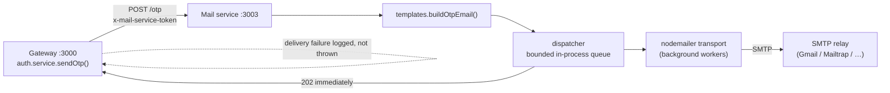
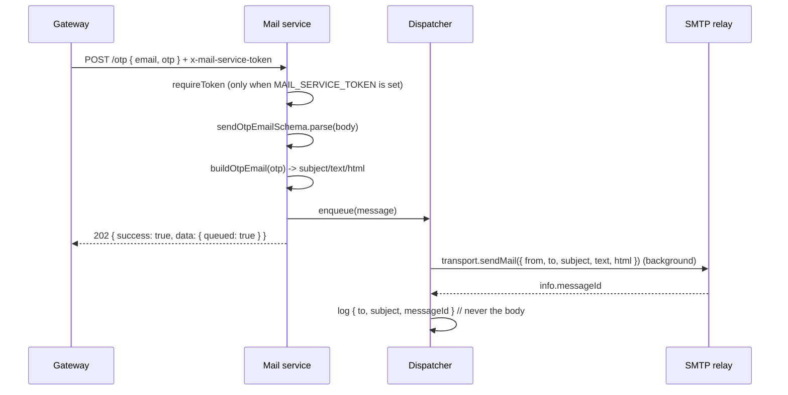

# Mail Service (`@LCArena/mail`)

Internal SMTP relay microservice. It renders transactional emails and dispatches
them through any SMTP provider via [nodemailer](https://nodemailer.com/). The
gateway calls it to deliver login/registration OTPs.

- **Port:** `3003` (`PORT`, optional, default `3003`)
- **Runtime:** Node.js ≥ 24, Express 5, commonjs
- **Depends on:** an SMTP relay. No database, no Redis, no external broker —
  delivery is queued in-process.

---

## Overview

The service is intentionally tiny and has exactly two routes. Its job is to keep
SMTP credentials (and the OTP value) inside one process that nothing else can
reach except the gateway.

- **`GET /health`** — always open, so orchestrators can probe the pod.
- **`POST /otp`** — body `{ email, otp }`; renders the verification email,
  **queues it for background delivery** and immediately answers `202 Accepted`.
  Protected by the optional `x-mail-service-token` shared secret.

Three deliberate safety properties:

1. **The OTP is never logged.** `createMailer` logs only `to`, `subject` and
   `messageId`; the message body is excluded. The OTP is also never logged on the
   gateway side (`otp.service.ts` states this explicitly).
2. **A missing relay does not crash the service.** The nodemailer transport is
   lazy — nothing connects until the first `send()` — so the service boots and
   reports healthy even before SMTP is configured. Connection failures surface
   per-send as errors instead.
3. **Sending never blocks a request.** `POST /otp` only renders the message and
   appends it to a bounded in-memory queue (`dispatcher.ts`); nodemailer runs on
   its own clock. A relay that takes seconds — or is unreachable and only
   answers after a timeout — can no longer stretch the caller's auth request.

## Architecture



Both hops are asynchronous, so OTP latency is bounded by a Redis write plus two
in-memory hand-offs:

- **Gateway:** `dispatchOtp` fires `notifyOtp` without awaiting it and returns as
  soon as the code is stored in Redis.
- **Mail service:** the controller enqueues and answers `202`; the dispatcher
  delivers with its own concurrency limit.

The gateway still treats delivery as **best-effort**: a failure is logged and the
request has already returned. That is a deliberate anti-enumeration choice —
`/auth/send-otp` must not become an oracle for which accounts exist or for
provider health. The trade-off is that a broken relay is invisible to the user,
who simply never receives a code; the mail service logs it and exposes queue
depth on `/health`.

## Technology stack

| Concern | Choice |
| :--- | :--- |
| HTTP | `express` ^5 |
| Validation | `zod` ^4 (`sendOtpEmailSchema`) |
| Mail | `nodemailer` ^10 (`createTransport`, `sendMail`) |
| Async delivery | `dispatcher.ts` — bounded in-memory queue, configurable concurrency, bounded retries with linear backoff |
| DI for tests | `createApp(mailer, { token, dispatcher })` and `createMailer(transport, from)` accept injected collaborators |
| Dev SMTP sink | `smtp-server` (not used by Docker) |

## Directory structure

```
apps/apis/mail/
├── src/
│   ├── index.ts      # wires transport + mailer + dispatcher + createApp(), drains on SIGTERM
│   ├── app.ts        # createApp(mailer, { token, dispatcher }): /health, /otp, requireToken, error handler
│   ├── dispatcher.ts # createDispatcher(mailer, options): queue, workers, retries, idle()/drain()
│   ├── controller.ts # createOtpController(dispatcher): validate -> render -> enqueue -> 202
│   ├── mailer.ts     # createSmtpTransport / createMailer (lazy connection, no body logging)
│   ├── templates.ts  # buildOtpEmail(otp, ttlMinutes = 5) -> { subject, text, html }
│   ├── validation.ts # sendOtpEmailSchema
│   └── constants.ts  # PORT and every SMTP/secret env var, all optional
└── test/unit/{app,dispatcher,mailer,templates,validation}.test.ts
```

## Internal workflow



A failed send is retried (`MAIL_MAX_ATTEMPTS`, default 3) with linear backoff
(`MAIL_RETRY_DELAY_MS`). After the last attempt the message is dropped and the
failure logged — an OTP has a 5-minute life, so retrying forever buys nothing.
`SIGTERM`/`SIGINT` stop new work, wait for in-flight requests, then drain the
queue for up to `MAIL_DRAIN_TIMEOUT_MS` so already-acknowledged codes still go
out during a redeploy.

The rendered email (`templates.ts`):

- **Subject:** `Your LCArena verification code`
- **Text:** `Your LCArena verification code is <otp>.` / `It expires in 5 minutes.` / `If you did not request this code, you can safely ignore this email.`
- **HTML:** the same content with the code at `font-size:24px; letter-spacing:4px`.
- `OTP_TTL_MINUTES = 5`, matching the gateway's `EX 300` Redis TTL. If one side
  changes, the other must change too.

## API documentation

Success envelope: `{ status, message, success, data, error: null }`.
Errors: `{ success: false, message }` (plus `errors[]` for Zod failures).

| Method | Path | Auth | Body | Success |
| :--- | :--- | :--- | :--- | :--- |
| `GET` | `/health` | none | — | 200 `{ message: "Mail Service Healthy" }` |
| `POST` | `/otp` | `x-mail-service-token` **when `MAIL_SERVICE_TOKEN` is set** | `{ email, otp }` | 202 `"OTP email queued for delivery"`, `data: { queued: true }` |

Validation (`sendOtpEmailSchema`): `email` is trimmed, lowercased and must be a
valid address; `otp` is trimmed and must match `/^\d{6}$/`.

Errors:

| Condition | Status | Body |
| :--- | :--- | :--- |
| Token configured and header missing/wrong | 401 | `{ success: false, message: "Invalid or missing mail service token" }` |
| Invalid body | 400 | `{ success: false, message: "Validation Error", errors: [...] }` |
| Queue full (`MAIL_QUEUE_MAX_SIZE`) or service shutting down | 503 | `{ success: false, message: "Mail delivery queue is saturated, retry shortly" }` |

SMTP failures no longer surface as HTTP errors: the message was already
acknowledged with `202`. They appear in the logs (`Email delivery failed;
retrying` / `… giving up`) and in queue depth on `/health`.

## Inter-service communication

| Direction | Mechanism | Details |
| :--- | :--- | :--- |
| In | HTTP `POST /otp` | From the gateway's `mailClient.dispatchOtp` (`axios.post`, 10s timeout, un-awaited) → `202` |
| In | HTTP `GET /health` | Compose healthcheck / `scripts/docker/health.mjs`; also reports `{ queued, inFlight }` |
| Out | SMTP | nodemailer, lazy connection, `connectionTimeout`/`greetingTimeout` 10s, `socketTimeout` 20s, off the request path |

No database, no Redis, no RabbitMQ, no outbound HTTP.

## Environment variables and configuration

Every variable is optional so the service can boot and report healthy before
credentials are supplied. All are read through `getEnvVariable(name, false)`.

| Variable | Default | Purpose |
| :--- | :--- | :--- |
| `PORT` | `3003` | HTTP port |
| `MAIL_HOST` | `localhost` | SMTP relay host |
| `MAIL_PORT` | `587` | SMTP port (`465` with secure, `25`/`1025` plain) |
| `MAIL_SECURE` | `false` | `"true"` → implicit TLS; anything else → STARTTLS/plain |
| `MAIL_USER` | *(undefined)* | SMTP username. **When unset, no `auth` block is sent at all** (local relays and tests accept anonymous mail) |
| `MAIL_PASSWORD` | *(undefined)* | SMTP password / provider API key |
| `MAIL_FROM` | `LCArena <no-reply@lcarena.local>` | `From` header |
| `MAIL_CONNECTION_TIMEOUT_MS` | `10000` | Connect **and** greeting timeout (one delivery attempt, not an HTTP budget) |
| `MAIL_QUEUE_CONCURRENCY` | `2` | Deliveries attempted in parallel |
| `MAIL_QUEUE_MAX_SIZE` | `500` | Messages allowed to wait; beyond this `/otp` answers `503` |
| `MAIL_MAX_ATTEMPTS` | `3` | Attempts per message before it is dropped with an error log |
| `MAIL_RETRY_DELAY_MS` | `500` | Base delay; attempt *n* waits *n* × this value |
| `MAIL_DRAIN_TIMEOUT_MS` | `10000` | How long `SIGTERM` waits for the queue to empty |
| `MAIL_SERVICE_TOKEN` | *(undefined)* | Shared secret required in `x-mail-service-token` |
| `LOG_LEVEL` | `info` | Winston level |

> ⚠️ **Set `MAIL_SERVICE_TOKEN`** in any environment where the service is
> reachable beyond the gateway. Without it `/otp` is an **open email sender**:
> anything that can reach port 3003 can send arbitrary OTP-shaped mail through
> your relay. At boot the service logs an explicit warning when the token is
> unset. Set the identical value on the gateway (`MAIL_SERVICE_TOKEN`), which
> sends it automatically.

Typical relay configuration:

```sh
# Gmail (use an app password, not the account password)
MAIL_HOST=smtp.gmail.com  MAIL_PORT=587  MAIL_SECURE=false
# Mailtrap sandbox
MAIL_HOST=sandbox.smtp.mailtrap.io  MAIL_PORT=2525  MAIL_SECURE=false
# Implicit TLS
MAIL_SECURE=true  MAIL_PORT=465
```

## Dependencies and prerequisites

- An SMTP relay (real provider, or any local catcher). No other infrastructure.
- The gateway must be able to reach `MAIL_SERVICE_URL` (default
  `http://localhost:3003`, `http://mail:3003` in Compose).

## Local development and execution

```sh
npm run docker:up                                       # full stack
npx turbo run dev --filter=@LCArena/mail                # service alone
curl http://localhost:3003/health
```

To exercise it end to end without a real provider, run any SMTP catcher (for
example MailHog/Mailpit on `127.0.0.1:1025`) and set `MAIL_HOST=127.0.0.1`,
`MAIL_PORT=1025`, `MAIL_SECURE=false`. Its UI shows the delivered OTP.

## Testing

```sh
cd apps/apis/mail
npm test        # unit suite (node:test + tsx), no external services
```

The suite spins up an **in-process SMTP server** with `smtp-server` and sends a
real message through it, so the full nodemailer path is exercised without an
external dependency. Suites: `templates.test.ts` (subject/body/TTL),
`validation.test.ts` (email + 6-digit regex), `mailer.test.ts` (transport config,
including the "no auth when no user" branch, and the no-body-logging guarantee),
`dispatcher.test.ts` (concurrency, retries, give-up, backpressure, drain) and
`app.test.ts` (token enforcement, validation errors, `202` before a slow send
completes, `503` when saturated).

## Error handling and troubleshooting

| Symptom | Cause / handling |
| :--- | :--- |
| `401 "Invalid or missing mail service token"` | `MAIL_SERVICE_TOKEN` is set on this service but the caller did not send a matching header — check that the gateway has the same value |
| `400 Validation Error` | `email` malformed or `otp` is not exactly 6 digits |
| `202` but no mail arrives | The relay rejected/failed the message; look for `Email delivery failed; giving up` in the logs. `MAIL_SECURE` mismatched for the port (classic: 465 with `secure=false`) is a common cause |
| `503 "Mail delivery queue is saturated"` | The relay is slower than the incoming OTP rate. Raise `MAIL_QUEUE_MAX_SIZE`/`MAIL_QUEUE_CONCURRENCY` or fix the relay; a drain in progress also answers 503 |
| Service is healthy but no mail arrives | Expected if the relay is unconfigured; the gateway swallows delivery failures by design. Check `docker compose logs gateway` for `Failed to deliver OTP email` |
| Boot log warns "the /otp endpoint is unauthenticated" | `MAIL_SERVICE_TOKEN` is unset. Fine for local-only, unacceptable anywhere reachable |
| Unauthenticated relay rejected | Set `MAIL_USER`/`MAIL_PASSWORD`; when `MAIL_USER` is empty no `auth` is sent at all |

## Related services

- [Gateway](../gateway/README.md) — the only caller (`mail.client.ts` → `axios.post`) and the owner of the matching shared secret.
- [Submission evaluation flow](../../../docs/SUBMISSION_EVALUATION_FLOW.md) — where OTP delivery sits in the wider system.
