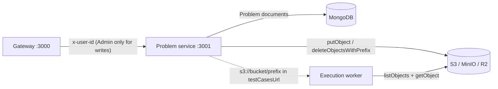

# Problem Service (`@LCArena/problem`)

Owns the coding-challenge catalogue: problem metadata plus the **test-case
objects** that the evaluation worker later downloads to judge submissions.

- **Port:** `3001` (`PORT`, required)
- **Runtime:** Node.js ≥ 24, Express 5, commonjs
- **Depends on:** MongoDB (`problems` collection), S3-compatible object storage.
- **Internal only.** It exposes no authentication of its own; the gateway is
  responsible for RBAC, and it injects `x-user-id` for downstream visibility.

---

## Overview

1. **CRUD for problems.** Create, list, read, update, delete.
2. **Test-case storage.** When a create/update payload carries a `testCases`
   array, the service uploads each pair to object storage under a deterministic
   key prefix before (or alongside) persisting the document.
3. **Compensating cleanup.** Partial uploads are rolled back, updates delete the
   stale prefix before re-uploading, and deletes best-effort remove the prefix.
4. **Deterministic key layout.** `Evaluation_Test_Cases/Test_Cases_<PROBLEM_ID>/test_case_NNN/input.in`
   and `.../output.ans`, with 3-digit zero padding, so the worker can locate
   every case without a manifest.

## Architecture



This service is the **producer** of test cases; the execution worker is the only
consumer. They share the key contract implemented in
`@LCArena/config` (`getProblemTestCasePrefix`, `getTestCaseInputKey`,
`getTestCaseOutputKey`, `formatTestCaseFolderName`) — see
[`packages/backend/config`](../../../packages/backend/config/README.md).

## Technology stack

| Concern | Choice |
| :--- | :--- |
| HTTP | `express` ^5 |
| Validation | `zod` ^4 |
| Persistence | Mongoose `Problem` model from `@LCArena/models` |
| Object storage | `@aws-sdk/client-s3` through `@LCArena/config` (`ensureBucketExists`, `putObject`, `deleteObjectsWithPrefix`, `getProblemTestCasePrefix`, `getTestCaseInputKey`, `getTestCaseOutputKey`, `getBucketName`) |
| Errors/HTTP shape | `@LCArena/utils`, `@LCArena/middlewares` `appErrorHandler` |

## Directory structure

```
apps/apis/problem/
├── src/
│   ├── index.ts        # express app: /health + CRUD routes, appErrorHandler
│   ├── controller.ts   # zod parsing + delegation to the service
│   ├── service.ts      # S3 upload/cleanup + Mongo persistence (the real logic)
│   ├── validation.ts   # create/update schemas + size and count limits
│   └── constants.ts    # PORT, MONGODB_URL
└── test/
    ├── unit/service.test.ts, unit/validation.test.ts
    ├── integration/problem.api.test.js
    ├── load_test/problem.load.test.js
    └── README.md
```

## Internal workflow

### Create with inline test cases

1. `createProblemSchema` parses the body. A `preprocess` step injects
   `testCasesUrl: "storage://auto"` when `testCases` is present but no URL was
   supplied, so the schema's "URL or cases" rule is satisfied.
2. `createProblemService` mints the `_id` **first** (so storage keys are known
   before the document exists) and calls `uploadProblemTestCases`:
   - `ensureBucketExists()` (idempotent; tolerates a concurrent creator),
   - `putObject(<prefix>test_case_NNN/input.in, input)`,
   - `putObject(<prefix>test_case_NNN/output.ans, output)`,
   - on any failure: `deleteObjectsWithPrefix(prefix)` then a
     `500 InternalServerError`.
3. `Problem.create({ _id, ..., testCaseStoragePrefix, testCasesCount })`.
   If this throws, the uploaded objects are deleted again before the DB error is
   re-thrown.
4. `sampleTestCaseUrl` defaults to `<storageRef>test_case_001/input.in` and
   `testCasesUrl` to the `s3://<bucket>/<prefix>` storage reference.

### Create with a URL only

If no inline `testCases` are supplied, `testCasesUrl` must be provided and the
document is created directly with `testCasesCount: 0`. Nothing is uploaded — the
URL is resolved later, at evaluation time, by the worker.

### Update

`updateProblemService`:

1. Validates the id and requires the problem to exist.
2. If `testCases` were supplied: deletes **all** existing objects under the
   stored prefix (a warning, not a failure, if that cleanup fails), re-uploads
   the new cases, and adds `testCaseStoragePrefix`, `testCasesCount` and
   `testCasesUrl` to the update payload.
3. Removes `testCases` from the payload so the raw array is never stored in
   MongoDB, then `findByIdAndUpdate(..., { returnDocument: "after", runValidators: true })`.

### Delete

`findByIdAndDelete`, then best-effort `deleteObjectsWithPrefix`. A storage
failure is logged and does not fail the request — the document is already gone.

## API documentation

Responses use the shared envelope: `{ status, message, success, data, error }`
on success; `{ success: false, message }` (plus `errors[]` for validation) on
failure.

| Method | Path | Caller | Body / params | Success |
| :--- | :--- | :--- | :--- | :--- |
| `GET` | `/health` | any | — | `{ message: "Problem Service Healthy" }` |
| `GET` | `/` | public (via gateway) | — | 200, `data: Problem[]` |
| `GET` | `/:id` | public (via gateway) | ObjectId | 200, `data: Problem` |
| `POST` | `/` | Admin (gateway) | see below | 201 `"Problem Created Successfully"` |
| `PUT` | `/:id` | Admin (gateway) | partial body | 200 `"Problem updated successfully"` |
| `DELETE` | `/:id` | Admin (gateway) | ObjectId | 200 `"Problem deleted successfully"` |

**Create body**

```jsonc
{
  "description": "…at least 10 characters…",   // required, min 10
  "difficulty": "Easy" | "Medium" | "Hard",     // required
  "sampleTestCaseUrl": "…",                     // required, min 1
  "testCasesUrl": "…",                          // required unless testCases[] is given
  "time_limit": 5000,                           // required, must be > 0 (ms)
  "testCases": [                                // optional, 1..100 entries
    { "input": "2\n0 0 1 1\n", "output": "2\n" }
  ]
}
```

Validation limits (`src/validation.ts`):

- `MAX_TEST_CASES_PER_PROBLEM = 100`.
- `MAX_TEST_CASE_SIZE_BYTES = 5 MiB` for each individual `input` and `output`.
- The object is `refine`d so that **either** `testCasesUrl` **or** a non-empty
  `testCases` array is present; the failure is reported on the `testCases` path.

**Update body** — every field optional: `description`, `difficulty`,
`sampleTestCaseUrl`, `testCasesUrl`, `time_limit`, `testCases` (same 1..100 and
5 MiB limits).

Errors: `400 BadRequestError("Provided id isn't valid")` for a malformed id,
`404 NotFoundError("Problem not found")`, `400 Validation Error` with `errors[]`
from Zod, `500` for storage failures.

## Inter-service communication

- **Inbound:** the gateway only. There is **no** service-side authentication: a
  direct call to `:3001` can create or delete problems. Do not expose port 3001
  beyond the internal network.
- **Outbound:** object storage only (no HTTP calls, no queues).
- **Shared contract with the worker:** the objects written here are read by
  `apps/apis/execution` (`downloadFromS3` → `resolveTestCasesRoot` →
  `validateTestCaseFolderCompleteness`). The worker also accepts plain archives
  and local directories, so `testCasesUrl` may be an `http(s)` URL to a
  `.zip`/`.tar`/`.tar.gz` or an `s3://bucket/prefix` URI instead of the storage
  reference this service mints.

## Environment variables and configuration

| Variable | Required | Default | Purpose |
| :--- | :--- | :--- | :--- |
| `PORT` | **yes** | — | HTTP port (3001 in Compose) |
| `MONGODB_URL` | **yes** | — | Mongo connection string |
| `S3_ENDPOINT` | no | *(unset → real AWS)* | `http://minio:9000` in Compose; R2/S3 endpoint in production |
| `S3_REGION` | no | `us-east-1` | Use `auto` for Cloudflare R2 |
| `S3_ACCESS_KEY_ID` | no | `minioadmin` | Falls back to `AWS_ACCESS_KEY_ID` / `AWS_ACCESS_KEY` |
| `S3_SECRET_ACCESS_KEY` | no | `minioadmin` | Falls back to `AWS_SECRET_ACCESS_KEY` |
| `S3_BUCKET_NAME` | no | `lcarena-testcases` | Target bucket |
| `S3_FORCE_PATH_STYLE` | no | `true` when `S3_ENDPOINT` is set | Path-style addressing (required by MinIO) |
| `AWS_ACCESS_KEY` / `AWS_SECRET_ACCESS_KEY` | no | *(empty)* | Legacy fallbacks read by `getStorageConfig` |
| `OPENAI_API_KEY` | no | *(empty)* | Passed through by Compose; **not read anywhere in the current problem service source** |
| `LOG_LEVEL` | no | `info` | Winston level |

## Dependencies and prerequisites

- MongoDB reachable at boot (`dbConnect` exits the process on failure).
- Object storage reachable **and** the bucket creatable; `ensureBucketExists`
  will attempt a `CreateBucket`.
- `@LCArena/*` packages built before running outside Turborepo.

## Local development and execution

```sh
npm run docker:up                                       # full stack (mongo + minio + service)
npx turbo run dev --filter=@LCArena/problem             # service only
curl http://localhost:3001/health
```

`npm run seed:problems` inserts sample problems idempotently. Problems created
through MinIO are visible in the console at <http://localhost:9001>
(`minioadmin` / `minioadmin` by default).

The API is usually exercised through the gateway at
`http://localhost:3000/api/problems` so that Admin RBAC is enforced.

## Testing

```sh
cd apps/apis/problem
npm test                        # unit: service.test.ts + validation.test.ts, no infra
npm run test:integration        # problem.api.test.js against a live service + MongoDB
npm run test:load               # 50 concurrent GET / (CONCURRENT_REQUESTS=200 to raise)
```

The integration suite creates its own fixtures and removes them, and reads data
back with the MongoDB driver to prove it landed. The load test is read-only.

## Error handling and troubleshooting

| Symptom | Cause / handling |
| :--- | :--- |
| Boot exits immediately | Missing `PORT` or `MONGODB_URL` — `getEnvVariable` names it |
| `400 "Provided id isn't valid"` | The `:id` param is not a Mongo ObjectId (checked before any query) |
| `400 Validation Error` + `errors[]` | Zod schema failure; `errors[]` carries `path` and `message` |
| `500 Failed to upload problem test cases to object storage` | Storage unreachable/bucket creation denied; uploaded objects are cleaned up first |
| Orphaned S3 objects after a failed create | Should not happen — the compensating `deleteObjectsWithPrefix` runs on both the upload and the DB-write failure paths; check logs for `Compensating ... cleanup failed` |
| `GET /:id` works but the array is empty | Expected: `getAllProblemsService` is `Problem.find()` with no filter, sort or pagination |
| Worker reports "No test-case objects found in storage under prefix" | The problem has a `testCasesUrl` the worker cannot resolve, or `testCaseStoragePrefix` is stale |

## Related services

- [Gateway](../gateway/README.md) — public RBAC-protected access.
- [Execution worker](../execution/README.md) — consumes the test cases this service stores.
- [`@LCArena/config`](../../../packages/backend/config/README.md) — storage helpers and the key layout.
- [`@LCArena/models`](../../../packages/backend/models/README.md) — the `Problem` schema.
- [Submission evaluation flow](../../../docs/SUBMISSION_EVALUATION_FLOW.md).
