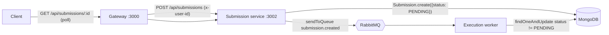
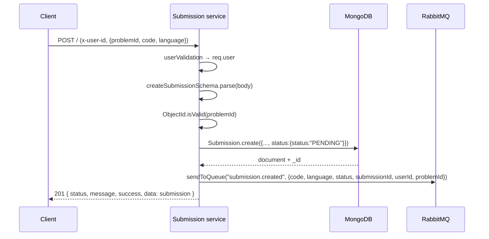

# Submission Service (`@LCArena/submission`)

The **ingress point for user code**. It persists a submission as `PENDING` and
publishes a `submission.created` message that the evaluation worker consumes.
It does not execute anything — it is deliberately small and fast so that intake
latency stays flat while Docker sandboxes start and stop elsewhere.

- **Port:** `3002` (`PORT`, required)
- **Runtime:** Node.js ≥ 24, Express 5, commonjs
- **Depends on:** MongoDB (`submissions`), RabbitMQ.
- **Internal only.** The gateway is the authorization boundary; this service
  trusts the `x-user-id` header that the gateway mints.

---

## Overview

1. **Validate** the payload (`problemId`, `code`, `language`) and that the
   problem id is a real ObjectId.
2. **Resolve the caller** from `x-user-id` via `userValidation`, which looks the
   user up in MongoDB.
3. **Mint the initial verdict server-side** — always `{ status: "PENDING" }`.
   A client-supplied `status` is stripped by Zod and can never influence the
   stored value.
4. **Persist** the `Submission` document.
5. **Publish** to the `submission.created` queue.
6. **Return `201`** with the created document, so the client immediately has the
   `_id` it needs to poll.

## Architecture



The service is fire-and-forget from the client's perspective: the response says
"accepted", not "judged". The verdict arrives in MongoDB later and the client
polls for it — see
[`docs/SUBMISSION_EVALUATION_FLOW.md`](../../../docs/SUBMISSION_EVALUATION_FLOW.md).

## Technology stack

| Concern | Choice |
| :--- | :--- |
| HTTP | `express` ^5 |
| Validation | `zod` ^4 (a discriminated union mirroring `ExecutionResult`) |
| Persistence | Mongoose `Submission` model from `@LCArena/models` |
| Queue | `amqplib` via `@LCArena/config` (`connectToQueue`, `channel`, `queue`) |
| Identity | `userValidation` from `@LCArena/middlewares` |
| Verdict types | `ExecutionResult` from `@LCArena/execution` |

## Directory structure

```
apps/apis/submission/
├── src/
│   ├── index.ts        # express app: POST /, PUT /:submissionId, GET /:submissionId
│   ├── controller.ts   # zod parsing, ObjectId validation, calls the service
│   ├── service.ts      # evaluationService / updateSubmissionService / getSubmissionService
│   ├── validations.ts  # create + update schemas, canonical verdict union
│   └── constants.ts    # PORT, MONGODB_URL
└── test/
    ├── unit/validation.test.ts
    ├── integration/submission.api.test.js
    ├── load_test/submission.load.test.js
    └── README.md
```

## Internal workflow

### `POST /` — create a submission



Step by step in `service.ts`:

1. `evaluationService({ problemId, code, language, userId })`.
2. Guards `channel`/`queue` and throws `500 InternalServerError("Rabbit Mq chnnel
   or queue not found")` if the broker never connected. **Note the ordering:** the
   service connects to RabbitMQ *before* MongoDB at boot, so this guard fires
   early.
3. `const status: ExecutionResult = { status: "PENDING" }` — minted here, never
   taken from the request.
4. `Submission.create(...)` with `problemId`/`userId` cast to `ObjectId`.
5. `channel.sendToQueue(queue.submissionCreated, Buffer.from(JSON.stringify({...})))`.
   The published payload is:

   ```json
   {
     "code": "<user source>",
     "language": "cpp",
     "status": { "status": "PENDING" },
     "submissionId": "<ObjectId>",
     "userId": "<string>",
     "problemId": "<string>"
   }
   ```

6. Returns the document; the controller responds `201 Submission created successfully`.

The message is **not published persistent** and `submission.created` is asserted
without `{ durable: true }` in `@LCArena/config`, so a broker restart can drop a
queued-but-unprocessed submission. See the gaps section of the flow document.

### `PUT /:submissionId` — update

`updateSubmissionSchema` allows any of `problemId`, `code`, `language`, `status`
(each optional; `status` must satisfy the canonical verdict union).
`findByIdAndUpdate(..., { returnDocument: "after" })`, then `404` if missing.

### `GET /:submissionId` — read

Validates the id, then `Submission.findById`; `404 NotFoundError("Submission not
found")` when absent.

## API documentation

Success envelope: `{ status, message, success, data, error: null }`.
Error envelope: `{ success: false, message }` or `{ success: false, message:
"Validation Error", errors: [{ path, message }] }`.

| Method | Path | Middleware | Body | Success |
| :--- | :--- | :--- | :--- | :--- |
| `POST` | `/` | `userValidation` | `{ problemId, code, language? }` | 201 `"Submission created successfully"` |
| `GET` | `/:submissionId` | none in this service | — | 200 `"Submission fetched successfully"` |
| `PUT` | `/:submissionId` | none in this service | any of `problemId`, `code`, `language`, `status` | 200 `"Submission updated successfully"` |

> ⚠️ **Authorization lives in the gateway.** `GET` and `PUT` here are *not*
> wrapped in `userValidation`; the gateway enforces `authenticate` +
> `requireSubmissionOwner` before proxying. A direct call to port 3002 bypasses
> that check. Keep 3002 on the internal network.

**`POST` validation** (`src/validations.ts`):

- `problemId`: string, min 1 — additionally checked with
  `mongoose.Types.ObjectId.isValid`.
- `code`: string, min 1.
- `language`: `z.nativeEnum(ELanguage)`, default `ELanguage.cpp`
  (`"py" | "cpp" | "java" | "js"`).
- `status` is **absent from the create schema**. Zod strips unknown keys, so a
  client-supplied `status` is ignored.

**`PUT` validation** — `submissionStatusSchema` is a discriminated union on
`status`:

| `status` | Shape |
| :--- | :--- |
| `PENDING` | `{ status: "PENDING" }` (no extra fields) |
| `COMPILE_ERROR` | `{ status, compileError: string }` |
| `SUCCESS` | `{ status, passed: int ≥ 0, total: int ≥ 0, failedCases: { tle[], re[], wa[] }, executionTimeMs: Record<string, number> }` |
| `INTERNAL_ERROR` | `{ status, message: string }` |

A compile-time assertion (`_assertCanonicalStatusCompatibility`) ties this union
to `ExecutionResult` from `@LCArena/execution`, so the HTTP layer, the model and
the worker cannot silently drift apart.

## Inter-service communication

| Direction | Mechanism | Details |
| :--- | :--- | :--- |
| In | HTTP | From the gateway only; identity via `x-user-id` |
| Out | RabbitMQ | `submission.created` (non-persistent publish) |
| Out | MongoDB | `Submission.create` / `findByIdAndUpdate` / `findById` |
| In | MongoDB | The worker writes the final verdict into the same document |

No Redis, no sockets, no outbound HTTP to other services (`axios` is imported in
`service.ts` but is not actually used there).

## Environment variables and configuration

| Variable | Required | Default | Purpose |
| :--- | :--- | :--- | :--- |
| `PORT` | **yes** | — | HTTP port (3002 in Compose) |
| `MONGODB_URL` | **yes** | — | Mongo connection string |
| `RABBITMQ_URL` | no | `amqp://localhost` | Read by `@LCArena/config` `connectToQueue` |
| `LOG_LEVEL` | no | `info` | Winston level |

## Dependencies and prerequisites

- **RabbitMQ must be up before boot:** `startServer()` awaits `connectToQueue()`
  first, and a successful connect is what populates `channel`. If it fails,
  `index.ts` logs and the process never calls `app.listen`.
- **MongoDB** must be reachable; `dbConnect` exits the process otherwise.
- `@LCArena/*` packages built (`npm run build:backend`).

There is no `/health` route on this service. The Compose healthcheck therefore
just proves the process accepts HTTP on `/`:

```
fetch('http://127.0.0.1:3002/').then(() => process.exit(0))
```

That returns a 404 JSON body once the server is listening, which is why the check
only looks at "did the request complete".

## Local development and execution

```sh
npm run docker:up                                        # full stack
npx turbo run dev --filter=@LCArena/submission           # service only
```

Through the gateway:

```sh
curl -X POST http://localhost:3000/api/submissions \
  -H "Authorization: Bearer <access token>" \
  -H "Content-Type: application/json" \
  -d '{"problemId":"<object id>","code":"class Solution{...}","language":"cpp"}'
```

Then poll `GET /api/submissions/<id>` until `data.status.status !== "PENDING"`.

## Testing

```sh
cd apps/apis/submission
npm test                        # unit: validation contract only, no infra
npm run test:integration        # submission.api.test.js — service + MongoDB + RabbitMQ
TEST_USER_ID=<valid user id> npm run test:load
TEST_USER_ID=<id> CONCURRENT_REQUESTS=200 npm run test:load
```

- The unit suite is pure Zod schema testing with no infrastructure.
- The integration suite drives every route and asserts both the MongoDB document
  and the RabbitMQ publish. It seeds and deletes its own user.
- The load test needs a real `TEST_USER_ID` because it cannot seed one, and
  measures **ingestion only** (HTTP + Mongo + publish); the worker is not in the
  path.
- Running the integration suite without the execution worker leaves
  `submission.created` messages unconsumed — expected.

## Error handling and troubleshooting

| Symptom | Cause / handling |
| :--- | :--- |
| `401 { message: "Missing user header" }` | `userValidation` got no `x-user-id`; call through the gateway |
| `404 "User not found"` | `x-user-id` is not a user in this database — the service looks the user up |
| `400 "Invalid problem id"` | `problemId` is not a Mongo ObjectId (e.g. a slug like `two-sum`) |
| `400 Validation Error` | Zod failure on `problemId`/`code`/`language` |
| `500 "Rabbit Mq chnnel or queue not found"` | Broker not connected at boot (or the channel closed) |
| Submission stays `PENDING` forever | The worker is not running, or its message was lost. Enqueue happens before the client even gets a response, so `PENDING` is not evidence of failure |
| `404 "Submission not found"` | Bad or deleted id |

## Related services

- [Gateway](../gateway/README.md) — authentication, RBAC and owner checks for these routes.
- [Execution worker](../execution/README.md) — consumes `submission.created` and writes the verdict.
- [`@LCArena/models`](../../../packages/backend/models/README.md) — the `Submission` schema.
- [`@LCArena/execution`](../../../packages/backend/execution/README.md) — the `ExecutionResult` contract.
- [Submission evaluation flow](../../../docs/SUBMISSION_EVALUATION_FLOW.md).
