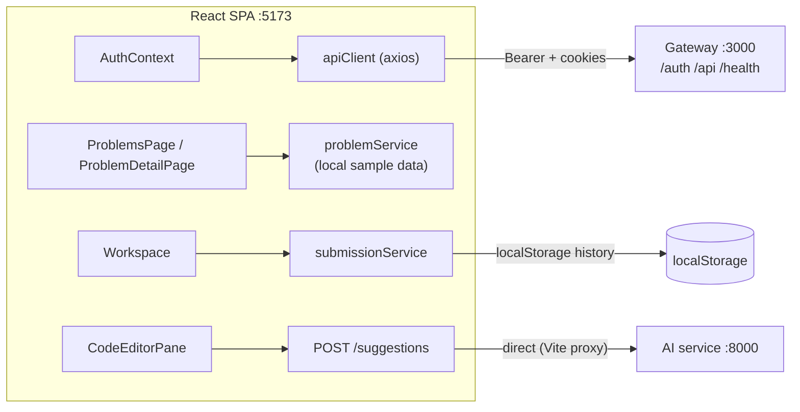
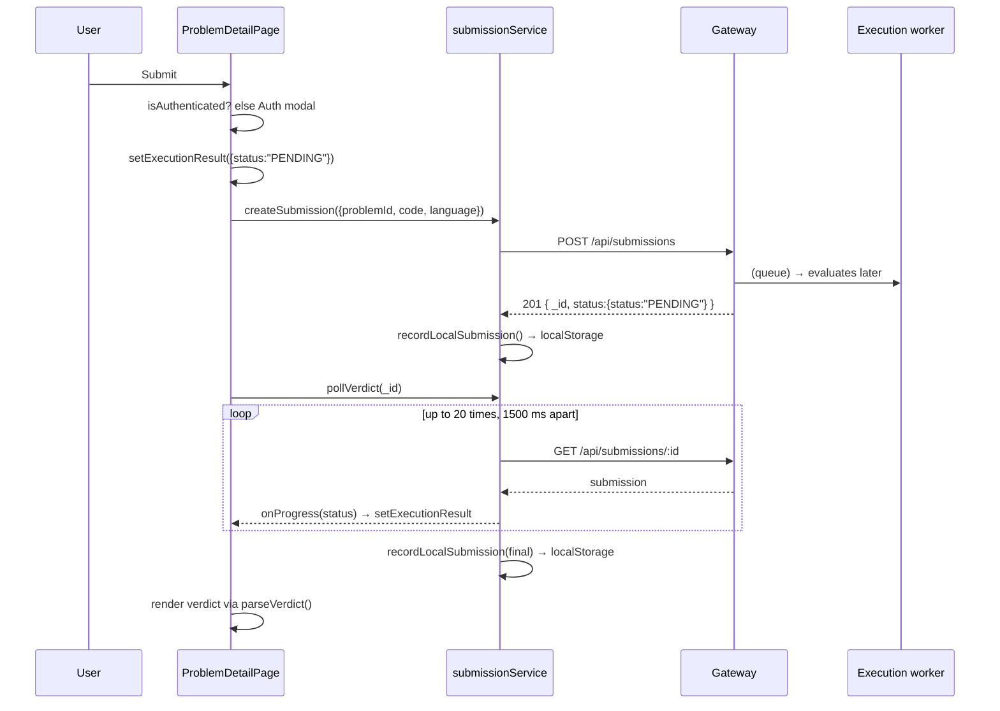

# LCArena Frontend (`frontend`)

The React single-page application: a problem catalogue, a submission workspace
(problem statement + Monaco editor + verdict console), authentication screens and
submission history.

- **Port:** `5173` (Vite dev server)
- **Stack:** React 19, TypeScript, Vite 8, Tailwind CSS v4
- **Talks to:** the [gateway](../apis/gateway/README.md) via `/auth`, `/api`,
  `/health` and the [AI service](../apis/ai-suggestion-service/README.md) via
  `/suggestions` — all through the Vite dev proxy.

---

## ⚠️ Read this first: the deployed frontend runs in demo mode

The current frontend source is a **hosted demo**, not a full judge client. Two
behaviours in the code are easy to misread from the UI:

1. **Problems are local, static fixtures.** `services/problemService.ts`
   `getAllProblems()` / `getProblemById()` read
   [`src/data/sampleProblems.ts`](src/data/sampleProblems.ts) and never issue an
   HTTP request. The ids are **slugs** (`"two-sum"`, `"reverse-a-string"`,
   `"valid-parentheses"`, `"maximum-subarray-sum"`), not Mongo ObjectIds.
   Preserved-but-unused remote fetchers exist as
   `fetchRemoteProblems()` / `fetchRemoteProblemById()`.
2. **The "Run" button does not execute code.** `handleRun()` in
   `ProblemDetailPage.tsx` waits 250 ms and calls `formatDemoRunNotice(problem)`,
   which prints the sample cases and explains that execution requires running the
   backend locally. The real in-browser judge in `utils/codeRunner.ts`
   (`runCode`, `executeJavaScript`, `evaluateStaticCode`) exists and is unit
   tested, but is **not wired to the Run button**.

Consequently `handleSubmit()` posts to `POST /api/submissions` with a slug
`problemId`, and the real Submission service rejects it with
`400 "Invalid problem id"`. The error is caught and replaced by a
"Code Execution Unavailable in Online Demo" modal. **Submission grading from this
frontend only works against a backend after the problem ids are real ObjectIds**
— see [Gaps](#gaps-at-the-frontendbackend-boundary).

## Overview

| Area | Pages / components |
| :--- | :--- |
| Auth | `LoginPage`, `RegisterPage`, `AuthContext`, `ProtectedRoute` |
| Catalogue | `ProblemsPage`, `ProblemFilters`, `ProblemRow` |
| Workspace | `ProblemDetailPage` → `WorkspaceHeader`, `ProblemDescription`, `CodeEditorPane`, `OutputConsole`, `SubmissionHistoryTab`, `Resizable` |
| History | `SubmissionsPage`, `SubmissionHistoryTab` |
| Account | `ProfilePage`, `ServerStatusModal` |
| Chrome | `Navbar`, `Footer`, `Alert`, `Badge`, `Button`, `Input`, `Modal`, `Skeleton`, `Tabs`, `EmptyState`, `DeveloperApologyBanner` |
| Routing | `App.tsx`, `NotFoundPage` |

## Architecture



Only `apiClient`, `authService` and `submissionService` make network calls.
Problem browsing and submission history are client-side.

## Technology stack

| Concern | Choice |
| :--- | :--- |
| UI | React 19 (`react`, `react-dom`), TypeScript |
| Build/dev | Vite 8, `@vitejs/plugin-react`, Tailwind CSS v4 via `@tailwindcss/vite` |
| Routing | `react-router-dom` 7 |
| HTTP | `axios` (a single `apiClient` instance) |
| Editor | `@monaco-editor/react` (a **devDependency**), custom `lcarena-paper` theme |
| Icons | `lucide-react` |
| Animation | `gsap` + `@gsap/react` (`src/animations/*`) |
| Tests | Vitest 5 + Testing Library + `jsdom` |

## Directory structure

```
apps/frontend/
├── index.html
├── vite.config.ts                 # dev proxy + Vitest config (coverage thresholds 80%)
├── src/
│   ├── main.tsx, App.tsx, index.css
│   ├── context/AuthContext.tsx     # login/logout/refresh, hydrates from /auth/me
│   ├── services/
│   │   ├── apiClient.ts            # axios instance, token storage, 401 refresh queue
│   │   ├── authService.ts
│   │   ├── problemService.ts       # local sample problems (+ unused remote fetchers)
│   │   └── submissionService.ts    # create / get / pollVerdict / localStorage history
│   ├── pages/                      # LoginPage, RegisterPage, ProblemsPage,
│   │                               # ProblemDetailPage, SubmissionsPage, ProfilePage, NotFoundPage
│   ├── components/
│   │   ├── Resizable.tsx           # split-pane primitive
│   │   ├── common/                 # design-system primitives
│   │   └── problem/                # workspace pieces (editor, console, description, history)
│   ├── utils/
│   │   ├── codeRunner.ts           # in-browser judge (present, not wired to Run)
│   │   ├── verdictHelper.ts        # parseVerdict(): ExecutionResult -> badge/label/summary
│   │   ├── problemParser.ts        # raw Problem -> ParsedProblem
│   │   └── starterCode.ts          # per-language templates
│   ├── types/{auth,problem,submission}.types.ts
│   ├── data/sampleProblems.ts      # the 4 demo problems
│   └── test/                       # vitest suites (components, pages, routing, unit)
└── public/{favicon.svg,icons.svg}
```

## Internal workflow

### Authentication

`apiClient` (axios) attaches `Authorization: Bearer <token>` from
`localStorage["lcarena_access_token"]` on every request. The response
interceptor implements a **single-flight refresh**:

1. On `401` for a non-auth route, if a refresh is not already running, POST
   `/auth/refresh` with the stored refresh token (and `withCredentials: true`
   for the cookie).
2. On success, store the new access token (and refresh token when returned),
   drain a queue of requests that arrived during the refresh, and retry the
   original request once (`_retry` flag prevents loops).
3. `/auth/login`, `/auth/register` and `/auth/refresh` are excluded from retry.

`AuthContext` calls `GET /auth/me` on mount to hydrate the user, exposes
`user`/`isAuthenticated`, and clears tokens on logout.

### Submitting and receiving a verdict



Verified details:

- **Mechanism: client-side HTTP polling.** There is **no WebSocket, no
  Socket.IO, no Server-Sent Events and no push notification** anywhere in the
  frontend source.
- `pollVerdict(submissionId, onProgress, maxAttempts = 20, intervalMs = 1500)`
  polls until `status.status !== "PENDING"`, giving a **30-second ceiling**.
  On exhaustion it performs one final `getSubmission` and returns whatever it
  gets — so a submission still `PENDING` will render as "Pending" with no error
  and no retry.
- `onProgress` is called for **every** poll, including the `PENDING` ones, so the
  console updates live during evaluation.
- The verdict is rendered by `parseVerdict()` (`utils/verdictHelper.ts`), which
  maps the backend union to a label, colours, a summary and, where known,
  `passedCount`/`totalCount`/`timeMs`. The `SUCCESS` status is further decoded
  with the precedence **TLE → RE → WA → Accepted**, mirroring the worker's
  `firstFailedTestCase`.
- History is **client-side**: `recordLocalSubmission()` writes to
  `localStorage["lcarena_submissions_<effectiveUserId>"]`, newest first, capped
  at 50 entries. `getEffectiveUserId()` prefers the argument, then decodes
  `userId`/`id` from the stored JWT, then falls back to `"anonymous"`.
  Anonymous submissions are merged into the authenticated list on first read.
  **Consequently, submission history does not survive a different browser or
  device, and was never fetched from the server.**

### Editor

`CodeEditorPane` renders Monaco with a custom paper-toned theme, a font-size
control persisted at `lcarena_editor_font_size` (10–32, default 13), and an AI
toggle. When AI is enabled it debounces 500 ms after a cursor move and POSTs to
`/suggestions`, aborting the previous request via `AbortController`. The response
is currently discarded (no inline insertion). A visually hidden
`<textarea aria-label="Code Editor Input">` mirrors the code so tests can drive
the editor without Monaco.

Per-problem code is persisted in `localStorage` at
`lcarena_code_<problemId>_<language>`.

### "Run" vs "Submit"

- **Run** → `handleRun()` → 250 ms later `formatDemoRunNotice()`: a notice plus
  the sample cases, explicitly labelled "Reference Only". No code leaves the
  browser.
- **Submit** → the real pipeline, described above. Requires authentication; an
  unauthenticated click opens a sign-in modal.

## API documentation

The frontend consumes the gateway; it defines no API of its own. Client-side
surface:

| Function | Method + path | Purpose |
| :--- | :--- | :--- |
| `submissionService.createSubmission` | `POST /api/submissions` | Submit `{ problemId, code, language }` |
| `submissionService.getSubmission` | `GET /api/submissions/:id` | Fetch status/details |
| `submissionService.pollVerdict` | repeated `GET` | Poll to a terminal verdict |
| `submissionService.recordLocalSubmission` | — | localStorage history write |
| `submissionService.getLocalSubmissions` | — | localStorage history read |
| `submissionService.getProblemSubmissions` | — | History filtered by problem |
| `problemService.getAllProblems` | — | Returns local sample problems |
| `problemService.getProblemById` | — | Local lookup; throws `"Problem not found"` |
| `problemService.fetchRemoteProblems` / `fetchRemoteProblemById` | `GET /api/problems` | Preserved remote fetchers, unused by pages |
| `authService.*` | `/auth/*` | Login, register, OTP, me, logout, change password, delete account |
| `CodeEditorPane` | `POST /suggestions` | AI completion (see AI service README) |

Response typing assumes the shared envelope (`ApiResponse<T>` with `data`).

Note `submission.types.ts` declares `ISubmission.problemId` and `.userId` as
plain `string`s, while the backend may return populated objects; the history tab
defends against that when filtering by problem id.

**Real endpoints, request bodies and error semantics:** see the
[gateway README](../apis/gateway/README.md) and
[submission README](../apis/submission/README.md).

## Inter-service communication

| Direction | Mechanism | Details |
| :--- | :--- | :--- |
| Out | HTTP to the gateway | `/auth`, `/api`, `/health`; Bearer header + `withCredentials` for the refresh cookie; 15s axios timeout |
| Out | HTTP to the AI service | `POST /suggestions`, debounced, abortable |
| In | — | No server-to-client channel exists; **no WebSocket / SSE** |
| Storage | `localStorage` | `lcarena_access_token`, `lcarena_refresh_token`, `lcarena_code_*`, `lcarena_submissions_*`, `lcarena_editor_font_size` |

## Environment variables and configuration

Vite only exposes `import.meta.env.*`, so every variable must be prefixed with
`VITE_` and is **compiled into the bundle** — never put secrets here.

| Variable | Default | Purpose |
| :--- | :--- | :--- |
| `VITE_API_URL` | `""` (same origin → Vite proxy) | Base URL for the gateway |
| `VITE_AI_URL` | falls back to `VITE_API_URL` | Base URL for the AI suggestion service |

Development proxy (`vite.config.ts`):

| Prefix | Target |
| :--- | :--- |
| `/auth`, `/api`, `/health` | `http://localhost:3000` (gateway) |
| `/suggestions` | `http://localhost:8000` (AI service) |

Because the SPA and gateway share an origin in development, CORS is not
exercised locally. For a separate deployment origin, set `CORS_ORIGIN` on the
gateway to the frontend origin — a cookie-bearing cross-origin setup requires an
explicit allowlist, not `*` reflection with credentials in production. See
[`docs/FRONTEND_DEPLOY_AWS.md`](../../docs/FRONTEND_DEPLOY_AWS.md) for the AWS
deployment guide.

## Dependencies and prerequisites

- Node ≥ 24 and npm ≥ 11 (root `engines`).
- A running gateway at `:3000` for authentication and submissions, and optionally
  the AI service at `:8000`. The catalogue renders without either.
- `npm install` at the repository root (npm workspaces).

## Local development and execution

```sh
# from the repository root
npm install
npm run docker:up                       # backend stack (gateway, problem, submission, …)
cd apps/frontend && npm run dev         # http://localhost:5173
```

```sh
npm run build      # tsc -b && vite build  -> dist/
npm run preview    # serve the production build
npm run lint       # eslint .
```

`@monaco-editor/react` is currently a **devDependency**, which works for the dev
server and for a build produced in the same install, but is fragile for
production installs that omit dev dependencies. Promoting it (and
`monaco-editor`, which only exists in the root `package.json`) to `dependencies`
is a small, worthwhile fix.

## Testing

```sh
cd apps/frontend
npm test                # vitest run (all suites)
npm run test:watch      # vitest watch
npm run test:coverage   # vitest run --coverage
```

Vitest configuration (`vite.config.ts`): `environment: "jsdom"`, globals,
`setupFiles: ./src/test/setup.ts`, 10s test timeout, V8 coverage over
`src/**/*.{ts,tsx}` with **80% thresholds** for statements, branches, functions
and lines.

Suites: `test/unit/` (`apiClient.test.ts` — including the refresh queue,
`codeRunner.test.ts`, `services.test.ts`, `utils.test.ts`,
`AuthContext.test.tsx`, `Animations.test.tsx`), `test/components/`,
`test/pages/`, `test/routing/`.

Note that the tests validate the demo behaviour as-is (e.g. `ProblemDetailPage`
tests assert `recordLocalSubmission`), so they will need updating when the
catalogue is switched to remote problems.

## Error handling and troubleshooting

| Symptom | Cause / handling |
| :--- | :--- |
| Catalogue shows only 4 problems | Expected: local `sampleProblems.ts`, no API call |
| `400 Invalid problem id` after Submit | The slug problem id is not a Mongo ObjectId — see [Gaps](#gaps-at-the-frontendbackend-boundary) |
| "Code Execution Unavailable in Online Demo" modal | Any error from `createSubmission` is replaced by this modal; check the network tab first |
| Submit button requires sign-in | `handleSubmit` opens the auth modal when `!isAuthenticated` |
| Every `401` then a redirect to login | Refresh token missing/expired; `apiClient` falls through and clears tokens |
| Requests fail with a CORS error | Frontend and gateway on different origins without `CORS_ORIGIN` allowing the frontend |
| Verdict never appears | Polling stopped after ~30s; the submission may still have been judged — refetch it |
| Loss of submission history | History is localStorage-only; clearing site data or switching devices loses it |
| AI completion does nothing | The AI toggle is off, or the response is discarded (current behaviour) |

## Gaps at the frontend/backend boundary

Documented rather than fixed (documentation-only task):

1. **Problem ids are slugs, not ObjectIds.** `POST /api/submissions` therefore
   fails against the real backend. Bridging this means either pointing the
   catalogue at `fetchRemoteProblems()` (and seeding problems) or mapping slugs
   to server ids.
2. **No push notification path.** The worker publishes `submission.completed`
   into a queue that nothing consumes; the SPA polls instead. Any real-time
   feature requires a new consumer plus a client channel — see
   [`docs/SUBMISSION_EVALUATION_FLOW.md`](../../docs/SUBMISSION_EVALUATION_FLOW.md).
3. **The in-browser judge is dead code** from the user's perspective: `runCode`
   and friends are implemented and tested but not invoked by the Run button.
4. **History is device-local.** There is no `GET /api/submissions?userId=…`
   endpoint to list a user's submissions server-side.
5. **AI responses are dropped**, so the toggle currently only produces network
   traffic and token usage.

## Related services

- [Gateway](../apis/gateway/README.md) — the API this app talks to.
- [Problem service](../apis/problem/README.md) — the real source of problems.
- [Submission service](../apis/submission/README.md) — submission intake.
- [AI suggestion service](../apis/ai-suggestion-service/README.md) — `/suggestions`.
- [Submission evaluation flow](../../docs/SUBMISSION_EVALUATION_FLOW.md) — how a verdict reaches the UI.
