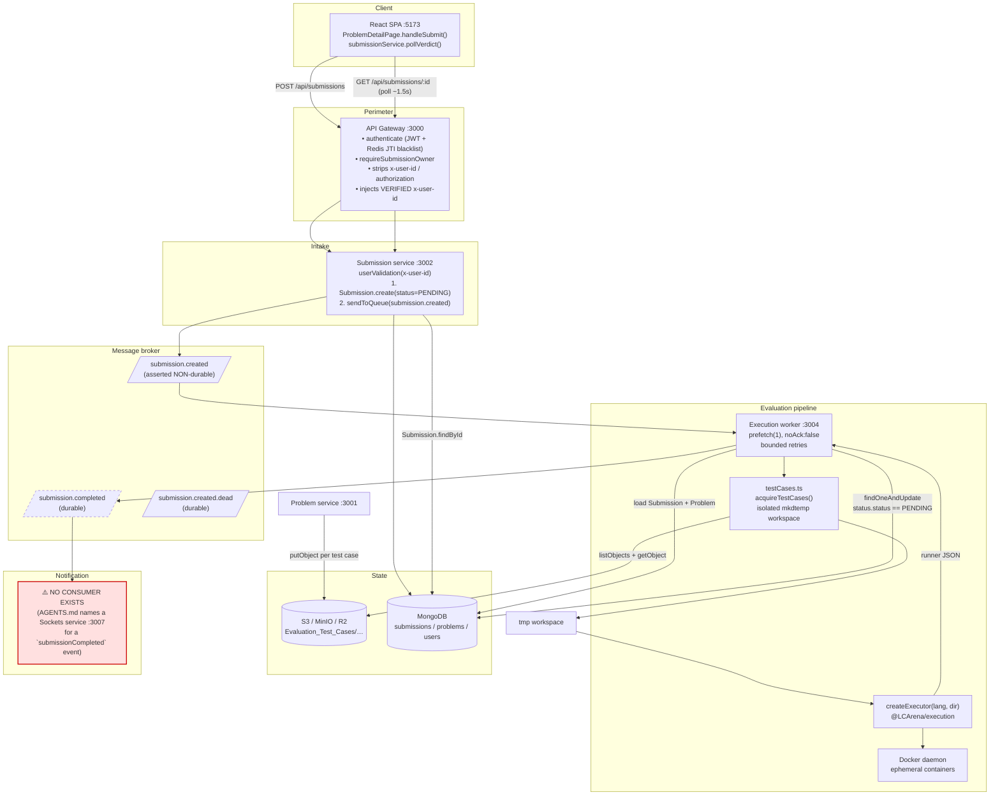
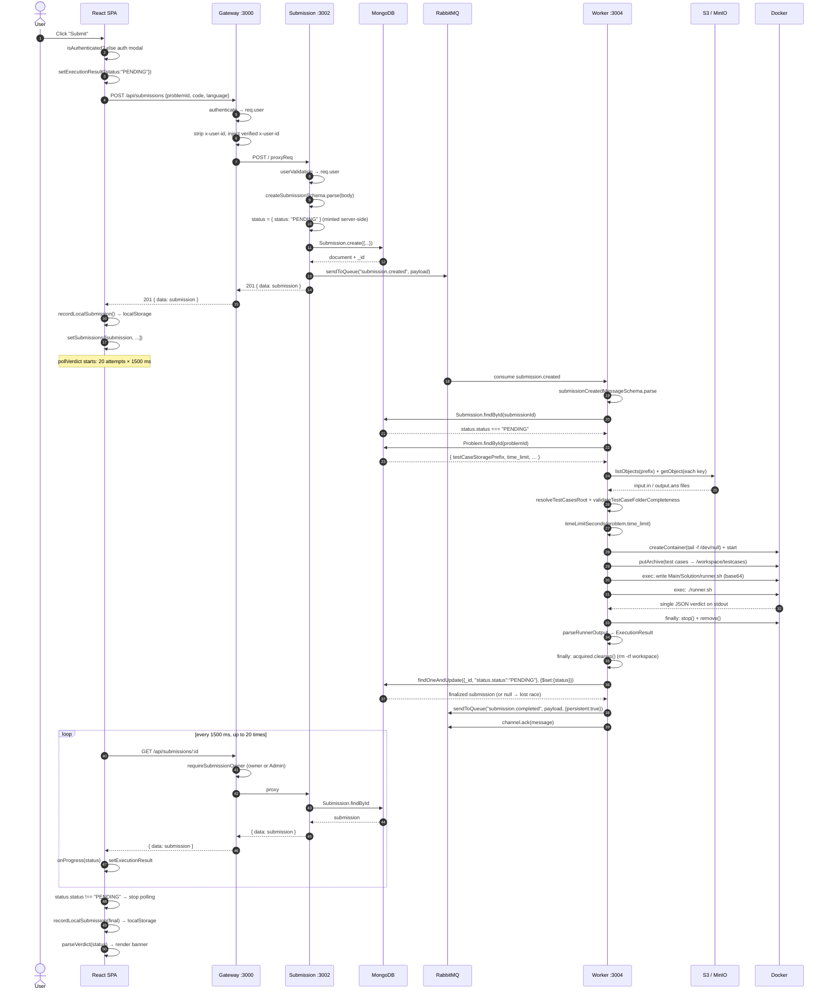
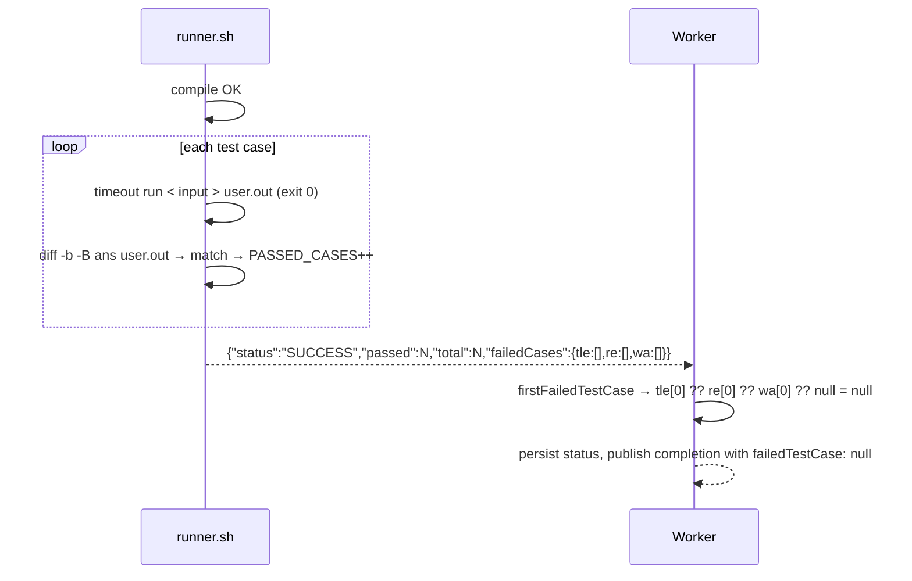
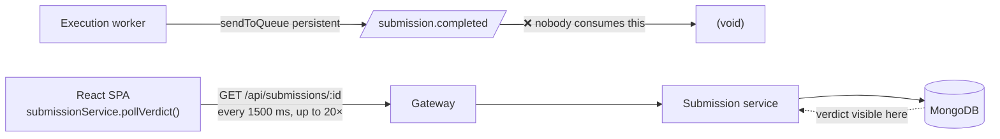

# Submission Evaluation & Notification Flow

The complete lifecycle of a code submission in LCArena: from the HTTP request that
creates it, through the message broker and the sandboxed execution pipeline, to
the moment the verdict becomes visible to the user.

Everything below is traced from the current source code. Where the implemented
behaviour differs from what `AGENTS.md` describes, or where a component is
missing, that is called out explicitly and marked **[gap]** or **[not
implemented]**. No behaviour has been changed by writing this document.

**Headline finding:** the evaluation pipeline is complete and robust, but the
**real-time notification service does not exist**. The worker publishes
`submission.completed` into RabbitMQ and nothing consumes it. The user learns the
verdict because the browser **polls** `GET /api/submissions/:id`. See
[§6](#6-user-notification-the-critical-section).

---

## 1. Component inventory

| Component | Path | Port | Role in this flow |
| :--- | :--- | :--- | :--- |
| React SPA | `apps/frontend` | 5173 | Submits code, polls for the verdict, persists local history |
| API Gateway | `apps/apis/gateway` | 3000 | Auth, RBAC, ownership checks, reverse proxy, injects `x-user-id` |
| Submission service | `apps/apis/submission` | 3002 | Persists `PENDING`, publishes `submission.created` |
| RabbitMQ | Docker | 5672 / 15672 | `submission.created`, `submission.completed`, `submission.created.dead` |
| Execution worker | `apps/apis/execution` (`@LCArena/evaluator`) | 3004 (`/health`) | Consumes, stages test cases, runs Docker sandboxes, persists verdict, publishes completion |
| `@LCArena/execution` | `packages/backend/execution` | — | `Executor` + 4 language executors, runner script, `ExecutionResult` |
| Object storage | MinIO / R2 / S3 | 9000 | Immutable test-case objects |
| MongoDB | Docker | 27017 | `users`, `problems`, `submissions` |
| Problem service | `apps/apis/problem` | 3001 | **Writes** the test cases the worker reads |
| **Sockets service** | — | — | **[not implemented]** — `AGENTS.md` §3.5 describes `apps/apis/sockets` on port 3007; the directory does not exist |

---

## 2. High-level architecture



The dashed `submission.completed` edge and the red node are the two things to take
away from this diagram.

---

## 3. Sequence diagram — successful submission



Note what the polling loop does **not** do: it never reads the
`submission.completed` payload. MongoDB is the sole channel by which the verdict
reaches the user.

---

## 4. Stage-by-stage walkthrough

### 4.1 Submission creation

**Endpoint:** `POST /api/submissions` (gateway) → `POST /` (submission service).

**Gateway middleware chain:** `authenticate` → `submissionProxy`.

- `authenticate` extracts the bearer token, verifies the signature, rejects an
  expired token with `401 Access token expired` and any other failure with `401
  Invalid access token`, checks `revoked_access:<jti>` in Redis, and **re-reads
  the user from MongoDB** so a deleted account or changed role applies instantly.
- `proxy.factory` removes the client's `x-user-id` and `authorization` headers and
  sets `x-user-id: <verified userId>`.

**Validation** (`apps/apis/submission/src/validations.ts`):

```ts
createSubmissionSchema = z.object({
  problemId: z.string().min(1, "Problem Id is required"),
  code:      z.string().min(1, "Code is required"),
  language:  z.nativeEnum(ELanguage).default(ELanguage.cpp),
})
```

`status` is deliberately **not** in the schema; Zod strips unknown keys, so a
client-supplied `status` is discarded.

**Additional check:** `mongoose.Types.ObjectId.isValid(problemId)` → `400 Invalid
problem id`.

**Caller resolution:** `userValidation` reads `x-user-id`, strips surrounding
quotes, looks the user up in MongoDB, sets `req.user`. Missing header →
`401 { message: "Missing user header" }`; unknown id → `404 User not found`.

**Persistence and enqueue** (`evaluationService`):

```ts
const status: ExecutionResult = { status: "PENDING" }   // always server-minted

const submission = await Submission.create({
  problemId: new mongoose.Types.ObjectId(problemId),
  code, language,
  userId: new mongoose.Types.ObjectId(userId),
  status,
})

channel.sendToQueue(queue.submissionCreated, Buffer.from(JSON.stringify({
  code, language,
  status: submission.status,
  submissionId: submission._id,
  userId,
  problemId,
})))
```

**Response to the frontend:** `201 Created`, envelope
`{ status: 201, message: "Submission created successfully", success: true, data:
<submission document>, error: null }`.

**Identifiers generated:** the Mongo `_id` (returned immediately — this is what
the client polls with). No separate idempotency key, no `attempt` counter, no
client-supplied correlation id.

**Immediately visible to the user:** `{ status: "PENDING" }`, and the submission
appended to the local history list.

### 4.2 Queueing and processing

| Aspect | Implementation |
| :--- | :--- |
| Exchange | **None.** `channel.sendToQueue(name, …)` publishes directly to the queue (AMQP default exchange, routing key = queue name). No topic/fanout exchange, no routing keys. |
| Queue | `submission.created` |
| Queue durability | **Not durable** — `connectToQueue()` calls `assertQueue("submission.created")` with no options, so `durable: false` **[gap]** |
| Message persistence | **Not persistent** — `sendToQueue` is called with no `options` **[gap]** |
| Producer | Submission service (`Node.js` / `amqplib`) |
| Consumer | Execution worker, `prefetch(1)`, `noAck: false` (manual ack) |
| Concurrency | `prefetch(1)` — **one submission at a time per worker process**. Add replicas to parallelise. |
| Ack timing | Only after the verdict is durably persisted (`channel.ack` after `processSubmission` resolves) |
| Retries | Re-publish the **same content** with an incremented `x-attempts` header, up to `EXECUTION_MAX_ATTEMPTS` (default 3), then ack |
| Dead lettering | After exhaustion: persist `INTERNAL_ERROR`, publish `submission.completed`, park on `submission.created.dead` with `x-park-reason: retries-exhausted`, ack |
| Malformed messages | Parked immediately with `x-park-reason: malformed`, ack (no retry) |
| Duplicate delivery | Handled by idempotency (see 4.4) |

Message payload (produced by the submission service, validated by the worker):

```jsonc
{
  "code": "<user source>",
  "language": "cpp",                    // ELanguage: py | cpp | java | js
  "status": { "status": "PENDING" },    // present but NEVER trusted
  "submissionId": "<ObjectId>",
  "userId": "<ObjectId string>",
  "problemId": "<ObjectId string>"
}
```

Worker-side validation (`submissionCreatedMessageSchema`): each of
`submissionId`/`userId`/`problemId` must be a string that
`mongoose.Types.ObjectId.isValid` accepts; `code` must be a non-empty string;
`language` must be a member of `ELanguage`; `status` is `z.unknown().optional()`
and explicitly not trusted.

Retry envelope written on re-publish:

```ts
channel.sendToQueue(queues.submissionCreated, message.content, {
  persistent: true,                     // note: upgrades persistence on retry only
  contentType: message.properties.contentType,
  headers: { ...message.properties.headers, "x-attempts": nextAttempt },
})
```

### 4.3 Code execution and test-case evaluation

**Obtaining test cases** — `acquireTestCases({ testCasesUrl, testCaseStoragePrefix,
problemId, maxBytes, maxEntries })` resolves the source in this precedence order:

1. `problem.testCaseStoragePrefix` (explicit prefix — the normal path for
   problems created through the Problem service).
2. `testCasesUrl` that resolves to a storage prefix: `s3://bucket/prefix`
   (`extractPrefixFromStorageUrl` strips `s3://<bucket>/`) or a bare
   `Evaluation_Test_Cases/…` prefix.
3. `http(s)` URL → download to a temp file (30s `AbortController` timeout,
   `content-length` pre-check plus a streaming byte counter), then detect the
   format from magic bytes and extract (ZIP / gzip-tar / ustar-tar).
4. Local path → directory copy, or archive extraction. Legacy fallbacks resolve
   `"testcases"`, `"that"`, `"this"` and `packages/backend/execution/testcases`
   relative to `cwd` and `__dirname`.
5. No path, but a `problemId` → `getProblemTestCasePrefix(problemId)`.
6. Otherwise → `TestCaseSourceError("No test cases source or storage reference
   specified")`.

**Retrieval of input/expected-output files** — `downloadFromS3` lists the prefix
(`listObjects`) and fetches each key (`getObject`), writing files at
`<workspace>/<key-relative-to-prefix>`. Every path passes through
`resolveSafeEntryPath`, which rejects absolute paths, NUL bytes, and any `..`
escape.

The expected layout is the key contract from `@LCArena/config`:

```
Evaluation_Test_Cases/Test_Cases_<PROBLEM_ID>/test_case_001/input.in
Evaluation_Test_Cases/Test_Cases_<PROBLEM_ID>/test_case_001/output.ans
Evaluation_Test_Cases/Test_Cases_<PROBLEM_ID>/test_case_002/input.in
...
```

**Validation** — `resolveTestCasesRoot` descends up to 8 levels through a single
wrapper directory to find the folder whose children are case directories, then
`validateTestCaseFolderCompleteness` requires **both** a `*.in` and a `*.ans` in
**every** case directory. Violations throw (`TestCasesUnavailableError` /
`TestCaseSourceError`), which means an empty or partial case set is an
infrastructure failure — never a zero-test `SUCCESS`.

Limits: 64 MiB total (`EXECUTION_MAX_TESTCASES_BYTES`), 10,000 entries
(`EXECUTION_MAX_TESTCASES_ENTRIES`), files written mode `0o600`, tar entries that
are not regular files skipped.

**Compilation and execution in the sandbox** — `createExecutor(language,
testCasesDir)` picks from the registry:

| `language` | Class | Image | Compile command | Run command |
| :--- | :--- | :--- | :--- | :--- |
| `cpp` | `CPPExecutor` | `gcc:latest` | `g++ -O3 -std=c++17 "Main.cpp" -o "./solution"` | `./solution` |
| `java` | `JavaExecutor` | `eclipse-temurin` | `javac Main.java Solution.java` | `java Main` |
| `py` | `PythonExecutor` | `python:3.11-slim` | `python -m py_compile solution.py` | `python main.py` |
| `js` | `JSExecutor` | `node:20-slim` | `node -c solution.js` | `node main.js` |

Container protocol per submission:

1. `pullImage` (inspect; pull only on a 404).
2. `createContainer({ Image, Cmd: ["/bin/bash","-c","tail -f /dev/null"],
   WorkingDir: "/workspace", HostConfig: {} })`, `start()`.
3. `copyTestCasesToContainer`: pack the workspace into a `tar-stream` archive as
   `testcases/<relpath>` and `container.putArchive(..., { path: "/workspace" })`.
   Zero files → `TestCasesUnavailableError` (fails closed).
4. Write the wrapper, `Solution`, and `runner.sh` via
   `echo "<base64>" | base64 -d > /workspace/<file>` (base64 sidesteps all shell
   quoting of user code).
5. `exec: ./runner.sh`.
6. `finally`: `container.stop()` then `container.remove()`.

**Output comparison and verdict determination** — inside the container, the
generated `runner.sh`:

- runs the compile command; non-zero → prints
  `{"status":"COMPILE_ERROR","compileError":"…"}` and `exit 0`;
- iterates `./testcases/*`, taking the first `*.in` and `*.ans` in each case dir;
- times each run with `date +%s%N`;
- runs `timeout "$TIME_LIMIT" <runCmd> < input > user.out`;
- classifies: exit `124` → TLE, exit `!= 0` → RE, `diff -b -B ans user.out`
  matches → passed, else WA;
- prints one JSON object on stdout.

```json
{
  "status": "SUCCESS",
  "passed": 40,
  "total": 40,
  "executionTimeMs": { "test_case_001": 12, "test_case_002": 15 },
  "failedCases": { "tle": [], "re": [], "wa": [] }
}
```

**Time limit:** `timeLimitSeconds(problem.time_limit)` uses `problem.time_limit`
in ms when it is a number `> 0`, else 5000 ms, then
`Math.max(1, Math.ceil(ms / 1000))` — whole seconds, minimum 1.

**Memory usage:** **not measured or enforced anywhere.** There is no memory
verdict, no `MemoryLimit` on the container, and no `ru_maxrss`-style measurement
**[gap]**.

**`compareOutputs` is not used on this path. [gap]** The sandbox judges with
`diff -b -B` (ignore whitespace-change, ignore blank-line-change). The richer
`compareOutputs`/`normalizeOutput` implementation in
`packages/backend/execution/src/judging/outputComparison.ts` is exported and unit
tested but is only used by the frontend's in-browser judge. Two implementations of
the same policy can drift.

**Security posture of the sandbox (as implemented).** Untrusted code never runs on
the host, runs under GNU `timeout`, and the container is removed in a `finally`
block. However: `HostConfig: {}` means **no memory limit, no CPU quota, no pids
limit, no capability drop, no read-only rootfs, no seccomp/AppArmor profile**; the
default bridge network gives the container outbound network access; the process
runs as the image's default user (root); and the Docker API calls (pull, exec)
have no timeout of their own. See [§10](#10-gaps-race-conditions-and-reliability-issues).

### 4.4 Result persistence

**Who updates the record:** `evaluationDeps.persistVerdict`, executed by the
execution worker.

**Model and fields** (`packages/backend/models/src/submission.model.ts`):

```ts
{
  problemId: ObjectId,
  userId:    ObjectId,
  code:      String,
  language:  "py" | "cpp" | "java" | "js",
  status:    Mixed,        // the ExecutionResult union
  createdAt / updatedAt    // timestamps: true
}
```

`status` holds the whole verdict:

| Verdict | Stored `status` |
| :--- | :--- |
| Accepted | `{ status:"SUCCESS", passed:N, total:N, failedCases:{tle:[],re:[],wa:[]}, executionTimeMs:{…} }` |
| Wrong answer | `SUCCESS` with `failedCases.wa` non-empty |
| Runtime error | `SUCCESS` with `failedCases.re` non-empty |
| Time limit exceeded | `SUCCESS` with `failedCases.tle` non-empty |
| Compilation error | `{ status:"COMPILE_ERROR", compileError:"…" }` |
| Infrastructure failure | `{ status:"INTERNAL_ERROR", message:"…" }` |

`SUCCESS` therefore means "the harness completed", and the human verdict is
derived from `failedCases` with precedence **TLE → RE → WA → Accepted**.

**Atomicity and duplicate handling.** The write is conditional:

```ts
Submission.findOneAndUpdate(
  { _id: submissionId, "status.status": "PENDING" },   // guard
  { $set: { status } },
  { returnDocument: "after" },
)
```

- Resolves `null` when another worker already finalised it → the loser logs
  `lost-finalize-race`, returns without publishing, and does **not** overwrite.
- A submission whose status is already terminal is never re-executed. Instead its
  **stored** verdict is re-published:

  ```ts
  if (submission.status?.status !== "PENDING") {
      await deps.publishCompletion(buildCompletionPayload(submission, submission.status));
      return { outcome: "skipped", reason: "already-finalized", status: submission.status };
  }
  ```

  This is the compensation for "persisted but crashed before publishing", so a
  completion event is not lost. **[gap]** It re-emits on *every* duplicate
  delivery for the same id, so a re-delivered message produces a second
  `submission.completed` for the same submission (the E2E test asserts
  `eventCountAfter >= eventCountBefore`, i.e. it accepts duplicates).

**Partial results.** There is no partial-result model: the verdict is written once,
in full. Per-case timings live only inside `status.executionTimeMs`.

**Unexpected worker errors.** A missing problem is recorded explicitly as
`INTERNAL_ERROR("Referenced problem could not be loaded")`. A missing submission is
only logged (`submission-not-found`) and produces **no** completion event — the
submission cannot exist to update. Storage/Docker/persistence throws are retried
and, on exhaustion, recorded as
`INTERNAL_ERROR("Evaluation failed after repeated attempts")` plus a DLQ park.

**Cleanup.** The per-submission workspace is removed in a `finally` block around
the executor call, and `acquireTestCases` removes it before re-throwing on
failure. The Docker container is stopped/removed in the executor's own `finally`.

### 4.5 The completion payload

Built by `buildCompletionPayload(submission, status)` in
`apps/apis/execution/src/service.ts` and published by `publishCompletion`:

```ts
channel.sendToQueue(queue.submissionCompleted, Buffer.from(JSON.stringify(payload)), {
  persistent: true,
})
```

```jsonc
{
  "submissionId": "<ObjectId string>",
  "userId":       "<ObjectId string>",
  "problemId":    "<ObjectId string>",
  "status":       { /* ExecutionResult */ },
  "results":      { /* the SAME object as status, duplicated */ },
  "failedTestCase": "test_case_001" | null
}
```

- `status` and `results` are the **same object reference**, serialised twice, so
  `status.status === results.status` always holds. `results` exists for consumers
  that key off that name; in this repository **no consumer reads either**.
- `failedTestCase` is `firstFailedTestCase(status)`: for `SUCCESS`, the first
  non-empty entry with precedence `tle → re → wa`; `null` for every other status.
- The queue is asserted `{ durable: true }` and the message is published
  `persistent: true`, so completions survive a broker restart — the opposite of
  the intake queue.

**Exact event name:** the queue name is `submission.completed`. There is **no
Socket.IO event name in the codebase**, so the `submissionCompleted` event that
`AGENTS.md` §3.5 describes **cannot be verified** — it does not exist
**[not implemented]**.

**Ordering guarantee:** the payload is published **after** the conditional
`findOneAndUpdate` returns a document, so **yes — the notification is emitted only
after the database has been updated.** This is the one part of the notification
contract that is implemented and correct.

### 4.6 User-facing reachability requirement

`GET /api/submissions/:id` is **not public**. The gateway mounts
`authenticate` + `requireSubmissionOwner`, which:

1. rejects a non-ObjectId id with `400 Invalid submission id`,
2. returns `404 Submission not found` if it does not exist,
3. throws `403 You can only access your own submissions` unless
   `String(submission.userId) === req.user.userId` or the caller is an `Admin`.

So a user can only see their own verdict. The submission service itself applies no
ownership check, so a direct request to port 3002 for any known id would return
it — which is why the internal port must stay unexposed.

---

## 5. Verdict-specific flows

All five verdicts share stages 1–3; they diverge only in what the runner prints and
what is therefore persisted.

### 5.1 Accepted (`SUCCESS`, no failures)



Stored `status`: `SUCCESS` with `passed === total` and empty `failedCases`.
UI: `parseVerdict` finds no `tle`/`re`/`wa` entries and renders **Accepted** —
"All N test cases passed!", with the maximum per-case time as `timeMs`.

### 5.2 Wrong Answer (`failedCases.wa`)

The program exits 0 but `diff -b -B` reports a difference. The case name is
appended to `WA_CASES`. `status` is still `SUCCESS` with `passed < total` and
`failedCases.wa` non-empty.

- `failedTestCase` = the first WA case (only if `tle` and `re` are both empty).
- UI: **Wrong Answer** — "Wrong answer on test case `<case>`", with
  `passed / total` and a `Failed case: <case>` detail line.

### 5.3 Time Limit Exceeded (`failedCases.tle`)

`timeout "$TIME_LIMIT"` kills the program, so the exit code is **124** and the case
is appended to `TLE_CASES`. `TIME_LIMIT` is derived from `problem.time_limit`
(ms → whole seconds, min 1; default 5000 ms → `5s`).

- `failedTestCase` = the first TLE case (highest precedence).
- UI: **Time Limit Exceeded** — "Time limit exceeded on test case `<case>`".

Note the granularity: the limit is **per test case**, and it constrains wall clock,
not CPU time.

### 5.4 Runtime Error (`failedCases.re`)

The program exits non-zero for any reason other than 124 — an uncaught exception,
a signal, a non-zero `exit`. The case is appended to `RE_CASES`.

- `failedTestCase` = the first RE case when `tle` is empty.
- UI: **Runtime Error** — "Runtime error on test case `<case>`".
- stderr is captured to `<case>/user.err` inside the container, but it is **not**
  surfaced in the verdict or to the user.

> **Design asymmetry to be aware of:** a *parse-time* failure in the wrapper
> produces `COMPILE_ERROR`, whereas a failure *during* a test case produces
> `failedCases.re` inside a `SUCCESS` verdict. The UI distinguishes them, and
> `parseVerdict` gives `RE` precedence over `WA`.

### 5.5 Compilation Error (`COMPILE_ERROR`)

The compile command returns non-zero, so the script writes the compiler output to
`compile_error.log`, JSON-escapes it (`sed 's/"/\\"/g' | tr '\n' ' '`), prints
`{"status":"COMPILE_ERROR","compileError":"<escaped>"}` and **exits 0** — the JSON,
not the exit code, is the result. Nothing is persisted from the run beyond
`compileError`.

- Derived verdicts: `passed`/`total`/`executionTimeMs`/`failedCases` are **absent**
  (the union has no such fields for this status).
- `firstFailedTestCase` returns `null` (it only inspects `SUCCESS`) → completion
  payload carries `failedTestCase: null`.
- UI: **Compilation Error**, with `compileError` rendered verbatim in the
  "Diagnostic Output" block. Newlines are already collapsed to spaces by the
  escaping pipeline, so multi-line diagnostics arrive as one long string.

### 5.6 Infrastructure failure (`INTERNAL_ERROR`)

Nothing in the pipeline can produce this from user code. It is minted only by the
worker, in two places:

| Trigger | `message` | Path |
| :--- | :--- | :--- |
| `Problem.findById` returns nothing | `Referenced problem could not be loaded` | Inline in `processSubmission`, persisted + published immediately |
| Docker/storage/persistence threw on every attempt | `Evaluation failed after repeated attempts` | `recordPermanentFailure()` in `consumer.ts` after `EXECUTION_MAX_ATTEMPTS` |

In the second case the message is also parked on `submission.created.dead` with
`x-park-reason: retries-exhausted`, and `recordPermanentFailure` only publishes the
completion if its conditional persist actually won (otherwise the winner is
responsible).

Exceptions that reach the consumer without producing this verdict:

- **Unparseable message** → parked as `malformed`; there is no id to update, so
  nothing is persisted and no completion is published.
- **Missing submission** → logged `submission-not-found`, acked, no persist, no
  completion.

UI: **Internal Error**, showing `status.message` as the summary. If the persist
itself failed (e.g. MongoDB unreachable), the submission stays `PENDING` and the
UI will show "Pending" once the 30s poll window expires **[gap]**.

---

## 6. User notification — the critical section

### 6.1 What the code actually does



| Question | Verified answer |
| :--- | :--- |
| How does the frontend know evaluation finished? | **HTTP polling.** `submissionService.pollVerdict()` calls `GET /api/submissions/:id` up to 20 times, 1500 ms apart (a 30 s ceiling), stopping as soon as `status.status !== "PENDING"`. |
| Socket.IO / WebSockets? | **No.** No `socket.io`, no `ws`, no `WebSocket`, no `Server-Sent Events`, no `EventSource` anywhere in the repository. |
| SSE / notifications? | **No.** |
| Which service emits the notification? | The **execution worker** emits the RabbitMQ message `submission.completed`. No service delivers anything to a browser. |
| Exact event name? | The AMQP queue is `submission.completed`. `AGENTS.md` names a Socket.IO event `submissionCompleted` and a service at port 3007 — **neither exists in this repository.** |
| Payload? | See [§4.5](#45-the-completion-payload). It identifies the submission via `submissionId` and carries the verdict in `status`/`results`, plus `userId`, `problemId` and `failedTestCase`. |
| How does the frontend subscribe / associate? | It does not subscribe. It correlates by holding the `_id` returned from its own `createSubmission` call and polling that exact id. |
| Does the frontend navigate, update UI, toast, refresh? | It **updates UI state**: `onProgress` sets `executionResult` for every poll (so the console shows live `PENDING` → verdict), then the final submission replaces the entry in the `submissions` list. No navigation, no toast, no notification API. |
| What if the user disconnects / refreshes / misses it? | **Nothing is lost**, because the verdict is in MongoDB and polling is stateless. A refresh re-mounts `ProblemDetailPage`, reads history from `localStorage` via `getProblemSubmissions`, and displays the last recorded status. A submission in flight at refresh time is lost from the client's perspective (polling stops), but the correct verdict is still stored server-side and would be returned by `GET /api/submissions/:id` if the id were kept. |
| Fallback for retrieving the final result? | Yes — `GET /api/submissions/:id`. It is the *only* mechanism, not a fallback. History is also cached in `localStorage["lcarena_submissions_<userId>"]`, capped at 50 entries, but it is a client-side cache, never a server query. |
| Emitted only after the DB is updated? | **Yes.** `publishCompletion` runs after the conditional `findOneAndUpdate` returns a document. |

### 6.2 The missing components, precisely

The flow **stops at RabbitMQ**. Concretely, what does not exist:

1. **No consumer of `submission.completed`.** A repository-wide search finds the
   queue name only in: the queue registry, the worker's `assertQueue` and
   `publishCompletion`, the E2E test (which subscribes with its own channel), and
   documentation. There is no production process reading it.
2. **No sockets service.** `AGENTS.md` §3.5 documents `apps/apis/sockets`
   (`@LCArena/socket`, port 3007) with a `userSockets: Map<userId, Set<socketId>>`
   registry that consumes `submission.completed` and emits `submissionCompleted`.
   `docker-compose.yml` has no such service, `apps/apis/` has no such directory,
   and the root workspace list contains no such package. `docs/BACKEND.md`
   already states this explicitly: *"Sockets | — | — | Not implemented in this
   repository."*
3. **No client-side subscription code.** The SPA has no socket client, no
   `EventSource`, no Service Worker push handling.
4. **No server-side submission list endpoint.** There is no
   `GET /api/submissions?userId=…`, so history cannot be reconstructed from the
   server — hence the `localStorage` cache.
5. **No durable "verdict viewed" state.** Nothing acknowledges a completion
   message, so if a consumer were added, it would need its own idempotency and
   offline-user handling.

### 6.3 Consequences for the user experience

- **Latency floor of 1500 ms** after the verdict lands in MongoDB, plus the poll
  round-trip. Real time-to-verdict is dominated by sandbox startup and Docker
  image pulls, not by polling.
- **A hard 30 s ceiling.** If evaluation takes longer (cold image pull, a slow
  build), the component stops polling and renders **"Pending"** with no error,
  even though the verdict arrives moments later. There is no "check again"
  affordance and no automatic retry — the user must re-submit or reload.
- **N requests per submission** regardless of how fast evaluation completes, all
  routed through the gateway and `requireSubmissionOwner` (which performs a
  MongoDB read on **every** poll to check ownership).
- **No cross-tab / cross-device sync.** Two windows polling the same submission
  each learn the verdict independently; there is no push channel to keep them
  consistent.
- **Anonymous submissions** cannot be polled at all — `POST /api/submissions`
  requires authentication, so `handleSubmit` opens the auth modal instead.

---

## 7. Verdict reference table

Derived by, in order: the runner (`diff`/exit code) → the persisted
`ExecutionResult` → `firstFailedTestCase` → the frontend's `parseVerdict`.

| User-visible verdict | Persisted `status` | `failedTestCase` | `passed`/`total` | `timeMs` in UI | Detail shown |
| :--- | :--- | :--- | :--- | :--- | :--- |
| **Accepted** | `SUCCESS`, `failedCases` all empty | `null` | present, equal | max per-case | — |
| **Wrong Answer** | `SUCCESS`, `wa` non-empty | first `wa` | present | max per-case | `Failed case: <case>` |
| **Time Limit Exceeded** | `SUCCESS`, `tle` non-empty | first `tle` | present | max per-case | `Failed case: <case>` |
| **Runtime Error** | `SUCCESS`, `re` non-empty | first `re` | present | max per-case | `Failed case: <case>` |
| **Compilation Error** | `COMPILE_ERROR` | `null` | absent | — | `compileError` verbatim |
| **Internal Error** | `INTERNAL_ERROR` | `null` | absent | — | `status.message` |
| **Pending** | `PENDING` | — | — | — | "Judging solution in ephemeral Docker container…" |
| *No verdict within 30 s* | still `PENDING` server-side | — | — | — | Renders as **Pending**, silently |

Precedence when several case types fail in one run:
**TLE → RE → WA** — the first non-empty array wins, and only one case name is
reported even when many failed.

---

## 8. Local development: reproducing the whole flow

```sh
# 1. Full backend + infra (MongoDB, Redis, RabbitMQ, MinIO, all services)
cp .env.example .env          # fill in JWT keys at minimum
npm run docker:up             # waits for healthchecks
npm run docker:health

# 2. A problem with real test cases
npm run seed:problems         # prints problem ids; or POST /api/problems as Admin

# 3. Watch the pipeline
npm run docker:logs                             # everything
docker compose logs -f execution                # sandbox activity
# RabbitMQ management UI: http://localhost:15672  (guest / guest)

# 4. Submit and observe both channels
#    POST /api/submissions  → 201 { _id, status: {status:"PENDING"} }
#    GET  /api/submissions/<id>  → poll until terminal
#    submission.created           → consumed by the worker
#    submission.completed         → published, and NOT consumed

# 5. Inspect the persisted verdict
docker compose exec mongo mongosh lcarena --quiet \
  --eval 'db.submissions.find({}, { status: 1, language: 1 }).sort({ createdAt: -1 }).limit(3)'
```

The authoritative automated proof is the worker's opt-in E2E suite, which asserts
each verdict **and** the completion event:

```sh
cd apps/apis/execution && E2E=1 npm run test:integration
```

It covers Accepted, Wrong Answer, Compilation Error, Runtime Error, Time Limit
Exceeded, MinIO key/content verification, duplicate-delivery idempotency,
concurrent isolation and cleanup. It purges the queues on start, so never point it
at a shared broker.

---

## 9. Reliability summary of the implemented path

| Property | Status |
| :--- | :--- |
| Verdict persisted exactly once per submission | ✅ conditional `findOneAndUpdate` on `status.status == "PENDING"` |
| Idempotent duplicate delivery | ✅ never re-executes a terminal submission |
| Lost completion event after a crash between persist and publish | ✅ repaired by re-publishing the stored verdict on the next delivery |
| Infrastructure failure never recorded as a verdict | ✅ explicit `INTERNAL_ERROR`, bounded retries, DLQ |
| Empty/partial test-case set never reported as a pass | ✅ rejected before execution |
| Workspace and container cleanup on every path | ✅ `finally` blocks in both the worker and the executor |
| Submission survives a broker restart | ❌ `submission.created` is non-durable and published non-persistent |
| Completion message survives a broker restart | ✅ durable queue + `persistent: true` |
| Real-time delivery of the verdict to the user | ❌ no consumer exists; polling only |
| Per-submission time limit enforced | ✅ GNU `timeout`, whole seconds, min 1s |
| Memory limit enforced | ❌ not implemented |
| Ownership enforced on every read | ✅ gateway `requireSubmissionOwner` (at the cost of an extra Mongo read per poll) |

---

## 10. Gaps, race conditions and reliability issues

Ordered by impact. Each is a factual observation about the current source, with a
suggested direction — **none of these were changed by this documentation task.**

### 10.1 Notification (highest impact)

1. **`submission.completed` has no consumer.** The worker correctly publishes only
   after the verdict is durable, and nothing reads the queue. The message
   accumulates until the broker's queue limits apply. *Direction: implement the
   `apps/apis/sockets` service described in `AGENTS.md` §9.2 / §3.5, or an internal
   SSE endpoint on the gateway, consuming `submission.completed` with its own
   idempotency keys.*
2. **A 30-second polling ceiling silently masks late verdicts.** `maxAttempts = 20`,
   `intervalMs = 1500`. A slow first image pull routinely exceeds 30 s, and the UI
   then shows **Pending** forever with no retry, no error and no "keep waiting".
   *Direction: raise/backoff the ceiling, show an explicit "still running" state,
   and add a manual re-check.*
3. **Polling is O(N) per submission with an extra MongoDB read per request.**
   `requireSubmissionOwner` queries `submissions` on every poll, then the
   submission service reads the same document again — two reads per 1.5 s per
   active submission. *Direction: move ownership into the document response, or add
   a cheap status-only endpoint with a shorter payload.*
4. **Duplicate completion events.** Re-delivering a `submission.created` message
   for an already-finalised submission re-publishes `submission.completed` (the
   E2E test explicitly tolerates `>=`). A future consumer must dedupe on
   `submissionId` + a monotonic marker, or users will see duplicate notifications.
5. **No delivery guarantee for offline users.** A consumer must be able to answer
   "what did this user miss?"; today that requires a `GET` by id, and there is no
   list endpoint.

### 10.2 Intake durability

6. **`submission.created` is asserted non-durable and published non-persistent.**
   A broker restart drops queued-but-unprocessed submissions, leaving those
   submissions `PENDING` forever with no error surfaced anywhere. The retry path
   *does* set `persistent: true`, which is inconsistent with the initial publish.
   *Direction: `assertQueue(name, { durable: true })` and publish with
   `{ persistent: true }` everywhere.*
7. **The submission is persisted before the publish succeeds.** If
   `sendToQueue` throws (channel closed, broker gone), the document exists as
   `PENDING` and the client receives a 500 — an orphaned submission that will never
   be evaluated and that no retry mechanism can discover. *Direction: publish a
   persistent outbox record, or re-publish pending submissions on boot.*
8. **No `POST /submissions` idempotency key.** A double-click or a retried request
   creates two submissions and two sandbox runs. The frontend guards with
   `isEvaluating`, but that is client-side only.

### 10.3 Execution and judging

9. **`HostConfig: {}` — no resource limits at all.** No memory, CPU quota, pid
   limit, `CapDrop`, `ReadonlyRootfs`, or `SecurityOpt`, and the container runs as
   root in the language images. A submission can exhaust host memory or fork-bomb
   the machine. This is the most serious correctness/availability risk in the
   pipeline and contradicts the "under strict resource ... limits" claim in
   `AGENTS.md` §1.
10. **No network isolation.** The default bridge is used, so untrusted code has
    outbound network access while it runs.
11. **No memory verdict.** Memory usage is neither limited nor measured, so
    neither the API nor the UI can report a memory limit exceeded.
12. **No timeout on the Docker API calls themselves.** A hung `pull` or `exec`
    blocks the `prefetch(1)` consumer indefinitely — and because prefetch is 1,
    that worker stops processing *all* submissions. *Direction: wrap Docker calls
    in an `AbortController`-style timeout and/or guard with a heartbeat.*
13. **`prefetch(1)` caps throughput at one submission per worker process.** Fine
    for correctness, a bottleneck under load; scaling means more replicas, each
    with its own Docker access.
14. **Two judging implementations.** `diff -b -B` in `runner.sh` versus
    `compareOutputs()` in TypeScript. They can disagree on the same pair of outputs
    (e.g. token-level whitespace) and nothing tests that they agree.
15. **RE stderr is discarded.** `<case>/user.err` is written inside the container
    and never read, so users get "Runtime Error on test_case_003" with no
    diagnostic, while the container is deleted immediately afterwards.
16. **The wrapper fixes the input format.** Every generated `main` reads a leading
    `n` then `n` integer pairs; an arbitrary problem's input cannot be parsed
    regardless of the submitted solution.
17. **`firstFailedTestCase` reports only one case.** A run failing 40 cases yields
    one `failedTestCase`; the full arrays are in `status.failedCases` but the UI
    only shows the first.

### 10.4 Data and observability

18. **No `GET /api/submissions` list endpoint.** Submission history is
    `localStorage`-only, capped at 50, and per browser/device. It also means the
    frontend's `userId` inference (decoding the JWT) is the source of truth for
    whose history to show.
19. **The frontend cannot create a valid submission against the real backend.**
    `problemService` returns local sample problems whose ids are slugs
    (`"two-sum"`), so `POST /api/submissions` fails with `400 Invalid problem id`
    and the error is replaced by the "Online Demo" modal. Until the catalogue is
    switched to `fetchRemoteProblems()` with real ObjectIds, the whole flow is
    unreachable from the deployed UI.
20. **The frontend's "Run" button executes nothing.** `handleRun` calls
    `formatDemoRunNotice` after 250 ms; the implemented in-browser judge
    (`utils/codeRunner.ts`) is not wired up.
21. **Two verdict-shaping precedence rules must stay in sync:** the worker's
    `firstFailedTestCase` (`tle → re → wa`) and the frontend's `parseVerdict`
    (same order). Neither is derived from the other.
22. **Completion events are not observable end to end in production.** With no
    consumer, `submission.completed` has no metrics, no logs after publish, and no
    alerting. The only evidence of a stuck pipeline is that submissions stay
    `PENDING`.
23. **`submission.created.dead` accumulates silently.** Exhausted or malformed
    messages are parked with no alert, no dashboard and no automated requeue; the
    only way to notice is `EXECUTION_MAX_ATTEMPTS`-related log lines or the
    management UI.
24. **The submission service writes `status` on `PUT` without ownership checks of
    its own,** relying entirely on the gateway. A direct call to port 3002 can
    overwrite any submission's verdict, including to a fabricated `SUCCESS`.

---

## 11. Recommended improvements (proposed, not implemented)

| # | Improvement | Addresses |
| :--- | :--- | :--- |
| 1 | Build a consumer for `submission.completed` (Socket.IO service or gateway SSE) with per-user fan-out and idempotency on `submissionId` | 10.1.1, 10.1.4, 10.1.5 |
| 2 | Persist the verdict *and* an outbox row in one transaction; a relay publishes and marks sent | 10.2.6, 10.2.7 |
| 3 | Make `submission.created` durable and publish it persistent | 10.2.6 |
| 4 | Add `HostConfig` limits: `Memory`, `MemorySwap`, `NanoCPUs`, `PidsLimit`, `CapDrop: ["ALL"]`, `ReadonlyRootfs`, `SecurityOpt: ["no-new-privileges"]`, `NetworkMode: "none"` | 10.3.9, 10.3.10, 10.3.11 |
| 5 | Add timeouts around Docker pull/exec and a consumer heartbeat | 10.3.12 |
| 6 | Make the runner report `passed`/`failed` counts for every status and include the failing case's stderr (truncated, escaped) | 10.3.15, 10.3.17 |
| 7 | Replace the runner's `diff -b -B` with the shared `compareOutputs` policy in one implementation used by both the sandbox and the browser judge | 10.3.14 |
| 8 | Generalise the wrapper I/O: have the harness supply raw stdin and compare raw stdout, letting the user's `Solution` own parsing | 10.3.16 |
| 9 | Replace client polling with a push channel, with polling retained as the documented fallback and a bounded backoff | 10.1.2, 10.1.3 |
| 10 | Add `GET /api/submissions` (owner-scoped, paginated) and make history server-authoritative | 10.4.18 |
| 11 | Point the frontend catalogue at `fetchRemoteProblems()` and map/seed real ObjectIds | 10.4.19 |
| 12 | Wire the Run button to `codeRunner.runCode()` | 10.4.20 |
| 13 | Report the failing test case's expected vs actual output in the verdict for WA | UX |
| 14 | Add an `attempt`/`idempotencyKey` to submission creation | 10.2.8 |
| 15 | Move ownership checks into the submission service, or expose a status-only endpoint | 10.4.24, 10.1.3 |
| 16 | Add metrics/alerts for queue depth, `PENDING` age, DLQ size and completion publish rate | 10.4.22, 10.4.23 |
| 17 | Implement memory accounting (cgroup `memory.peak` or `ru_maxrss`) and a `MEMORY_LIMIT_EXCEEDED` verdict | 10.3.11 |

---

## 12. Source-of-truth index

| Concern | File |
| :--- | :--- |
| Submit endpoint + enqueue | [`apps/apis/submission/src/service.ts`](../apps/apis/submission/src/service.ts), [`controller.ts`](../apps/apis/submission/src/controller.ts), [`validations.ts`](../apps/apis/submission/src/validations.ts) |
| Gateway proxy + identity injection | [`apps/apis/gateway/src/proxy/proxy.factory.ts`](../apps/apis/gateway/src/proxy/proxy.factory.ts) |
| Ownership guard | [`apps/apis/gateway/src/middlewares/submissionOwner.middleware.ts`](../apps/apis/gateway/src/middlewares/submissionOwner.middleware.ts) |
| Queue name registry | [`packages/backend/config/src/rabbitMQ.config.ts`](../packages/backend/config/src/rabbitMQ.config.ts) |
| Consume / retry / DLQ | [`apps/apis/execution/src/consumer.ts`](../apps/apis/execution/src/consumer.ts) |
| Pipeline + completion payload | [`apps/apis/execution/src/service.ts`](../apps/apis/execution/src/service.ts), [`evaluation.ts`](../apps/apis/execution/src/evaluation.ts) |
| Test-case acquisition | [`apps/apis/execution/src/testCases.ts`](../apps/apis/execution/src/testCases.ts) |
| Runner script generation | [`packages/backend/execution/src/executor/Executor.ts`](../packages/backend/execution/src/executor/Executor.ts) |
| Language executors | [`packages/backend/execution/src/executors/`](../packages/backend/execution/src/executors/) |
| Verdict union | [`packages/backend/execution/src/executor/executionResult.type.ts`](../packages/backend/execution/src/executor/executionResult.type.ts) |
| Comparison policy | [`packages/backend/execution/src/judging/outputComparison.ts`](../packages/backend/execution/src/judging/outputComparison.ts) |
| Submission model | [`packages/backend/models/src/submission.model.ts`](../packages/backend/models/src/submission.model.ts) |
| Storage key layout | [`packages/backend/config/src/storage.config.ts`](../packages/backend/config/src/storage.config.ts) |
| Test-case producer | [`apps/apis/problem/src/service.ts`](../apps/apis/problem/src/service.ts) |
| Client polling | [`apps/frontend/src/services/submissionService.ts`](../apps/frontend/src/services/submissionService.ts) |
| Client submit + render | [`apps/frontend/src/pages/ProblemDetailPage.tsx`](../apps/frontend/src/pages/ProblemDetailPage.tsx), [`utils/verdictHelper.ts`](../apps/frontend/src/utils/verdictHelper.ts) |
| Automated proof of the pipeline | [`apps/apis/execution/test/integration/full-flow.e2e.ts`](../apps/apis/execution/test/integration/full-flow.e2e.ts) |

## 13. Per-service documentation

| Component | README |
| :--- | :--- |
| Gateway | [apps/apis/gateway/README.md](../apps/apis/gateway/README.md) |
| Problem service | [apps/apis/problem/README.md](../apps/apis/problem/README.md) |
| Submission service | [apps/apis/submission/README.md](../apps/apis/submission/README.md) |
| Execution worker | [apps/apis/execution/README.md](../apps/apis/execution/README.md) |
| Mail service | [apps/apis/mail/README.md](../apps/apis/mail/README.md) |
| AI suggestion service | [apps/apis/ai-suggestion-service/README.md](../apps/apis/ai-suggestion-service/README.md) |
| Frontend | [apps/frontend/README.md](../apps/frontend/README.md) |
| `@LCArena/config` | [packages/backend/config/README.md](../packages/backend/config/README.md) |
| `@LCArena/models` | [packages/backend/models/README.md](../packages/backend/models/README.md) |
| `@LCArena/middlewares` | [packages/backend/middlewares/README.md](../packages/backend/middlewares/README.md) |
| `@LCArena/utils` | [packages/backend/utils/README.md](../packages/backend/utils/README.md) |
| `@LCArena/execution` | [packages/backend/execution/README.md](../packages/backend/execution/README.md) |
| Backend operations guide | [docs/BACKEND.md](./BACKEND.md) |
