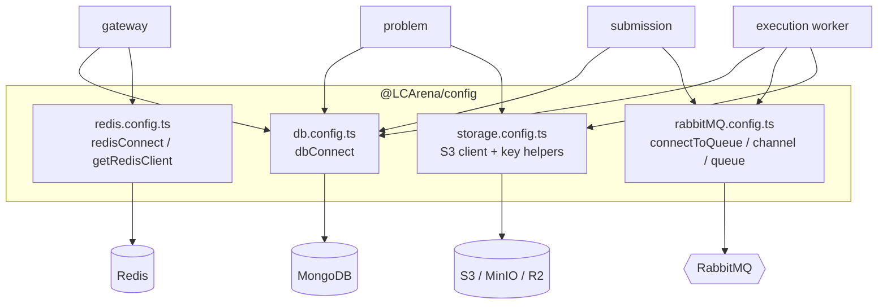

# `@LCArena/config`

Shared infrastructure connections and the single source of truth for LCArena's
**RabbitMQ queue names** and its **object-storage key layout**. Every service that
talks to MongoDB, Redis, RabbitMQ or S3-compatible storage does so through this
package, so connection singletons and naming conventions exist exactly once.

- **Type:** ESM library (`"type": "module"`), built to `dist/` with `tsc`
- **Consumers:** gateway, problem, submission, execution worker
- **Peer infrastructure:** MongoDB, Redis, RabbitMQ, S3-compatible storage

---

## Overview

| Export | Purpose |
| :--- | :--- |
| `dbConnect(MONGODB_URL)` | Singleton Mongoose connection; **exits the process** on failure |
| `redisConnect()` / `getRedisClient()` | Singleton Redis client; `getRedisClient()` throws if `redisConnect()` never ran |
| `connectToQueue()` / `closeQueue()` | AMQP connection + channel, and graceful teardown |
| `channel`, `queue` | The live AMQP channel and the queue-name registry |
| Storage helpers | `getS3Client`, `ensureBucketExists`, `putObject`, `getObject`, `listObjects`, `deleteObject`, `deleteObjectsWithPrefix`, `getPresignedDownloadUrl`, `getStorageConfig`, `getBucketName`, `resetS3Client` |
| Key-layout helpers | `getProblemTestCasePrefix`, `getTestCaseInputKey`, `getTestCaseOutputKey`, `formatTestCaseFolderName` |

## Architecture



`queue` and `channel` are exported **by binding**: `channel` is reassigned inside
`connectToQueue()`, and ES module live bindings mean consumers see the updated
value after connecting. Import them as `import { channel, queue } from "@LCArena/config"`.

## Technology stack

| Concern | Choice |
| :--- | :--- |
| MongoDB | `mongoose` ^9 |
| Redis | `redis` ^6 (`createClient`, socket host/port) |
| RabbitMQ | `amqplib` ^2 |
| Object storage | `@aws-sdk/client-s3` ^3 + `@aws-sdk/s3-request-presigner` |
| Logging / errors | `@LCArena/utils` (`logger`, `InternalServerError`) |
| Module format | ESM (`"type": "module"`), NodeNext resolution, `tsc` to `dist/` |

`jsonwebtoken` and `otp-generator` are declared dependencies but no source file
in this package imports them.

## Directory structure

```
packages/backend/config/
├── src/
│   ├── index.ts            # re-exports; storage is `export *`, the rest explicit
│   ├── db.config.ts        # dbConnect
│   ├── redis.config.ts     # redisConnect, getRedisClient
│   ├── rabbitMQ.config.ts  # queue registry, connectToQueue, closeQueue, channel
│   └── storage.config.ts   # S3 client, bucket helpers, key layout, presigning
└── test/unit/{config,storage}.test.ts
```

## Responsibilities and internal workflow

### MongoDB (`db.config.ts`)

```ts
await dbConnect(process.env.MONGODB_URL)
```

Calls `mongoose.connect` and logs success. On an `Error` it logs
`"Problem Service db connection failed"` (a copy-paste label that now runs for
every service) and calls `process.exit(1)`. Non-`Error` rejections are logged and
**do not** exit. There is no retry and no connection-pool configuration — the
Mongoose defaults apply.

### Redis (`redis.config.ts`)

`redisConnect()` creates the client from `REDIS_HOST` (default `localhost`) and
`REDIS_PORT` (default `6379`), attaches an `error` listener that logs, then
awaits `connect()`. `getRedisClient()` returns the singleton or throws
`InternalServerError("Redis Client not found")` — which is why the gateway must
call `redisConnect()` before serving traffic.

Only the gateway uses Redis today.

### RabbitMQ (`rabbitMQ.config.ts`)

```ts
export const queue = {
  submissionCreated:          "submission.created",
  submissionCompleted:        "submission.completed",
  submissionCreatedDeadLetter:"submission.created.dead",
}
```

`connectToQueue()`:

1. `amqplib.connect(process.env.RABBITMQ_URL || "amqp://localhost")`.
2. `createChannel()`.
3. `channel.assertQueue(queue.submissionCreated)` — **without `durable`**, so the
   queue is transient.
4. Logs `"Connected to RabbitMQ"`; any error is logged and **re-thrown**, so
   callers that `await` it (the gateway does not; submission and execution do)
   see the failure.

`closeQueue()` closes the channel and then the connection, swallowing and logging
each error, and is safe to call when nothing was ever connected.

> ⚠️ **Durability asymmetry.** `submissionCreated` is asserted non-durable here,
> while the execution worker asserts `submissionCompleted` and
> `submissionCreatedDeadLetter` with `{ durable: true }`, and publishes
> completion messages with `{ persistent: true }`. A submission enqueued just
> before a broker restart can therefore be lost, whereas completions cannot.
> See [`docs/SUBMISSION_EVALUATION_FLOW.md`](../../../docs/SUBMISSION_EVALUATION_FLOW.md).

### Object storage (`storage.config.ts`)

`getStorageConfig()` reads the environment once per call (with sensible local
defaults) and resolves credentials from `S3_*` first, then the legacy
`AWS_ACCESS_KEY_ID` / `AWS_ACCESS_KEY` names:

| Resolved field | Resolution order |
| :--- | :--- |
| `endpoint` | `S3_ENDPOINT` (undefined → real AWS) |
| `region` | `S3_REGION` → `us-east-1` |
| `accessKeyId` | `S3_ACCESS_KEY_ID` → `AWS_ACCESS_KEY_ID` → `AWS_ACCESS_KEY` → `minioadmin` |
| `secretAccessKey` | `S3_SECRET_ACCESS_KEY` → `AWS_SECRET_ACCESS_KEY` → `minioadmin` |
| `bucketName` | `S3_BUCKET_NAME` → `lcarena-testcases` |
| `forcePathStyle` | explicit `S3_FORCE_PATH_STYLE`; else `true` whenever an endpoint is set |

`getS3Client()` lazily creates and **caches** one `S3Client`. `resetS3Client()`
clears the cache so tests can change env vars between cases — call it in test
hooks if you mutate `process.env` after the first client creation.

Key layout (the contract between the problem service and the worker):

```
Evaluation_Test_Cases/Test_Cases_<PROBLEM_ID>/test_case_001/input.in
Evaluation_Test_Cases/Test_Cases_<PROBLEM_ID>/test_case_001/output.ans
Evaluation_Test_Cases/Test_Cases_<PROBLEM_ID>/test_case_002/input.in
...
```

- `formatTestCaseFolderName(n)` → `test_case_${String(n).padStart(3, "0")}` — so
  the 1000th case is `test_case_1000` (padding is a minimum width, not a cap).
- `getProblemTestCasePrefix(id)` → `Evaluation_Test_Cases/Test_Cases_<id>/`.
- `getTestCaseInputKey(id, n)` / `getTestCaseOutputKey(id, n)` build the full keys.
- `ensureBucketExists(bucket?)` does `HeadBucket`, then `CreateBucket` on a
  404/`NotFound`/`NoSuchBucket`, tolerating `BucketAlreadyOwnedByYou` /
  `BucketAlreadyExists` for the concurrent-create race. Any other `HeadBucket`
  error is logged and re-thrown.
- `putObject(key, body, contentType = "text/plain; charset=utf-8", bucket?)`
  stringifies to UTF-8, so test-case whitespace and trailing newlines are
  preserved byte-for-byte.
- `getObject(key, bucket?)` normalises Buffer / Uint8Array / stream bodies into a
  single `Buffer`.
- `listObjects(prefix, bucket?)` pages through `ListObjectsV2` with
  `NextContinuationToken` and returns the full key list.
- `deleteObjectsWithPrefix(prefix, bucket?)` lists then deletes in batches of
  1000 (the `DeleteObjects` limit), returning the number of keys removed.
- `getPresignedDownloadUrl(key, expiresInSeconds = 900, bucket?)` — available,
  but **not used by any service** today (the worker streams objects server-side
  instead).

## Public API

```ts
import {
  // connections
  dbConnect, redisConnect, getRedisClient,
  connectToQueue, closeQueue, channel, queue,
  // storage
  getStorageConfig, getS3Client, resetS3Client, getBucketName,
  ensureBucketExists, putObject, getObject, listObjects, deleteObject,
  deleteObjectsWithPrefix, getPresignedDownloadUrl,
  // key layout
  formatTestCaseFolderName, getProblemTestCasePrefix,
  getTestCaseInputKey, getTestCaseOutputKey,
  type StorageConfig,
} from "@LCArena/config";
```

| Signature | Returns | Notes |
| :--- | :--- | :--- |
| `dbConnect(url: string)` | `Promise<void>` | Exits the process on failure |
| `redisConnect()` | `Promise<void>` | Must run before `getRedisClient()` |
| `getRedisClient()` | `RedisClientType` | Throws `InternalServerError` if unconnected |
| `connectToQueue()` | `Promise<void>` | Asserts `submission.created`; re-throws on failure |
| `closeQueue()` | `Promise<void>` | Never throws; safe when never connected |
| `channel` | `Channel` | Live binding; `undefined` until connected |
| `queue` | `{ submissionCreated, submissionCompleted, submissionCreatedDeadLetter }` | Queue-name registry |
| `getStorageConfig()` | `StorageConfig` | Re-reads env on every call |
| `getS3Client()` | `S3Client` | Lazily created, then cached |
| `resetS3Client()` | `void` | Clears the cache (for tests) |
| `getBucketName()` | `string` | Resolved bucket |
| `ensureBucketExists(bucket?)` | `Promise<void>` | HeadBucket, then CreateBucket on 404 |
| `putObject(key, body, contentType?, bucket?)` | `Promise<void>` | Defaults to UTF-8 text |
| `getObject(key, bucket?)` | `Promise<Buffer>` | Normalises stream/Uint8Array bodies |
| `listObjects(prefix, bucket?)` | `Promise<string[]>` | Paginates via continuation tokens |
| `deleteObject(key, bucket?)` | `Promise<void>` | Single key |
| `deleteObjectsWithPrefix(prefix, bucket?)` | `Promise<number>` | Batches of 1000; returns the count |
| `getPresignedDownloadUrl(key, expiresInSeconds?, bucket?)` | `Promise<string>` | Default TTL 900s; currently unused |
| `formatTestCaseFolderName(index)` | `string` | `test_case_001` |
| `getProblemTestCasePrefix(problemId)` | `string` | `Evaluation_Test_Cases/Test_Cases_<id>/` |
| `getTestCaseInputKey(problemId, index)` | `string` | `…/input.in` |
| `getTestCaseOutputKey(problemId, index)` | `string` | `…/output.ans` |

```ts
interface StorageConfig {
  endpoint?: string;
  region: string;
  credentials: { accessKeyId: string; secretAccessKey: string };
  forcePathStyle: boolean;
  bucketName: string;
}
```

## Inter-service communication

This package contains **no application logic and initiates no inter-service
calls**. It provides the clients that other services use:

| Consumer | Uses |
| :--- | :--- |
| Gateway | `dbConnect`, `redisConnect` / `getRedisClient` |
| Problem service | `dbConnect`, storage helpers (writes) |
| Submission service | `dbConnect`, `connectToQueue` / `channel` / `queue` (publishes) |
| Execution worker | `dbConnect`, `connectToQueue` / `channel` / `queue`, `listObjects` / `getObject` (reads) |

The queue names and the storage key layout are the two shared contracts defined
here; changing either affects both the producer and the consumer.

## Environment variables and configuration

Because this package reads `process.env` directly (no `getEnvVariable`), a
missing variable falls back to a default rather than throwing.

| Variable | Default | Used by |
| :--- | :--- | :--- |
| `MONGODB_URL` | *(passed in by each service)* | `dbConnect` argument |
| `REDIS_HOST` | `localhost` | `redisConnect` |
| `REDIS_PORT` | `6379` | `redisConnect` |
| `RABBITMQ_URL` | `amqp://localhost` | `connectToQueue` |
| `S3_ENDPOINT` | *(unset)* | `getStorageConfig` |
| `S3_REGION` | `us-east-1` | `getStorageConfig` |
| `S3_ACCESS_KEY_ID` | `minioadmin` | `getStorageConfig` |
| `S3_SECRET_ACCESS_KEY` | `minioadmin` | `getStorageConfig` |
| `S3_BUCKET_NAME` | `lcarena-testcases` | `getStorageConfig` |
| `S3_FORCE_PATH_STYLE` | `true` when an endpoint is set | `getStorageConfig` |
| `AWS_ACCESS_KEY_ID` / `AWS_ACCESS_KEY` | — | Credential fallback |
| `AWS_SECRET_ACCESS_KEY` | — | Credential fallback |

Cloudflare R2 profile (see [`docs/BACKEND.md`](../../../docs/BACKEND.md)):
`S3_ENDPOINT=https://<account>.r2.cloudflarestorage.com`, `S3_REGION=auto`,
`S3_FORCE_PATH_STYLE=false`.

The default credentials (`minioadmin`) are development placeholders. Never rely
on them outside local Compose.

## Dependencies and prerequisites

| Dependency | Role |
| :--- | :--- |
| `mongoose` ^9 | MongoDB ODM |
| `redis` ^6 | Redis client |
| `amqplib` ^2 | AMQP 0-9-1 client |
| `@aws-sdk/client-s3`, `@aws-sdk/s3-request-presigner` | Object storage + presigning |
| `jsonwebtoken`, `otp-generator` | Declared but **not imported by any source file in this package** (the gateway owns token and OTP logic) |
| `@LCArena/utils` | `logger`, `InternalServerError` |

Build before use outside Turborepo: `npm run build:backend` (or
`npx turbo run build --filter=@LCArena/config`).

## Local development and execution

```sh
npx turbo run build --filter=@LCArena/config
npx turbo run test:unit --filter=@LCArena/config
```

For a fully local stack: `npm run docker:up` (Mongo, Redis, RabbitMQ, MinIO with
a `minio-init` container that creates the bucket).

## Testing

```sh
cd packages/backend/config
npm test        # unit suite, no infrastructure
```

- `test/unit/config.test.ts` asserts the queue-name registry and that
  `getRedisClient()` throws before `redisConnect()`, and that `closeQueue()` is
  safe when nothing is connected.
- `test/unit/storage.test.ts` covers `getStorageConfig` precedence,
  `formatTestCaseFolderName` padding, the key builders and
  `resetS3Client()`.

Neither suite opens a real network connection.

## Error handling and troubleshooting

| Symptom | Cause / handling |
| :--- | :--- |
| Process exits at boot with "Problem Service db connection failed" | Mongo unreachable; the message is generic but comes from `dbConnect` for every service |
| `InternalServerError: Redis Client not found` | `redisConnect()` was never awaited (or failed) before `getRedisClient()` |
| Service starts but never listens | `connectToQueue()` re-throws, and submission/execution await it before `listen()` |
| `NoSuchBucket` / upload failures | Run `ensureBucketExists()` (the problem service does) or create the bucket manually; MinIO's `minio-init` handles Compose |
| S3 requests signed for the wrong URL style | MinIO needs `forcePathStyle: true`; set `S3_FORCE_PATH_STYLE=true`, or unset `S3_ENDPOINT` to use virtual-host style against real AWS/R2 |
| Tests are flaky after changing env vars | Call `resetS3Client()` — the client is cached after first use |
| Messages disappear on broker restart | `submission.created` is asserted without `durable`; see the flow document's reliability section |

## Related packages and services

- [`@LCArena/utils`](../utils/README.md) — `logger`, `InternalServerError`.
- [`@LCArena/models`](../models/README.md) — the schemas stored through `dbConnect`.
- [Problem service](../../../apps/apis/problem/README.md) — the main storage consumer for writes.
- [Execution worker](../../../apps/apis/execution/README.md) — the main storage consumer for reads.
- [Gateway](../../../apps/apis/gateway/README.md) — the only Redis consumer.
- [Submission evaluation flow](../../../docs/SUBMISSION_EVALUATION_FLOW.md).
