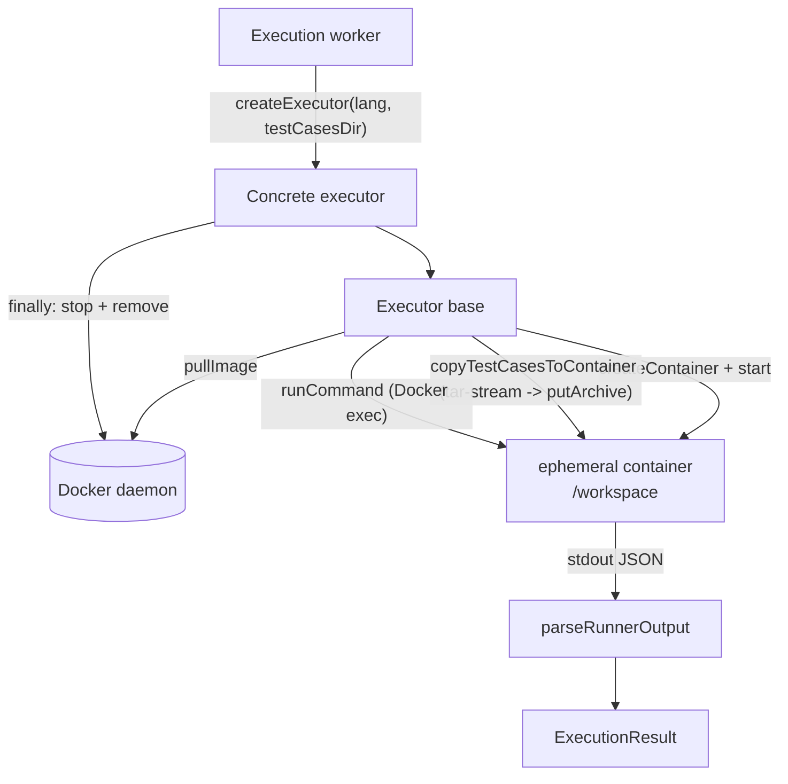

# `@LCArena/execution`

The sandboxed code-execution core. It provides a `dockerode`-based `Executor`
base class, one subclass per supported language, the canonical `ExecutionResult`
verdict union, and the `compareOutputs` judging helper.

- **Type:** ESM library, built to `dist/` with `tsc`
- **Consumer:** the [execution worker](../../../apps/apis/execution/README.md) (via `createExecutor`), the [submission service](../../../apps/apis/submission/README.md) (types), [`@LCArena/models`](../models/README.md) (types)
- **Depends on:** the host Docker daemon, `dockerode`, `tar-stream`

---

## Overview

| Export | Purpose |
| :--- | :--- |
| `Executor` | Abstract base: image pull, in-container command execution, test-case injection, runner-script synthesis |
| `CPPExecutor`, `JavaExecutor`, `PythonExecutor`, `JSExecutor` | Per-language wrappers and commands |
| `TestCasesUnavailableError` | Raised when test cases cannot be read or are empty — an infrastructure failure, never a `SUCCESS` |
| `ExecutionResult` (+ `ExecutionStatus`, `FailedCases`, `CompileErrorResult`, `ExecutionSuccessResult`, `PendingResult`, `InternalErrorResult`) | The canonical verdict union shared by the worker, the API and the database |
| `compareOutputs`, `normalizeOutput`, `ComparisonOptions`, `ComparisonResult` | Standalone judging/comparison utility |

## Architecture



The base class owns everything language-independent; subclasses supply only the
wrapper source, the compile command and the run command.

## Technology stack

| Concern | Choice |
| :--- | :--- |
| Docker API | `dockerode` ^5 (`createContainer`, `exec`, `putArchive`, `pull`, `stop`, `remove`) |
| Archive packing | `tar-stream` ^3 |
| Logging | `@LCArena/utils` (`logger`) |
| In-container harness | Bash + GNU coreutils (`date +%s%N`, `timeout`, `diff -b -B`) |
| Module format | ESM (`"type": "module"`), NodeNext resolution, `tsc` to `dist/` |

`express`, `winston`, `nodemon` and `prettier` are declared dependencies that
this package's source does not import.

## Directory structure

```
packages/backend/execution/
├── src/
│   ├── index.ts                          # public surface
│   ├── errors.ts                         # TestCasesUnavailableError
│   ├── executor/
│   │   ├── Executor.ts                   # abstract base: pull, exec, tar, runner script, parse
│   │   ├── executionResult.type.ts       # ExecutionResult union
│   │   └── index.ts                      # barrel for the executor module
│   ├── executors/
│   │   ├── CppExecutor.ts / JavaExecutor.ts / PythonExecutor.ts / JSExecutor.ts
│   │   └── index.ts
│   ├── judging/outputComparison.ts       # normalizeOutput, compareOutputs
│   └── testcases/                        # sample fixture cases (test_case_id001..040)
└── test/unit/{executor,outputComparison}.test.ts
```

`src/testcases/` holds a 40-case ICPC-style fixture set (`icpc-barrier_1_N.in/.ans`)
used by the package's own tests. The evaluation worker uses its own per-submission
workspace instead.

## The `ExecutionResult` contract

```ts
type ExecutionStatus = "SUCCESS" | "COMPILE_ERROR" | "INTERNAL_ERROR";

interface FailedCases { tle: string[]; re: string[]; wa: string[] }

type ExecutionResult =
  | { status: "PENDING" }
  | { status: "COMPILE_ERROR"; compileError: string }
  | { status: "SUCCESS"; passed: number; total: number;
      failedCases: FailedCases; executionTimeMs: any }
  | { status: "INTERNAL_ERROR"; message: string };
```

Two subtleties that matter everywhere downstream:

1. **`SUCCESS` means "the harness ran", not "accepted".** A wrong answer is
   `SUCCESS` with `failedCases.wa` populated. Human-facing verdicts are derived
   from `failedCases` with the precedence `tle → re → wa` (see the worker's
   `firstFailedTestCase` and the frontend's `parseVerdict`).
2. **`INTERNAL_ERROR` is the only verdict for infrastructure failures.** It exists
   so Docker/storage/persistence problems are never recorded as a misleading
   `SUCCESS`/wrong answer and never leave a submission stuck on `PENDING`.

`executionTimeMs` is typed `any` (it is a `Record<string, number>` in practice,
serialised by bash), so validate before relying on it.
`ExecutionStatus` as declared omits `PENDING` even though the union includes it.

## Base class behaviour (`Executor.ts`)

`static docker: Docker = new Docker()` — one shared client per process, using the
platform default socket (`/var/run/docker.sock`, or `DOCKER_HOST`).

`protected readonly testCasesDir` — the host directory whose **contents** become
`/workspace/testcases` in the container. Defaults to `<cwd>/testcases`; the worker
passes an isolated per-submission temp directory so concurrent runs cannot clobber
each other.

### `pullImage(imageName)`

`getImage(name).inspect()` first; only a `statusCode === 404` triggers a
`docker.pull`, followed by `modem.followProgress`. Any other inspect error is
logged and re-thrown, so a daemon outage surfaces rather than silently pulling.

### `runCommand(container, cmdString)`

Runs `/bin/bash -c <cmdString>` via `container.exec({ AttachStdout, AttachStderr })`
then `exec.start({ Detach: false })`, demultiplexes the stdout/stderr streams, and
**resolves the collected stdout only** (stderr is logged at debug and discarded).
That is why every executor writes its result as JSON on stdout and its errors to
files it then reads.

### `copyTestCasesToContainer(container)`

Recursively reads `testCasesDir`, packs every file into a `tar-stream` archive
with entries named `testcases/<relative posix path>`, and
`container.putArchive(pack, { path: "/workspace" })`. Fails closed with
`TestCasesUnavailableError` when the directory is unreadable or yielded
**zero files** — deliberately, so an empty run is never reported as `SUCCESS`.

Subdirectories are traversed; symlinks are followed by `fs.stat` (they are not
filtered out here, unlike the worker's archive extraction).

### `generateRunnerScript(timeLimit, testcasesDir, compileCmd, runCmd)`

Builds the bash harness described below, with the time limit in **seconds**
(`TIME_LIMIT="<n>s"`).

### `parseRunnerOutput(output)`

`JSON.parse(output.trim())`, falling back to slicing from the first `{` to the
last `}` so stray output around the JSON object is tolerated. Throws
`Error("Failed to parse runner output as JSON: …")` if neither works — which the
worker treats as an infrastructure failure and retries.

### `abstract execute(clientCode, timeLimit, testcasesDir)`

Implemented by each subclass.

## The generated runner script

```bash
TIME_LIMIT="<n>s"
TESTCASES_DIR="./testcases"

# 1. Compile / syntax check
if ! <compileCmd> > compile_stdout.log 2> compile_error.log; then
    # JSON-escape the compiler output (quotes + newlines) and print:
    echo '{"status":"COMPILE_ERROR", "compileError":"<escaped>"}'
    exit 0                                   # note: exit 0, the JSON is the result
fi

for tc_dir in "$TESTCASES_DIR"/*; do
    [ -d "$tc_dir" ] || continue
    tc_name=$(basename "$tc_dir")
    input_file=$(find "$tc_dir" -maxdepth 1 -name "*.in"  | head -n 1)
    ans_file=$(  find "$tc_dir" -maxdepth 1 -name "*.ans" | head -n 1)
    [ -n "$input_file" ] && [ -n "$ans_file" ] || continue

    TOTAL_CASES=$((TOTAL_CASES + 1))
    START_TIME=$(date +%s%N)
    timeout "$TIME_LIMIT" <runCmd> < "$input_file" > "$user_out" 2> "$tc_dir/user.err"
    EXIT_CODE=$?
    END_TIME=$(date +%s%N)
    EXECUTION_TIMES["$tc_name"]=$(( (END_TIME - START_TIME) / 1000000 ))

    if   [ $EXIT_CODE -eq 124 ]; then TLE_CASES+=("\"$tc_name\"")
    elif [ $EXIT_CODE -ne 0   ]; then RE_CASES+=( "\"$tc_name\"")
    elif diff -b -B "$ans_file" "$user_out" > /dev/null 2>&1; then PASSED_CASES=$((PASSED_CASES + 1))
    else WA_CASES+=("\"$tc_name\"")
    fi
done

cat <<EOF
{ "status": "SUCCESS", "passed": <n>, "total": <n>,
  "executionTimeMs": { "<case>": <ms>, ... },
  "failedCases": { "tle": [...], "re": [...], "wa": [...] } }
EOF
```

Verdict rules, exactly as implemented:

| Condition | Result |
| :--- | :--- |
| Compile command returns non-zero | `COMPILE_ERROR` with the compiler output (quotes/newlines escaped via `sed`/`tr`, so multi-line output arrives as one string) |
| Run exit code `124` (GNU `timeout` killed it) | Case listed in `failedCases.tle` |
| Run exit code non-zero | Case listed in `failedCases.re` |
| `diff -b -B ans user.out` matches | Case counted as passed |
| Otherwise | Case listed in `failedCases.wa` |
| No case folder has both a `*.in` and a `*.ans` | `SUCCESS` with `total: 0` at the script level — but the worker's `validateTestCaseFolderCompleteness` rejects this before execution |

Per-case timing uses `date +%s%N` (nanoseconds) and is reported in milliseconds.
`EXECUTION_TIMES` is a bash associative array, so the script requires bash (not
`sh`) — every image in use has it.

### `compareOutputs` is *not* on the sandbox path

The runner compares with **`diff -b -B`**: ignore changes in the amount of
whitespace, and ignore changes whose lines are entirely blank. The richer
`compareOutputs`/`normalizeOutput` helper exported by this package is a separate,
independently tested implementation used elsewhere (notably the frontend's
in-browser judge in `apps/frontend/src/utils/codeRunner.ts`). If you change the
judging policy, change **both** — they can currently disagree.

`compareOutputs(actual, expected, options)` normalisation, with
`ignoreSpaceChange = true`, `ignoreBlankLines = true`, `stripTrailingCr = true`
by default:

1. `\r\n` and `\r` → `\n`.
2. Per line: strip trailing spaces/tabs; if `ignoreSpaceChange`, collapse internal
   runs of spaces/tabs to a single space, then trim.
3. If `ignoreBlankLines`, drop all empty lines; otherwise drop only trailing
   empty lines.
4. Return `matched`, the normalised pair, and on mismatch a `diffLine` (1-based)
   plus a human `reason` describing missing, extra or differing content.

## Language implementations

| Language | Class | Image | Wrapper | Compile | Run |
| :--- | :--- | :--- | :--- | :--- | :--- |
| C++ | `CPPExecutor` | `gcc:latest` | `Main.cpp` = `<bits/stdc++.h>` + `#include "Solution.cpp"` + a `main()` that repeatedly reads `n` then `n` coordinate pairs and prints `Solution().solve(points)` | `g++ -O3 -std=c++17 "Main.cpp" -o "./solution"` | `./solution` |
| Java | `JavaExecutor` | `eclipse-temurin` | `Main.java` that reads tokens with a `Scanner` and delegates to `new Solution().solve(...)` | `javac Main.java Solution.java` | `java Main` |
| Python | `PythonExecutor` | `python:3.11-slim` | `main.py` that reads `sys.stdin.read().split()` and prints `Solution().solve(points)` | `python -m py_compile solution.py` | `python main.py` |
| JavaScript | `JSExecutor` | `node:20-slim` | `main.js` that reads `fs.readFileSync(0)` and calls `Solution.solve(...)` | `node -c solution.js` | `node main.js` |

All four follow the same container protocol:

1. `pullImage`.
2. `createContainer({ Image, Cmd: ["/bin/bash","-c","tail -f /dev/null"], WorkingDir: "/workspace", HostConfig: {} })`, `start()`.
3. `copyTestCasesToContainer`.
4. Write three base64 blobs with `echo "<b64>" | base64 -d > /workspace/<file>`
   (wrapper, user solution, `runner.sh` + `chmod +x`). Base64 avoids all shell
   quoting problems with arbitrary user source.
5. `runCommand(container, "./runner.sh")` → `parseRunnerOutput`.
6. `finally`: `container.stop()` then `container.remove()`.

`HostConfig` is an **empty object** — see the gaps section.

> ⚠️ **The wrapper I/O format is problem-shaped, not generic.** The generated
> `main` functions read a leading integer `n` followed by `n` pairs of integers
> (the "points" shape used by the sample problem). A problem whose input has any
> other structure cannot be judged, regardless of the user's solution, because the
> wrapper — not the user's code — parses stdin. This is the single most important
> limitation of the current judging engine.

## API documentation

There is no HTTP API. The programmatic surface is:

```ts
import {
  Executor, CPPExecutor, JavaExecutor, PythonExecutor, JSExecutor,
  TestCasesUnavailableError,
  compareOutputs, normalizeOutput,
  type ExecutionResult,
} from "@LCArena/execution";

const executor: Executor = new JSExecutor("/tmp/isolated-testcases");
const result: ExecutionResult = await executor.execute(userCode, 5 /* seconds */, "testcases");
```

- `execute(clientCode, time_limit, testcases_dir)` — `time_limit` is in **seconds**
  (the worker converts from `problem.time_limit` ms), `testcases_dir` is the
  in-container directory name (always `"testcases"` in the worker).
- `TestCasesUnavailableError` should be treated by callers as an infrastructure
  failure, and the worker does exactly that (it rethrows and lets the retry
  policy handle it).

## Inter-service communication

This package is a **library**, not a service: it opens no ports and speaks no
HTTP. Its cross-boundary traffic is all Docker-side.

| Direction | Mechanism | Details |
| :--- | :--- | :--- |
| Out | Docker daemon over the local socket | `pull`, `createContainer`, `start`, `putArchive`, `exec`, `stop`, `remove` — the socket path is Docker's own configuration (`DOCKER_HOST`, else the platform default) |
| Out | Container registry (via the daemon) | First-use pulls of `gcc:latest`, `eclipse-temurin`, `python:3.11-slim`, `node:20-slim` |
| In | Host filesystem | Reads `testCasesDir` (the worker supplies an isolated per-submission temp directory, never a shared path) |
| In | Docker exec stdout | The runner's JSON verdict, parsed by `parseRunnerOutput` |

The only in-container channel back to LCArena is that single JSON object on
stdout; stderr is captured by the runner into per-case `user.err` files and is not
returned. The one caller is the execution worker's `createExecutor` registry — see
[the worker README](../../../apps/apis/execution/README.md).

## Environment variables and configuration

**None.** The Docker client is configured by Docker's own mechanism
(`DOCKER_HOST`, the platform socket). Timeouts, images and the test-case
directory are constructor/method arguments, which is what makes the executors
unit-testable.

## Dependencies and prerequisites

| Dependency | Role |
| :--- | :--- |
| `dockerode` ^5 | Docker API client |
| `tar-stream` ^3 | Packing the test-case archive |
| `@LCArena/utils` | `logger` |
| `nodemon`, `prettier`, `winston`, `express` | Declared but unused by this package's source |

Runtime prerequisites:

- A reachable Docker daemon. **No fallback exists** — without it every `execute`
  rejects.
- Linux-container support (the images are Linux-only).
- Network access to the registry for the first pull of each image.
- The default bridge network is used (no `NetworkMode` is set), so the container
  has outbound network access while running untrusted code.

## Local development and execution

```sh
npx turbo run build --filter=@LCArena/execution
npx turbo run test:unit --filter=@LCArena/execution
```

To try an executor by hand you need Docker running and the language image
available; see [the worker README](../../../apps/apis/execution/README.md) for the
full pipeline and the `E2E=1` integration test, which is the supported way to
exercise this package against real containers.

## Testing

```sh
cd packages/backend/execution
npm test        # unit suite; Docker and network calls are stubbed
```

- `test/unit/executor.test.ts` covers the base class: `pullImage` (existing image
  vs 404 pull), `runCommand` stdout demultiplexing, the tar packing and the
  zero-file failure, `generateRunnerScript` output, and `parseRunnerOutput`
  (including the messy-output fallback).
- `test/unit/outputComparison.test.ts` covers `normalizeOutput` and
  `compareOutputs`: CRLF/CR handling, trailing and internal whitespace, blank-line
  policy, JSON/string equality, and `diffLine`/`reason` reporting.

The `src/testcases/` fixture set (40 ICPC-barrier cases) is used by these suites.

## Error handling and troubleshooting

| Symptom | Cause / handling |
| :--- | :--- |
| `TestCasesUnavailableError: No test cases found in …` | The host directory was empty or unreadable — fails closed rather than reporting a zero-test pass |
| `Error: Failed to parse runner output as JSON: …` | The container produced no parsable JSON (usually the wrapper crashed before printing); the worker retries, then records `INTERNAL_ERROR` |
| `docker: Error response from daemon: … not found` / inspect error | Image missing and the pull failed (registry unreachable), or the daemon is down |
| Every case reported as RE | The wrapper could not parse the input shape for this problem (see the wrapper caveat) |
| Compile error text is truncated or mangled | The escaping pipeline (`sed` then `tr`) collapses newlines into spaces by design |
| `status: "SUCCESS"` but `total: 0` | Only possible when bypassing the worker, which validates case completeness first |
| Containers left running | `stop()`/`remove()` are in `finally`; leftovers mean the daemon or process died mid-run |
| Unit tests pass but nothing executes | Expected: the suites stub Docker, so only the worker's `E2E=1` test proves real execution |

## Security notes and gaps

Good properties already implemented:

- Untrusted code never runs on the host; it runs in ephemeral containers that are
  removed afterwards.
- Wall-clock time is bounded per case by GNU `timeout`.
- User source is transferred via base64, avoiding shell-injection through code
  content.
- An empty test-case set is refused rather than silently reported as a pass.

Open hardening gaps (documented, not fixed):

1. **`HostConfig: {}`** — no memory limit, no CPU quota, no pids limit, no
   `CapDrop`, no `ReadonlyRootfs`, no `SecurityOpt`. A submitted program can
   exhaust host memory or spawn unbounded processes.
2. **No network isolation** — the default bridge is used, so untrusted code has
   outbound network access while it runs.
3. **Runs as the image's default user** (root in the language images) inside the
   container.
4. **No timeout on the Docker API calls themselves** — a hung `exec` or `pull`
   blocks the single-prefetch consumer indefinitely.
5. **Fixed wrapper I/O shape** — only `n` + `n` integer pairs is supported, as
   described above.
6. **Two judging implementations** (`diff -b -B` in the runner, `compareOutputs`
   in TypeScript) that can drift apart.

## Related packages and services

- [Execution worker](../../../apps/apis/execution/README.md) — `createExecutor` registry, workspace staging and retries.
- [`@LCArena/models`](../models/README.md) — stores `ExecutionResult` in `Submission.status`.
- [`@LCArena/utils`](../utils/README.md) — `logger`.
- [`@LCArena/config`](../config/README.md) — test-case storage the worker stages into `testCasesDir`.
- [Submission evaluation flow](../../../docs/SUBMISSION_EVALUATION_FLOW.md) — the complete end-to-end trace, including these gaps.
