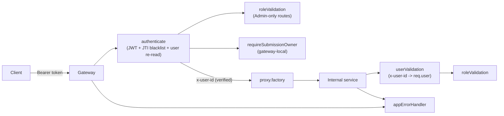

# `@LCArena/middlewares`

Express middleware shared by the LCArena services: the perimeter identity check,
the role guard, the centralized error handler, and the `req.user` type
augmentation that lets every service agree on the authenticated-caller shape.

- **Type:** ESM library, built to `dist/` with `tsc`
- **Consumers:** gateway (`appErrorHandler`, `roleValidation`), submission (`userValidation`, `appErrorHandler`), problem (`appErrorHandler`), mail (`appErrorHandler`), execution worker (`appErrorHandler`)

---

## Overview

| Export | Signature | Purpose |
| :--- | :--- | :--- |
| `userValidation` | `(req, res, next) => Promise<void>` | Resolve `x-user-id` → `req.user`, or `401`/`404` |
| `roleValidation` | `(...allowedRoles) => (req, res, next) => void` | Fail-closed RBAC gate on `req.user.userRole` |
| `appErrorHandler` | `(err, req, res, next) => Response` | Single error → HTTP mapping for every service |
| `AuthenticatedUser` | type | `{ userId: string; userRole?: UserType }` |

## The two identity models

The repository has **two** distinct ways a request acquires an identity, and this
package implements both:

| | `userValidation` | gateway's `authenticate` |
| :--- | :--- | :--- |
| Used by | Internal services (submission) | The gateway, on its own routes |
| Input | `x-user-id` header | `Authorization: Bearer <JWT>` |
| Checks | Header present + user exists in Mongo | Signature, expiry, Redis JTI blacklist, then re-reads the user |
| Sets | `req.user = { userId, userRole }` | same shape |
| Result on failure | `401 { message: "Missing user header" }` or `404 User not found` | `401` with a specific message |

The gateway's `authenticate` is what makes `x-user-id` trustworthy: it strips any
client-supplied `x-user-id` before proxying and injects the value it verified
(`proxy.factory.ts`). `userValidation` therefore exists to make internal services
*practically* safe when reached only through the gateway — it is **not** a
cryptographic boundary, and a direct call to a downstream port with a forged
`x-user-id` for an existing user will succeed. Keep the downstream ports internal.

## Architecture



## Technology stack

| Concern | Choice |
| :--- | :--- |
| HTTP | `express` ^5 (middleware signatures and `Response`) |
| Validation errors | `zod` ^4 (`ZodError` detection) |
| Errors / logging | `@LCArena/utils` (`AppError` family, `logger`) |
| Persistence | `@LCArena/models` (`User` lookup, `UserType`) |
| Tests | `node:test` with `--experimental-test-module-mocks` (the suites mock `@LCArena/models`) |
| Module format | ESM (`"type": "module"`), NodeNext resolution, `tsc` to `dist/` |

`@LCArena/config` is a declared dependency that no source file in this package
imports.

## Directory structure

```
packages/backend/middlewares/
├── src/
│   ├── index.ts             # public surface + AuthenticatedUser type re-export
│   ├── userValidation.ts    # x-user-id -> req.user
│   ├── roleValidation.ts    # RBAC guard
│   ├── errorHandler.ts      # appErrorHandler
│   └── express-request.ts   # AuthenticatedUser + `declare global` Request.user augmentation
└── test/unit/{userValidation,roleValidation,errorHandler}.test.ts, helpers.ts
```

### Why `express-request.ts` exists

`declare global { namespace Express { interface Request { user?: AuthenticatedUser } } }`
used to live inside `userValidation.ts`, which meant any file reading `req.user`
only compiled when that exact sibling file happened to be in the same program —
it broke `roleValidation.ts` and the gateway. Moving the augmentation into its own
module makes it apply program-wide as soon as `@LCArena/middlewares` is imported.
That is why `roleValidation.ts` and `express-request.ts` both end with `export {}`.

## Responsibilities and internal workflow

### `userValidation`

```ts
const rawUserId = req.headers["x-user-id"]
if (!rawUserId || typeof rawUserId !== "string")
    return res.status(401).json({ message: "Missing user header" })

const userId = rawUserId.replace(/"/g, "")   // tolerates a quoted header value
const user = await User.findById(userId)
if (!user) throw new NotFoundError("User not found")

req.user = { userId, userRole: user.userType }
next()
```

Notes: the `401` is written **directly** (bypassing `appErrorHandler`, so it is
the one response in the codebase without a `success` field), a quoted header
value is cleaned up before the lookup, and a well-formed-but-unknown id produces
`404`, not `401`.

### `roleValidation(...allowedRoles)`

Throws `UnauthorizedError` (401) when `req.user` is absent or has no role — the
message tells you `userValidation` must run first — and `ForbiddenError` (403)
when the role is not in the allowlist. Denials go through `next(error)` so
`appErrorHandler` owns the response and the rejection is logged.

Usage (gateway):

```ts
router.post("/", authenticate, roleValidation(UserType.Admin), problemProxy)
```

### `appErrorHandler`

```ts
logger.error(err)

if (err instanceof ZodError)  -> 400 { success: false, message: "Validation Error",
                                        errors: [{ path, message }] }
if (err instanceof AppError)  -> err.statusCode { success: false, message }
if (4xx statusCode/status)    -> that status   { success: false, message }
if (err.name === "CastError") -> 400 { success: false, message: "Invalid value for <path>" }
otherwise                     -> 500 { success: false, message: err.message || "Internal Server Error" }
```

Design intent: malformed JSON bodies (thrown by `express.json()`) and bad
ObjectId casts are client mistakes, so they are reported as `4xx` rather than
leaked as 500s. The final branch does surface `err.message` to the client, so do
not put secrets in thrown error messages.

The handler is mounted **last** in each app, after the route table and (in the
gateway) after `notFoundHandler`.

## API documentation

There is no HTTP API; this package is a middleware library. Behaviour is fully
described by the status codes and bodies in the table above.

## Inter-service communication

None directly. Its effect on inter-service traffic is that `userValidation`
consumes the `x-user-id` header the gateway injects — the *only* channel of
verified identity between the edge and the internal services.

| Header | Producer | Consumer |
| :--- | :--- | :--- |
| `x-user-id` | gateway `proxy.factory` (verified) | `userValidation` in submission |
| `x-forwarded-for`, `x-forwarded-proto`, `x-forwarded-host` | gateway `proxy.factory` | informational |
| `authorization` | client | gateway only — **stripped** before proxying |

## Environment variables and configuration

None. The package reads no environment variables and has no configuration surface.

## Dependencies and prerequisites

| Dependency | Role |
| :--- | :--- |
| `express` ^5 | Types |
| `zod` ^4 | `ZodError` detection |
| `@LCArena/utils` | `AppError` family, `logger` |
| `@LCArena/models` | `User` lookup, `UserType` |
| `@LCArena/config` | Declared dependency; **not imported** by any source file here |

Build before use outside Turborepo.

## Local development and execution

```sh
npx turbo run build --filter=@LCArena/middlewares
npx turbo run test:unit --filter=@LCArena/middlewares
```

Note the package's `test:unit` script uses
`node --experimental-test-module-mocks --import tsx --test`, because the suites
mock `@LCArena/models` and `@LCArena/utils` module imports. Running the suites
with a plain `node --test` will not work.

## Testing

```sh
cd packages/backend/middlewares
npm test        # unit suite with module mocks; no infrastructure
```

- `userValidation.test.ts` — missing/array/non-string headers, quoted values,
  unknown user, success path.
- `roleValidation.test.ts` — no user, no role, allowed role, denied role.
- `errorHandler.test.ts` — Zod errors, each `AppError` subclass, 4xx status
  passthrough, `CastError`, and the generic 500.
- `helpers.ts` builds fake Express `req`/`res`/`next` objects.

## Error handling and troubleshooting

| Symptom | Cause / handling |
| :--- | :--- |
| `401 { message: "Missing user header" }` | `x-user-id` absent. This body has no `success` field — it is the only handler that writes its own response |
| `404 User not found` from an internal service | The gateway injected an id that no longer exists in this service's database (e.g. pointing at a different Mongo) |
| `401 "…userValidation must run before roleValidation"` | Middleware order is wrong on the route |
| `403 Role '<role>' is not allowed to access this path` | Working as intended; check the route's `roleValidation(...)` allowlist |
| Validation errors arrive as 500 in one service | `appErrorHandler` is not mounted last, or the error is wrapped and loses `ZodError`/`AppError` identity before reaching it |
| `req.user` is `undefined` in TypeScript | Import `AuthenticatedUser` (or anything) from `@LCArena/middlewares` so the global augmentation is in the program |
| Tests fail with "Cannot find module @LCArena/models" | Build the workspace packages first — the suites mock real module specifiers |

## Related packages and services

- [`@LCArena/utils`](../utils/README.md) — the `AppError` taxonomy and `logger`.
- [`@LCArena/models`](../models/README.md) — the `User` lookup and `UserType`.
- [Gateway](../../../apps/apis/gateway/README.md) — `authenticate`, `notFoundHandler`, `requireSubmissionOwner` all follow this package's `req.user` convention.
- [Submission service](../../../apps/apis/submission/README.md) — the main `userValidation` consumer.
- [Submission evaluation flow](../../../docs/SUBMISSION_EVALUATION_FLOW.md).
