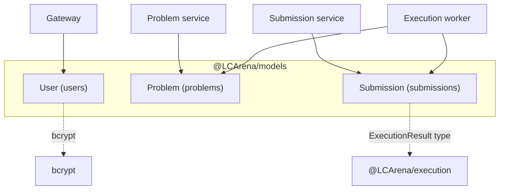

# `@LCArena/models`

Mongoose schemas and domain types shared by every LCArena service. It defines the
three persistent collections (`users`, `problems`, `submissions`), the
`ELanguage` and `UserType` enums, and the bcrypt password hook.

- **Type:** ESM library, built to `dist/` with `tsc`
- **Consumers:** gateway (User), problem (Problem), submission (Submission), execution worker (both)
- **Depends on:** `mongoose`, `bcrypt`, and `@LCArena/execution` for the verdict type

---

## Overview

| Export | Kind | Notes |
| :--- | :--- | :--- |
| `User`, `IUser`, `IUserMethods`, `UserModel`, `UserType` | model + types + enum | bcrypt hashing on save, `comparePassword()` |
| `Problem`, `IProblem` | model + type | metadata + object-storage pointers |
| `Submission`, `ISubmission`, `ELanguage` | model + type + enum | `status` is the canonical execution verdict |

## Architecture

A pure data-layer package: it owns the schemas and imports nothing that connects
to infrastructure — connection lifecycle belongs to `@LCArena/config`.



Each collection has exactly one owning writer for its meaningful fields:

| Collection | Written by | Read by |
| :--- | :--- | :--- |
| `users` | Gateway (register, role change, password change, delete) | Gateway, `userValidation` in the Submission service |
| `problems` | Problem service (create/update/delete) | Problem service, Execution worker |
| `submissions` | Submission service (create), Execution worker (verdict) | Both, plus the gateway's ownership guard |

## Technology stack

| Concern | Choice |
| :--- | :--- |
| ODM | `mongoose` ^9 (`Schema`, `Model`, `Document`, `HydratedDocument`) |
| Password hashing | `bcrypt` ^6 (cost 10, `pre("save")` hook + `comparePassword`) |
| Verdict typing | `ExecutionResult` from `@LCArena/execution` |
| Module format | ESM (`"type": "module"`), NodeNext resolution, `tsc` to `dist/` |

`@aws-sdk/client-s3` and `@aws-sdk/s3-request-presigner` are declared
dependencies that this package's source does not import.

## Directory structure

```
packages/backend/models/
├── src/
│   ├── index.ts             # the only public entry point (re-exports the three models)
│   ├── user.model.ts        # User, UserType, IUserMethods
│   ├── problem.model.ts     # Problem
│   └── submission.model.ts  # Submission, ELanguage
└── test/unit/{user,problem,submission}.model.test.ts
```

`index.ts` imports from `./*.model.js` (with the `.js` extension, required by
NodeNext ESM resolution) and re-exports the named bindings.

## Schemas

### `users` — `User`

```ts
{
  name:           String,  required, trim
  email:          String,  required, unique, lowercase, trim
  password:       String,  required, minlength 6   // stored as a bcrypt hash (cost 10)
  profilePicUrl:  String,  default "/default-url", required
  userType:       String,  enum UserType,  default "Regular", required
  roleExpiry:     Date,    default null
  resetPasswordToken: String
  resetTokenExpiry:   String
}
// { timestamps: true }
```

- `UserType = "Regular" | "Admin" | "Premium"`.
- A `pre("save")` hook re-hashes **only when `password` is modified**
  (`if (!this.isModified("password")) return`), so an unrelated `save()` does not
  double-hash an existing digest.
- `comparePassword(candidate)` → `bcrypt.compare(candidate, this.password)`
  (`IUserMethods`).
- `unique: true` on `email` is a **schema-level index declaration**, not a
  guarantee that the index exists — ensure it is built in any environment where
  duplicate signups matter. The gateway also does an explicit
  `findOne({ email })` check before creating a user.
- `resetPasswordToken` / `resetTokenExpiry` exist on the schema but **no code in
  this repository reads or writes them**; password reset is not implemented.
  `resetTokenExpiry` is typed as `String`, not `Date`.

### `problems` — `Problem`

```ts
{
  description:          String, required
  difficulty:           String, required, enum ["Easy", "Medium", "Hard"]
  sampleTestCaseUrl:    String, required
  testCasesUrl:         String, required        // required: true in the schema
  time_limit:           Number, required, default 5000   // milliseconds
  testCaseStoragePrefix:String, required false   // e.g. "Evaluation_Test_Cases/Test_Cases_<ID>/"
  testCasesCount:       Number, required false, default 0
}
// { timestamps: true }
```

The `testCasesUrl` required flag is worth knowing: the **service-level** Zod
schema accepts a create request with only an inline `testCases` array by
injecting `testCasesUrl: "storage://auto"` in a `preprocess` step, so the two
layers agree in practice.

### `submissions` — `Submission`

```ts
{
  problemId: ObjectId, ref "Problem"
  code:      String, required
  language:  String, required, enum Object.values(ELanguage)
  userId:    ObjectId, ref "User"
  status:    Mixed, required      // the ExecutionResult union
}
// { timestamps: true }
// indexes: { userId: 1, createdAt: -1 }, { problemId: 1, createdAt: -1 }
```

- `ELanguage = "py" | "cpp" | "java" | "js"`.
- `status` is `mongoose.Schema.Types.Mixed` because the verdict is a
  discriminated union, not a fixed shape. `ISubmission.status` is typed as
  `ExecutionResult` imported from `@LCArena/execution`, so the compiler keeps the
  model, the HTTP validation layer and the evaluation worker aligned.
- The two compound indexes back the "my submissions, newest first" and "this
  problem's submissions, newest first" access patterns. Note that `problemId`
  and `userId` are declared **without** `required: true` or `index: true`, even
  though `ISubmission` types them as non-optional.

The verdict union (`@LCArena/execution`):

```ts
{ status: "PENDING" }
{ status: "COMPILE_ERROR", compileError: string }
{ status: "SUCCESS", passed: number, total: number,
  failedCases: { tle: string[], re: string[], wa: string[] },
  executionTimeMs: Record<string, number> }
{ status: "INTERNAL_ERROR", message: string }
```

`SUCCESS` means "the harness completed", not "accepted" — a wrong answer is
`SUCCESS` with `failedCases.wa` populated. Consumers derive the human verdict
from those arrays (see `apps/frontend/src/utils/verdictHelper.ts`).

## Public API

```ts
import {
  User, type IUser, type IUserMethods, type UserModel, UserType,
  Problem, type IProblem,
  Submission, type ISubmission, ELanguage,
} from "@LCArena/models";
```

| Export | Kind | Notes |
| :--- | :--- | :--- |
| `User` | model | `mongoose.model<IUser, UserModel>("User", userSchema)` |
| `IUser`, `UserModel`, `IUserMethods` | types | Document/model/method typing |
| `UserType` | enum | `"Regular" \| "Admin" \| "Premium"` |
| `Problem`, `IProblem` | model + type | Catalogue + storage pointers |
| `Submission`, `ISubmission` | model + type | `status` is the verdict union |
| `ELanguage` | enum | `"py" \| "cpp" \| "java" \| "js"` |

Instance method on `User` documents:

```ts
const user = await User.findOne({ email });
await user?.comparePassword(candidate);   // -> Promise<boolean>
```

Typical usage:

```ts
const submission = await Submission.create({
  problemId: new mongoose.Types.ObjectId(problemId),
  userId:    new mongoose.Types.ObjectId(userId),
  code, language, status: { status: "PENDING" },
});
```

`index.ts` is the only public entry point. Deep imports such as
`@LCArena/models/dist/user.model.js` are not part of the contract.

## Inter-service communication

None directly — this package opens no connections and makes no network calls. It
*is* the shared vocabulary over which services communicate indirectly: every
service writes and reads the same three collections through the same schemas
(see the ownership table in [Architecture](#architecture)).

## Environment variables and configuration

None. This package reads no environment variables; connection strings are passed
into `dbConnect` from [`@LCArena/config`](../config/README.md).

## Dependencies and prerequisites

| Dependency | Role |
| :--- | :--- |
| `mongoose` ^9 | Schemas and models |
| `bcrypt` ^6 | Password hashing (native module — the Docker build needs build tools or a prebuilt binary) |
| `@LCArena/execution` | The `ExecutionResult` type used by `Submission.status` |
| `@aws-sdk/client-s3`, `@aws-sdk/s3-request-presigner` | Declared but **unused** in this package's source |
| `@types/jsonwebtoken`, `@types/otp-generator` | Declared dev deps for packages not imported here |

Because `Submission` imports a type from `@LCArena/execution`, that package must
be built first — Turborepo's `dependsOn: ["^build"]` handles this in
`npm run build:backend`.

## Local development and execution

```sh
npx turbo run build --filter=@LCArena/models
npx turbo run test:unit --filter=@LCArena/models
```

Models are registered **per process**: importing this package is enough to
register the schemas, and a service crashes at first query if Mongoose is not
connected. There is no `syncIndexes()` call anywhere, so new indexes are only
created when `autoIndex` runs (Mongoose's default in non-production) —
production deployments should build them explicitly.

## Testing

```sh
cd packages/backend/models
npm test        # unit suite, no MongoDB required
```

`test/unit/*.model.test.ts` assert schema paths, defaults, enums, the bcrypt
`pre("save")` behaviour, `comparePassword`, and the declared indexes. No live
connection is opened.

## Error handling and troubleshooting

| Symptom | Cause / handling |
| :--- | :--- |
| `E11000 duplicate key error … email_1` | The unique index rejected a duplicate signup; the gateway normally pre-checks with `findOne` and returns a 400 |
| Password stored in plaintext / login fails after a direct `save()` | The hook only re-hashes when `password` is modified — assign `user.password = …` then `save()`, never `findByIdAndUpdate({ password })`, which bypasses hooks |
| `CastError` on `userId`/`problemId` | A non-ObjectId string was written; `appErrorHandler` maps this to `400 Invalid value for <path>` |
| Verdict reads as `undefined` | `status` is `Mixed`; there is no schema-level shape enforcement, so validate at the boundary (the submission service does, with Zod) |
| Indexes missing in production | `autoIndex` is not enabled explicitly; create them in a migration step |

## Related packages and services

- [`@LCArena/config`](../config/README.md) — `dbConnect` and the storage key helpers.
- [`@LCArena/execution`](../execution/README.md) — the `ExecutionResult` union stored in `Submission.status`.
- [Gateway](../../../apps/apis/gateway/README.md) — owns all `User` writes and auth flows.
- [Problem service](../../../apps/apis/problem/README.md) — owns `Problem` writes.
- [Submission service](../../../apps/apis/submission/README.md) — creates `Submission` documents.
- [Execution worker](../../../apps/apis/execution/README.md) — writes the verdict back.
- [Submission evaluation flow](../../../docs/SUBMISSION_EVALUATION_FLOW.md).
