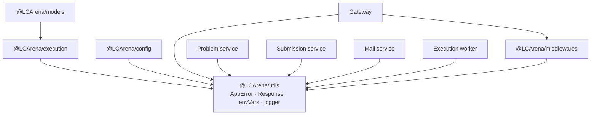

# `@LCArena/utils`

The small, dependency-light primitives every LCArena service is built on: the
`AppError` taxonomy, the HTTP response envelope, environment-variable loading, and
a Winston logger with a table renderer.

- **Type:** ESM library, built to `dist/` with `tsc`
- **Consumers:** every backend workspace, directly or through another package
- **Depends on:** `winston` and `express` (types only for the latter)

---

## Overview

| Export | Kind | Purpose |
| :--- | :--- | :--- |
| `AppError` (+ 7 subclasses) | classes | Typed, status-carrying errors |
| `sendSuccess`, `sendError` | functions | The shared JSON response envelope |
| `getEnvVariable` | function (default export) | Required/optional env lookup that throws loudly |
| `logger` | Winston instance (+ `.table()`) | Structured console logging |

`getEnvVariable` is a **default export** (`import getEnvVariable from "@LCArena/utils"`),
while every other member is named. `index.ts` re-exports the rest explicitly and
does not use `export *`.

## Architecture

This package sits at the bottom of the dependency graph: it imports nothing from
LCArena and everything else imports it. Keeping it free of infrastructure code is
what lets `appErrorHandler` and the response envelope be used by the gateway (no
frontend-facing dependency on Mongo) as well as by the queue worker.



## Technology stack

| Concern | Choice |
| :--- | :--- |
| Logging | `winston` ^3, console transport only, colourised printf format |
| HTTP types | `express` ^5 (`Response`) — type-only at runtime |
| Module format | ESM (`"type": "module"`), NodeNext resolution, `tsc` to `dist/` |
| Runtime dependencies | None beyond the two above |

## Directory structure

```
packages/backend/utils/
├── src/
│   ├── index.ts      # re-exports logger, Response, AppError family, getEnvVariable
│   ├── AppError.ts   # AppError + BadRequest/NotFound/Unauthorized/Forbidden/Conflict/InternalServer/NotImplemented
│   ├── Response.ts   # sendSuccess / sendError
│   ├── envVars.ts    # getEnvVariable(name, required = true)
│   └── logger.ts     # winston logger + logger.table()
└── test/unit/{appError,response,envVars,logger}.test.ts
```

## Responsibilities and internal workflow

### `AppError` taxonomy

```ts
class AppError extends Error {
  readonly statusCode: number
  constructor(message, statusCode, name)   // captures the stack, sets `name`
}
```

| Class | `statusCode` | Default `name` |
| :--- | ---: | :--- |
| `BadRequestError` | 400 | `BadRequestError` |
| `UnauthorizedError` | 401 | `Unauthorized Error` |
| `ForbiddenError` | 403 | `ForbiddenError` |
| `NotFoundError` | 404 | `NotFoundError` |
| `ConflictError` | 409 | `ConflictError` |
| `InternalServerError` | 500 | `Internal Server Error` |
| `NotImplementedError` | 501 | `NotImplementedError` |

Every subclass signature is `(message, statusCode = <default>, name = <default>)`,
so a caller can override the status when a specific case deserves a different
code. `appErrorHandler` in [`@LCArena/middlewares`](../middlewares/README.md)
uses `instanceof AppError` to decide the response status — so **always throw these
rather than plain `Error`s** when a client should see a specific status. A plain
`Error` becomes a 500.

### Response envelope

```ts
sendSuccess<T>(res, data?: T, message = "Success", status = 200)
// -> { status, message, success: true, data, error: null }

sendError<T>(res, message = "Something went wrong", status = 500, error = null)
// -> { status, message, success: false, data: null, error }
```

`sendSuccess` is used by every controller (gateway auth, problem, submission,
mail). `sendError` is exported and unit-tested but **not used by any service** —
error responses actually come from `appErrorHandler`, which emits the smaller
shape `{ success: false, message, errors? }`. The frontend therefore only relies
on `success` and `message` for failures.

Because `sendSuccess` returns `res.status(...).json(...)`, controllers commonly
`return sendSuccess(...)` to end the handler.

### `getEnvVariable`

```ts
getEnvVariable(name: string, required = true): string
```

- `required = true` (the default): throws
  ``Error(`Missing required environment variable: ${name}`)`` when the variable is
  unset **or whitespace-only**.
- `required = false`: returns `""` instead of throwing.

The throw happens at **module load** in every `constants.ts`/`env.config.ts`
because those files call it at the top level — which is why a service with a
missing required variable dies immediately at boot with a clear message instead of
failing on the first request. This is the intended behaviour and is documented in
[`docs/BACKEND.md`](../../../docs/BACKEND.md) troubleshooting.

### `logger`

Winston, console transport only, level from `LOG_LEVEL` (default `info`),
format `errors({ stack: true })` + `timestamp({ format: "YYYY-MM-DD HH:mm:ss" })`
+ `colorize()` + a custom printf that appends `JSON.stringify(meta)`.

```ts
logger.info("Email dispatched", { to, subject, messageId })
// 2026-10-14 10:00:00 [info] Email dispatched {"to":"…","subject":"…"}
```

`exitOnError: false`, so a logging failure never kills a service.

`logger.table(rows)` is a custom helper that renders an ASCII table and logs it
at `info` level. It computes column widths from the union of keys across rows,
stringifies every value, and logs `"Table is empty"` for an empty array. It is
used by `scripts/docker/health.mjs` for the health report.

Never log an OTP, password, token or test-case body: the existing code goes out of
its way to avoid this (`otp.service.ts`, `mailer.ts`), and keeping it that way is
part of the security invariants in `AGENTS.md`.

## Public API

```ts
import {
  getEnvVariable,                                   // default export
  logger,
  sendSuccess, sendError,
  AppError, BadRequestError, UnauthorizedError, ForbiddenError,
  NotFoundError, ConflictError, InternalServerError, NotImplementedError,
} from "@LCArena/utils";
```

| Signature | Returns |
| :--- | :--- |
| `getEnvVariable(name, required = true)` | `string` — throws when `required` and unset/blank; returns `""` otherwise |
| `logger.error/info/warn/debug/http(msg, meta?)` | Winston methods; `meta` is JSON-appended |
| `logger.table(rows: Record<string, unknown>[])` | `void` — renders and logs an ASCII table |
| `sendSuccess<T>(res, data?, message = "Success", status = 200)` | `Response` |
| `sendError<T>(res, message = "Something went wrong", status = 500, error = null)` | `Response` |
| `new AppError(message, statusCode, name)` | `Error` with a readonly `statusCode` |
| `new <Subclass>Error(message, statusCode?, name?)` | `AppError` with the subclass default |

```ts
class AppError extends Error {
  readonly statusCode: number;
  constructor(message: string, statusCode: number, name: string);
}
```

## Inter-service communication

None directly — this package opens no sockets and makes no network calls. Its
only cross-service effect is *shaping* traffic: `sendSuccess` defines the envelope
clients parse, and the `AppError` taxonomy is what `appErrorHandler` translates
into status codes, so the same error type produces the same HTTP response in every
service.

## Environment variables and configuration

| Variable | Default | Effect |
| :--- | :--- | :--- |
| `LOG_LEVEL` | `info` | Winston level (`error`, `warn`, `info`, `http`, `debug`, …) |

No other configuration. This package is where the *convention* is enforced, not
where specific variables are declared; each service declares its own in
`constants.ts` / `env.config.ts`.

## Dependencies and prerequisites

| Dependency | Role |
| :--- | :--- |
| `winston` ^3 | Logging |
| `express` ^5 | `Response` type for the helpers (type-only at runtime) |

Build before use outside Turborepo: `npx turbo run build --filter=@LCArena/utils`.
This package has the fewest dependencies in the monorepo and is a safe starting
point when `tsc` cannot resolve `@LCArena/*`.

## Local development and execution

```sh
npx turbo run build --filter=@LCArena/utils
npx turbo run test:unit --filter=@LCArena/utils
```

## Testing

```sh
cd packages/backend/utils
npm test        # unit suite, no infrastructure
```

- `appError.test.ts` — each subclass's status and name, and instance identity.
- `response.test.ts` — envelope shapes for both helpers.
- `envVars.test.ts` — required vs optional, blank-string handling, throw message.
- `logger.test.ts` — level configuration and `table()` rendering (including the
  empty case).

Unit tests are pure Node (`node:test` via `tsx`) with no network or database.

## Error handling and troubleshooting

| Symptom | Cause / handling |
| :--- | :--- |
| Service exits at boot with `Missing required environment variable: X` | Working as designed — set `X`, or pass `false` as the second `getEnvVariable` argument if it is genuinely optional |
| An error returns 500 when a 4xx was expected | A plain `Error` was thrown instead of an `AppError` subclass, or it was wrapped before reaching `appErrorHandler` |
| A client sees an internal message | `appErrorHandler`'s 500 branch forwards `err.message`; never put secrets in a thrown message |
| `error: null` / `data: null` in responses | Expected — that is the envelope contract |
| Log lines carry no metadata | Pass `meta` as the second argument: `logger.info("msg", { … })` |
| Timestamps are not ISO | Intentional: the format is `YYYY-MM-DD HH:mm:ss` |

## Related packages and services

- [`@LCArena/middlewares`](../middlewares/README.md) — turns these errors into HTTP responses.
- [`@LCArena/config`](../config/README.md) — uses `logger` and `InternalServerError`.
- [`@LCArena/models`](../models/README.md), [`@LCArena/execution`](../execution/README.md) — both depend on this package.
- [Submission evaluation flow](../../../docs/SUBMISSION_EVALUATION_FLOW.md).
